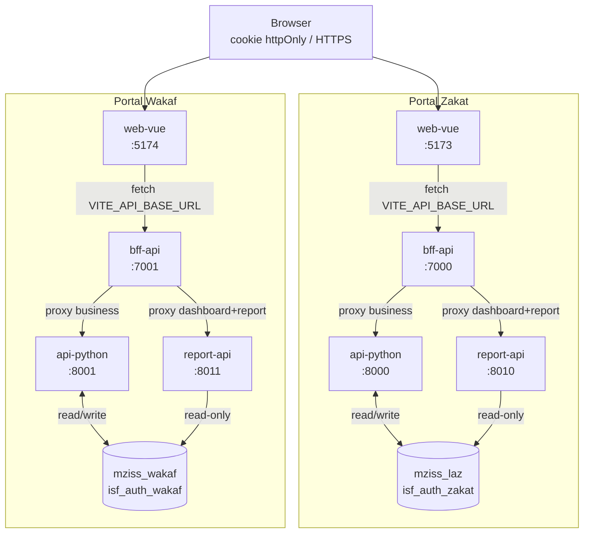
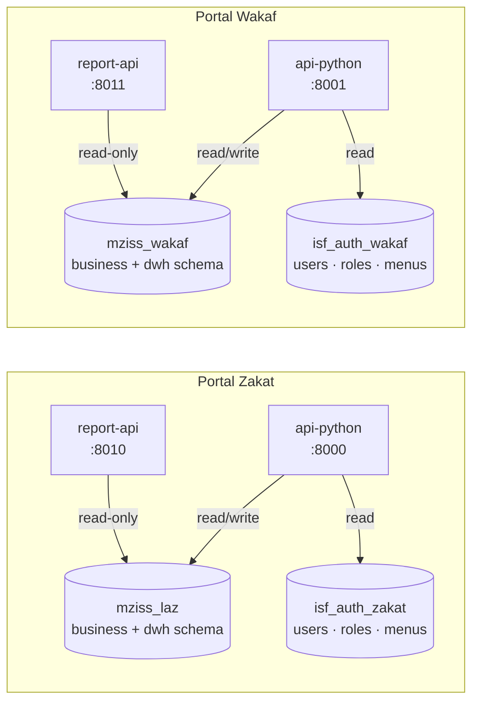
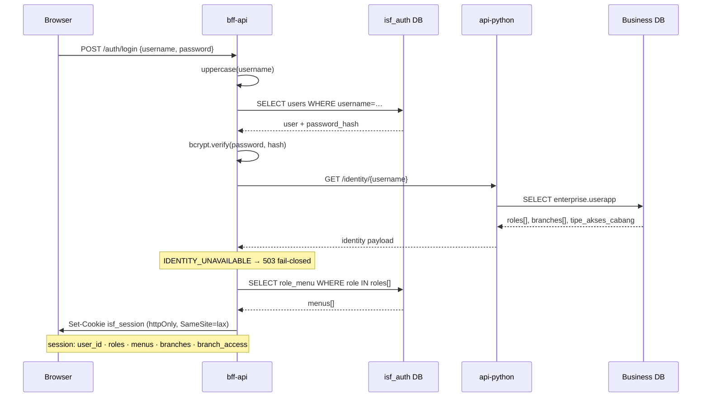
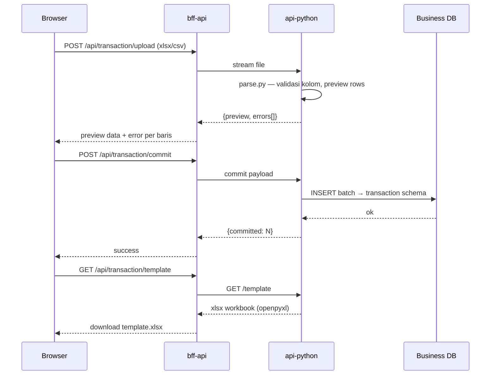

# Arsitektur Teknikal — isf-app

Dokumen ini mendeskripsikan **arsitektur aktual** yang sudah diimplementasi per 2026-06-07, bukan
rencana awal. Untuk roadmap evolusi (Kong, migrasi Go), lihat §13.

---

## 1. Topologi Sistem

isf-app adalah platform ZISWAF dengan **dua portal independen** — Zakat dan Wakaf. Setiap portal
punya stack layanan tersendiri dan dua database terpisah.



### Port Map

| Service       | Zakat | Wakaf |
|---------------|-------|-------|
| web-vue       | 5173  | 5174  |
| bff-api       | 7000  | 7001  |
| api-python    | 8000  | 8001  |
| report-api    | 8010  | 8011  |

---

## 2. Layanan per Portal

Tiap portal terdiri dari **4 layanan** yang di-deploy via podman-compose (bind-mount source, hot-reload
di dev). Tidak ada layanan bersama antar portal — isolasi penuh.

### 2.1 web-vue — Vue 3 SPA

**Tanggung jawab**: UI utama, routing client-side, state management.

**Stack**:
- Vue 3.5 + Vite 5 + TypeScript
- Pinia 2.2 (state management)
- Vue Router 4.4
- PrimeVue 4.5 (unstyled komponent)
- reka-ui (shadcn-vue pattern)
- Tailwind CSS 4.0
- Chart.js 4.4 via vue-chartjs
- Lucide icons

**Struktur `src/`**:

```
src/
  main.ts              # entry point — mount app + Pinia + router + PrimeVue
  App.vue
  router/
    index.ts           # 60+ named routes, meta.menu_key untuk guard
  stores/
    auth.ts            # user, roles, menus[], branches, active_tenant
    sidebar.ts         # collapsed state, active menu
    notifications.ts   # notifikasi bell
    theme.ts           # dark/light mode
  pages/
    LoginPage.vue
    DashboardPage.vue  # overview
    dashboard/
      KeuanganPage.vue
      PenyaluranPage.vue
      PenghimpunanPage.vue
    keuangan/
      CoaPage.vue, KasPage.vue, BankPage.vue
      JurnalHarianPage.vue, TransaksiUmumPage.vue
      KasHarianPage.vue, RekapKasPage.vue, SaldoBulananPage.vue
      NeracaPage.vue, TrialBalancePage.vue, ArusKasPage.vue
      BukuBesarPage.vue, PerubahanDanaPage.vue
      PiutangKaryawanPage.vue, PiutangNonKaryawanPage.vue
      RekapUangMukaPage.vue, UpzPage.vue
      UangMukaPage.vue, RealisasiMemoPage.vue, PiutangRealisasiPage.vue
      PenghimpunanAkunPage.vue, PenyaluranDanaPage.vue
      AmilCashInPage.vue, AmilCashOutPage.vue
      UploadPenghimpunanPage.vue, UploadPenghimpunanDetailPage.vue
    HistoriTransaksiPage.vue
    admin/
      RoleMenuPage.vue, UsersPage.vue
    profile/
      PasswordPage.vue
  components/
    AppHeader.vue, AppSidebar.vue, AppLogo.vue
    UserMenu.vue, SystemDate.vue, NotificationBell.vue
    widgets/          # chart widgets per dashboard domain
    ui/               # Button, Card, Input, Alert, DateField, SearchSelect,
                      #   TablePagination, Modal, ...
  lib/
    api/client.ts     # fetch wrapper GET/POST/blob, base URL dari VITE_API_BASE_URL
    date.ts           # dmy() — format ISO → DD-MM-YYYY untuk display
    format.ts         # currency, number formatters
    charts.ts         # Chart.js register global plugins
    menu/registry.ts  # MENU_KEYS — single source of truth semua menu key
    useFetch.ts       # composable: loading/error/data state wrapper
```

**Aturan penting**:
- Frontend hanya mengenal `VITE_API_BASE_URL` (menuju bff-api).
- Tidak ada direct call ke api-python atau report-api dari browser.
- Halaman laporan **tidak auto-load** saat dibuka — data di-fetch hanya saat user klik "Tampilkan".
- Tanggal display pakai `dmy()` dari `lib/date.ts`; value internal tetap ISO `YYYY-MM-DD`.
- Input tanggal pakai `components/ui/DateField.vue` (text input + native date-picker, v-model ISO).
- Dropdown panjang pakai `components/ui/SearchSelect.vue` (combobox + keyboard nav + clear).

### 2.2 bff-api — Backend-for-Frontend (FastAPI)

**Tanggung jawab**: satu-satunya pintu masuk dari browser — auth, session, CORS, proxy ke downstream.

**Stack**: Python 3.12, FastAPI, uvicorn, asyncpg, httpx, bcrypt, PyJWT, starlette SessionMiddleware.

**Struktur `app/`**:

```
app/
  main.py            # mount routers, SessionMiddleware, CORSMiddleware, lifespan
  routers/
    auth.py          # POST /auth/login, /auth/logout, /auth/password/change
    auth_google.py   # GET /auth/google, /auth/google/callback (OAuth OIDC)
    tenants.py       # POST /auth/tenants/switch
    dashboard.py     # GET /api/dashboard/* — proxy ke report-api
    report.py        # GET /api/report/* — proxy + stream xlsx dari report-api
    coa.py           # GET/POST /api/coa/* — proxy ke api-python
    admin.py         # GET/POST /api/admin/* — role-menu management
    transaction.py   # POST /api/transaction/upload, /commit
    histori_transaksi.py  # GET /api/histori-transaksi/*
    donors.py, waqf.py, zakat.py   # stub kosong, belum aktif
  services/
    auth_db.py       # query isf_auth — login, roles, menus, branch_access
    auth_seed.py     # seed default users (dev)
    auth_providers/
      base.py        # AuthProvider ABC
      password.py    # bcrypt verify
      google.py      # OIDC code exchange + PKCE
    identity_client.py   # httpx ke api-python /identity — enrich session
    proxy.py         # stream_to_api_python(), stream_report_api()
    audit.py         # write ke isf_auth.audit_log
  shared/
    config.py        # Pydantic Settings — env vars, base URLs
    errors.py        # HTTP error helpers
    response.py      # ok()/err() shape
```

**Session**:
- Cookie name `isf_session`, httpOnly, SameSite=lax, path=/
- Session key: `SESSION_SECRET_<PORTAL>` di env
- Payload saat login: `user_id`, `username`, `display_name`, `active_tenant_id`,
  `roles[]`, `branches[]`, `primary_branch`, `branch_access`, `menus[]`
- `session["menus"]` adalah snapshot saat login — perubahan `role_menu` berlaku setelah re-login.

**Routing ke downstream**:
- `API_PYTHON_BASE_URL` → api-python (CRUD/business)
- `REPORT_API_BASE_URL` → report-api (dashboard + report + xlsx)
- Header diteruskan: `X-Request-ID`, `X-Tenant-Id`, `X-Branch-Id`, Authorization (internal)

**Branch RBAC** (di `routers/report.py`, fungsi `_resolve_branch`):
- user `branch_access=all` → boleh pilih cabang atau semua
- user `branch_access=single` → dikunci ke `primary_branch`, request cabang lain → 403

**Menu gating**:
- Dependency `require_menu("menu.key")` di tiap router endpoint
- Deny → catat ke `isf_auth.audit_log`, return 403

### 2.3 api-python — CRUD & Business Backend (FastAPI)

**Tanggung jawab**: business logic, persistensi, write-model, template upload.

**Stack**: Python 3.12, FastAPI, asyncpg, openpyxl, xlrd, python-multipart.

**Struktur `app/`**:

```
app/
  main.py            # mount semua modul router, init DB pools, lifespan
  modules/
    admin/           # role-menu CRUD (router, schema, service)
    coa/             # Chart of Accounts (router, schema, service, export.py)
    identity/        # user profile + roles + menus (router, schema, service)
    transaction/     # upload penghimpunan (router, schema, service, parse.py, commit.py, template.py)
    transaksi_histori/  # histori transaksi (router, schema, service, delete.py, export.py)
    donors/          # manajemen donatur (router, schema, service, repository)
    zakat/           # zakat-spesifik (router, schema, service, repository)
    waqf/            # wakaf-spesifik (router, schema, service, repository)
  shared/
    config.py        # Pydantic Settings
    db.py            # asyncpg dual-pool: business DB + isf_auth pool
    response.py      # ok()/err()
```

**Pola per modul**:

| File | Tanggung jawab |
|---|---|
| `router.py` | HTTP endpoint, dependency injection, validasi input |
| `schema.py` | Pydantic request/response models |
| `service.py` | Business logic — panggil repository, transform |
| `repository.py` | SQL query, asyncpg pool |
| `export.py` | XLSX generation (openpyxl) |

### 2.4 report-api — Reporting & Aggregation Service (FastAPI)

**Tanggung jawab**: dashboard KPIs, laporan tabular, export XLSX. **Read-only** ke business DB + DWH.

**Stack**: Python 3.12, FastAPI, asyncpg, openpyxl.

**Port**: zakat `:8010`, wakaf `:8011`.

**Struktur `app/`**:

```
app/
  main.py
  modules/
    dashboard/       # GET /dashboard/summary, /keuangan, /penyaluran, /penghimpunan
    report/          # 20+ laporan + export xlsx
      service.py     # query logic (running balance, agregasi via DWH views)
      router.py      # route per laporan + /<name>/export.xlsx
      export.py      # openpyxl workbook generation
  shared/
    config.py
    db.py            # dua pool: DATABASE_URL (business) + DWH_DATABASE_URL (dwh schema)
    response.py
```

**Laporan yang aktif** (zakat, juga di-mirror ke wakaf kecuali yang zakat-only):

| Kategori | Laporan | Keterangan |
|---|---|---|
| Keuangan (mirror) | Jurnal Harian | `dwh.v_journal_daily` |
| Keuangan (mirror) | List Transaksi Umum | `dwh.v_*` |
| Keuangan (mirror) | Transaksi Kas/Bank Harian | per rekening |
| Keuangan (mirror) | Rekapitulasi Kas/Bank | agregat |
| Keuangan (mirror) | Monitoring Saldo Bulanan | per bulan × cabang |
| Akuntansi (zakat) | Trial Balance | `dwh.v_daily_balance` + hierarki |
| Akuntansi (zakat) | Neraca | idem |
| Akuntansi (zakat) | Arus Kas | config `balancesum_*`, view `dwh.v_aruskas_item_account` |
| Akuntansi (zakat) | Perubahan Dana | idem |
| Akuntansi (zakat) | Perubahan Dana Detail | idem |
| Akuntansi (zakat) | Buku Besar | `dwh.v_general_ledger` |
| Transaksi (zakat) | Penghimpunan Akun | `dwh.v_collection` |
| Transaksi (zakat) | Penyaluran Dana | `dwh.v_distribution` |
| Transaksi (zakat) | Penerimaan/Pengeluaran Amil | `dwh.v_amil_cash{in,out}` |
| Piutang (zakat) | Piutang Karyawan/Non-Karyawan/Rekap | `dwh.v_ar_account` per `accountreceivabletype` |
| Program (zakat) | List Uang Muka / Realisasi Memo / Piutang Realisasi | `dwh.v_program_reports` |
| UPZ (zakat) | List UPZ | `dwh.v_upz_trx` |

**Konvensi export XLSX**:
- Header `Content-Disposition` di-set report-api
- BFF CORS wajib `expose_headers=["Content-Disposition"]` agar nama file terbaca lintas-origin
- `downloadBlob()` di frontend tunda `revokeObjectURL` agar Chrome tidak simpan nama UUID

---

## 3. Database Topology

Setiap portal punya **dua database Postgres** yang terpisah:

| Portal | Business DB | Auth DB |
|--------|-------------|---------|
| Zakat  | `mziss_laz` | `isf_auth_zakat` |
| Wakaf  | `mziss_wakaf` | `isf_auth_wakaf` |



### 3.1 isf_auth_\<portal\> — Auth & RBAC

Tabel utama:

| Tabel | Isi |
|---|---|
| `isf_auth.users` | user akun (id, username, display_name, status) |
| `isf_auth.user_credentials` | password_hash (bcrypt) |
| `isf_auth.user_provider_links` | link ke OAuth provider |
| `isf_auth.tenants` | daftar tenant per portal |
| `isf_auth.tenant_memberships` | user ↔ tenant mapping |
| `isf_auth.menu` | menu registry (id, key, label, parent) |
| `isf_auth.role_menu` | role → menu_key mapping |
| `isf_auth.audit_log` | log deny + action per user |

**Seed idempotent**: `infra/db/migrations/isf_auth/seed-menu-and-rolemenu.sql` — 9 menu key + 45 baris
role-menu untuk 14 role aktif. Re-apply aman (`ON CONFLICT DO NOTHING`).

### 3.2 mziss\_laz / mziss\_wakaf — Business DB

DB legacy existing. Portal hanya read (+ beberapa write di transaction, coa, admin modul).
Schema utama: `transaction`, `accounting`, `enterprise`, `fund`, `program`, `personalia`.
**Tidak ada** migration DDL di repo ini — DDL referensi di `docs/datadictionary/ddl_all_schema.sql`.

### 3.3 Schema dwh — Data Warehouse

Berada di dalam business DB (`mziss_laz` / `mziss_wakaf`), schema `dwh`.

Tabel utama:

| Nama | Jenis | Keterangan |
|---|---|---|
| `dim_branch` | dimension | cabang |
| `dim_donor` | dimension | donatur |
| `dim_fund_type` | dimension | jenis dana |
| `dm_*_monthly` | aggregate | per bulan × cabang × fund_entity |
| `fact_fundraising_monthly` | fact | penghimpunan per bulan |
| `etl_log` | log | riwayat ETL run |
| `etl_watermark` | watermark | batas data terakhir di-ETL |

Views (`v_*.sql` di `infra/db/migrations/dwh/`): `v_journal_daily`, `v_cash_mutation`,
`v_general_ledger`, `v_daily_balance`, `v_collection`, `v_distribution`, `v_amil_cash_in`,
`v_amil_cash_out`, `v_ar_account`, `v_program_reports`, `v_upz_trx`, `v_aruskas_item_account`.

**Catatan**: `dwh.v_daily_balance` terisi data s/d 2025-12-31 — laporan TB/Neraca untuk 2026 belum akurat
sampai ETL dijalankan.

**Config Arus Kas / Perubahan Dana** (portal-spesifik):
- Tabel `transaction.balancesum*` — **jangan cross-apply** seeder antar portal
- Seed: `infra/db/migrations/seed/balancesum-config-{zakat,wakaf}.sql`
- Zakat: 31 item AK_MUT; wakaf: 6 item beda COA

---

## 4. Auth & RBAC

### 4.1 Login Flow



### 4.2 Identity vs Auth DB

- **isf_auth**: username, password, role_menu, menu keys → di-manage portal
- **enterprise.userapp** (business DB): profil pengguna, role organisasi, cabang → data legacy

Identity lookup (`api-python /identity`) menjembatani keduanya: cari `enterprise.userapp` dengan
`username=<UPPERCASE>`, kembalikan `display_name`, `role[]`, `branches[]`, `tipe_akses_cabang`.

### 4.3 Branch RBAC

`tipe_akses_cabang` di `enterprise.userapp`:
- `S` (Seluruh) → `branch_access=all` → user bisa lihat semua cabang
- `T` (Tunggal) → `branch_access=single` → dikunci ke `primary_branch`

`_resolve_branch()` di `bff-api/routers/report.py` menolak cabang lain dengan 403 untuk user `single`.

### 4.4 Menu Gating

**Frontend** (Vue Router guard): cek `auth.menus` untuk setiap route dengan `meta.menu_key`.
Redirect ke `?denied=<key>` bila tidak ada.

**Backend** (FastAPI dependency `require_menu("menu.key")`): cek session menus, deny → 403 + audit log.

**Single source of truth**: `apps_*/web-vue/src/lib/menu/registry.ts` — `MENU_KEYS` constant.
Backend dan seed SQL harus konsisten dengan file ini.

### 4.5 Google OAuth

Provider `google` di `bff-api/services/auth_providers/google.py`:
- OIDC discovery + PKCE code verifier
- Callback exchange token → ambil email → match ke `isf_auth.user_provider_links`
- Env: `GOOGLE_OAUTH_CLIENT_ID`, `GOOGLE_OAUTH_CLIENT_SECRET`, `FRONTEND_BASE_URL_<PORTAL>`

---

## 5. Upload Penghimpunan

Feature di `api-python/modules/transaction/`:



---

## 6. Infrastruktur

### 6.1 Podman Compose

```
infra/
  docker-compose.zakat.yml    # network isf-zakat-net, volume isf-zakat-bff-data
  docker-compose.wakaf.yml    # network isf-wakaf-net, volume isf-wakaf-bff-data
```

Semua service pakai `security_opt: [label:disable]` — workaround SELinux MCS label block
pada `mprotect` saat `pip install` / `npm install` di Fedora 44 + crun 1.27.

Source di-bind-mount → uvicorn / vite hot-reload aktif tanpa rebuild image.
**Rebuild image hanya perlu** jika `pyproject.toml` atau `package.json` berubah.

### 6.2 Makefile

```bash
make build       # pre-build semua image (podman build --security-opt label=disable)
make run         # jalankan kedua stack (zakat + wakaf)
make run-zakat   # zakat only
make run-wakaf   # wakaf only
make health      # curl /health semua service
make migrate     # createdb + apply schema + seed isf_auth_{zakat,wakaf}
make logs        # tail logs
make stop        # stop semua container
make restart     # stop + start
make db-drop     # ⚠️ DROP kedua isf_auth DB
```

### 6.3 DB First-Time Setup

```bash
for portal in zakat wakaf; do
  PGPASSWORD=solusi createdb -h localhost -U postgres "isf_auth_$portal"
  PGPASSWORD=solusi psql -h localhost -U postgres -d "isf_auth_$portal" \
    -f infra/db/migrations/isf_auth/recovered-schema-$portal.sql
  PGPASSWORD=solusi psql -h localhost -U postgres -d "isf_auth_$portal" \
    -f infra/db/migrations/isf_auth/seed-menu-and-rolemenu.sql
done
```

**DB credentials lokal**: user `transaction`, password `solusi`. Postgres superuser `postgres` dipakai
hanya untuk createdb/psql DDL.

---

## 7. Environment Variables

Semua env var ada di `infra/.env` (copy dari `.env.example`). Compose baca via `${VAR:-default}`.

| Var | Dipakai oleh | Keterangan |
|---|---|---|
| `DATABASE_URL_ZAKAT` | api-python (z), report-api (z) | business DB zakat |
| `DATABASE_URL_WAKAF` | api-python (w), report-api (w) | business DB wakaf |
| `ISF_AUTH_DATABASE_URL_ZAKAT` | bff-api (z), api-python (z) | auth DB zakat |
| `ISF_AUTH_DATABASE_URL_WAKAF` | bff-api (w), api-python (w) | auth DB wakaf |
| `DWH_DATABASE_URL_ZAKAT` | report-api (z) | DWH read (saat ini sama dgn business) |
| `DWH_DATABASE_URL_WAKAF` | report-api (w) | DWH read wakaf |
| `SESSION_SECRET_ZAKAT` | bff-api (z) | session middleware key |
| `SESSION_SECRET_WAKAF` | bff-api (w) | session middleware key |
| `AUTH_PROVIDERS` | bff-api | `password`, `google`, atau keduanya |
| `GOOGLE_OAUTH_CLIENT_ID` | bff-api | Google SSO |
| `GOOGLE_OAUTH_CLIENT_SECRET` | bff-api | Google SSO |
| `FRONTEND_BASE_URL_ZAKAT` | bff-api | asal redirect Google callback |
| `FRONTEND_BASE_URL_WAKAF` | bff-api | idem |
| `API_PYTHON_BASE_URL` | bff-api | URL internal api-python |
| `REPORT_API_BASE_URL` | bff-api | URL internal report-api |
| `VITE_API_BASE_URL` | web-vue | base URL BFF (dari browser) |
| `HOST_IP` | compose | LAN IP untuk akses multi-device |

---

## 8. Konvensi Format & Response

### 8.1 Format Tanggal

| Konteks | Format | Contoh |
|---|---|---|
| Display (UI) | `DD-MM-YYYY` | `07-06-2026` |
| Internal / API payload | ISO `YYYY-MM-DD` | `2026-06-07` |
| SQL `ORDER BY` / running-balance | ISO (dari `to_char(...,'YYYY-MM-DD')`) | jangan diubah ke DD-MM-YYYY |
| Input user | `DateField.vue` (ISO v-model) | komponen handle konversi |

`dmy()` di `lib/date.ts` dipakai di seluruh template untuk konversi display.

### 8.2 Response Shape

**Success**:
```json
{ "data": { ... }, "meta": { "request_id": "req_xxx" } }
```

**List**:
```json
{
  "data": [...],
  "pagination": { "page": 1, "limit": 20, "total": 100, "total_pages": 5 },
  "meta": { "request_id": "req_xxx" }
}
```

**Error**:
```json
{ "error": { "code": "MENU_DENIED", "message": "...", "details": null }, "meta": { "request_id": "req_xxx" } }
```

### 8.3 Error Codes yang Umum

| Code | HTTP | Situasi |
|---|---|---|
| `UNAUTHORIZED` | 401 | Session tidak ada / expired |
| `MENU_DENIED` | 403 | Tidak ada menu key di session |
| `BRANCH_DENIED` | 403 | User single-branch coba akses cabang lain |
| `IDENTITY_UNAVAILABLE` | 503 | api-python /identity down saat login |
| `UNKNOWN_IDENTITY` | 404 | Username tidak ada di `enterprise.userapp` |
| `VALIDATION_ERROR` | 422 | Input gagal validasi Pydantic |

---

## 9. Pola Penambahan Laporan

Semua laporan keuangan mengikuti pola 5 langkah ini:

1. **View DWH** — `dwh.v_<name>` di `mziss_*` bungkus query legacy.
   Agregasi/running-balance dihitung di report-api, bukan di view.
2. **report-api module** — `modules/report/service.py` + `router.py`
   (`/report/<name>` + `/<name>/export.xlsx`) + `export.py` (openpyxl).
3. **BFF route** — `routers/report.py` → `require_menu('keuangan.report.<key>')`
   + `_resolve_branch` + `stream_report_api` untuk xlsx.
4. **Frontend** — `pages/keuangan/Laporan*Page.vue` + key di `lib/menu/registry.ts`
   + child di sidebar grup "Laporan" + route dengan `meta.menu_key`.
5. **Seed menu** — tambah baris ke `seed-menu-and-rolemenu.sql`, apply ke `isf_auth_zakat`
   (dan `isf_auth_wakaf` bila laporan di-mirror).

**Referensi legacy**: query asli di `docs/legacy-apps/core/dialogs/Report/f<Name>_data.py`.
`AllowedGroups` di menu legacy (`.dfr`/`.mnu`) → mapping role untuk `role_menu`.

---

## 10. Observability

Tiap layanan Python punya endpoint:

```
GET /health   → { "status": "ok" }
GET /ready    → { "status": "ready" } (setelah pool DB siap)
```

Log format: structured JSON dengan `timestamp`, `level`, `service`, `request_id`, `method`, `path`,
`status`, `duration_ms`.

Request ID diteruskan dari bff-api ke downstream via header `X-Request-ID`.

---

## 11. Testing

- **E2E script** per fitur di `testing/e2e-<feature>.sh` (curl ke localhost)
- **pytest** di `tests/` tiap layanan Python
- **Wrapper** `apps_*/api-python/test.sh`, `apps_*/bff-api/test.sh`
- Belum ada CI/CD — semua test dijalankan lokal

**Dev E2E users** (password `test1234`, di-set manual ke `isf_auth_zakat.user_credentials`):
- `HADI` (DIST/SPVDIST, branch_access=all) — dashboard, jurnal, transaksi-umum
- `RAIS` (ACC/KEU, single-branch 001) — laporan kas, finance

---

## 12. Packages Shared

```
packages/
  api-contract/openapi.yaml    # OpenAPI 3.0 — source of truth kontrak API
  api-client-ts/generated/     # TypeScript client (di-generate dari openapi.yaml)
```

Saat ini TypeScript client belum terpakai penuh di frontend — frontend masih pakai `lib/api/client.ts`
langsung. Generate ulang client dengan `openapi-ts` bila kontrak berubah.

---

## 13. Roadmap Evolusi

Fase yang sudah selesai: MVP (login, dashboard skeleton, COA, laporan keuangan, upload penghimpunan,
histori transaksi, admin role-menu).

Fase berikutnya (lihat `docs/recovery/README.md` untuk detail outstanding):

| Fase | Fokus |
|---|---|
| ETL runners | 14 file ETL di `apps_zakat/api-python/etl/` belum di-restore post-recovery |
| Admin/profile | Beberapa halaman admin frontend belum selesai |
| Wakaf diverge | Fitur spesifik wakaf (layout Arus Kas/Perubahan Dana berbeda) |
| Go migration | `apps_*/api-go/` scaffold siap — migrasi per-modul via Strangler Fig |
| Kong/API Gateway | Jika ada kebutuhan nyata: rate limit, API key, partner API |
| Production auth | Rotate session secret, HTTPS enforced, audit log viewer UI |
| Approval workflow | Maker-checker untuk posting jurnal & penyaluran (PRD §7.8) |

### 13.1 Strangler Fig — Migrasi Python → Go

Ketika satu modul siap dipindah:

1. Buat `apps_*/api-go/internal/modules/<module>/` (handler, service, repository, dto)
2. Ikuti OpenAPI contract yang sama
3. Jalankan contract test Python vs Go
4. Ubah env `API_PYTHON_BASE_URL` routing di bff-api ke Go service
5. Frontend tidak perlu berubah

Checklist sebelum cutover:
- [ ] Response shape sama dengan OpenAPI
- [ ] Error code dan HTTP status sama
- [ ] Auth behavior sama
- [ ] Pagination/filtering sama
- [ ] Contract test lulus
- [ ] Rollback path jelas (env var balik ke Python)
