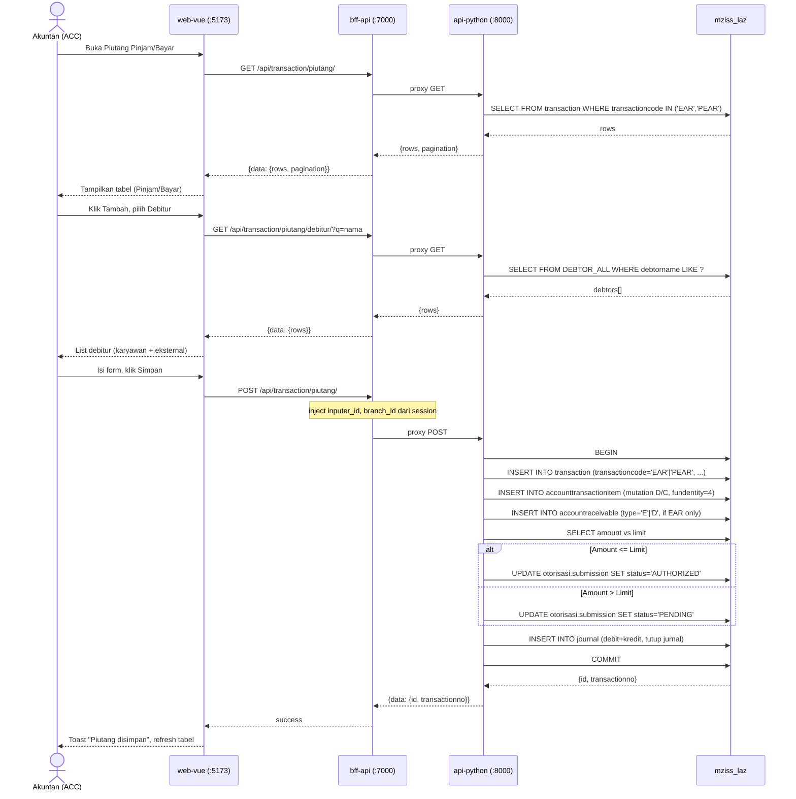

# Specs: Piutang (Pinjam & Bayar)

**Portal**: zakat  
**Domain**: `transaction`  
**Tipe**: CRUD + Approval  
**Legacy Ref**: `docs/legacy-apps/core/dialogs/Transaksi/fAccountReceivable.*`  
**Tanggal**: 2026-06-17

## Konteks

Modul Piutang mengelola pinjaman kepada karyawan dan pihak eksternal, serta pelunasan piutang. Fitur ini mendukung two-channel submission: pembayaran via kas/bank atau via rekening ledger. Workflow approval terintegrasi dengan otorisasi (CheckLimitOtorisasi) untuk auto-approval transaksi di bawah limit atau manual approval untuk yang melebihi limit.

## Alur Data



## Endpoint Contract

### GET /api/transaction/piutang/
**Auth**: `require_menu("keuangan.piutang.pinjam-bayar")`  
**Query params**:
- `page` (int, default=1)
- `limit` (int, default=25)
- `transaction_type` (str, optional: "P" | "B") — filter Pinjam/Bayar
- `debtor_type` (str, optional: "E" | "X") — filter Karyawan/Non-Karyawan
- `date_from` (ISO date, optional)
- `date_to` (ISO date, optional)

**Response**:
```json
{
  "data": {
    "rows": [
      {
        "id": 1,
        "transactionno": "EAR-001-2026-06-17",
        "transactioncode": "EAR",
        "transactiontype": "P",
        "actualdate": "2026-06-17",
        "branchcode": "001",
        "inputer": "RAIS",
        "debtorname": "Budi Santoso",
        "debtortype": "E",
        "accountname": "Piutang Karyawan - Budi Santoso",
        "amount": 5000000.00,
        "currencycode": "IDR",
        "status": "AUTHORIZED",
        "referenceno": "CHK-123",
        "description": "Pinjaman modal kerja"
      }
    ],
    "pagination": { "page": 1, "limit": 25, "total": 87, "total_pages": 4 }
  },
  "meta": { "request_id": "..." }
}
```

### POST /api/transaction/piutang/
**Auth**: `require_menu("keuangan.piutang.pinjam-bayar")`  
**Body**:
```json
{
  "actualdate": "2026-06-17",
  "transactiontype": "P",
  "channeltype": "C",
  "cashaccountno": "KAS-001",
  "debtorid": "E0001",
  "amount": 5000000.00,
  "referenceno": "CHK-123",
  "description": "Pinjaman modal kerja",
  "casher": "RAIS"
}
```

**Validasi** (backend):
- `actualdate` wajib (date valid)
- `transactiontype` wajib (P | B)
- `channeltype` wajib (C | G)
  - jika `C` → `cashaccountno` wajib
  - jika `G` → `glaccount` wajib
- `debtorid` wajib (lookup DEBTOR_ALL valid)
- `amount` > 0
- debtortype otomatis dari lookup (E | X)
- FundEntity hardcoded = 4 (Dana Amil)

**Save Logic**:
1. Create batch harian jika belum ada
2. Insert transaction (code='EAR' | 'PEAR')
3. **EAR (Pinjam)**: auto-create AccountReceivable jika belum ada; PEAR (Bayar): lookup only
4. Insert accounttransactionitem (D untuk piutang, C untuk kas/ledger)
5. CheckLimitOtorisasi(amount):
   - ≤ limit → status AUTHORIZED (auto-approve)
   - > limit → status PENDING (manual approval)
6. Generate journal (debit piutang, kredit kas/ledger)
7. Generate transactionno (auto)

**Response**:
```json
{
  "data": {
    "id": 1,
    "transactionno": "EAR-001-2026-06-17",
    "transactiontype": "P",
    "status": "AUTHORIZED",
    "amount": 5000000.00
  }
}
```

### PUT /api/transaction/piutang/{transactionno}
**Auth**: `require_menu("keuangan.piutang.pinjam-bayar")`  
**Body**: (same as POST)

**Logic**: Delete journal → Cancel transaction → Re-execute (INSERT new)

### GET /api/transaction/piutang/debitur/
**Auth**: `require_menu("keuangan.piutang.pinjam-bayar")`  
**Query params**:
- `q` (str, optional) — filter by debtorname/debtorcode
- `limit` (int, default=50)

**Response**:
```json
{
  "data": [
    {
      "debtorid": "E0001",
      "debtorcode": "EMP-001",
      "debtorname": "Budi Santoso",
      "debtortype": "E",
      "branchcode": "001"
    },
    {
      "debtorid": "X0001",
      "debtorcode": "EXT-001",
      "debtorname": "PT ABC Jaya",
      "debtortype": "X",
      "branchcode": "001"
    }
  ]
}
```

## Database

**Tabel**: `transaction.ACCOUNTRECEIVABLE`, `transaction.FINANCIALACCOUNT`, `transaction.EXTERNALDEBTOR`, `transaction.TRANSACTION`  
Status: Sudah ada (legacy migration, tidak ada tabel baru)

**DWH Views**: 
- `dwh.v_piutang_karyawan` — JOIN transaction + accounttransactionitem + accountreceivable (type='E') + employee
- `dwh.v_piutang_non_karyawan` — JOIN transaction + accounttransactionitem + accountreceivable (type='D') + externaldebtor

**Kolom kunci TRANSACTION**:
| Kolom | Type | Keterangan |
|---|---|---|
| `id` | SERIAL | PK |
| `transactionno` | VARCHAR | Nomor transaksi (auto-generated) |
| `transactioncode` | VARCHAR | 'EAR' (Pinjam) \| 'PEAR' (Bayar) |
| `actualdate` | DATE | Tanggal posting (dari batch harian) |
| `branchcode` | VARCHAR | FK ke enterprise.branch (injected session) |
| `inputer` | VARCHAR | User ID (injected session) |
| `receivedfrom` | VARCHAR | Kasir (optional, default session) |
| `amount` | DECIMAL | Nominal transaksi |
| `currencycode` | VARCHAR | 'IDR' (default) |
| `referenceno` | VARCHAR | Nomor cek/kwitansi (optional) |
| `description` | VARCHAR | Keterangan (optional) |
| `batchid` | INTEGER | FK ke transaction.transactionbatch |

**Kolom kunci ACCOUNTRECEIVABLE**:
| Kolom | Type | Keterangan |
|---|---|---|
| `accountno` | VARCHAR | PK (shared dengan FINANCIALACCOUNT) |
| `accountreceivabletype` | VARCHAR | 'E' (Karyawan) \| 'D' (Non-Karyawan) \| 'P' (Realisasi, modul lain) |
| `employeeidnumber` | VARCHAR | FK employee (saat type='E') |
| `debtorid` | VARCHAR | FK EXTERNALDEBTOR (saat type='D') |
| `accountname` | VARCHAR | "Piutang {DebtorName}" |
| `financialaccounttype` | VARCHAR | 'R' (hardcoded untuk piutang) |
| `balance` | DECIMAL | Saldo piutang |

**Discriminators** (hardcoded di query, bukan filter user):
- `transactioncode IN ('EAR', 'PEAR')` — filter piutang
- `transactioncode = 'EAR'` → Pinjam (auto-create rekening)
- `transactioncode = 'PEAR'` → Bayar (lookup only)
- `accountreceivabletype = 'E'` → Piutang Karyawan
- `accountreceivabletype = 'D'` → Piutang Non-Karyawan
- `accountreceivabletype != 'P'` → exclude Realisasi Penyaluran
- `financialaccounttype = 'R'` → filter AccountReceivable
- `fund_entity = 4` → Dana Amil (hardcoded di mutation)

## Menu Key

| Key | Label | Roles |
|---|---|---|
| `keuangan.piutang.pinjam-bayar` | Piutang (Pinjam/Bayar) | ACC |

**Sidebar placement**: Keuangan → Piutang → Pinjam/Bayar

## Catatan Implementasi

### Otorisasi Integration
- Endpoint `POST /api/transaction/piutang/` menggunakan `otorisasi.save-and-submit()` **internally** — user tidak perlu submit ke otorisasi page terpisah
- API secara otomatis:
  - Create submission dengan entity_type='piutang'
  - Check limit via `CheckLimitOtorisasi(amount)`
  - Set status='AUTHORIZED' jika ≤ limit, status='PENDING' jika > limit
  - Return submission.status ke frontend
- Jika PENDING, user harus approve via Otorisasi page (`keuangan.monitoring.otorisasi`)

### Entity Type Registration
- Piutang entity_type baru — perlu register dispatcher di `otorisasi/service.py:_register_defaults()`
- Dispatcher: `piutang_service.create_from_payload()` — execute transaction + journal saat AUTHORIZED

### Debitur Lookup
- Endpoint `/debitur/` mengembalikan UNION Employee + ExternalDebtor (DEBTOR_ALL view)
- Frontend SearchSelect.vue menampilkan debtorname dengan kategori debtortype (E/X)
- Saat user memilih, debtortype otomatis terupdate (read-only field)

### Channel Type Toggle
- UI: v-show (bukan v-if) untuk toggle LCashAccount vs LGLAccount
- Backend validasi: jika ChannelType='C' → cashaccountno wajib; jika 'G' → glaccount wajib
- Mutation counter-entry mengikuti channel type (Kas vs Ledger)

### Auto-Create Rekening
- **EAR (Pinjam)**: AUTO-CREATE AccountReceivable jika belum ada
  - accountreceivabletype='E' untuk karyawan, ='D' untuk non-karyawan
  - accountname="Piutang {DebtorName}"
  - balance=0 awal
- **PEAR (Bayar)**: LOOKUP ONLY — error 404 jika rekening belum ada

### TransactionNo Generation
- Auto-generated backend: "{transactioncode}-{branchcode}-{YYYY-MM-DD}"
- Returned di response POST/PUT
- Frontend display di table list dan success toast

### Validation Order
1. Client-side: required fields, amount > 0, date valid
2. Server-side: debtor lookup, cash/ledger account lookup, amount check, limit check

