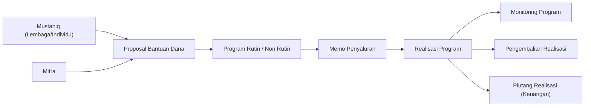

# Product Requirements Document — Portal ZISWAF v1.0 (`isf-app`)

| Atribut | Nilai |
| --- | --- |
| Nama Produk | `isf-app` — Portal ZISWAF (Zakat + Wakaf) |
| Versi Dokumen | 1.0 (Baseline operasional — migrasi legacy DAF) |
| Tanggal | 2026-11-06 |
| Status | Draft untuk review stakeholder |
| Menggantikan | — (melengkapi [`prd.md`](./prd.md) v0.3; dokumen lama tetap dipertahankan sebagai histori) |
| Dokumen Terkait | [`architecture.md`](../architecture/architecture.md), [`rbac-permission-model.md`](../architecture/rbac-permission-model.md), [`PRD_Dashboard_Keuangan_Zakat.md`](./PRD_Dashboard_Keuangan_Zakat.md), [`PRD_Dashboard_Penyaluran_Zakat.md`](./PRD_Dashboard_Penyaluran_Zakat.md), [`PRD_Dashboard_Penghimpunan_ZIS.md`](./PRD_Dashboard_Penghimpunan_ZIS.md), [`docs/todos/`](../../todos/README.md) |

---

## 1. Ringkasan Eksekutif

`isf-app` adalah platform **Islamic Social Finance** internal yang menggantikan aplikasi legacy **DAF** (modul `core`, `enterprise`, `fund`, `program`, `personalia`) secara bertahap dengan stack modern (Vue 3 + FastAPI BFF + FastAPI backend, migrasi bertahap ke Go).

PRD v0.3 (`prd.md`) memposisikan produk sebagai **portal read-first** (dashboard + laporan) dengan fitur input yang baru dimulai di Fase 4+. Kondisi aktual repositori telah melampaui rencana tersebut:

- **Portal Zakat** sudah memiliki **±128 halaman** di 5 domain (Keuangan, Program/Penyaluran, Penghimpunan, Administrasi & Umum, Pengaturan Akses) — termasuk **transaksi tulis** (penghimpunan, penyaluran, uang muka, transaksi umum, amil, piutang, anggaran) dengan **otorisasi maker–checker terpusat** dan **limit transaksi per user**.
- **Portal Wakaf** berjalan dengan cakupan terbatas (dashboard, master data keuangan, 5 laporan kas/jurnal, manajemen user & role-menu).
- **RBAC granular per aksi menu** (`view/tambah/edit/hapus/detail`) sudah aktif di kedua portal.
- Auth produksi (password ter-hash + session cookie via BFF + opsi Google SSO) sudah tersedia — bukan lagi dummy.

Dokumen ini menetapkan **baseline produk v1.0**: apa yang sudah ada, requirement yang mengikat untuk fitur berikutnya, dan roadmap menuju **paritas penuh dengan legacy DAF** serta **pengembangan Portal Wakaf**.

---

## 2. Latar Belakang & Masalah

| Masalah | Dampak | Jawaban `isf-app` |
| --- | --- | --- |
| Aplikasi legacy DAF berbasis desktop/proprietary, sulit dikembangkan & dirawat | Ketergantungan vendor, onboarding lambat, tidak bisa diakses via browser | SPA Vue 3 + API berbasis kontrak (OpenAPI) |
| Data operasional tersebar & laporan disusun manual | Keputusan lambat | Dashboard per domain + laporan standar dari schema `dwh` |
| Kontrol transaksi bergantung pada prosedur manual | Risiko salah input/fraud | Otorisasi terpusat maker–checker + limit transaksi per user |
| Hak akses kasar (akses/tidak akses menu) | Pemisahan tugas lemah | RBAC per aksi per menu, dienforce di BFF |
| Dua lembaga (LAZ & Wakaf) dengan domain berbeda | Kebutuhan fitur divergen | Dua portal independen dengan DB & auth terpisah |

---

## 3. Tujuan & Ukuran Keberhasilan

### 3.1 Tujuan Produk

1. **Menggantikan legacy DAF** untuk operasional harian lembaga LAZ, modul demi modul, tanpa migrasi skema besar (tetap memakai DB existing `mziss_laz` / `mziss_wakaf`).
2. **Menjamin kontrol & akuntabilitas** setiap transaksi keuangan melalui otorisasi dan audit trail.
3. **Mempercepat pelaporan** — laporan keuangan dan program tersedia self-service, dapat diekspor (Excel/PDF).
4. **Membangun Portal Wakaf** di atas fondasi yang sama, lalu berdivergensi sesuai kebutuhan domain wakaf.

### 3.2 Indikator Keberhasilan (target, dikunci saat sign-off)

| KPI | Target |
| --- | --- |
| Paritas fitur legacy DAF (modul `fund`, `core` keuangan, `program`) di Portal Zakat | ≥ 90% menu operasional harian |
| Transaksi keuangan yang diinput via portal (bukan legacy) | ≥ 80% dalam 3 bulan setelah go-live per modul |
| Laporan bulanan keuangan dihasilkan tanpa olah manual | 100% laporan standar §7.1.6 |
| Selisih data portal vs legacy (parity test) | 0 selisih nominal pada laporan rekonsiliasi |
| Waktu muat dashboard | < 3 detik (p95) |
| Transaksi tanpa jejak otorisasi/audit | 0 |

---

## 4. Stakeholder & Persona

### 4.1 Stakeholder

| Peran | Tanggung jawab |
| --- | --- |
| Direksi / Sponsor | Mandat, prioritas, sign-off rilis |
| Product Owner | Prioritas backlog, validasi requirement |
| Domain Lead (Keuangan, Akuntansi, Program, Penghimpunan, Umum) | Input requirement, UAT, sign-off paritas |
| IT Lead / Tim Engineering | Kelayakan teknis, ownership DB, operasional |

### 4.2 Persona & Role Sistem

Role berasal dari `enterprise.peran` (legacy) dan dipakai langsung oleh RBAC portal.

| Persona | Kode Role | Aktivitas utama |
| --- | --- | --- |
| Administrator Sistem | `ADM`, `SPVADM` | User, role, role-menu, cabang, limit transaksi |
| Staf Keuangan | `KEU` | Input penghimpunan/penyaluran, uang muka, transfer, kas kecil |
| Supervisor Keuangan | `SPVKEU` | Otorisasi transaksi keuangan, monitoring |
| Staf Akuntansi | `ACC` | Transaksi umum/jurnal, master COA, laporan akuntansi |
| Supervisor Akuntansi | `SPVACC` | Otorisasi jurnal & master data, laporan neraca/trial balance |
| Quality Assurance / Audit | `QAC` | Akses baca laporan & histori transaksi |
| Staf Program/Penyaluran | `DIST` | Mustahiq, proposal, program, memo, realisasi |
| Supervisor Penyaluran | `SPVDIST` | Persetujuan proposal/memo, monitoring program |
| Staf Penghimpunan | `PHP` | Donatur, konfirmasi donasi, BSZ, export donasi |
| Supervisor Penghimpunan | `SPVPHP` | Supervisi & laporan penghimpunan |
| Staf / Supervisor Umum | `GA`, `SPVGA` | Dokumen masuk/keluar |
| Pimpinan | (role eksekutif, read) | Dashboard & laporan ringkas |

---

## 5. Ruang Lingkup

### 5.1 Topologi Produk

| Portal | Lembaga | Business DB | Auth DB | Web | BFF |
| --- | --- | --- | --- | --- | --- |
| **Zakat** | LAZ (zakat, infaq, sadaqah) | `mziss_laz` | `isf_auth_zakat` | `:5173` | `:7000` |
| **Wakaf** | Lembaga Wakaf | `mziss_wakaf` | `isf_auth_wakaf` | `:5174` | `:7001` |

Tiap portal **single-tenant, multi-cabang**, di-deploy independen (`web-vue` → `bff-api` → `api-python` / `report-api` → PostgreSQL). Browser **hanya** berbicara dengan `bff-api`.

### 5.2 In-Scope v1.x

- Seluruh domain di §7 untuk Portal Zakat (status "Tersedia" dipertahankan; status "Rencana" dibangun).
- Portal Wakaf: paritas modul keuangan inti + domain wakaf spesifik (§7.6).
- Otorisasi terpusat & limit transaksi untuk **semua** transaksi tulis keuangan.
- RBAC per aksi menu, audit log, manajemen cabang.
- Export laporan (XLSX/PDF) dan cetak dokumen (BSZ, bukti transaksi).

### 5.3 Out-of-Scope v1.x

- Portal donatur publik / donasi online untuk masyarakat (hanya **export/konfirmasi** data donasi website).
- Aplikasi mobile native.
- Integrasi langsung perbankan / payment gateway / SIMBA BAZNAS (dievaluasi setelah v1.x).
- Konsolidasi data **lintas** portal (Zakat + Wakaf) dalam satu view.
- Redesain skema DB legacy secara menyeluruh (hanya schema tambahan terisolasi: `otorisasi`, `dwh` views, `isf_auth`).
- Modul Personalia/HR (`docs/legacy-apps/personalia`) — dijadwalkan setelah paritas keuangan & program (§10).

---

## 6. Asumsi, Constraint & Dependency

### 6.1 Asumsi

- DB legacy tetap menjadi *system of record*; legacy DAF dan portal dapat berjalan paralel selama masa transisi per modul.
- Identitas user mengikuti `enterprise.userapp` dan peran `enterprise.listperanuser`.
- Struktur cabang mengikuti data cabang existing (`branch_code`); satu cabang ditandai HQ.

### 6.2 Constraint

- **Perubahan DB diperbolehkan hanya bersifat aditif & terisolasi**: schema `otorisasi`, view `dwh.v_*`, sequence/kolom pendukung yang tidak merusak legacy (mis. `transaction.transactiontype.jenis_limit`). Setiap perubahan wajib berupa file migrasi di `infra/db/migrations/`.
- Frontend wajib mengikuti aturan non-negotiable di `CLAUDE.md`: TypeScript + `<script setup>`, PrimeVue unstyled, paginator di atas tabel (default 25 baris), HTTP hanya via `shared/api/client.ts`, named routes, ikon Lucide.
- Format respons & error API mengikuti `architecture.md` §12–§13.
- Fitur baru/migrasi legacy wajib melalui alur `nuwis-*` (analyze → doc → build/migrate → verify).

### 6.3 Dependency

- Akses ke source legacy DAF (`docs/legacy-apps/`) untuk analisis paritas.
- Domain lead tersedia untuk UAT per modul.
- Infrastruktur container (Docker/Podman) untuk dev/staging/production.

---

## 7. Persyaratan Fungsional

Legenda status: ✅ Tersedia · 🟡 Sebagian · ⬜ Rencana

### 7.0 Platform & Lintas Modul

#### 7.0.1 Autentikasi & Sesi — ✅

| ID | Requirement |
| --- | --- |
| AUTH-01 | Login username + password terhadap `isf_auth.user_credentials` (password ter-hash). |
| AUTH-02 | Login Google SSO opsional (`/auth/google/start` → `/callback`), dikonfigurasi per portal. |
| AUTH-03 | Session disimpan sebagai cookie httpOnly di BFF; frontend tidak pernah memegang token backend. |
| AUTH-04 | Saat login, BFF mengambil profil (roles, branches, primary branch, menus+actions) dari identity service secara **fail-closed** — gagal ambil profil = login ditolak. |
| AUTH-05 | Endpoint `me`, `logout`, `refresh-profile`, `change-password` tersedia. |
| AUTH-06 | Login sukses/gagal/terblokir dicatat di `isf_auth.audit_log` beserta IP & user-agent. |
| AUTH-07 ⬜ | Kebijakan password (panjang/kompleksitas), lockout setelah N kali gagal, idle timeout terkonfigurasi. |

#### 7.0.2 Multi-Cabang — 🟡

| ID | Requirement |
| --- | --- |
| BR-01 ✅ | User memiliki daftar cabang yang dapat diakses + cabang utama; mode akses `single` / `multi` / `all`. |
| BR-02 ✅ | Seluruh query transaksi dan laporan di-scope ke cabang yang diizinkan di sisi server. |
| BR-03 ✅ | Master cabang dapat dilihat via menu **List Cabang** (`appadmin.branch.list`). |
| BR-04 ⬜ | Switcher cabang di header + mode **Konsolidasi** untuk user dengan akses semua cabang; setiap perpindahan tercatat di audit log. |

#### 7.0.3 RBAC per Aksi Menu — ✅

| ID | Requirement |
| --- | --- |
| RBAC-01 | Hak akses disimpan di `isf_auth.role_menu_permission (role_id, menu_key, action)` dengan aksi `view`, `tambah`, `edit`, `hapus`, `detail`. |
| RBAC-02 | Aksi selain `view` mensyaratkan `view`; UI auto-check/auto-clear dependensi. |
| RBAC-03 | BFF menolak request ke endpoint menu tanpa aksi `view` (`require_menu()` → `403 MENU_FORBIDDEN`). |
| RBAC-04 | Frontend memakai `usePermission(menuKey)` untuk menampilkan/menyembunyikan tombol Tambah/Edit/Hapus/Detail. Ini kosmetik — enforcement tetap di server. |
| RBAC-05 | Halaman **Role & Menu** berbentuk matriks permission dengan filter domain & role, dan dapat diekspor ke Excel (baris = menu × aksi, kolom = role). |
| RBAC-06 | Cache permission di BFF ber-TTL 5 menit; perubahan role berlaku paling lambat 5 menit atau via `refresh-profile`. |
| RBAC-07 ⬜ | Enforcement aksi tulis (`tambah/edit/hapus`) di BFF per endpoint, bukan hanya `view`. |

#### 7.0.4 Otorisasi Terpusat (Maker–Checker) — ✅

| ID | Requirement |
| --- | --- |
| OTO-01 | Semua input transaksi keuangan disimpan sebagai **submission** (`otorisasi.submission`, payload JSONB) sebelum diposting ke tabel utama. |
| OTO-02 | Konfigurasi per jenis entitas di `otorisasi.entity_config` (modul, label, `menu_key`, `level_required` untuk multi-level). |
| OTO-03 | Status: `DRAFT → SUBMITTED → APPROVED → (posted via dispatcher)`, cabang `REJECTED` (maker dapat revisi & submit ulang). Riwayat di `otorisasi.approval_log`. |
| OTO-04 | Posting ke tabel legacy dilakukan oleh **dispatcher registry** per `entity_type` secara asinkron (BackgroundTasks) dengan `processing_status` untuk memantau kegagalan posting. |
| OTO-05 | Maker tidak boleh meng-approve submission miliknya sendiri (dienforce di backend). |
| OTO-06 | Halaman **Otorisasi** (antrian approver) dan **Riwayat Submission** (milik maker) tersedia di menu Monitoring Keuangan. |
| OTO-07 | Entitas tercakup saat ini: penghimpunan, penyaluran, upload penghimpunan, transfer antar rekening, uang muka & LPJ/pengembalian, transaksi umum, penerimaan amil, pengeluaran amil, piutang, master COA/kas/bank. |
| OTO-08 ⬜ | Notifikasi in-app (bell) untuk approver saat ada submission baru; email opsional. |
| OTO-09 ⬜ | SLA approval & eskalasi otomatis ke tier di atasnya. |

#### 7.0.5 Limit Transaksi per User — ✅

| ID | Requirement |
| --- | --- |
| LIM-01 | Limit per user per jenis limit disimpan di `enterprise.limittransaksi`; jenis transaksi yang terkena limit ditandai `transaction.transactiontype.jenis_limit`. |
| LIM-02 | Endpoint atomik `save-and-submit`: nominal ≤ limit → langsung efektif (auto-approve tercatat); nominal > limit atau limit = 0 → masuk antrian otorisasi. |
| LIM-03 | Form transaksi menampilkan limit user dan indikator "akan langsung efektif / butuh otorisasi". |
| LIM-04 | CRUD limit transaksi tersedia di Manajemen User. |

#### 7.0.6 Audit Trail — 🟡

- ✅ Login/logout/gagal login, perubahan permission (`updated_by`, `updated_at`), jejak approval submission.
- ⬜ **Audit Log Viewer** (filter user, periode, aksi, entitas) untuk role `ADM`/`QAC`.
- ⬜ Audit perubahan master data non-keuangan (mustahiq, donatur, dokumen) dengan ringkasan before/after.

#### 7.0.7 Standar UI Lintas Modul — ✅

- Layout list: `PageHeader` + `FilterPanel` + paginator di atas + `AppDataTable`; teks "Menampilkan X–Y dari Z data".
- Tanggal tampil `dd/mm/yyyy`; nominal format `id-ID` (Rupiah); input nominal via `AmountInput`.
- Halaman laporan: filter periode → tampilkan → ekspor XLSX/PDF (via `report-api`, download blob).
- Seluruh label berbahasa Indonesia.

---

### 7.1 Domain Keuangan (Portal Zakat)

#### 7.1.1 Dashboard — ✅

Overview, Keuangan, Penyaluran, Penghimpunan. Spesifikasi widget mengacu pada PRD dashboard terkait (`PRD_Dashboard_*.md`). Tiap widget dimuat independen (satu widget gagal tidak menggagalkan halaman).

#### 7.1.2 Master Data — ✅

| Menu | Key | Catatan |
| --- | --- | --- |
| Chart of Accounts | `finance.coa` | CRUD via otorisasi |
| Kas | `finance.cash` | CRUD via otorisasi |
| Bank (rekening) | `finance.bank` | CRUD via otorisasi |
| Kas Kecil | `finance.petty_cash` | CRUD |
| Pemilik Anggaran | `finance.parameter.budget_owner` | |

#### 7.1.3 Anggaran — ✅

Buat Anggaran Baru (import), Revisi Anggaran, Item Anggaran, Periode Anggaran; Inquiry Anggaran (per pemilik & per transaksi).

#### 7.1.4 Transaksi (semua melalui §7.0.4 + §7.0.5) — ✅

| Menu | Key |
| --- | --- |
| Input Penghimpunan | `finance.transactions.fund_collection` |
| Input Penyaluran | `finance.transactions.fund_distribution` |
| Uang Muka | `finance.transactions.cash_advance` |
| LPJ Uang Muka | `finance.transactions.cash_advance_lpj` |
| Transfer Antar Rekening | `finance.transactions.fund_transfer` |
| Transaksi Umum (jurnal) | `finance.transactions.general` |
| Penerimaan Amil | `finance.transactions.amil_income` |
| Pengeluaran Amil | `finance.transactions.amil_expense` |
| Piutang (pinjam/bayar) | `finance.transactions.receivable` |

#### 7.1.5 Upload & Inquiry — ✅

- Upload Penghimpunan (+ Otorisasi Upload), Upload ZIS Rutin (+ Daftar Upload).
- Inquiry: Histori Transaksi (list + detail), Anggaran, Uang Muka Kegiatan, Piutang Karyawan/Non-Karyawan.

#### 7.1.6 Laporan — ✅

Kas/Bank Harian, Rekapitulasi Kas/Bank, Monitoring Saldo Bulanan, Jurnal Harian, List Transaksi Umum, Trial Balance, Neraca, Arus Kas, Buku Besar, Perubahan Dana (ringkas & detail), Penghimpunan Dana, Penyaluran Dana, Penerimaan & Pengeluaran Amil, Piutang Karyawan & Non-Karyawan, Rekapitulasi & List Uang Muka, Realisasi Project (Memo), Piutang Realisasi Penyaluran, List Transaksi UPZ.

**Requirement laporan:** angka wajib identik dengan laporan legacy untuk filter yang sama (parity test sebelum go-live); sumber data dari view `dwh.v_*`; ekspor XLSX wajib, PDF untuk laporan resmi (Neraca, Arus Kas, Perubahan Dana, Trial Balance).

#### 7.1.7 Rencana Keuangan — ⬜

- Tutup buku / closing periode bulanan (lock transaksi periode tertutup).
- Rekonsiliasi bank.
- Laporan Distribusi per Asnaf (8 asnaf) dan Laporan Hak Amil.
- Penyusutan/aset tetap (bila ada di legacy `core`).

---

### 7.2 Domain Program / Penyaluran (Portal Zakat) — ✅

Alur bisnis utama:

| Kelompok | Menu |
| --- | --- |
| Parameter | Jenis Program, Program Penyaluran, Bidang Pekerjaan, Rincian Biaya Realisasi |
| Data Mustahiq | Mustahiq Lembaga, Mustahiq Individu (list, form, detail terpisah) |
| Kegiatan | Proposal Bantuan Dana, Mitra, Program Rutin, Program Non Rutin, Memo Penyaluran Rutin/Non Rutin, Realisasi Program Rutin/Non Rutin, Monitoring Program Penyaluran, Pengembalian Realisasi Program |
| Laporan | Proposal Masuk, Daftar Mustahiq, Penyaluran Rutin, Penyaluran Non Rutin, Piutang Realisasi, Pengembalian Realisasi, Penyaluran per Mustahiq |

**Requirement tambahan:**

- PRG-01: Realisasi yang memiliki dampak keuangan wajib terhubung ke transaksi penyaluran/uang muka di domain Keuangan (tidak boleh double posting).
- PRG-02: Validasi duplikasi mustahiq (NIK/identitas) saat pendaftaran.
- PRG-03 ⬜: Klasifikasi asnaf wajib pada setiap realisasi zakat agar laporan per asnaf akurat.
- PRG-04 ⬜: Persetujuan proposal & memo memakai otorisasi terpusat (saat ini mengikuti status legacy).

---

### 7.3 Domain Penghimpunan (Portal Zakat) — 🟡

| Menu | Status |
| --- | --- |
| Data Donatur Korporat (list/form) | ✅ |
| Data Donatur Individu (list/form/detail) | ✅ |
| Konfirmasi Donasi (transaksi donasi website) | ✅ |
| Cetak Bukti Setor Zakat (BSZ) — list, buat, cetak | ✅ |
| Export Donasi HC Batch (XLSX) | ✅ |
| Export Donasi Website (Baru) per rentang tanggal (XLSX) | ✅ |
| Program/Campaign penghimpunan & target per channel | ⬜ |
| Laporan capaian vs target per channel/fundraiser | ⬜ |
| Komitmen donasi rutin (donor commitment) & pengingat | ⬜ |
| Riwayat kontribusi donatur & statement tahunan (untuk pengurang pajak) | ⬜ |

**Requirement:** FND-01 nomor BSZ unik & tidak dapat dicetak ulang tanpa jejak; FND-02 satu transaksi hanya dapat masuk satu BSZ; FND-03 donatur dapat dicari via lookup lintas form (penghimpunan, BSZ, konfirmasi).

---

### 7.4 Domain Administrasi & Umum (Portal Zakat) — ✅

- Parameter: Jenis Dokumen.
- Manajemen Dokumen: Dokumen Masuk, Dokumen Keluar (form + lampiran).
- Laporan Dokumen Masuk & Keluar.
- ⬜ Disposisi dokumen antar unit + status tindak lanjut; inventaris/aset umum.

---

### 7.5 Domain Pengaturan Akses (kedua portal) — ✅

List User (termasuk limit transaksi), List Role, Role & Menu (matriks permission + ekspor), List Cabang (zakat). ⬜ Audit Log Viewer, ⬜ Konfigurasi sistem (periode fiskal, label lembaga, parameter otorisasi).

---

### 7.6 Portal Wakaf — 🟡

| Area | Status |
| --- | --- |
| Dashboard Overview / Keuangan / Penyaluran / Penghimpunan | ✅ (clone zakat) |
| Master: COA, Kas, Bank, Pemilik Anggaran | ✅ |
| Laporan: Kas/Bank Harian, Rekap Kas/Bank, Saldo Bulanan, Jurnal Harian, List Transaksi Umum | ✅ |
| Pengaturan Akses: List User, Role & Menu | ✅ |
| Transaksi keuangan + otorisasi (paritas dengan zakat) | ⬜ |
| **Domain wakaf spesifik**: registrasi wakif & ikrar wakaf, aset wakaf (tanah/bangunan/uang/saham), sertifikat & AIW, nazhir, wakaf produktif (hasil pengelolaan & bagi hasil mauquf ‘alaih), laporan ke BWI | ⬜ |
| Service Go modul `waqf` (`apps_wakaf/api-go`) | 🟡 skeleton |

**Prinsip:** fitur keuangan generik di-port dari zakat; fitur khas wakaf dibangun sebagai modul baru dan menjadi kandidat pertama implementasi di Go.

---

## 8. Matriks Akses Default (ringkas)

`V` = view/laporan, `W` = tambah/edit/hapus, `A` = otorisasi, `–` = tidak ada. Matriks detail per menu dikelola di halaman Role & Menu dan seed `infra/db/migrations/seed/`.

| Role | Dashboard | Keuangan Transaksi | Keuangan Laporan | Program | Penghimpunan | Umum | Pengaturan Akses |
| --- | --- | --- | --- | --- | --- | --- | --- |
| ADM | V | V | V | V | W | V | W |
| KEU | V | W | V | V | – | – | – |
| SPVKEU | V | A | V | V | – | – | – |
| ACC | V | W (jurnal, master) | V | – | – | – | – |
| SPVACC | V | A | V | – | – | – | – |
| QAC | V | V | V | V | V | – | – |
| DIST | V | – | – | W | – | – | – |
| SPVDIST | V | – | V (penyaluran) | W + A | – | – | – |
| PHP | V | – | – | – | W | – | – |
| SPVPHP | V | – | V (penghimpunan) | – | W | – | – |
| GA / SPVGA | – | – | – | – | – | W | – |

Role dapat digabung; hak efektif = gabungan aksi dari seluruh role user.

---

## 9. Persyaratan Non-Fungsional

| Kategori | Requirement |
| --- | --- |
| Keamanan | HTTPS di production; cookie `Secure`/`HttpOnly`/`SameSite`; RBAC & scope cabang dienforce di server; tidak ada secret di env `VITE_*`; query ter-parameter (asyncpg) |
| Integritas data | Posting transaksi bersifat atomik; sequence legacy (`fund.seq_*`, dll.) dipakai agar tidak bentrok dengan DAF yang masih berjalan paralel |
| Performa | Dashboard < 3 dtk; API p95 < 500 ms; laporan besar < 10 dtk atau via ekspor asinkron |
| Ketersediaan | Uptime 99% jam kerja; degraded mode bila `report-api` down (transaksi tetap jalan) |
| Observabilitas | Request-ID end-to-end (BFF → backend), log terstruktur, monitor `processing_status` dispatcher otorisasi |
| Testing | Unit test (Vitest/pytest), E2E smoke per fitur (`testing/`, skrip `e2e-*.sh`), parity test laporan vs legacy |
| Kompatibilitas | Browser evergreen; desktop ≥ 1280×800; tidak rusak di layar kecil |
| Aksesibilitas | WCAG 2.1 AA (kontras, keyboard, label form) |
| Lokalisasi | Bahasa Indonesia, locale `id-ID`, mata uang IDR, zona waktu Asia/Jakarta |
| Maintainability | Struktur modular per domain (`modules/<domain>`) di FE, BFF, dan backend; nama kode Inggris, label UI Indonesia |

---

## 10. Roadmap

| Fase | Fokus | Isi utama | Status |
| --- | --- | --- | --- |
| **v0.x** | Fondasi | Login, dashboard, split portal, laporan kas/jurnal | ✅ Selesai |
| **v1.0** | Keuangan & Program Zakat | Transaksi + otorisasi + limit, anggaran, laporan akuntansi, penyaluran end-to-end, RBAC per aksi, manajemen dokumen | ✅ Selesai (baseline dokumen ini) |
| **v1.1** | Penghimpunan & Hardening | Lengkapi domain penghimpunan (§7.3 ⬜), switcher cabang + konsolidasi, Audit Log Viewer, enforcement aksi tulis di BFF, kebijakan password | ⬜ |
| **v1.2** | Penutupan Paritas Zakat | Closing periode, rekonsiliasi bank, laporan asnaf & hak amil, notifikasi otorisasi, parity sign-off & **dekomisioning modul legacy** per domain | ⬜ |
| **v2.0** | Portal Wakaf | Port transaksi keuangan + otorisasi, modul domain wakaf (§7.6), service Go `waqf` | ⬜ |
| **v2.x** | Scale & Ekstensi | Kong gateway, migrasi endpoint ke Go, modul Personalia, evaluasi integrasi bank/payment gateway | ⬜ |

**Kriteria dekomisioning modul legacy:** (1) seluruh menu operasional modul tersebut tersedia di portal, (2) parity test laporan lolos 1 periode tutup buku penuh, (3) sign-off domain lead, (4) akses tulis legacy untuk modul tersebut dinonaktifkan.

---

## 11. Kriteria Penerimaan Fitur (Definition of Done)

Setiap fitur baru/migrasi dianggap selesai bila:

- [ ] Analisis legacy & spesifikasi tersedia di `docs/todos/<tanggal>-<slug>/` (`specs.md`, `plan.md`, dan `MIGRATION_ANALYSIS.md` untuk migrasi).
- [ ] Menu terdaftar di `isf_auth.menu` + seed `role_menu_permission` untuk role terkait (file migrasi seed).
- [ ] Endpoint api-python + proxy BFF dengan `require_menu()`; format respons standar.
- [ ] Halaman Vue mengikuti §7.0.7 dan `CLAUDE.md`; tombol aksi digate `usePermission`.
- [ ] Transaksi keuangan melalui otorisasi terpusat & limit transaksi.
- [ ] Data ter-scope cabang di sisi server.
- [ ] E2E smoke test lolos; untuk laporan, angka cocok dengan legacy.
- [ ] Bila berlaku untuk kedua portal, perubahan di-mirror ke `apps_wakaf`.
- [ ] Panduan pengguna (MkDocs) diperbarui.

---

## 12. Risiko & Mitigasi

| # | Risiko | Dampak | Kemungkinan | Mitigasi |
| --- | --- | --- | --- | --- |
| R1 | Legacy DAF & portal menulis ke tabel yang sama secara paralel (bentrok nomor/sequence) | Tinggi | Sedang | Gunakan sequence legacy yang sama; transaksi atomik; jadwal cut-over per modul |
| R2 | Selisih angka laporan portal vs legacy | Tinggi | Sedang | Parity test wajib; view `dwh` terdokumentasi; sign-off domain lead |
| R3 | Dispatcher otorisasi gagal posting setelah approve (asinkron) | Tinggi | Rendah | `processing_status` + retry + alert; halaman monitoring kegagalan |
| R4 | Kebocoran data antar cabang | Tinggi | Rendah | Scope cabang di server; test isolasi cabang di E2E |
| R5 | Enforcement hanya `view` di BFF memungkinkan aksi tulis tanpa izin via API langsung | Sedang | Sedang | RBAC-07 di v1.1 |
| R6 | Drift kode antara `apps_zakat` dan `apps_wakaf` (clone) | Sedang | Tinggi | Ekstraksi komponen bersama ke `packages/`; checklist mirror di DoD |
| R7 | Ketergantungan pada pengetahuan legacy DAF yang terbatas | Sedang | Sedang | Analisis legacy terdokumentasi per fitur (`nuwis-analyze`) |
| R8 | Scope creep domain wakaf | Sedang | Tinggi | PRD terpisah untuk modul wakaf sebelum v2.0 dimulai |

---

## 13. Pertanyaan Terbuka

1. Target tanggal cut-over & dekomisioning legacy DAF per domain?
2. Apakah persetujuan proposal/memo penyaluran dipindah ke otorisasi terpusat (PRG-04) atau tetap mengikuti status legacy?
3. Nilai threshold eskalasi multi-level (`level_required` > 1) per jenis transaksi?
4. Apakah konsolidasi lintas portal (Zakat + Wakaf) dibutuhkan untuk pelaporan ke manajemen induk?
5. Prioritas Portal Wakaf vs penutupan paritas zakat — boleh berjalan paralel?

---

## 14. Glosarium

| Istilah | Definisi |
| --- | --- |
| ZISWAF | Zakat, Infaq, Sadaqah, Wakaf |
| LAZ | Lembaga Amil Zakat |
| Muzakki / Donatur | Pemberi zakat / donasi |
| Mustahiq | Penerima zakat (8 asnaf) |
| Asnaf | Delapan golongan penerima zakat |
| Amil | Pengelola zakat; Hak Amil = porsi dana untuk operasional amil |
| Wakif / Nazhir / Mauquf ‘alaih | Pemberi wakaf / pengelola wakaf / penerima manfaat wakaf |
| AIW | Akta Ikrar Wakaf |
| BWI | Badan Wakaf Indonesia |
| BSZ | Bukti Setor Zakat |
| UPZ | Unit Pengumpul Zakat |
| HC Batch | Batch donasi dari kanal website/host-to-host yang diekspor berkelompok |
| LPJ | Laporan Pertanggungjawaban (uang muka) |
| DAF | Aplikasi legacy yang digantikan `isf-app` |
| DWH | Schema `dwh` — view/datamart sumber laporan & dashboard |
| Maker–Checker | Pemisahan pembuat dan penyetuju transaksi |
| Submission | Record staging transaksi di `otorisasi.submission` sebelum diposting |
| BFF | Backend-for-Frontend (`bff-api`) — satu-satunya API yang diakses browser |

---

## 15. Revision History

| Versi | Tanggal | Catatan |
| --- | --- | --- |
| 1.0 | 2026-11-06 | Dokumen baru. Baseline produk berdasarkan kondisi repositori aktual: Portal Zakat dengan 5 domain & transaksi tulis, otorisasi terpusat, limit transaksi, RBAC per aksi; Portal Wakaf parsial. Roadmap direvisi dari read-first (v0.3) ke paritas legacy DAF + pengembangan Wakaf. `prd.md` v0.3 dipertahankan sebagai histori. |
