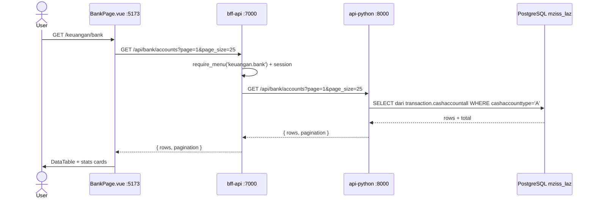

# Plan: Rekening Bank (TR0006 Migration)

**Tanggal:** 2026-06-08
**Berdasarkan Specs:** `docs/todos/2026-06-08-004-rekening-bank/specs.md`
**Status:** In Progress

---

## Ringkasan

Migrasi menu TR0006 (Rekening Bank) ke portal zakat — menggantikan BankPage.vue
yang saat ini dummy hardcoded dengan data nyata dari `transaction.cashaccountall`.
Menu/seed sudah done; hanya perlu api-python module + BFF route + UI rewrite.

---

## Checklist Progress

| # | File | Aksi | Agent | Status |
|---|------|------|-------|--------|
| 1 | `apps_zakat/api-python/app/modules/bank/__init__.py` | CREATE | isf-agent-python | ⏳ Pending |
| 2 | `apps_zakat/api-python/app/modules/bank/schema.py` | CREATE | isf-agent-python | ⏳ Pending |
| 3 | `apps_zakat/api-python/app/modules/bank/service.py` | CREATE | isf-agent-python | ⏳ Pending |
| 4 | `apps_zakat/api-python/app/modules/bank/router.py` | CREATE | isf-agent-python | ⏳ Pending |
| 5 | `apps_zakat/api-python/app/main.py` | MODIFY | isf-agent-python | ⏳ Pending |
| 6 | `apps_zakat/bff-api/app/routers/bank.py` | CREATE | isf-agent-bff | ⏳ Pending |
| 7 | `apps_zakat/bff-api/app/main.py` | MODIFY | isf-agent-bff | ⏳ Pending |
| 8 | `apps_zakat/web-vue/src/pages/keuangan/BankPage.vue` | REWRITE | isf-agent-ui | ⏳ Pending |

---

## Langkah Manual

| # | Langkah | Status |
|---|---------|--------|
| A | Restart container api-python zakat | ⏳ Pending |
| B | Restart container bff-api zakat | ⏳ Pending |
| C | Test E2E: `bash testing/e2e-rekening-bank.sh` | ⏳ Pending |

> Seed tidak diperlukan — menu + role_menu sudah ada di isf_auth_zakat.

---

## Arsitektur Alur Data

---

## Endpoint Kontrak

| Layer | Method | Path | Auth |
|---|---|---|---|
| api-python | GET | `/api/bank/accounts` | internal |
| bff-api | GET | `/api/bank/accounts` | session + `keuangan.bank` |

**Query params (keduanya):** `search`, `page` (default 1), `page_size` (default 25)

---

## Test E2E

Script: `testing/e2e-rekening-bank.sh`
