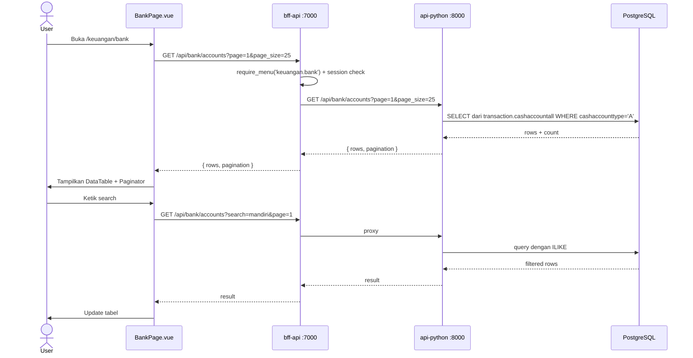

# Specs: Rekening Bank (TR0006 Migration)

**Tanggal:** 2026-06-08
**Portal:** Zakat
**Tipe:** CRUD module (list + form via otorisasi workflow)
**Legacy:** `TR0006 · fDaftarRekeningBank · ShowQueryClick`

---

## Akses

| Role | Keterangan |
|---|---|
| `SPVKEU` | Supervisor Keuangan — full view |
| `KEU` | Staf Keuangan — full view |
| `ACC` | Akuntan — full view |
| `SPVACC` | Supervisor Akuntan — full view |
| `ADM` | Admin — full view |
| `SPVADM` | Supervisor Admin — full view |

**Menu key:** `keuangan.bank`
**Route:** `/keuangan/bank`
**DB state:** ✅ `isf_auth.menu` sudah ada · ✅ `isf_auth.role_menu` sudah ada (6 roles) · ✅ `lib/menu/registry.ts` sudah ada

---

## Deskripsi Fitur

Halaman daftar rekening bank milik LAZ — menampilkan semua rekening dengan saldo,
nama bank, nomor rekening, dan status. Data bersumber dari view `transaction.cashaccountall`
(filter `cashaccounttype = 'A'`). Create/edit rekening melalui otorisasi workflow (sudah ada).

BankPage.vue saat ini masih menampilkan 5 data dummy hardcoded. Migrasi ini
menggantikan seluruh dummy layer dengan API call nyata.

---

## Data & Schema

**View:** `transaction.cashaccountall` — filter `cashaccounttype = 'A'`

| Kolom DB | Tipe | Label UI |
|---|---|---|
| `accountno` | varchar(30) | Kode Rekening |
| `bankname` | varchar(30) | Nama Bank |
| `bankaccountno` | varchar(20) | No Rekening Bank |
| `accountname` | varchar(50) | Nama Rekening |
| `branchcode` | varchar(5) | Cabang |
| `currencycode` | varchar(5) | Valuta |
| `balance` | numeric(38,2) | Saldo |
| `status` | char(1) | Status (A=Aktif, N=Non-aktif) |

**Reference tables (lookup):**
- `transaction.bank(bankcode, bankshortname, bankname)` — untuk dropdown pilih bank di form

---

## API Contracts

### api-python (internal, port :8000)

```
GET /api/bank/accounts
  Query: search (str), page (int, default=1), page_size (int, default=25)
  Filter: cashaccounttype='A' always applied
  Response:
  {
    "rows": [
      {
        "account_no": "BANK0001",
        "account_name": "ZAKAT",
        "bank_name": "Mandiri",
        "bank_account_no": "0700000092895",
        "branch_code": "001",
        "currency_code": "IDR",
        "balance": 138691103.71,
        "status": "A"
      }
    ],
    "pagination": { "page": 1, "page_size": 25, "total": 42, "total_pages": 2 }
  }
```

### bff-api (browser-facing, port :7000)

```
GET /api/bank/accounts
  Auth: session cookie + require_menu('keuangan.bank')
  Proxy: passthrough ke api-python /api/bank/accounts
  Params passthrough: search, page, page_size
```

---

## UI Flow



---

## Handoff ke Agent

### → isf-agent-python (Sonnet)
Buat `apps_zakat/api-python/app/modules/bank/`:
- `schema.py` — `BankAccountRow`, `BankAccountList` (Pydantic models)
- `service.py` — `list_bank_accounts(search, page, page_size)` query `transaction.cashaccountall` filter `cashaccounttype='A'`, ILIKE search di `accountno + accountname + bankname + bankaccountno`
- `router.py` — `GET /accounts` → `ok(data.model_dump())`
- `__init__.py`
Daftarkan di `app/main.py` sebagai router dengan prefix `/bank`.

### → isf-agent-bff (Haiku)
Buat `apps_zakat/bff-api/app/routers/bank.py`:
- `GET /accounts` → `require_menu('keuangan.bank')` + proxy ke `/api/bank/accounts`
- Params passthrough: search, page, page_size
Daftarkan di `app/main.py` dengan prefix `/bank`.

### → isf-agent-ui (Sonnet)
Rewrite `apps_zakat/web-vue/src/pages/keuangan/BankPage.vue`:
- Ganti hardcoded data → `GET /api/bank/accounts` via `lib/api/client.ts`
- Layout: toolbar (search + Tambah Rekening) → Paginator (top) → DataTable
- Kolom: Kode Rekening, Nama Rekening, Nama Bank, No Rekening Bank, Cabang, Valuta, Saldo, Status
- Saldo: format rupiah via `lib/format.ts`
- Stats cards: total rekening (total dari pagination), total saldo IDR (sum dari rows)
- Loading/error state
- Hapus dummy data dan dummy alert "Fase 2"
- Pertahankan modal "Tambah Rekening" yang sudah ada (otorisasi flow)
- Pertahankan section submissions (my-submissions otorisasi)
