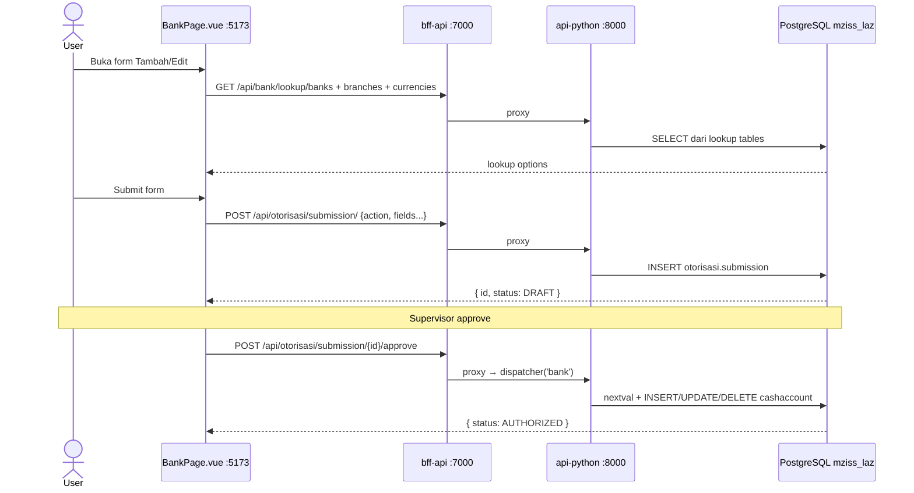

# Plan: Rekening Bank — CRUD Lengkap via Otorisasi

**Tanggal:** 2026-06-08
**Berdasarkan Specs:** `docs/todos/2026-06-08-005-rekening-bank-crud/specs.md`
**Status:** In Progress

---

## Ringkasan

Menambah form create/edit/delete lengkap untuk Rekening Bank menggunakan otorisasi workflow.
Lookup endpoints di api-python + BFF, dispatcher bank di otorisasi service, dan UI form drawer.

---

## Checklist Progress

| # | File | Aksi | Agent | Status |
|---|------|------|-------|--------|
| 1 | `apps_zakat/api-python/app/modules/bank/service.py` | MODIFY | isf-agent-python | ⏳ Pending |
| 2 | `apps_zakat/api-python/app/modules/bank/schema.py` | MODIFY | isf-agent-python | ⏳ Pending |
| 3 | `apps_zakat/api-python/app/modules/bank/router.py` | MODIFY | isf-agent-python | ⏳ Pending |
| 4 | `apps_zakat/api-python/app/modules/otorisasi/service.py` | MODIFY | isf-agent-python | ⏳ Pending |
| 5 | `apps_zakat/bff-api/app/routers/bank.py` | MODIFY | isf-agent-bff | ⏳ Pending |
| 6 | `apps_zakat/web-vue/src/pages/keuangan/BankPage.vue` | MODIFY | isf-agent-ui | ⏳ Pending |

---

## Langkah Manual

| # | Langkah | Status |
|---|---------|--------|
| A | Restart container api-python zakat | ⏳ Pending |
| B | Restart container bff-api zakat | ⏳ Pending |
| C | Test E2E: `bash testing/e2e-rekening-bank-crud.sh` | ⏳ Pending |

---

## Arsitektur Alur Data

---

## Endpoint Kontrak

| Layer | Method | Path | Keterangan |
|---|---|---|---|
| api-python | GET | `/api/bank/lookup/banks` | transaction.bank |
| api-python | GET | `/api/bank/lookup/branches` | transaction.branch (isactive=T) |
| api-python | GET | `/api/bank/lookup/currencies` | transaction.currency |
| api-python | GET | `/api/bank/lookup/gl_accounts` | transaction.account (is_detail=T) + search |
| api-python | GET | `/api/bank/lookup/products` | program.product (isdetail=T) + search |
| api-python | GET | `/api/bank/accounts/{account_no}` | detail single rekening |
| bff-api | GET | `/api/bank/lookup/{type}` | passthrough |
| bff-api | GET | `/api/bank/accounts/{account_no}` | passthrough |

---

## Test E2E

Script: `testing/e2e-rekening-bank-crud.sh`
