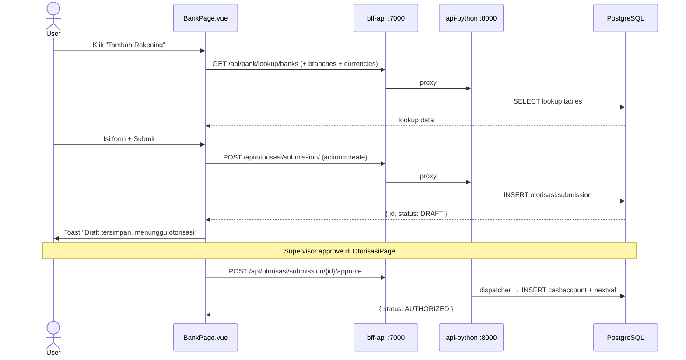

# Specs: Rekening Bank — CRUD Lengkap via Otorisasi

**Tanggal:** 2026-06-08
**Portal:** Zakat
**Tipe:** CRUD module + Otorisasi workflow
**Extends:** `docs/todos/2026-06-08-004-rekening-bank/`

---

## Akses

| Role | Keterangan |
|---|---|
| `SPVKEU` | Bisa buat, edit, hapus + otorisasi |
| `KEU` | Bisa buat, edit, hapus (submit ke otorisasi) |
| `ACC` | Bisa buat, edit, hapus (submit ke otorisasi) |
| `SPVACC` | Bisa buat, edit, hapus + otorisasi |
| `ADM` | Bisa buat, edit, hapus (submit ke otorisasi) |
| `SPVADM` | Bisa buat, edit, hapus + otorisasi |

**Menu key:** `keuangan.bank` (sudah ada)

---

## Deskripsi Fitur

Ekstensi dari TR0006 — menambah form create/edit lengkap + delete via otorisasi.
Saat submission disetujui, dispatcher bank menulis ke `transaction.cashaccount`.
Account number di-generate otomatis dari `seq_bankcash` (format `BANK####`).

---

## Fields Form (dari legacy fRekeningBank)

| Field | Label | Tipe | Required | Keterangan |
|---|---|---|---|---|
| `account_name` | Nama Rekening | text | ✓ | |
| `bank_account_no` | No Rekening Bank | text | ✓ | min 8 char |
| `bank_code` | Nama Bank | lookup | ✓ | → `transaction.bank` |
| `branch_code` | Cabang BPZIS | lookup | ✓ | → `transaction.branch (isactive=T)` |
| `currency_code` | Valuta | lookup | ✓ | → `transaction.currency` |
| `account_interface` | GL Interface | lookup | ✓ | → `transaction.account (is_detail=T)` |
| `opening_date` | Tgl Buka | date | — | ISO YYYY-MM-DD |
| `is_amil_account` | Rekening Amil? | boolean | — | default false, disable product saat true |
| `product_id` | Default Produk | lookup | — | → `program.product (isdetail=T)`, disabled jika is_amil=true |
| `cash_code` | Kode Kas | text | — | harus unik jika diisi |

**Auto-generated (tidak diisi user):**
- `account_no` = `BANK` + `nextval('seq_bankcash')` zero-padded 4 digit
- `balance` = 0.0 (inisialisasi)
- `status` = `'A'` (aktif)
- `is_recon_account` = `'F'`

---

## Lookup Endpoints (baru)

```
GET /api/bank/lookup/banks         → transaction.bank
GET /api/bank/lookup/branches      → transaction.branch WHERE isactive='T'
GET /api/bank/lookup/currencies    → transaction.currency
GET /api/bank/lookup/gl_accounts   → transaction.account WHERE is_detail='T' (+ search)
GET /api/bank/lookup/products      → program.product WHERE isdetail='T' (+ search)
GET /api/bank/accounts/{account_no} → detail single rekening
```

---

## API Contracts

### Lookup responses

```
GET /api/bank/lookup/banks
→ { data: [{ bank_code, bank_short_name, bank_name }] }

GET /api/bank/lookup/branches
→ { data: [{ branch_code, branch_name }] }

GET /api/bank/lookup/currencies
→ { data: [{ currency_code, short_name, full_name }] }

GET /api/bank/lookup/gl_accounts?search=
→ { data: [{ account_code, account_name }] }

GET /api/bank/lookup/products?search=
→ { data: [{ product_id, product_code, product_name }] }

GET /api/bank/accounts/{account_no}
→ { data: { account_no, account_name, bank_name, bank_code, bank_account_no,
            branch_code, currency_code, balance, account_interface, opening_date,
            is_amil_account, product_id, cash_code, status } }
```

### Otorisasi submission payload

```json
{
  "entity_type": "bank",
  "module": "keuangan",
  "payload": {
    "action": "create" | "edit" | "delete",
    "account_no": "BANK0001",        // only for edit/delete
    "account_name": "ZAKAT",
    "bank_account_no": "0700000092895",
    "bank_code": "001",
    "branch_code": "001",
    "currency_code": "IDR",
    "account_interface": "110101",
    "opening_date": "2024-01-01",     // optional
    "is_amil_account": false,
    "product_id": null,               // optional
    "cash_code": null                 // optional
  }
}
```

### Dispatcher (api-python, dipanggil saat submission AUTHORIZED)

```python
async def create_from_payload(payload: dict, user_id: str, branch_code: str) -> str:
    action = payload['action']
    if action == 'create':
        # nextval('seq_bankcash') → BANK####
        # INSERT INTO transaction.cashaccount
        return account_no
    elif action == 'edit':
        # UPDATE transaction.cashaccount WHERE accountno = payload['account_no']
        return payload['account_no']
    elif action == 'delete':
        # DELETE FROM transaction.cashaccount WHERE accountno = payload['account_no']
        return payload['account_no']
```

---

## UI Flow



---

## Handoff ke Agent

### → isf-agent-python
- Tambah 5 lookup endpoints di `app/modules/bank/router.py`
- Tambah `GET /accounts/{account_no}` endpoint
- Buat `bank_service.create_from_payload()` dispatcher
- Register dispatcher di `app/modules/otorisasi/service.py`

### → isf-agent-bff
- Tambah 5 lookup proxy routes + GET /{account_no} ke `app/routers/bank.py`

### → isf-agent-ui
- Ganti modal sederhana di BankPage.vue → drawer form lengkap
- SearchSelect untuk lookup bank, cabang, valuta, GL account, produk
- Load lookup data saat form dibuka
- Tombol Edit per baris tabel → preload dari GET /{account_no}
- Tombol Hapus per baris → confirm → submit action='delete'
