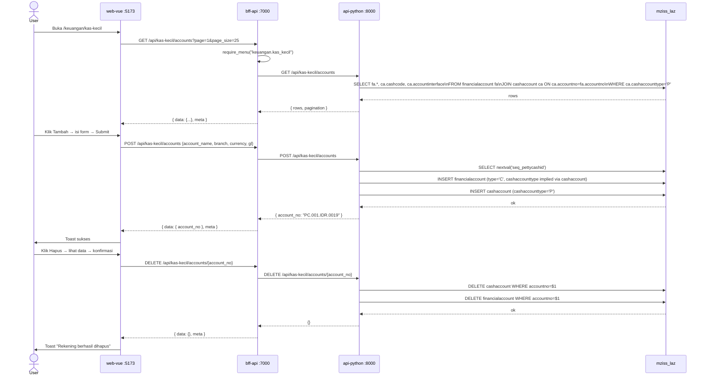

# Plan: Rekening Kas Kecil

**Tanggal:** 2026-06-08  
**Berdasarkan Specs:** `docs/todos/2026-06-08-006-rekening-kas-kecil/specs.md`  
**Status:** In Progress

---

## Ringkasan

CRUD master data rekening kas kecil (petty cash) untuk portal zakat.
Menggunakan tabel `cashaccount` + `financialaccount` dengan discriminator `cashaccounttype='P'`, mirip pola Bank (type='A').

---

## Checklist Progress

| # | File | Aksi | Agent | Status |
|---|------|------|-------|--------|
| 1 | `apps_zakat/api-python/app/modules/kas_kecil/schema.py` | CREATE | isf-agent-python | ⏳ Pending |
| 2 | `apps_zakat/api-python/app/modules/kas_kecil/service.py` | CREATE | isf-agent-python | ⏳ Pending |
| 3 | `apps_zakat/api-python/app/modules/kas_kecil/router.py` | CREATE | isf-agent-python | ⏳ Pending |
| 4 | `apps_zakat/api-python/app/modules/kas_kecil/__init__.py` | CREATE | isf-agent-python | ⏳ Pending |
| 5 | `apps_zakat/api-python/app/main.py` | MODIFY | isf-agent-python | ⏳ Pending |
| 6 | `apps_zakat/bff-api/app/routers/kas_kecil.py` | CREATE | isf-agent-bff | ⏳ Pending |
| 7 | `apps_zakat/bff-api/app/main.py` | MODIFY | isf-agent-bff | ⏳ Pending |
| 8 | `infra/db/migrations/seed/seed-menu-kas-kecil.sql` | CREATE | isf-agent-seed | ⏳ Pending |
| 9 | `apps_zakat/web-vue/src/lib/menu/registry.ts` | MODIFY | isf-agent-seed | ⏳ Pending |
| 10 | `apps_zakat/web-vue/src/pages/keuangan/KasKecilPage.vue` | CREATE | isf-agent-ui | ⏳ Pending |
| 11 | `apps_zakat/web-vue/src/router/index.ts` | MODIFY | isf-agent-ui | ⏳ Pending |
| 12 | `apps_zakat/web-vue/src/components/AppSidebar.vue` | MODIFY | isf-agent-ui | ⏳ Pending |

---

## Langkah Manual

| # | Langkah | Status |
|---|---------|--------|
| A | Apply seed SQL ke isf_auth_zakat: `PGPASSWORD=solusi psql -U transaction -p 5432 -h localhost -d isf_auth_zakat -f infra/db/migrations/seed/seed-menu-kas-kecil.sql` | ⏳ Pending |
| B | Restart container api-python dan bff-api zakat | ⏳ Pending |
| C | User logout + login ulang di browser | ⏳ Pending |
| D | Jalankan E2E script: `bash testing/e2e-rekening-kas-kecil.sh` | ⏳ Pending |

---

## Arsitektur Alur Data



---

## Endpoint Kontrak

### api-python /api/kas-kecil/*

| Method | Path | Keterangan |
|---|---|---|
| GET | `/api/kas-kecil/accounts` | List + pagination, query: search, page, page_size |
| GET | `/api/kas-kecil/accounts/{account_no}` | Detail satu rekening |
| POST | `/api/kas-kecil/accounts` | Buat rekening baru (auto-generate account_no) |
| PUT | `/api/kas-kecil/accounts/{account_no}` | Update rekening (branch_code read-only) |
| DELETE | `/api/kas-kecil/accounts/{account_no}` | Hapus dari FA + CA |
| GET | `/api/kas-kecil/lookup/branches` | Dropdown cabang |
| GET | `/api/kas-kecil/lookup/currencies` | Dropdown valuta |
| GET | `/api/kas-kecil/lookup/gl_accounts` | Dropdown GL account (SearchSelect, ?search=) |

### bff-api /api/kas-kecil/* (semua proxy + require_menu)

Semua route sama dengan api-python, proxied via `get_api_python(...)`.

---

## Seed Command

```bash
PGPASSWORD=solusi psql -U transaction -p 5432 -h localhost \
  -d isf_auth_zakat \
  -f infra/db/migrations/seed/seed-menu-kas-kecil.sql
```

---

## Test E2E

Lihat script: `testing/e2e-rekening-kas-kecil.sh`
