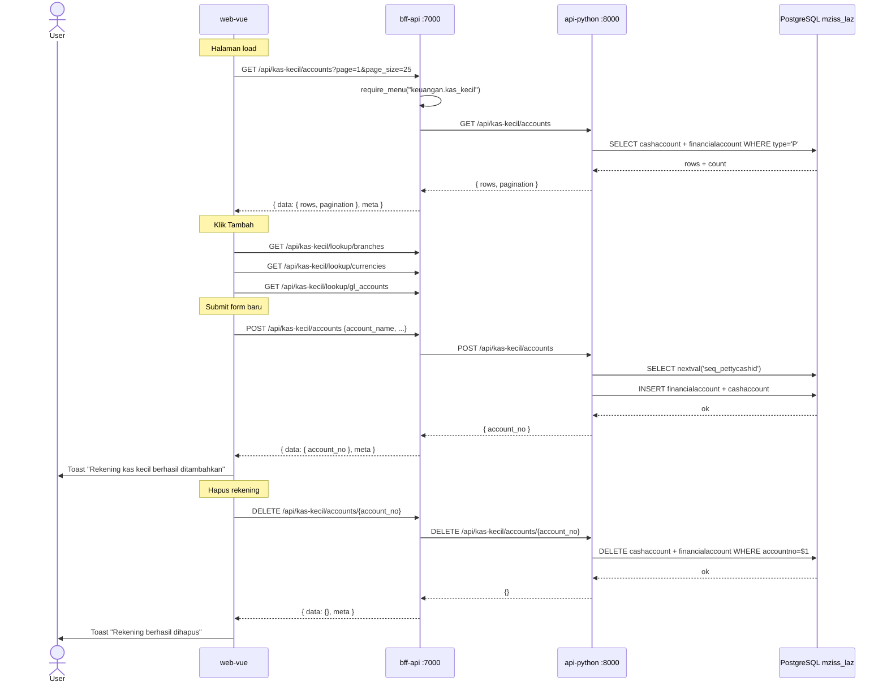

# Specs: Rekening Kas Kecil

**Tanggal:** 2026-06-08  
**Portal:** zakat  
**Tipe:** CRUD module

---

## Akses

| Role | Keterangan |
|---|---|
| `ADM` | Full access — create, edit, delete |
| `KEU` | Full access |
| `ACC` | Full access |

**Menu key:** `keuangan.kas_kecil`  
**Route:** `/keuangan/kas-kecil`  
**Sidebar:** Di bawah "Bank" dalam group Keuangan

---

## Deskripsi Fitur

Migrasi dari legacy `fDaftarRekeningKasKecil` + `fRekeningKasKecil` (DAF/Jython).
Manajemen master data rekening kas kecil (*petty cash*) — daftar, tambah, ubah, hapus.
Setiap rekening kas kecil terikat ke satu cabang, satu valuta, dan satu GL interface.

---

## Data & Schema

Tabel di `mziss_laz` (schema `transaction`):

| Tabel | Peran |
|---|---|
| `transaction.cashaccount` | Detail kas: cashcode, accountinterface, tipe akun |
| `transaction.financialaccount` | Data keuangan: nama, cabang, valuta, saldo, status, tanggal buka |

**Discriminator:** `cashaccount.cashaccounttype = 'P'` (P = PettyCash, beda dari Bank = 'A', Kas = 'R')

### Kolom penting

| Kolom | Tabel | Tipe | Keterangan |
|---|---|---|---|
| `accountno` | keduanya | varchar | PK, format `PC.{branch}.{currency}.{seq4}` |
| `accountname` | financialaccount | varchar | Nama rekening, wajib |
| `cashcode` | cashaccount | varchar | Kode kas, unik per semua akun (opsional) |
| `accountinterface` | cashaccount | varchar | Kode GL account interface, wajib |
| `currencycode` | financialaccount | varchar | Kode valuta, wajib |
| `branchcode` | financialaccount | varchar | Kode cabang, wajib |
| `balance` | financialaccount | numeric | Saldo (read-only di form) |
| `status` | financialaccount | varchar | Status: 'A' = aktif |
| `openingdate` | financialaccount | date | Tanggal buka |

### Auto-generate account_no (Create)
```
SELECT nextval('seq_pettycashid')  → zfill(4)
account_no = f"PC.{branch_code}.{currency_code}.{seq}"
```

### Sequence name
`seq_pettycashid` di schema `transaction`.

---

## API Contracts

### api-python (:8000)

```
GET  /api/kas-kecil/accounts?search=&page=1&page_size=25
     → { rows: [...], pagination: { page, page_size, total, total_pages } }

GET  /api/kas-kecil/accounts/{account_no}
     → { account_no, account_name, cash_code, account_interface,
         currency_code, branch_code, balance, status, opening_date }

POST /api/kas-kecil/accounts
     body: { account_name, cash_code?, account_interface,
             currency_code, branch_code, opening_date }
     → { account_no }  ← yang baru di-generate

PUT  /api/kas-kecil/accounts/{account_no}
     body: { account_name, cash_code?, account_interface,
             currency_code, opening_date }
     → {}

DELETE /api/kas-kecil/accounts/{account_no}
     → {}

GET  /api/kas-kecil/lookup/branches   → reuse logic dari bank (tabel sama)
GET  /api/kas-kecil/lookup/currencies → reuse logic dari bank (tabel sama)
GET  /api/kas-kecil/lookup/gl_accounts?search= → reuse logic dari bank
```

### bff-api (:7000)

```
GET    /api/kas-kecil/accounts
GET    /api/kas-kecil/accounts/{account_no}
POST   /api/kas-kecil/accounts
PUT    /api/kas-kecil/accounts/{account_no}
DELETE /api/kas-kecil/accounts/{account_no}
GET    /api/kas-kecil/lookup/branches
GET    /api/kas-kecil/lookup/currencies
GET    /api/kas-kecil/lookup/gl_accounts
```

Semua route di-gate dengan `require_menu("keuangan.kas_kecil")`.

---

## UI Flow



---

## Validasi

- `account_name` — wajib diisi
- `branch_code` — wajib dipilih
- `currency_code` — wajib dipilih
- `account_interface` — wajib dipilih (GL account)
- `cash_code` — opsional; jika diisi, harus unik di seluruh `cashaccount`
- `branch_code` tidak bisa diubah saat Edit (read-only setelah create)

---

## Handoff ke Agent

→ **isf-agent-python**:
  Buat `apps_zakat/api-python/app/modules/kas_kecil/` dengan 3 file:
  - `schema.py` — KasKecilRow, KasKecilList, KasKecilDetail, Create/UpdatePayload, lookups
  - `service.py` — list, get, create (nextval seq_pettycashid, INSERT FA + CA), update, delete, lookups
  - `router.py` — APIRouter prefix="/kas-kecil"
  Daftarkan di `apps_zakat/api-python/app/main.py`.

→ **isf-agent-bff**:
  Buat `apps_zakat/bff-api/app/routers/kas_kecil.py`:
  - Semua 8 endpoint, semua gate dengan `require_menu("keuangan.kas_kecil")`
  - POST/PUT/DELETE juga perlu `current_user_id_or_401`
  Daftarkan di `apps_zakat/bff-api/app/main.py`.

→ **isf-agent-seed**:
  MENU_KEY: `keuangan.kas_kecil`
  LABEL: `Kas Kecil`
  ROLES: `ADM`, `KEU`, `ACC`
  SORT_ORDER: 135 (setelah Bank=130)
  Buat `infra/db/migrations/seed/seed-menu-kas-kecil.sql`
  Tambahkan `'keuangan.kas_kecil'` ke `apps_zakat/web-vue/src/lib/menu/registry.ts`

→ **isf-agent-ui**:
  PAGE: `apps_zakat/web-vue/src/pages/keuangan/KasKecilPage.vue`
  - List table: accountno, accountname, cashcode, branch_code, currency_code, balance (formatted), status badge, openingdate
  - Modal form (add/edit/view/delete pattern seperti BankPage.vue)
  - Lookup branches + currencies + gl_accounts via SearchSelect
  - Delete: tampilkan form read-only dengan data lengkap dulu sebelum konfirmasi (sesuai feedback-delete-form-modal)
  - Pagination: Paginator di atas tabel, default 25 rows
  ROUTE: `/keuangan/kas-kecil` → name `keuangan-kas-kecil`, meta.menu_key `keuangan.kas_kecil`
  SIDEBAR: tambah entry setelah Bank di group Keuangan
