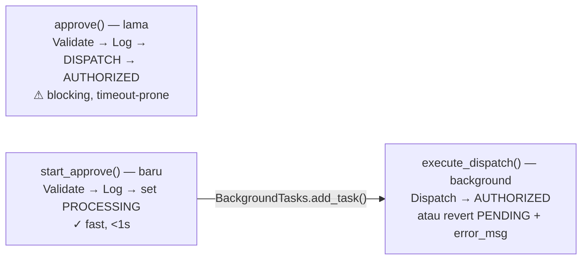

# Plan: Otorisasi Async Dispatch

**Tanggal:** 2026-06-08  
**Berdasarkan Specs:** `docs/todos/2026-06-08-007-otorisasi-async-dispatch/specs.md`  
**Status:** ⏳ Pending

---

## Ringkasan

Tambah status `PROCESSING` ke otorisasi.submission dan gunakan FastAPI BackgroundTasks agar approve endpoint mengembalikan response < 1s. Dispatcher berat (create penghimpunan, batch upload commit) berjalan setelah response dikirim. UI auto-refresh untuk polling status.

---

## Checklist Progress

| # | File | Aksi | Agent | Status |
|---|------|------|-------|--------|
| 1 | `infra/db/migrations/otorisasi/005_add_processing_status.sql` | CREATE | isf-agent-db | ⏳ |
| 2 | `apps_{portal}/api-python/app/modules/otorisasi/repo.py` | MODIFY | isf-agent-python | ⏳ |
| 3 | `apps_{portal}/api-python/app/modules/otorisasi/service.py` | MODIFY | isf-agent-python | ⏳ |
| 4 | `apps_{portal}/api-python/app/modules/otorisasi/router.py` | MODIFY | isf-agent-python | ⏳ |
| 5 | `apps_{portal}/api-python/app/modules/transaction/repository.py` | MODIFY | isf-agent-python | ⏳ |
| 6 | `apps_{portal}/api-python/app/modules/transaction/commit.py` | MODIFY | isf-agent-python | ⏳ |
| 7 | `apps_{portal}/api-python/app/modules/transaction/router.py` | MODIFY | isf-agent-python | ⏳ |
| 8 | `apps_{portal}/bff-api/app/routers/transaction.py` | MODIFY | isf-agent-bff | ⏳ |
| 9 | `apps_zakat/web-vue/src/components/otorisasi/StatusBadge.vue` | MODIFY | isf-agent-ui | ⏳ |
| 10 | `apps_zakat/web-vue/src/pages/keuangan/OtorisasiPage.vue` | MODIFY | isf-agent-ui | ⏳ |
| 11 | Upload page (list atau detail) | MODIFY | isf-agent-ui | ⏳ |

`{portal}` = zakat + wakaf untuk semua file backend (items 2–8).

---

## Langkah Manual

| # | Langkah | Status |
|---|---------|--------|
| A | Apply migration ke mziss_laz: `psql -U transaction -d mziss_laz -f infra/db/migrations/otorisasi/005_add_processing_status.sql` | ⏳ |
| B | Apply migration ke mziss_wakaf: sama untuk wakaf | ⏳ |
| C | Restart container api-python + bff-api (zakat + wakaf) | ⏳ |
| D | Test: approve submission dari OtorisasiPage → lihat badge PROCESSING | ⏳ |
| E | Test: upload batch 10+ item → approve → lihat PROCESSING → auto-refresh ke AUTHORIZED | ⏳ |

---

## Arsitektur Perubahan



---

## Detail Implementasi

### Step 1: DB Migration

```sql
-- File: infra/db/migrations/otorisasi/005_add_processing_status.sql
ALTER TABLE otorisasi.submission DROP CONSTRAINT submission_status_check;
ALTER TABLE otorisasi.submission
    ADD CONSTRAINT submission_status_check
        CHECK (status IN ('DRAFT','PENDING','AUTHORIZED','REJECTED','PROCESSING'));
ALTER TABLE otorisasi.submission
    ADD COLUMN IF NOT EXISTS dispatch_error VARCHAR(500);
```

### Step 2+3+4: api-python otorisasi

**repo.py** — tambah 2 fungsi:
```python
async def set_processing(submission_id: int) -> None:
    await execute(
        "UPDATE otorisasi.submission SET status='PROCESSING', updated_at=NOW() WHERE id=$1",
        submission_id,
    )

async def revert_to_pending_with_error(submission_id: int, error_msg: str) -> None:
    await execute(
        "UPDATE otorisasi.submission SET status='PENDING', dispatch_error=$2, updated_at=NOW() WHERE id=$1",
        submission_id, error_msg,
    )
```

**service.py** — ganti `approve()` dengan dua fungsi baru:

```python
async def start_approve(
    submission_id: int, authorizer_id: str,
    branch_access: str = 'single', notes: str | None = None,
) -> dict:
    """Validate, log approval, set PROCESSING jika dispatcher ada.
    Returns dict dengan 'needs_dispatch': bool."""
    sub = await repo.get_submission(submission_id)
    if not sub:
        raise HTTPException(404, 'Submission tidak ditemukan')
    if sub['status'] not in ('PENDING', 'PROCESSING'):
        raise HTTPException(400, f"Status '{sub['status']}' tidak bisa diotorisasi")
    
    level = sub['level_current']
    level_required = sub['level_required']
    await repo.insert_approval_log(submission_id, level, authorizer_id, 'APPROVED', notes)

    if level >= level_required:
        dispatcher = _DISPATCHERS.get(sub['entity_type'])
        if dispatcher:
            await repo.set_processing(submission_id)
            return {
                'id': submission_id, 'status': 'PROCESSING', 'needs_dispatch': True,
                'entity_type': sub['entity_type'], 'payload': dict(sub['payload']),
                'submitted_by': sub['submitted_by'], 'branch_code': sub['branch_code'],
            }
        else:
            await repo.authorize_submission(submission_id, None)
            return {'id': submission_id, 'status': 'AUTHORIZED', 'needs_dispatch': False}
    else:
        await repo.advance_level(submission_id, level + 1)
        return {'id': submission_id, 'status': 'PENDING', 'needs_dispatch': False, 'level_current': level + 1}


async def execute_dispatch(
    submission_id: int, entity_type: str, payload: dict,
    submitted_by: str, branch_code: str,
) -> None:
    """Background task: panggil dispatcher, finalize ke AUTHORIZED atau revert ke PENDING."""
    try:
        dispatcher = _DISPATCHERS[entity_type]
        result_entity_id = await dispatcher(
            payload=payload, user_id=submitted_by, branch_code=branch_code,
        )
        await repo.authorize_submission(submission_id, result_entity_id)
    except Exception as exc:
        await repo.revert_to_pending_with_error(submission_id, str(exc)[:500])
```

Update `bulk_approve()` untuk pakai `start_approve()` dan kembalikan list hasil (termasuk `needs_dispatch` info untuk router).

**router.py** — update approve + bulk dengan BackgroundTasks:

```python
from fastapi import BackgroundTasks

@router.post('/submission/{submission_id}/approve')
async def approve_submission(
    submission_id: int, body: ApproveIn,
    background_tasks: BackgroundTasks,
    authorizer_id: str = Query(...),
    branch_access: str = Query('single'),
):
    try:
        result = await service.start_approve(submission_id, authorizer_id, branch_access, body.notes)
        if result.get('needs_dispatch'):
            background_tasks.add_task(
                service.execute_dispatch,
                result['id'], result['entity_type'], result['payload'],
                result['submitted_by'], result['branch_code'],
            )
        return JSONResponse(ok({'id': result['id'], 'status': result['status']}))
    except HTTPException as e:
        return JSONResponse(err('ERROR', e.detail), status_code=e.status_code)

@router.post('/bulk/approve')
async def bulk_approve(
    body: BulkApproveIn, background_tasks: BackgroundTasks,
    authorizer_id: str = Query(...), branch_access: str = Query('single'),
):
    results = []
    for sid in body.ids:
        try:
            r = await service.start_approve(sid, authorizer_id, branch_access, notes=None)
            if r.get('needs_dispatch'):
                background_tasks.add_task(
                    service.execute_dispatch,
                    r['id'], r['entity_type'], r['payload'], r['submitted_by'], r['branch_code'],
                )
            results.append({'id': r['id'], 'status': r['status']})
        except HTTPException as e:
            results.append({'id': sid, 'error': e.detail})
    return JSONResponse(ok(results))
```

### Step 5+6+7: api-python transaction

**repository.py** — tambah:
```python
async def get_batch_header(batch_id: int) -> dict | None:
    return await fetch_one(
        "SELECT batchid, authstatus FROM transaction.batchupload WHERE batchid = $1",
        batch_id,
    )

async def set_batch_processing(batch_id: int) -> None:
    await execute(
        "UPDATE transaction.batchupload SET authstatus = 'Q' WHERE batchid = $1",
        batch_id,
    )

async def set_batch_failed(batch_id: int) -> None:
    await execute(
        "UPDATE transaction.batchupload SET authstatus = 'F' WHERE batchid = $1",
        batch_id,
    )
```

**commit.py** — tambah wrapper:
```python
async def approve_batch_background(batch_id: int, authorized_user: str, branch_code: str, inputer: str) -> None:
    """Background task wrapper untuk approve_batch. Set 'F' jika gagal."""
    try:
        await approve_batch(batch_id, authorized_user, branch_code, inputer)
        # approve_batch sudah update authstatus='A' on success
    except Exception:
        await set_batch_failed(batch_id)

# Update approve_batch(): tambah cek authstatus='Q' di awal (skip jika sudah processing)
# if batch_row['authstatus'] in ('A', 'Q'): raise ValueError(...)
```

**transaction/router.py** — update batch approve:
```python
@router.post('/upload/penghimpunan/batches/{batch_id}/approve')
async def approve_batch_endpoint(batch_id: int, body: BatchApproveIn, background_tasks: BackgroundTasks):
    batch = await repository.get_batch_header(batch_id)
    if not batch:
        raise HTTPException(404, f'Batch {batch_id} tidak ditemukan')
    if batch['authstatus'] == 'A':
        raise HTTPException(400, 'Batch sudah pernah diotorisasi')
    if batch['authstatus'] == 'Q':
        raise HTTPException(400, 'Batch sedang dalam proses otorisasi')
    
    await repository.set_batch_processing(batch_id)
    background_tasks.add_task(
        commit.approve_batch_background,
        batch_id, body.authorized_user, body.branch_code, body.inputer,
    )
    return JSONResponse(ok({'batch_id': batch_id, 'status': 'PROCESSING'}))
```

### Step 8: BFF timeout fix

**bff-api/routers/transaction.py** — baris approve batch (currently uses `post_api_python` 10s):
```python
# Ganti dari post_api_python() ke inline httpx.AsyncClient(timeout=60.0)
url = f"{settings.api_python_base_url}/api/transaction/upload/penghimpunan/batches/{batch_id}/approve"
async with httpx.AsyncClient(timeout=60.0) as client:
    resp = await client.post(url, json={...})
```

### Step 9+10+11: UI

**StatusBadge.vue** — tambah case PROCESSING:
```vue
<span v-else-if="status === 'PROCESSING'"
  class="inline-flex items-center gap-1 rounded-full px-2 py-0.5 text-[10px] font-semibold bg-amber-100 text-amber-700 dark:bg-amber-900/30 dark:text-amber-300">
  <span class="w-1.5 h-1.5 rounded-full bg-amber-500 animate-pulse" />
  Diproses
</span>
```

**OtorisasiPage.vue** — auto-refresh pattern:
```typescript
const hasProcessing = computed(() => rows.value.some(r => r.status === 'PROCESSING'))
let refreshTimer: ReturnType<typeof setInterval> | null = null

watch(hasProcessing, (val) => {
  if (val && !refreshTimer) {
    refreshTimer = setInterval(() => loadPendingList(), 5000)
  } else if (!val && refreshTimer) {
    clearInterval(refreshTimer)
    refreshTimer = null
  }
}, { immediate: true })
onUnmounted(() => { if (refreshTimer) clearInterval(refreshTimer) })
```

**UploadPenghimpunanListPage.vue** — handle authstatus 'Q' dan 'F':
- Badge "Sedang Diproses" (amber) untuk 'Q'
- Badge "Gagal" (merah) untuk 'F'  
- Tombol Approve disabled jika authstatus in ('Q', 'A')
- Auto-refresh 5s jika ada batch dengan authstatus='Q'

---

## Endpoint Kontrak (ringkasan perubahan)

| Endpoint | Response lama | Response baru |
|---|---|---|
| `POST /api/otorisasi/submission/{id}/approve` | `{status:"AUTHORIZED"}` setelah dispatch | `{status:"PROCESSING"}` jika dispatcher, `{status:"AUTHORIZED"}` jika tidak |
| `POST /api/otorisasi/bulk/approve` | Array AUTHORIZED setelah semua dispatch | Array PROCESSING/PENDING langsung |
| `POST /api/transaction/upload/.../batches/{id}/approve` | `{committed: N}` setelah loop selesai | `{batch_id, status:"PROCESSING"}` langsung |

---

## Catatan Penting

**Dispatcher `_decide_and_finalize()` (save-and-submit auto-bypass) TIDAK diubah** — path ini untuk inputer normal, bukan supervisor. Jumlah item kecil (dalam limit), tidak perlu backgrounding.

**Recovery jika server restart saat PROCESSING:** Submission stuck di PROCESSING. Admin reset manual:
```sql
UPDATE otorisasi.submission SET status='PENDING', dispatch_error='Manual reset — server restart'
WHERE status='PROCESSING';
UPDATE transaction.batchupload SET authstatus='P' WHERE authstatus='Q';
```

**Wakaf:** Setelah zakat stabil, apply perubahan yang sama ke `apps_wakaf/` (struktur identik).

---

## Test E2E

Lihat script: `testing/e2e-otorisasi-async.sh` (dibuat saat eksekusi)

Manual verification checklist:
1. Login RAIS → submit penghimpunan besar → logout
2. Login HADI → halaman Otorisasi → approve submission
3. Badge berubah "Diproses" dalam <1s ✓
4. Tidak perlu tunggu — bisa langsung approve submission lain ✓
5. 5-10 detik kemudian: auto-refresh → badge "Diotorisasi" ✓
6. Upload batch 20 item → approve → badge "Diproses" → "Diotorisasi" ✓
7. Simulasi error: test dispatcher gagal → submission kembali ke PENDING ✓
