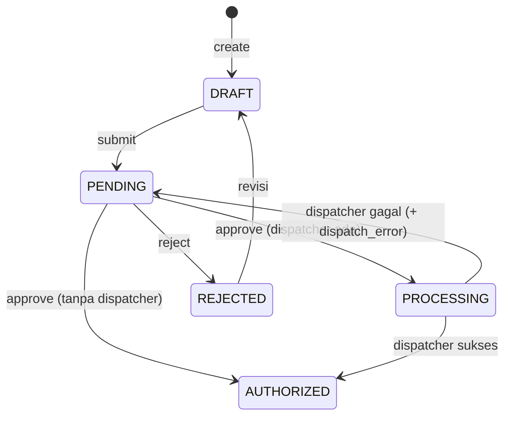
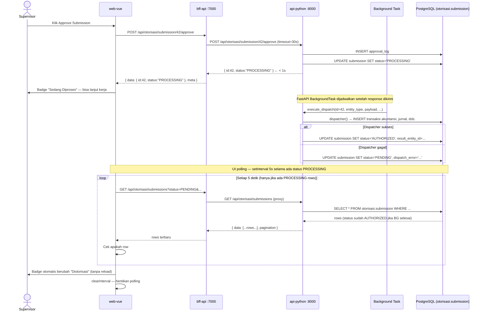

# Specs: Otorisasi Async Dispatch — Background Task Pattern

**Tanggal:** 2026-06-08  
**Portal:** zakat + wakaf (backend both; UI zakat dulu)  
**Tipe:** Enhancement — non-blocking approval execution

---

## Latar Belakang & Masalah

Sistem otorisasi saat ini **synchronous penuh**. Saat supervisor meng-approve submission, endpoint `POST /otorisasi/submission/{id}/approve` harus menunggu seluruh dispatcher selesai sebelum mengembalikan response. Akibatnya:

| Situasi | Masalah |
|---|---|
| Approve penghimpunan besar (banyak item) | Dispatcher bisa >30s → BFF timeout |
| Bulk approve N submissions | N × waktu dispatcher dalam 1 HTTP call |
| Upload batch 50+ item | Sequential loop, BFF timeout 10s (terlalu pendek) |

**Goal:** Approval endpoint mengembalikan response dalam <1s. Pekerjaan berat berjalan di background. UI menampilkan badge "Sedang Diproses" dan auto-refresh tanpa user perlu menunggu.

---

## Akses

Tidak ada perubahan akses — fitur ini adalah enhancement internal, bukan fitur baru.

---

## Solusi: FastAPI BackgroundTasks + Status PROCESSING

FastAPI memiliki `BackgroundTasks` built-in — tidak perlu Celery, Redis, atau infrastruktur tambahan.

```
Approve endpoint → set PROCESSING → kirim response → dispatch berjalan di background
```

**State machine baru otorisasi.submission:**



**State baru untuk batchupload.authstatus:**
- `'Q'` = Processing/Queued (sudah di-approve, batch sedang diproses background)
- `'F'` = Failed (background task gagal, butuh retry manual)

---

## Perubahan yang Diperlukan

### DB Schema (`otorisasi.submission`)

```sql
-- Expand CHECK constraint
ALTER TABLE otorisasi.submission DROP CONSTRAINT submission_status_check;
ALTER TABLE otorisasi.submission
    ADD CONSTRAINT submission_status_check
        CHECK (status IN ('DRAFT','PENDING','AUTHORIZED','REJECTED','PROCESSING'));

-- Tambah kolom error message
ALTER TABLE otorisasi.submission
    ADD COLUMN IF NOT EXISTS dispatch_error VARCHAR(500);
```

*Apply ke: `mziss_laz` + `mziss_wakaf` (schema `otorisasi` ada di business DB)*

---

## API Contracts

### Sebelum → Sesudah

| Endpoint | Sebelum | Sesudah |
|---|---|---|
| `POST /otorisasi/submission/{id}/approve` | Blocks 1-30s, returns AUTHORIZED | Returns PROCESSING dalam <1s |
| `POST /otorisasi/bulk/approve` | Blocks N×dispatch, returns all AUTHORIZED | Returns array with PROCESSING statuses |
| `POST /transaction/upload/.../batches/{id}/approve` | Blocks sequential loop, 10s timeout | Returns PROCESSING dalam <1s |

### Response shapes baru

```
POST /api/otorisasi/submission/{id}/approve
→ { data: { id: 42, status: "PROCESSING" }, meta }   ← jika dispatcher ada
→ { data: { id: 42, status: "AUTHORIZED" }, meta }   ← jika tidak ada dispatcher (entitas tanpa dispatch)
→ { data: { id: 42, status: "PENDING", level_current: 2 }, meta }  ← multi-level, belum final

POST /api/transaction/upload/.../batches/{batch_id}/approve
→ { data: { batch_id: 5, status: "PROCESSING" }, meta }
```

---

## UI Flow



---

## Handoff ke Agent

→ **isf-agent-db (Haiku)**:
  - Buat `infra/db/migrations/otorisasi/005_add_processing_status.sql`
  - Alter CHECK constraint + ADD COLUMN dispatch_error
  - Apply ke mziss_laz + mziss_wakaf

→ **isf-agent-python (Sonnet) — PORTAL: both**:
  - `otorisasi/repo.py`: tambah `set_processing()`, `revert_to_pending_with_error()`
  - `otorisasi/service.py`: refactor `approve()` → `start_approve()` + `execute_dispatch()`, update `bulk_approve()`
  - `otorisasi/router.py`: import BackgroundTasks, update approve + bulk_approve endpoints
  - `transaction/repository.py`: tambah `set_batch_processing()`, `set_batch_failed()`, `get_batch_header()`
  - `transaction/commit.py`: tambah `approve_batch_background()` wrapper
  - `transaction/router.py`: update `/batches/{id}/approve` → BackgroundTasks pattern

→ **isf-agent-bff (Haiku) — PORTAL: both**:
  - `bff-api/routers/transaction.py`: batch approve timeout 10s → 60s (inline httpx.AsyncClient)

→ **isf-agent-ui (Sonnet) — PORTAL: zakat**:
  - `components/otorisasi/StatusBadge.vue`: tambah PROCESSING badge (amber pulse)
  - `pages/keuangan/OtorisasiPage.vue`: auto-refresh 5s jika ada PROCESSING rows
  - `pages/keuangan/UploadPenghimpunanListPage.vue` atau DetailPage: handle authstatus 'Q' dan 'F'
