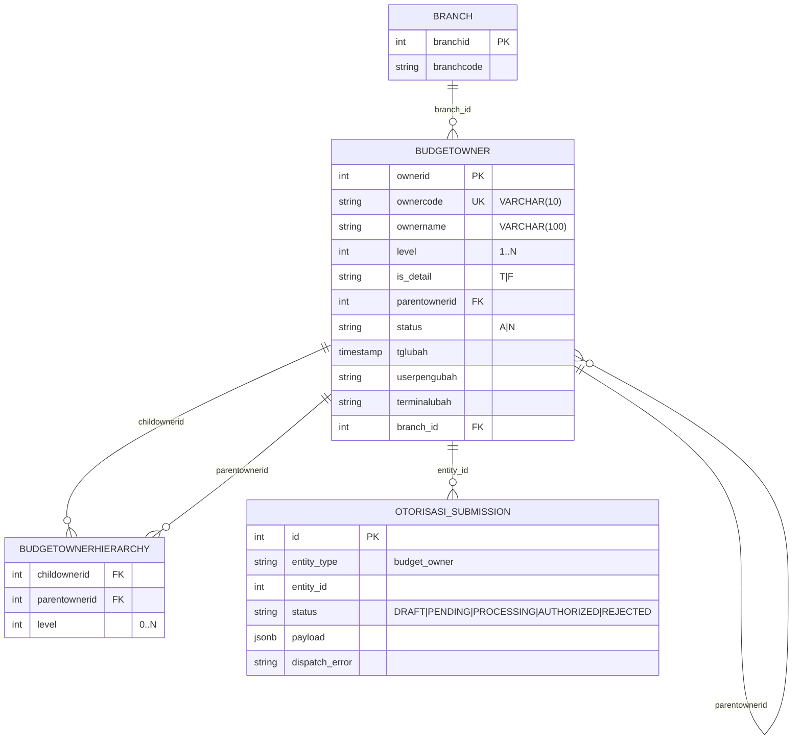

# Specs: Pemilik Anggaran (Budget Owner)

**Portal**: Keduanya (Zakat + Wakaf)  
**Domain**: `parameter`  
**Tipe**: Master Data + CRUD + Approval (Maker-Checker)  
**Legacy Ref**: `docs/legacy-apps/core/dialogs/Parameter/fDaftarBudgetOwner.*` dan `fBudgetOwner.*`  
**Tanggal**: 2026-06-11

## Konteks

Modul Pemilik Anggaran mengelola struktur hierarki pemilik/penanggung jawab anggaran (budget owner)
dalam organisasi. Data ini digunakan untuk alokasi anggaran per level organisasi dan tracking
akuntabilitas pengeluaran. Sistem mendukung CRUD dengan approval maker-checker (SPVADM approver),
dan penyimpanan otomatis hierarki parent-child via dispatcher.

---

## Database Schema

### Tabel: `transaction.budgetowner`

Menyimpan master data pemilik anggaran dengan status dan informasi audit.

```sql
CREATE TABLE transaction.budgetowner (
  ownerid SERIAL PRIMARY KEY,
  ownercode VARCHAR(10) NOT NULL UNIQUE,
  ownername VARCHAR(100) NOT NULL,
  level INTEGER NOT NULL DEFAULT 1,
  is_detail VARCHAR(1) NOT NULL DEFAULT 'T',  -- 'T'=leaf, 'F'=group
  parentownerid INTEGER REFERENCES transaction.budgetowner(ownerid),
  status VARCHAR(1) NOT NULL DEFAULT 'A',  -- 'A'=Active, 'N'=Not Active
  tglubah TIMESTAMP DEFAULT CURRENT_TIMESTAMP,
  userpengubah VARCHAR(30),
  terminalubah VARCHAR(30),
  branch_id INTEGER REFERENCES enterprise.branch(branchid),
  
  CHECK (status IN ('A', 'N')),
  CHECK (is_detail IN ('T', 'F')),
  CHECK ((is_detail = 'T' AND parentownerid IS NOT NULL) 
         OR (is_detail = 'F'))
);
```

### Tabel: `transaction.budgetownerhierarchy`

Menyimpan relasi hierarki parent-child (denormalisasi untuk query cepat).

```sql
CREATE TABLE transaction.budgetownerhierarchy (
  childownerid INTEGER NOT NULL,
  parentownerid INTEGER NOT NULL,
  level INTEGER NOT NULL,  -- 0 = self, 1 = direct parent, 2 = grandparent, etc.
  
  PRIMARY KEY (childownerid, parentownerid),
  FOREIGN KEY (childownerid) REFERENCES transaction.budgetowner(ownerid),
  FOREIGN KEY (parentownerid) REFERENCES transaction.budgetowner(ownerid)
);
```

**Catatan Hierarki:**
- Setiap row di `budgetowner` mendapat 1+ rows di `budgetownerhierarchy`:
  - `(ownerid, ownerid, 0)` — self-reference
  - `(ownerid, direct_parent_id, 1)` — direct parent
  - `(ownerid, grandparent_id, 2)` — grandparent, dll
- Digunakan untuk query path dari leaf ke root atau find all descendants

---

## ER Diagram



---

## Alur Data — Maker-Checker Workflow

```mermaid
sequenceDiagram
  actor User as Operator (KEU)
  participant Vue as web-vue (:5173)
  participant BFF as bff-api (:7000)
  participant API as api-python (:8000)
  participant DB as mziss_laz

  User->>Vue: Buka halaman Pemilik Anggaran
  Vue->>BFF: GET /api/parameter/pemilik-anggaran
  BFF->>API: proxy GET /api/parameter/pemilik-anggaran
  API->>DB: SELECT * FROM transaction.budgetowner ORDER BY ownercode
  DB-->>API: rows
  API-->>BFF: {data: rows, pagination: {...}}
  BFF-->>Vue: list render
  Vue-->>User: Tampilkan tabel

  User->>Vue: Klik "Tambah", isi form (ownercode, ownername, parent, is_detail)
  Vue->>BFF: POST /api/otorisasi/save-and-submit/
  Note over BFF: entity_type="budget_owner", payload={ownername, ownercode, ...}
  BFF->>API: proxy POST (inject inputer_id, branch_id)
  API->>DB: BEGIN; INSERT otorisasi.submission (status=DRAFT)
  Note over API: Cek limit otorisasi; jika OK → status=AUTHORIZED otomatis
  API->>DB: COMMIT
  API-->>BFF: {status: "AUTHORIZED" | "PENDING", submission_id: ...}
  BFF-->>Vue: success toast
  Vue-->>User: "Berhasil disimpan"

  par Jika status="AUTHORIZED"
    API->>API: dispatcher_budget_owner() di background
    API->>DB: INSERT transaction.budgetowner
    API->>DB: INSERT transaction.budgetownerhierarchy (walk parent chain)
    API->>DB: UPDATE otorisasi.submission SET status='AUTHORIZED'
  else Jika status="PENDING"
    User->>Vue: Navigasi ke Monitoring → Otorisasi
    Note over Vue: Lihat submission menunggu approval
    User->>Vue: Klik baris, lihat SubmissionDetailDrawer
    Note over Vue: Data lengkap + tombol "Otorisasi" (hanya SPVADM bisa)
    Vue->>BFF: POST /api/otorisasi/submission/{id}/approve
    BFF->>API: proxy POST
    API->>DB: UPDATE status='PROCESSING'
    API-->>BFF: {status: "PROCESSING"}
    BFF-->>Vue: success toast "Disetujui, sedang memproses..."
    
    par Background dispatcher
      API->>API: dispatcher_budget_owner()
      API->>DB: INSERT transaction.budgetowner
      API->>DB: INSERT budgetownerhierarchy
      API->>DB: UPDATE status='AUTHORIZED'
    end
  end
```

---

## Endpoint Contract

### GET /api/parameter/pemilik-anggaran
**Auth**: `require_menu("parameter.pemilik-anggaran")`  
**Method**: GET  
**Query params**:
- `page` (int, default=1)
- `limit` (int, default=25)

**Response**:
```json
{
  "data": [
    {
      "ownerid": 1,
      "ownercode": "PRD",
      "ownername": "Produksi",
      "level": 1,
      "is_detail": "F",
      "parentownerid": null,
      "status": "A",
      "tglubah": "2026-06-11T10:00:00",
      "userpengubah": "ADMIN",
      "terminalubah": "PC01"
    }
  ],
  "pagination": {
    "page": 1,
    "limit": 25,
    "total": 42,
    "total_pages": 2
  },
  "meta": { "request_id": "..." }
}
```

---

### GET /api/parameter/pemilik-anggaran/{id}
**Auth**: `require_menu("parameter.pemilik-anggaran")`  
**Method**: GET  
**Path params**:
- `id` (int)

**Response**:
```json
{
  "data": {
    "ownerid": 5,
    "ownercode": "PRD-A",
    "ownername": "Produksi - Bagian A",
    "level": 2,
    "is_detail": "T",
    "parentownerid": 1,
    "status": "A",
    "tglubah": "2026-06-11T10:05:30",
    "userpengubah": "KEU01",
    "terminalubah": "PC02"
  },
  "meta": { "request_id": "..." }
}
```

---

### GET /api/parameter/pemilik-anggaran/lookup
**Auth**: `require_menu("parameter.pemilik-anggaran")`  
**Method**: GET  
**Query params**:
- `q` (string, optional — search ownername, ownercode)

**Response** (list group/induk saja, untuk dropdown parent):
```json
{
  "data": [
    {
      "ownerid": 1,
      "ownercode": "PRD",
      "ownername": "Produksi",
      "is_detail": "F"
    },
    {
      "ownerid": 2,
      "ownercode": "ADM",
      "ownername": "Administrasi",
      "is_detail": "F"
    }
  ],
  "meta": { "request_id": "..." }
}
```

---

### POST /api/otorisasi/save-and-submit/ (CREATE)
**Auth**: `require_menu("parameter.pemilik-anggaran.tambah")`  
**Method**: POST  
**Body**:
```json
{
  "entity_type": "budget_owner",
  "entity_subtype": "create",
  "payload": {
    "ownercode": "PRD-B",
    "ownername": "Produksi - Bagian B",
    "parentownerid": 1,
    "is_detail": "T",
    "status": "A"
  }
}
```

**Response** (jika limit OK → AUTHORIZED otomatis):
```json
{
  "data": {
    "submission_id": 123,
    "status": "AUTHORIZED",
    "entity_type": "budget_owner",
    "result_entity_id": 6
  },
  "meta": { "request_id": "..." }
}
```

**Response** (jika melebihi limit → PENDING menunggu approval):
```json
{
  "data": {
    "submission_id": 124,
    "status": "PENDING",
    "entity_type": "budget_owner",
    "result_entity_id": null,
    "message": "Menunggu approval supervisor"
  },
  "meta": { "request_id": "..." }
}
```

---

### POST /api/otorisasi/save-and-submit/ (UPDATE)
**Auth**: `require_menu("parameter.pemilik-anggaran.ubah")`  
**Method**: POST  
**Body**:
```json
{
  "entity_type": "budget_owner",
  "entity_subtype": "update",
  "payload": {
    "ownerid": 6,
    "ownername": "Produksi - Bagian B (Revised)",
    "status": "A"
  }
}
```

**Note**: Fields `ownercode`, `parentownerid`, `is_detail` adalah **ReadOnly** setelah create.

**Response**: sama dengan CREATE

---

### POST /api/otorisasi/save-and-submit/ (DELETE)
**Auth**: `require_menu("parameter.pemilik-anggaran.hapus")`  
**Method**: POST  
**Body**:
```json
{
  "entity_type": "budget_owner",
  "entity_subtype": "delete",
  "payload": {
    "ownerid": 6
  }
}
```

**Validasi Delete**:
- Tidak boleh ada child owner
- Tidak boleh direferensi oleh tabel `transaction.budget` atau tabel lain yang FK-nya ke `budgetowner.ownerid`

**Response**: sama dengan CREATE

---

### POST /api/otorisasi/submission/{id}/approve (SUPERVISOR APPROVE)
**Auth**: `require_menu("parameter.pemilik-anggaran.approve")`  
**Method**: POST  
**Path params**:
- `id` (int — submission_id)

**Response**:
```json
{
  "data": {
    "submission_id": 124,
    "status": "PROCESSING",
    "message": "Persetujuan diterima, sedang memproses..."
  },
  "meta": { "request_id": "..." }
}
```

**Note**: Dispatcher berjalan di background setelah response dikirim.

---

## Business Rules & Validasi

| Rule | Kondisi | Action |
|---|---|---|
| **Parent wajib** | `is_detail = 'T'` | `parentownerid` harus filled |
| **Parent harus group** | Insert/Update dengan parent | Parent's `is_detail` harus = 'F' |
| **Ownercode unik** | CREATE/UPDATE | `ownercode` tidak boleh duplikat |
| **Ownername wajib** | CREATE/UPDATE | Tidak boleh kosong |
| **ReadOnly fields** | EDIT (UPDATE) | `ownercode`, `parentownerid`, `is_detail` tidak bisa diubah |
| **Status default** | CREATE | Auto-set ke 'A' (Active) |
| **Delete constraint** | DELETE | Tidak boleh ada child owner atau referensi di budget table |
| **Level auto-calc** | CREATE | `level = parent.level + 1` (atau 1 jika root) |
| **Hierarki auto-build** | After AUTHORIZED | Dispatcher walk parent chain → insert rows di `budgetownerhierarchy` |

---

## Discriminators KRITIS

| Kolom | Nilai | Artinya |
|---|---|---|
| `is_detail` | `'F'` | Node grup/induk — bisa jadi parent untuk owner lain |
| `is_detail` | `'T'` | Node detail/leaf — harus punya parent |
| `status` | `'A'` | Active — boleh digunakan untuk alokasi |
| `status` | `'N'` | Not Active — tidak boleh dipilih di form alokasi |
| `budgetownerhierarchy.level` | `0` | Self-reference row: `(ownerid, ownerid, 0)` |
| `budgetownerhierarchy.level` | `1+` | Ancestor rows — gunakan untuk query path |
| `otorisasi.entity_type` | `'budget_owner'` | Submission ini untuk Budget Owner master |

---

## Menu Keys & Authorization

| Menu Key | Label | Required Roles | Action |
|---|---|---|---|
| `parameter.pemilik-anggaran` | Pemilik Anggaran | KEU, SPVKEU, ACC, ADMIN | View/List |
| `parameter.pemilik-anggaran.tambah` | Tambah | KEU, SPVKEU, ACC, ADMIN | Create |
| `parameter.pemilik-anggaran.ubah` | Ubah | KEU, SPVKEU, ACC, ADMIN | Update |
| `parameter.pemilik-anggaran.hapus` | Hapus | KEU, SPVKEU, ACC, ADMIN | Delete |
| `parameter.pemilik-anggaran.approve` | Approve Pemilik Anggaran | SPVADM | Approve Submission |

**Catatan Approver**: SPVADM adalah role approver universal untuk semua approval (maker-checker).
Jangan gunakan role lain untuk approval otorisasi.

---

## Catatan Implementasi

### 1. SetHierarchy — Background Dispatcher Only
Penyimpanan hierarki `budgetownerhierarchy` **harus dilakukan di dispatcher** saat submission
berubah status AUTHORIZED, bukan saat submit. Ini memastikan tidak ada orphan rows jika
dispatcher gagal atau server restart saat PROCESSING.

**Pseudocode dispatcher:**
```
function create_budget_owner_from_payload(payload):
  1. INSERT transaction.budgetowner (ownercode, ownername, level, is_detail, parentownerid, status)
  2. ownerid = LAST_INSERT_ID
  3. INSERT budgetownerhierarchy (ownerid, ownerid, 0)  # self-reference
  4. IF parentownerid IS NOT NULL:
       Walk parent chain di transaction.budgetowner:
       FOR each ancestor UP TO root:
         INSERT budgetownerhierarchy (ownerid, ancestor.ownerid, level_diff)
```

### 2. ReadOnly Fields di Update
Ketika mengubah owner yang sudah tersimpan:
- `ownercode` → ReadOnly (key untuk otorisasi)
- `parentownerid` → ReadOnly (bisa break hierarki existing)
- `is_detail` → ReadOnly (bisa break parent-child constraint)

Hanya `ownername` dan `status` boleh diubah.

### 3. Delete Validation
Sebelum delete, query untuk memastikan:
```sql
-- Tidak ada child
SELECT COUNT(*) FROM transaction.budgetowner WHERE parentownerid = ?

-- Tidak ada referensi di budget allocation atau tabel lain
SELECT COUNT(*) FROM transaction.budget WHERE budgetownerid = ?
```

Jika ada, return error 409 (Conflict) dengan message "Tidak bisa dihapus — ada data detail atau referensi".

### 4. Approver SPVADM
Role SPVADM approve di halaman `/keuangan/monitoring/otorisasi` (shared dengan semua submission type).
Persiapkan `role_menu` untuk SPVADM → `parameter.pemilik-anggaran.approve`.

### 5. Portal Isolation
Seperti fitur lain, isolasi per portal:
- Zakat → `mziss_laz`
- Wakaf → `mziss_wakaf`

BFF inject `branch_id` dari session — pastikan `transaction.budgetowner` FK ke `enterprise.branch`.

---

## Entity Config (otorisasi)

Daftarkan di `otorisasi.entity_config`:
```sql
INSERT INTO otorisasi.entity_config (entity_type, entity_name, limit_checker_fn)
VALUES ('budget_owner', 'Pemilik Anggaran', 'check_limit_budget_owner');
```

Jika tidak ada limit checker, limit check otomatis pass (status langsung AUTHORIZED).
