# Specs: Buat Anggaran Baru (Budget Management)

**Portal**: zakat
**Domain**: `keuangan` (transaksi), `parameter` (master)
**Tipe**: CRUD + Approval (maker-checker) + Excel Import/Export
**Legacy Ref**: `docs/legacy-apps/daf-app/TRANS031-038` (fBudgetOwner, fBudgetItem, fBudgetPeriod, fBudgetImport, fBudgetRevision, fBudgetNew, fBudgetInquiry)
**Tanggal**: 2026-06-15
**Status**: Migrasi penuh, 8 tabel, 6 halaman, 16+ endpoint

## Konteks

Modul Buat Anggaran Baru mengelola data anggaran (budget) dengan struktur hierarki 2-level (Pemilik × Item Anggaran) dan periode tahunan. Alur otorisasi bermula di Kepala Keuangan (CREATE/REVISI/DELETE) melalui maker-checker, dengan laporan anggaran di DWH. Fitur ini kritis untuk perencanaan keuangan dan monitoring realisasi anggaran.

## Alur Data

```mermaid
sequenceDiagram
  actor User
  participant Vue as web-vue (:5173)
  participant BFF as bff-api (:7000)
  participant API as api-python (:8000)
  participant DB as mziss_laz

  %% Scenario 1: Buka Halaman Import Anggaran
  User->>Vue: Buka halaman Import Anggaran
  Vue->>BFF: GET /api/budget/select/budget-owners
  BFF->>API: proxy GET /api/budget/select/budget-owners
  API->>DB: SELECT FROM budget.budgetowner WHERE is_detail='T' AND deleteddate IS NULL
  DB-->>API: [{ id, name, ... }]
  API-->>BFF: { data: [...] }
  BFF-->>Vue: { data: [...] }
  Vue-->>User: Tampilkan dropdown Pemilik Anggaran

  %% Scenario 2: Upload Excel Anggaran
  User->>Vue: Pilih file Excel (template: Owner, Item, Amount)
  Vue->>BFF: POST /api/budget/import (multipart: file, owner_id, period_id)
  BFF->>API: proxy POST /api/budget/import
  Note over API: parse Excel → validasi kolom, duplikat, FK<br/>INSERT INTO otorisasi.submission (entity_type='budget_import')<br/>status='PENDING'
  API->>DB: INSERT otorisasi.submission
  DB-->>API: { submission_id, status: 'PENDING' }
  API-->>BFF: { data: { submission_id, status: 'PENDING' } }
  BFF-->>Vue: success toast
  Vue-->>User: Redirect ke halaman Otorisasi

  %% Scenario 3: Supervisor Approve Import
  User->>Vue: Buka halaman Otorisasi, lihat submission pending
  Vue->>BFF: POST /api/budget/submission/{id}/approve
  BFF->>API: proxy POST /api/budget/submission/{id}/approve
  Note over API: set status='PROCESSING', trigger BackgroundTask<br/>dispatcher: INSERT INTO budget.budget + budget.budgetitem<br/>set status='AUTHORIZED'
  API->>DB: UPDATE otorisasi.submission SET status='PROCESSING'
  API-->>BFF: { status: 'PROCESSING' }
  BFF-->>Vue: success toast
  Vue-->>User: Auto-refresh halaman Otorisasi sampai AUTHORIZED

  %% Scenario 4: Revisi Anggaran (Amount only)
  User->>Vue: Buka halaman Revisi Anggaran, cari budget
  Vue->>BFF: GET /api/budget/{id}/items
  BFF->>API: proxy GET /api/budget/{id}/items
  API->>DB: SELECT FROM budget.budgetitem WHERE budgetid={id} ORDER BY item_level
  DB-->>API: [{ id, name, amount, level, ... }]
  API-->>BFF: { data: [...] }
  BFF-->>Vue: tampilkan list item dengan amount editable
  
  User->>Vue: Edit amount, klik "Simpan Revisi"
  Vue->>BFF: PUT /api/budget/{id}/revise (payload: item_amounts)
  BFF->>API: proxy PUT /api/budget/{id}/revise
  Note over API: ⚠️ BYPASS otorisasi (direct commit)<br/>UPDATE budget.budgetitem SET amount=... WHERE budgetid={id}<br/>INSERT INTO budget.budgetrevision (budgetid, revision_date, revision_number)
  API->>DB: UPDATE + INSERT
  DB-->>API: { success: true }
  API-->>BFF: { data: { revision_number } }
  BFF-->>Vue: success toast "Revisi berhasil disimpan"
  Vue-->>User: Kembali ke list

  %% Scenario 5: Delete Anggaran
  User->>Vue: Buka detail anggaran, klik Delete
  Vue->>Vue: Tampilkan modal konfirmasi (read-only form)
  User->>Vue: Konfirmasi delete
  Vue->>BFF: DELETE /api/budget/{id}
  BFF->>API: proxy DELETE /api/budget/{id}
  Note over API: ⚠️ BYPASS otorisasi (direct commit)<br/>UPDATE budget.budget SET deleteddate=NOW() WHERE id={id}
  API->>DB: UPDATE budget.budget
  DB-->>API: { success: true }
  API-->>BFF: { data: { deleted: true } }
  BFF-->>Vue: success toast
  Vue-->>User: Refresh list, item hilang dari tampilan

  %% Scenario 6: Master Pemilik Anggaran CRUD
  User->>Vue: Buka halaman Master Pemilik Anggaran
  Vue->>BFF: GET /api/parameter/budget/owners
  BFF->>API: proxy GET /api/parameter/budget/owners
  API->>DB: SELECT FROM budget.budgetowner WHERE deleteddate IS NULL
  DB-->>API: [{ id, name, is_detail, parent_id, ... }]
  API-->>BFF: { data: {..., rows: [...], pagination: {...}} }
  BFF-->>Vue: { data: {...} }
  Vue-->>User: Tampilkan tabel Pemilik Anggaran

  User->>Vue: Klik "Tambah", isi form (name, is_detail=true/false, parent_id)
  Vue->>BFF: POST /api/parameter/budget/owners
  BFF->>API: proxy POST /api/parameter/budget/owners
  Note over API: validasi parent (jika is_detail='T', parent_id harus leaf)<br/>INSERT INTO budget.budgetowner + budget.budgetownerhierarchy
  API->>DB: INSERT
  DB-->>API: { id, name, ... }
  API-->>BFF: { data: {...} }
  BFF-->>Vue: success toast
  Vue-->>User: Refresh tabel

  %% Scenario 7: Master Item Anggaran CRUD
  User->>Vue: Buka halaman Master Item Anggaran
  Vue->>BFF: GET /api/parameter/budget/items
  BFF->>API: proxy GET /api/parameter/budget/items
  API->>DB: SELECT FROM budget.budgetitem WHERE (level=1 OR budgetid IS NULL) AND deleteddate IS NULL
  DB-->>API: [{ id, name, level, ... }]
  API-->>BFF: { data: {..., rows: [...]} }
  BFF-->>Vue: { data: {...} }
  Vue-->>User: Tampilkan tabel Item Anggaran

  User->>Vue: Klik item level-1, expand → lihat item level-2
  Vue->>BFF: GET /api/parameter/budget/items?parent_id={id}
  BFF->>API: proxy GET /api/parameter/budget/items?parent_id={id}
  API->>DB: SELECT FROM budget.budgetitem WHERE budgetid={parent_id} AND deleteddate IS NULL
  DB-->>API: [{ id, name, level, ... }]
  API-->>BFF: { data: [...] }
  BFF-->>Vue: tampilkan sub-items (nested)
  Vue-->>User: Ekspansi berhasil

  %% Scenario 8: Master Periode Anggaran CRUD
  User->>Vue: Buka halaman Master Periode Anggaran
  Vue->>BFF: GET /api/parameter/budget/periods
  BFF->>API: proxy GET /api/parameter/budget/periods
  API->>DB: SELECT FROM budget.budgetperiod WHERE parentperiodid IS NULL AND deleteddate IS NULL
  DB-->>API: [{ id, year, start_date, end_date, ... }]
  API-->>BFF: { data: {..., rows: [...]} }
  BFF-->>Vue: { data: {...} }
  Vue-->>User: Tampilkan tabel Periode Anggaran (tahun root saja)

  User->>Vue: Klik "Tambah", isi form (year, start_date, end_date)
  Vue->>BFF: POST /api/parameter/budget/periods
  BFF->>API: proxy POST /api/parameter/budget/periods
  Note over API: validasi tahun unik, date range valid<br/>INSERT INTO budget.budgetperiod (parentperiodid=NULL, type='Y')<br/>+ 12 child periods (bulanan, jika config aktif)
  API->>DB: INSERT
  DB-->>API: { id, year, ... }
  API-->>BFF: { data: {...} }
  BFF-->>Vue: success toast
  Vue-->>User: Refresh tabel

  %% Scenario 9: Inquiry Anggaran vs Realisasi
  User->>Vue: Buka halaman Inquiry Anggaran
  Vue->>Vue: Tampilkan filter: Pemilik Anggaran, Periode, Item
  User->>Vue: Pilih filter, klik "Tampilkan"
  Vue->>BFF: GET /api/budget/inquiry?owner_id={id}&period_id={id}&item_id={id}
  BFF->>API: proxy GET /api/budget/inquiry
  Note over API: JOIN budget + budgetitem + budgettransaction (realisasi)<br/>hitung: budget amount, realisasi amount, variance
  API->>DB: SELECT dengan JOIN kompleks
  DB-->>API: [{ item_name, budget_amount, realisasi_amount, variance, ... }]
  API-->>BFF: { data: {..., rows: [...]} }
  BFF-->>Vue: { data: {...} }
  Vue-->>User: Tampilkan tabel Inquiry dengan kolom Anggaran, Realisasi, Selisih
```



## Endpoint Contract

### Import Anggaran — POST /api/budget/import
**Auth**: `require_menu("keuangan.anggaran.import")`
**Content-Type**: `multipart/form-data`
**Body**:
```
file: <Excel file>
owner_id: integer (FK budget.budgetowner)
period_id: integer (FK budget.budgetperiod)
description: string (optional)
```

**Excel template columns** (case-insensitive):
- `Item Code` | `Item Name` | `Amount` (required)
- optional: `Keterangan`

**Validation rules**:
- File MIME: `application/vnd.openxmlformats-officedocument.spreadsheetml.sheet` (.xlsx) or `application/vnd.ms-excel` (.xls)
- Max 5000 rows per sheet
- No duplicate item names within upload
- FK `owner_id` must exist, `is_detail='T'` (leaf only)
- FK `period_id` must exist, `parentperiodid IS NULL` (year root only)
- Amount >= 0, numeric

**Response**:
```json
{
  "data": {
    "submission_id": 12345,
    "status": "PENDING",
    "row_count": 1250,
    "timestamp": "2026-06-15T10:30:00Z"
  },
  "meta": { "request_id": "..." }
}
```

---

### Approve/Reject Submission — POST /api/budget/submission/{id}/approve
**Auth**: `require_menu("keuangan.anggaran.import")` (supervisor only)
**Body**:
```json
{
  "approved": true,
  "notes": "Approved by supervisor"
}
```

**Response**:
```json
{
  "data": {
    "submission_id": 12345,
    "status": "PROCESSING"
  },
  "meta": { "request_id": "..." }
}
```

**Note**: Background dispatcher runs immediately after response; status becomes `AUTHORIZED` when complete.

---

### List Budgets — GET /api/budget?page=1&limit=25
**Auth**: `require_menu("keuangan.anggaran.import")` or `require_menu("keuangan.anggaran.revisi")` or `require_menu("keuangan.anggaran.inquiry")`
**Query params**:
- `page` (int, default=1)
- `limit` (int, default=25)
- `owner_id` (int, optional) — FK filter
- `period_id` (int, optional) — FK filter
- `status` (string, optional) — DRAFT|PENDING|AUTHORIZED|REJECTED

**Response**:
```json
{
  "data": {
    "rows": [
      {
        "id": 1,
        "owner_id": 10,
        "owner_name": "Kepala Keuangan",
        "period_id": 5,
        "period_year": 2026,
        "status": "AUTHORIZED",
        "created_date": "2026-01-15",
        "created_by": "WISNU",
        "total_amount": 500000000,
        "item_count": 25
      }
    ],
    "pagination": { "page": 1, "limit": 25, "total": 100, "total_pages": 4 }
  },
  "meta": { "request_id": "..." }
}
```

---

### Get Budget Detail with Items — GET /api/budget/{id}
**Auth**: `require_menu("keuangan.anggaran.*")` (any anggaran menu)
**Response**:
```json
{
  "data": {
    "id": 1,
    "owner_id": 10,
    "owner_name": "Kepala Keuangan",
    "period_id": 5,
    "period_year": 2026,
    "status": "AUTHORIZED",
    "items": [
      {
        "id": 101,
        "budget_id": 1,
        "item_code": "OPS-001",
        "item_name": "Gaji Pegawai",
        "level": 1,
        "amount": 100000000,
        "created_date": "2026-01-15"
      },
      {
        "id": 102,
        "budget_id": 1,
        "item_code": "OPS-001-A",
        "item_name": "Gaji Tetap",
        "level": 2,
        "parent_item_id": 101,
        "amount": 80000000
      }
    ]
  },
  "meta": { "request_id": "..." }
}
```

---

### Revise Budget Amount — PUT /api/budget/{id}/revise
**Auth**: `require_menu("keuangan.anggaran.revisi")`
**Body**:
```json
{
  "items": [
    {
      "item_id": 101,
      "amount": 120000000
    },
    {
      "item_id": 102,
      "amount": 90000000
    }
  ]
}
```

**⚠️ BYPASS otorisasi** — directly committed to DB, no submission.

**Response**:
```json
{
  "data": {
    "budget_id": 1,
    "revision_number": 2,
    "revision_date": "2026-06-15T10:30:00Z",
    "items_revised": 2
  },
  "meta": { "request_id": "..." }
}
```

---

### Delete Budget — DELETE /api/budget/{id}
**Auth**: `require_menu("keuangan.anggaran.import")` (atau revisi/inquiry? — tbd via ADR)
**Body**: (optional)
```json
{
  "reason": "Anggaran tidak sesuai rencana"
}
```

**⚠️ BYPASS otorisasi** — directly committed to DB (soft-delete via `deleteddate`).

**Response**:
```json
{
  "data": {
    "budget_id": 1,
    "deleted": true,
    "deleted_date": "2026-06-15T10:30:00Z"
  },
  "meta": { "request_id": "..." }
}
```

---

### Get Budget Transactions (Realisasi) — GET /api/budget/{id}/transactions
**Auth**: `require_menu("keuangan.anggaran.inquiry")`
**Response**:
```json
{
  "data": {
    "budget_id": 1,
    "rows": [
      {
        "transaction_id": 5001,
        "transaction_date": "2026-06-10",
        "item_id": 101,
        "item_name": "Gaji Pegawai",
        "amount": 25000000,
        "description": "Pembayaran gaji bulanan Juni"
      }
    ],
    "pagination": { "page": 1, "limit": 25, "total": 50, "total_pages": 2 }
  },
  "meta": { "request_id": "..." }
}
```

---

### Select Budget Owners (Dropdown) — GET /api/budget/select/budget-owners
**Auth**: `require_menu("keuangan.anggaran.*")` or `require_menu("parameter.anggaran.*")`
**Query params**:
- `include_parent` (bool, default=false) — jika true, include parent & leaf items; jika false, leaf only

**Response**:
```json
{
  "data": [
    { "id": 10, "name": "Kepala Keuangan", "is_detail": true },
    { "id": 11, "name": "Koordinator Akuntansi", "is_detail": true }
  ],
  "meta": { "request_id": "..." }
}
```

---

### Master Pemilik Anggaran — List/Create/Update/Delete

#### GET /api/parameter/budget/owners?page=1&limit=25
**Auth**: `require_menu("parameter.anggaran.pemilik")`
**Response**:
```json
{
  "data": {
    "rows": [
      {
        "id": 1,
        "name": "Kepala Keuangan",
        "is_detail": false,
        "parent_id": null,
        "created_date": "2026-01-01"
      },
      {
        "id": 10,
        "name": "Koordinator Keuangan",
        "is_detail": true,
        "parent_id": 1
      }
    ],
    "pagination": { "page": 1, "limit": 25, "total": 10, "total_pages": 1 }
  },
  "meta": { "request_id": "..." }
}
```

#### POST /api/parameter/budget/owners
**Auth**: `require_menu("parameter.anggaran.pemilik.tambah")`
**Body**:
```json
{
  "name": "Asisten Koordinator",
  "is_detail": true,
  "parent_id": 10
}
```

**Validation**:
- `is_detail=true` → parent_id required, parent.is_detail must be false (one level up)
- `is_detail=false` → parent_id optional or null
- Name unique within same level

**Response**:
```json
{
  "data": {
    "id": 11,
    "name": "Asisten Koordinator",
    "is_detail": true,
    "parent_id": 10
  },
  "meta": { "request_id": "..." }
}
```

#### PUT /api/parameter/budget/owners/{id}
**Auth**: `require_menu("parameter.anggaran.pemilik.ubah")`
**Body**: same as POST
**Response**: same as POST

#### DELETE /api/parameter/budget/owners/{id}
**Auth**: `require_menu("parameter.anggaran.pemilik.hapus")`
**Constraint**: Cannot delete if budgetowner has active budgets (status != 'REJECTED') or children

**Response**:
```json
{
  "data": { "deleted": true, "id": 11 },
  "meta": { "request_id": "..." }
}
```

---

### Master Item Anggaran — List/Create/Update/Delete

#### GET /api/parameter/budget/items?page=1&limit=25&parent_id={parent_id}
**Auth**: `require_menu("parameter.anggaran.item")`
**Query params**:
- `page`, `limit` (standard pagination)
- `parent_id` (int, optional) — if provided, list children; if null/omitted, list level-1 items

**Response**:
```json
{
  "data": {
    "rows": [
      {
        "id": 1,
        "code": "OPS",
        "name": "Operasional",
        "level": 1,
        "parent_id": null,
        "created_date": "2026-01-01"
      },
      {
        "id": 11,
        "code": "OPS-001",
        "name": "Gaji",
        "level": 2,
        "parent_id": 1
      }
    ],
    "pagination": { "page": 1, "limit": 25, "total": 5, "total_pages": 1 }
  },
  "meta": { "request_id": "..." }
}
```

#### POST /api/parameter/budget/items
**Auth**: `require_menu("parameter.anggaran.item.tambah")`
**Body**:
```json
{
  "code": "OPS-002",
  "name": "Tunjangan",
  "parent_id": 1
}
```

**Validation**:
- If parent_id → level = parent.level + 1; max level = 2
- Code unique (within budget scope or global? — tbd via ADR)
- Name unique within same level/parent

**Response**:
```json
{
  "data": {
    "id": 12,
    "code": "OPS-002",
    "name": "Tunjangan",
    "level": 2,
    "parent_id": 1
  },
  "meta": { "request_id": "..." }
}
```

#### PUT /api/parameter/budget/items/{id}
**Auth**: `require_menu("parameter.anggaran.item.ubah")`

#### DELETE /api/parameter/budget/items/{id}
**Auth**: `require_menu("parameter.anggaran.item.hapus")`
**Constraint**: Cannot delete if item used in active budgets or has children

---

### Master Periode Anggaran — List/Create/Update/Delete

#### GET /api/parameter/budget/periods?page=1&limit=25
**Auth**: `require_menu("parameter.anggaran.periode")`
**Query params**:
- `page`, `limit`
- `include_months` (bool, default=false) — jika true, include month children

**Response** (year root only):
```json
{
  "data": {
    "rows": [
      {
        "id": 1,
        "year": 2026,
        "start_date": "2026-01-01",
        "end_date": "2026-12-31",
        "period_type": "Y",
        "parent_period_id": null,
        "is_active": true
      }
    ],
    "pagination": { "page": 1, "limit": 25, "total": 3, "total_pages": 1 }
  },
  "meta": { "request_id": "..." }
}
```

#### POST /api/parameter/budget/periods
**Auth**: `require_menu("parameter.anggaran.periode.tambah")`
**Body**:
```json
{
  "year": 2027,
  "start_date": "2027-01-01",
  "end_date": "2027-12-31",
  "create_months": true
}
```

**Validation**:
- Year unique, 4-digit
- Date range valid (end >= start)
- If `create_months=true`, auto-create 12 child periods (monthly), parent_period_id = year.id

**Response**:
```json
{
  "data": {
    "id": 2,
    "year": 2027,
    "start_date": "2027-01-01",
    "end_date": "2027-12-31",
    "period_type": "Y",
    "months_created": 12
  },
  "meta": { "request_id": "..." }
}
```

#### PUT /api/parameter/budget/periods/{id}
**Auth**: `require_menu("parameter.anggaran.periode.ubah")`
**Constraint**: Cannot change year if budgets attached

#### DELETE /api/parameter/budget/periods/{id}
**Auth**: `require_menu("parameter.anggaran.periode.hapus")`
**Constraint**: Cannot delete if budgets attached

---

### Budget Inquiry — GET /api/budget/inquiry
**Auth**: `require_menu("keuangan.anggaran.inquiry")`
**Query params**:
- `owner_id` (int, optional)
- `period_id` (int, optional)
- `item_id` (int, optional)
- `page` (int, default=1)
- `limit` (int, default=50)

**Response**:
```json
{
  "data": {
    "rows": [
      {
        "budget_id": 1,
        "owner_name": "Kepala Keuangan",
        "period_year": 2026,
        "item_id": 101,
        "item_code": "OPS-001",
        "item_name": "Gaji Pegawai",
        "budget_amount": 100000000,
        "realisasi_amount": 25000000,
        "variance": -75000000,
        "variance_percent": -75.0,
        "status": "AUTHORIZED"
      }
    ],
    "pagination": { "page": 1, "limit": 50, "total": 150, "total_pages": 3 }
  },
  "meta": { "request_id": "..." }
}
```

---

## Database Schema

**Tabel**: Sudah ada di legacy, Flyway migrations akan auto-create/update

### budget.budget
| Kolom | Type | Constraint | Keterangan |
|---|---|---|---|
| `id` | SERIAL | PK | |
| `owner_id` | INTEGER | FK budgetowner.id | Pemilik anggaran |
| `period_id` | INTEGER | FK budgetperiod.id | Periode tahun |
| `budget_type` | VARCHAR(1) | CHECK IN ('Y','M') | 'Y'=yearly, 'M'=monthly |
| `is_detail` | CHAR(1) | CHECK IN ('T','F') | 'T'=detail level, 'F'=summary |
| `created_date` | DATE | NOT NULL | |
| `created_by` | VARCHAR(50) | NOT NULL | Dari session user |
| `updated_date` | DATE | | |
| `updated_by` | VARCHAR(50) | | |
| `deleted_date` | DATE | | Soft-delete flag |
| `deleted_by` | VARCHAR(50) | | |

**Discriminator**: `budget_type='Y'` AND `is_detail='F'` → yearly summary budget (main type for now)

### budget.budgetitem
| Kolom | Type | Constraint | Keterangan |
|---|---|---|---|
| `id` | SERIAL | PK | |
| `budget_id` | INTEGER | FK budget.id | Parent budget (NULL jika master item) |
| `item_code` | VARCHAR(50) | | Item code (e.g., OPS-001) |
| `item_name` | VARCHAR(255) | NOT NULL | Item name |
| `level` | INTEGER | CHECK IN (1,2) | 1=kategori, 2=detail |
| `parent_item_id` | INTEGER | FK budgetitem.id | Parent item (untuk level-2) |
| `amount` | DECIMAL(15,2) | | Amount per item |
| `amount_01` thru `amount_12` | DECIMAL(15,2) | | Monthly breakdown (inactive) |
| `created_date` | DATE | NOT NULL | |
| `deleted_date` | DATE | | Soft-delete |

**Discriminator**: 
- Master item (no budget): `budget_id IS NULL`
- Budget item: `budget_id IS NOT NULL`, inherits hierarchy from master item via code/name match

### budget.budgetitemhierarchy
| Kolom | Type | Constraint | Keterangan |
|---|---|---|---|
| `id` | SERIAL | PK | |
| `parent_item_id` | INTEGER | FK budgetitem.id | Level-1 item |
| `child_item_id` | INTEGER | FK budgetitem.id | Level-2 item |

---

### budget.budgetowner
| Kolom | Type | Constraint | Keterangan |
|---|---|---|---|
| `id` | SERIAL | PK | |
| `name` | VARCHAR(100) | NOT NULL, UNIQUE | Pemilik anggaran (e.g., Kepala Keuangan, Koordinator) |
| `is_detail` | CHAR(1) | CHECK IN ('T','F') | 'T'=leaf (operasional), 'F'=parent (summary) |
| `created_date` | DATE | NOT NULL | |
| `deleted_date` | DATE | | Soft-delete |

**Discriminator**: `is_detail='T'` → eligible untuk menjadi owner di budget.budget

### budget.budgetownerhierarchy
| Kolom | Type | Constraint | Keterangan |
|---|---|---|---|
| `id` | SERIAL | PK | |
| `parent_owner_id` | INTEGER | FK budgetowner.id | Parent (is_detail='F') |
| `child_owner_id` | INTEGER | FK budgetowner.id | Child (is_detail='T') |

---

### budget.budgetperiod
| Kolom | Type | Constraint | Keterangan |
|---|---|---|---|
| `id` | SERIAL | PK | |
| `year` | INTEGER | | Tahun anggaran (e.g., 2026) |
| `start_date` | DATE | NOT NULL | |
| `end_date` | DATE | NOT NULL | |
| `period_type` | VARCHAR(1) | CHECK IN ('Y','M','Q') | 'Y'=yearly, 'M'=monthly, 'Q'=quarterly |
| `parent_period_id` | INTEGER | FK budgetperiod.id | Null jika tahun root, otherwise parent year |
| `is_active` | BOOLEAN | DEFAULT true | |
| `created_date` | DATE | NOT NULL | |
| `deleted_date` | DATE | | Soft-delete |

**Discriminator**: `parent_period_id IS NULL` AND `period_type='Y'` → year root (eligible untuk budget.period_id)

---

### budget.budgetrevision
| Kolom | Type | Constraint | Keterangan |
|---|---|---|---|
| `id` | SERIAL | PK | |
| `budget_id` | INTEGER | FK budget.id | Budget yang direvisi |
| `revision_number` | INTEGER | | Increment per revisi (1, 2, 3, ...) |
| `revision_date` | DATE | NOT NULL | Tanggal revisi |
| `revision_by` | VARCHAR(50) | NOT NULL | User yg revisi |
| `notes` | TEXT | | Keterangan revisi |

---

### budget.budgettransaction
| Kolom | Type | Constraint | Keterangan |
|---|---|---|---|
| `id` | SERIAL | PK | |
| `budget_id` | INTEGER | FK budget.id | Link ke budget |
| `transaction_id` | INTEGER | FK transaction.transaction.id | Realisasi transaksi |
| `item_id` | INTEGER | FK budgetitem.id | Item yang terealisasi |
| `amount` | DECIMAL(15,2) | | Amount realisasi |
| `created_date` | DATE | NOT NULL | |

---

### otorisasi.submission (existing)
**Kolom penting** untuk budget import:
- `id` SERIAL PK
- `entity_type` VARCHAR = `'budget_import'`
- `payload` JSONB — full Excel data (rows array)
- `status` VARCHAR IN ('DRAFT','PENDING','PROCESSING','AUTHORIZED','REJECTED')
- `created_date`, `created_by`, `updated_date`, `dispatch_error`, `result_entity_id`

---

## DWH Views

### dwh.v_budget_summary
```sql
SELECT
  b.id AS budget_id,
  bo.name AS owner_name,
  bp.year AS period_year,
  COUNT(DISTINCT bi.id) AS item_count,
  CAST(SUM(bi.amount) AS DECIMAL(15,2)) AS total_amount,
  b.status,
  b.created_date,
  b.created_by
FROM budget.budget b
JOIN budget.budgetowner bo ON b.owner_id = bo.id
JOIN budget.budgetperiod bp ON b.period_id = bp.id AND bp.parent_period_id IS NULL
LEFT JOIN budget.budgetitem bi ON b.id = bi.budget_id AND bi.level = 1
WHERE b.deleted_date IS NULL
GROUP BY b.id, bo.name, bp.year, b.status, b.created_date, b.created_by
```

### dwh.v_budget_inquiry
```sql
SELECT
  b.id AS budget_id,
  bo.name AS owner_name,
  bp.year AS period_year,
  bi.id AS item_id,
  bi.item_code,
  bi.item_name,
  CAST(bi.amount AS DECIMAL(15,2)) AS budget_amount,
  CAST(COALESCE(SUM(bt.amount), 0) AS DECIMAL(15,2)) AS realisasi_amount,
  CAST(bi.amount - COALESCE(SUM(bt.amount), 0) AS DECIMAL(15,2)) AS variance,
  CASE 
    WHEN bi.amount = 0 THEN 0
    ELSE ROUND(100.0 * (1 - COALESCE(SUM(bt.amount), 0) / bi.amount), 2)
  END AS variance_percent,
  b.status
FROM budget.budget b
JOIN budget.budgetowner bo ON b.owner_id = bo.id
JOIN budget.budgetperiod bp ON b.period_id = bp.id AND bp.parent_period_id IS NULL
JOIN budget.budgetitem bi ON b.id = bi.budget_id
LEFT JOIN budget.budgettransaction bt ON bi.id = bt.item_id AND b.id = bt.budget_id
WHERE b.deleted_date IS NULL AND bi.deleted_date IS NULL
GROUP BY b.id, bo.name, bp.year, bi.id, bi.item_code, bi.item_name, bi.amount, b.status
```

---

## Menu Key Registry

### Transaksi (keuangan domain)

| Key | Label | Roles | Tipe |
|---|---|---|---|
| `keuangan.anggaran.import` | Import Anggaran | SPVKEU, ADMSYS | Create + Approve |
| `keuangan.anggaran.revisi` | Revisi Anggaran | SPVKEU, ADMSYS | Update (bypass otorisasi) |
| `keuangan.anggaran.inquiry` | Inquiry Anggaran | SPVKEU, SPVDIST, ADM, ADMSYS | Read |

### Parameter (parameter domain)

| Key | Label | Roles | Tipe |
|---|---|---|---|
| `parameter.anggaran.pemilik` | Master Pemilik Anggaran | ADMSYS | Read |
| `parameter.anggaran.pemilik.tambah` | Tambah Pemilik | ADMSYS | Create |
| `parameter.anggaran.pemilik.ubah` | Ubah Pemilik | ADMSYS | Update |
| `parameter.anggaran.pemilik.hapus` | Hapus Pemilik | ADMSYS | Delete |
| `parameter.anggaran.item` | Master Item Anggaran | ADMSYS | Read |
| `parameter.anggaran.item.tambah` | Tambah Item | ADMSYS | Create |
| `parameter.anggaran.item.ubah` | Ubah Item | ADMSYS | Update |
| `parameter.anggaran.item.hapus` | Hapus Item | ADMSYS | Delete |
| `parameter.anggaran.periode` | Master Periode Anggaran | ADMSYS | Read |
| `parameter.anggaran.periode.tambah` | Tambah Periode | ADMSYS | Create |
| `parameter.anggaran.periode.ubah` | Ubah Periode | ADMSYS | Update |
| `parameter.anggaran.periode.hapus` | Hapus Periode | ADMSYS | Delete |

---

## Catatan Implementasi

### Edge Cases & Validasi Kritis

1. **Revisi Amount tanpa Otorisasi** (⚠️ INKONSISTENSI)
   - Legacy behavior: revisi amount langsung commit, tidak melalui otorisasi
   - Alasan: perubahan amount dianggap operational adjustment, bukan policy change
   - Risiko: trace audit menjadi susah jika revisi sering tanpa approval trail
   - Keputusan: ikuti legacy pattern dulu, lihat ADR-001 untuk opsi di sprint mendatang

2. **Delete Budget tanpa Otorisasi** (⚠️ INKONSISTENSI)
   - Legacy: DELETE juga direct commit (soft-delete via `deleted_date`)
   - Apakah semua roles yg bisa CREATE bisa DELETE? Atau hanya ADMSYS?
   - Keputusan: tentukan via ADR, then hardcode di endpoint auth decorator

3. **Hierarki Item 2-Level vs Normalisasi**
   - Legacy: `budgetitem.level` IN (1,2) + `parent_item_id` FK self
   - Alternatif: pisah tabel `budgetitem_category` + `budgetitem_detail`
   - Keputusan: ikuti legacy (level + parent_id), lihat ADR-003

4. **Monthly Breakdown Inactive**
   - Kolom `amount_01` ... `amount_12` ada di schema tapi tidak diisi/digunakan
   - Jangan hardcode logic monthly breakdown — field ini dapat diaktifkan di sprint mendatang
   - Validasi: dalam Excel import, jika ada kolom bulan, abaikan (atau warning)

5. **Excel Import — Duplikat Item**
   - Validasi: tidak boleh ada duplikat item NAME dalam 1 upload
   - Tapi boleh ada duplikat across uploads (jika dari owner/period berbeda)
   - Perlu warning jika item_name sudah ada di master?

6. **BudgetType & IsDetail Discriminators**
   - `budget.budget`: `budget_type='Y'` + `is_detail='F'` → main use case
   - Jangan hardcode other combinations (`budget_type='M'`, `is_detail='T'`) di v1, tapi siapkan query untuk future
   - Di UI, tidak perlu form field ini — auto-set saat create

7. **Pemilik Anggaran Hierarki**
   - Level bisa unlimited (parent → child → grandchild), tapi UI hanya 2-level
   - Perlu validasi cyclic: parent_id tidak bisa equal child_id atau ancestor

8. **Budget Period Year Root Only**
   - `budgetperiod.parent_period_id IS NULL` → tahun root
   - Monthly periods (`parent_period_id IS NOT NULL`) untuk detail per-bulan (belum pakai di import, future feature)
   - Dropdown period di import hanya tampilkan year root

9. **Inquiry Realisasi Join**
   - Realisasi dari `budgettransaction` (hardcoded link)
   - Alternatif: lookup dari `transaction.transaction` dengan FK ke item? Perlu analisis legacy lagi
   - Untuk v1, gunakan `budgettransaction` table jika sudah ada; jika tidak, defer ke sprint berikutnya

10. **Legacy Bug: fBudgetImport_data.py baris 241**
    - Copy-paste: `nama_tabel='BranchCashAccount'` seharusnya `'Budget'`
    - Dampak: logging/error message salah, tidak affect actual data write
    - Fix: kapan port modul import, ganti ke nama table yg benar

---

## ADR Candidates

### ADR-001: Revisi Amount & Delete Bypass Otorisasi
**Status**: Pending decision
**Alasan saat ini** (legacy):
- Revisi amount dianggap operational adjustment (bukan policy change)
- Delete juga direct-commit (kemungkinan accident, atau deliberate bypass)

**Opsi**:
1. **Keep legacy** (v1) — `PUT /revise` dan `DELETE` langsung ke DB, no submission
2. **Strict otorisasi** — semua perubahan via maker-checker (potential breaking change)
3. **Hybrid** — revisi amount OK direct, DELETE harus approval (security middle-ground)

**Keputusan**: v1 ikuti legacy (opsi 1), dokumentasi di code, sprint selanjutnya evaluate

---

### ADR-002: BudgetYear sebagai Subclass via Discriminator
**Status**: Pending design review
**Pilihan**:
1. **Discriminator** (current) — `budget_type='Y'` + `is_detail='F'` di budget table
2. **Inheritance** — `budget` base, `budgetyear` child (separate table, FK)

**Keputusan**: ikuti legacy (opsi 1), karena schema sudah ada; alternative untuk refactoring sprint mendatang

---

### ADR-003: Hierarki Item via Level+ParentID vs Terpisah Tabel
**Status**: Pending design review
**Pilihan**:
1. **Single table** (current) — `budgetitem.level` + `parent_item_id`
2. **Separated tables** — `budgetitem_category` + `budgetitem_detail`

**Keputusan**: ikuti legacy (opsi 1), simpler migration path

