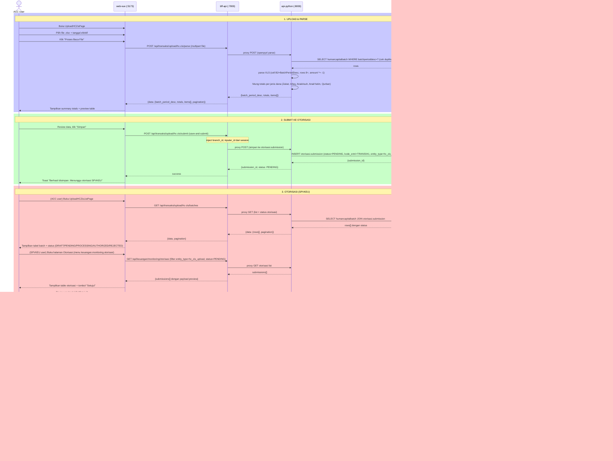

# Specs: Upload Data Penerimaan ZIS Rutin
**Portal**: zakat
**Domain**: `transaksi` (upload)
**Tipe**: Upload/Batch + Approval Workflow (Otorisasi Maker-Checker)
**Legacy Ref**: `docs/legacy-apps/daf/dialogs/Transaksi/fUploadHCTrans*` (5 dialogs)
**Tanggal**: 2026-06-15

## Konteks

Sistem upload batch data penerimaan ZIS (Zakat, Infaq, Sedekah) dari payroll karyawan internal perusahaan. File Excel per periode bulan berisi daftar karyawan dan nominal ZIS mereka. Sistem otomatis membuat donor baru untuk karyawan belum terdaftar, kemudian menghasilkan transaksi penghimpunan dan jurnal akuntansi. Workflow mengikuti maker-checker: ACC upload + submit → SPVKEU approve → background dispatcher eksekusi transaksi.

## Alur Data



## Endpoint Contract

### POST /api/transaksi/upload/hc-zis/parse
**Auth**: `require_menu("transaksi.upload.zis-rutin")`
**Content-Type**: `multipart/form-data`

**Form data**:
- `file` (binary, .xlsx/.xls)
- `tanggal_transaksi` (string ISO YYYY-MM-DD)

**Response** (success):
```json
{
  "data": {
    "batch_period_desc": "PERIODE 2026-06",
    "totals": {
      "zakat_amount": 5000000.00,
      "zakat_count": 50,
      "infaq_amount": 1000000.00,
      "infaq_count": 45,
      "anak_asuh_amount": 500000.00,
      "anak_asuh_count": 30,
      "anak_yatim_amount": 300000.00,
      "anak_yatim_count": 20,
      "wakaf_amount": 0.00,
      "wakaf_count": 0,
      "taqurma_amount": 2000000.00,
      "taqurma_count": 25,
      "grand_total": 8800000.00,
      "grand_count": 170
    },
    "items": [
      {
        "data_no": 1,
        "employee_number": "E001234",
        "employee_name": "Budi Santoso",
        "business_area_code": "DIV01",
        "business_area_desc": "Divisi Operasional",
        "birth_place": "Jakarta",
        "work_area_name": "Kantor Pusat",
        "mobile_phone": "08123456789",
        "birth_date": "1990-01-15",
        "gender": "L",
        "marital_status": "K",
        "position": "Manager",
        "organization_unit": "IT",
        "zakat_amount": 100000.00,
        "infaq_amount": 50000.00,
        "anak_asuh_amount": 0.00,
        "anak_yatim_amount": 0.00,
        "wakaf_amount": 0.00,
        "taqurma_amount": 100000.00,
        "total_amount": 250000.00
      }
    ]
  },
  "meta": { "request_id": "..." }
}
```

**Error responses**:
- `400 BAD_REQUEST` — file tidak valid / format bukan .xlsx / B2 kosong
- `409 CONFLICT` — BatchPeriodDesc sudah ada di DB
- `422 VALIDATION_ERROR` — baris data tidak valid (tipe data, kolom kosong)

### POST /api/transaksi/upload/hc-zis/submit
**Auth**: `require_menu("transaksi.upload.zis-rutin")`
**Body**:
```json
{
  "batch_period_desc": "PERIODE 2026-06",
  "tanggal_transaksi": "2026-06-15",
  "totals": {
    "zakat_amount": 5000000.00,
    "zakat_count": 50,
    "infaq_amount": 1000000.00,
    "infaq_count": 45,
    "anak_asuh_amount": 500000.00,
    "anak_asuh_count": 30,
    "anak_yatim_amount": 300000.00,
    "anak_yatim_count": 20,
    "wakaf_amount": 0.00,
    "wakaf_count": 0,
    "taqurma_amount": 2000000.00,
    "taqurma_count": 25,
    "grand_total": 8800000.00,
    "grand_count": 170
  },
  "items": [
    { "employee_number": "E001234", "employee_name": "Budi Santoso", ... }
  ]
}
```

*Note: `inputer_id` dan `branch_id` diinject oleh BFF dari session — tidak perlu dikirim frontend.*

**Response** (PENDING):
```json
{
  "data": {
    "submission_id": 123,
    "status": "PENDING",
    "kode_entri": "TRANS041",
    "entity_type": "hc_zis_upload"
  },
  "meta": { "request_id": "..." }
}
```

### GET /api/transaksi/upload/hc-zis/batches
**Auth**: `require_menu("transaksi.upload.zis-rutin-list")`
**Query params**:
- `page` (int, default=1)
- `limit` (int, default=25)
- `batch_period_desc` (string, optional filter)
- `date_from` (string ISO YYYY-MM-DD, optional)
- `date_to` (string ISO YYYY-MM-DD, optional)

**Response**:
```json
{
  "data": [
    {
      "batch_id": 1,
      "batch_period_desc": "PERIODE 2026-06",
      "tanggal_transaksi": "2026-06-15",
      "upload_user_id": "ACC_USER_001",
      "upload_date": "2026-06-15T10:30:00Z",
      "status_otorisasi": "AUTHORIZED",
      "grand_total": 8800000.00,
      "grand_count": 170
    }
  ],
  "pagination": { "page": 1, "limit": 25, "total": 45, "total_pages": 2 },
  "meta": { "request_id": "..." }
}
```

### GET /api/transaksi/upload/hc-zis/batches/{batch_id}
**Auth**: `require_menu("transaksi.upload.zis-rutin-list")`

**Response**:
```json
{
  "data": {
    "batch_id": 1,
    "batch_period_desc": "PERIODE 2026-06",
    "tanggal_transaksi": "2026-06-15",
    "upload_user_id": "ACC_USER_001",
    "upload_date": "2026-06-15T10:30:00Z",
    "status_otorisasi": "AUTHORIZED",
    "submission_id": 123,
    "totals": { ... },
    "items": [
      {
        "batch_item_id": 101,
        "employee_number": "E001234",
        "employee_name": "Budi Santoso",
        "zakat_amount": 100000.00,
        "infaq_amount": 50000.00,
        "anak_asuh_amount": 0.00,
        "anak_yatim_amount": 0.00,
        "wakaf_amount": 0.00,
        "taqurma_amount": 100000.00,
        "total_amount": 250000.00,
        "is_create_employee_data": "T",
        "donor_id": 5001
      }
    ]
  },
  "meta": { "request_id": "..." }
}
```

### PUT /api/transaksi/upload/hc-zis/batches/{batch_id}/date
**Auth**: `require_menu("transaksi.upload.zis-rutin")`
**Body**:
```json
{
  "tanggal_transaksi": "2026-06-20"
}
```

**Response** (PENDING):
```json
{
  "data": {
    "submission_id": 124,
    "status": "PENDING",
    "kode_entri": "TRANS044",
    "entity_type": "hc_zis_update_date"
  },
  "meta": { "request_id": "..." }
}
```

### DELETE /api/transaksi/upload/hc-zis/batches/{batch_id}
**Auth**: `require_menu("transaksi.upload.zis-rutin")`

**Response** (PENDING):
```json
{
  "data": {
    "submission_id": 125,
    "status": "PENDING",
    "kode_entri": "TRANS043",
    "entity_type": "hc_zis_delete"
  },
  "meta": { "request_id": "..." }
}
```

## Database

**Business DB**: `mziss_laz` (portal zakat)

### Tabel Target

#### `transaction.humancapitalbatch`
Menyimpan header batch upload HC/payroll per periode.

| Kolom | Type | Keterangan |
|---|---|---|
| `batch_id` | INTEGER PK | Auto sequence |
| `description` | VARCHAR(200) | Deskripsi batch |
| `batch_period_desc` | VARCHAR(50) | **UNIQUE** — dari cell B2 XLS (e.g., "PERIODE 2026-06") |
| `upload_date` | TIMESTAMP | Waktu upload |
| `upload_user_id` | VARCHAR(50) | User yang upload (dari session) |
| `transaction_date` | TIMESTAMP | Tanggal efektif transaksi (default = hari ini) |

#### `transaction.humancapitalbatchitem`
Menyimpan baris-baris item dari file XLS (per karyawan per jenis dana).

| Kolom | Type | Keterangan |
|---|---|---|
| `batch_item_id` | INTEGER PK | Auto sequence |
| `batch_id` | INTEGER FK | → `humancapitalbatch.batch_id` |
| `description` | VARCHAR(200) | Keterangan item |
| `transaction_id` | INTEGER | Link ke `transaction.transaction` setelah authorize |
| `business_area_code` | VARCHAR(10) | Kode area bisnis |
| `business_area_description` | VARCHAR(200) | Deskripsi area |
| `employee_number` | VARCHAR(30) | NIP karyawan |
| `name` | VARCHAR(200) | Nama karyawan |
| `birth_date` | TIMESTAMP | Tanggal lahir |
| `birth_place` | VARCHAR(150) | Tempat lahir |
| `gender` | VARCHAR(10) | L/P |
| `marital_status` | VARCHAR(20) | K/B/S |
| `position` | VARCHAR(200) | Jabatan |
| `organizational_unit` | VARCHAR(200) | Unit organisasi |
| `amount_zakat` | DOUBLE | Nominal zakat |
| `amount_infaq` | DOUBLE | Nominal infaq |
| `amount_anak_yatim` | DOUBLE | Nominal anak yatim |
| `amount_anak_asuh` | DOUBLE | Nominal anak asuh |
| `amount_wakaf` | DOUBLE | Nominal wakaf (**TIDAK diproses**) |
| `amount_qurban` | DOUBLE | Nominal qurban |
| `is_create_employee_data` | VARCHAR(1) | T/F: donor baru dibuat dari baris ini |
| `donor_id` | INTEGER FK | → `fund.donor.donor_id` |
| `work_area_name` | VARCHAR(100) | Nama area kerja |
| `mobile_phone` | VARCHAR(20) | No. HP |
| `smslog_id` | INTEGER | SMS log (opsional — IsSendSMS di-force F) |
| `smslog_time` | TIMESTAMP | Waktu SMS |

#### `transaction.humancapitalpassedreport`
Menyimpan donatur internal yang **tidak ada** di file batch (absen).

| Kolom | Type | Keterangan |
|---|---|---|
| `report_id` | INTEGER PK | Auto sequence |
| `batch_id` | INTEGER FK | → `humancapitalbatch.batch_id` |
| `employee_number` | VARCHAR(30) | NIP karyawan absen |
| `donor_id` | INTEGER FK | → `fund.donor.donor_id` |

### Tabel yang Dimodifikasi

| Tabel | Operasi | Keterangan |
|---|---|---|
| `fund.donor` | INSERT | Donor baru (DonorGroup='R', DonorType='I', DonorNo='P'+7digit) |
| `fund.individual_donor` | INSERT/UPDATE | IsInternalEmployee='T' |
| `fund.donor_commitment` | INSERT/UPDATE | Upsert komitmen rutin per account |
| `fund.donor_commitment_history` | INSERT | Trail perubahan komitmen |
| `fund.donor_field_history` | INSERT | Trail perubahan field donatur |
| `fund.custom_idgen` | UPDATE | Counter ID donatur prefix P |
| `transaction.transaction` | INSERT | 1–5 per baris (per jenis dana) |
| `transaction.transaction_item` | INSERT | 2 per transaksi (product + bank) |
| `transaction.account_transaction_item` | INSERT | Item akuntansi |
| `transaction.donor_total_fund` | UPDATE | Saldo donasi per donor per fundentity |
| `transaction.financial_account` | UPDATE | Saldo rekening bank + product |
| `transaction.journal` | INSERT | 1 per transaksi |
| `transaction.journal_item` | INSERT | Items jurnal |
| `transaction.journal_block` | INSERT | Block jurnal |
| `transaction.transaction_batch` | GET/CREATE | Batch harian (BatchTag='OPR') |
| `transaction.trans_history_of_changes` | INSERT | Audit trail (ChangeType=N/E/D) |

## Discriminators (Hardcoded)

**Kritis untuk query dan validasi:**

| Kolom | Value | Keterangan |
|---|---|---|
| `transaction.transaction_code` | `'SD002'` | Identifikasi transaksi HC/payroll (BUKAN SD001) |
| `transaction.channel_code` | `'A'` | Channel "auto/payroll" |
| `transaction.transaction_number` prefix | `'BPZIS'` | Format nomor transaksi |
| `transaction_item.account_ti_type` | `'D'` | Product account (donor side) |
| `transaction_item.account_ti_type` | `'C'` | Bank/kas account (counter side) |
| `fund_entity` | `1` | Zakat |
| `fund_entity` | `2` | Infaq, AnakAsuh, AnakYatim, Qurban |
| `fund_entity` | `3` | Wakaf (**SKIP — tidak diproses**) |
| `individual_donor.is_internal_employee` | `'T'` | Karyawan perusahaan |
| `donor.donor_group` | `'R'` | Donatur rutin (dari HC batch) |
| `donor.donor_type` | `'I'` | Individual |
| `donor.donor_no` prefix | `'P'` | Kode donatur HC: P + 7 digit |
| `humancapitalbatchitem.is_create_employee_data` | `'T'` | Donor baru |
| `humancapitalbatchitem.is_create_employee_data` | `'F'` | Donor existing |
| `transaction_batch.batch_tag` | `'OPR'` | Batch operasional harian |
| `trans_history_of_changes.change_type` | `'N'` | Create baru |
| `trans_history_of_changes.change_type` | `'E'` | Edit (update tanggal) |
| `trans_history_of_changes.change_type` | `'D'` | Delete |

## Menu Key & Roles

| Key | Label | Roles | Parent |
|---|---|---|---|
| `transaksi.upload.zis-rutin` | Upload Data Penerimaan ZIS Rutin | ACC | Transaksi → Upload |
| `transaksi.upload.zis-rutin-list` | List Upload Data Penerimaan ZIS Rutin | ACC | Transaksi → Upload |
| `keuangan.monitoring.otorisasi` | Monitoring Otorisasi | SPVKEU | Keuangan → Monitoring |

*Note: Role ACC untuk upload + list. Role SPVKEU untuk approve di halaman Otorisasi (shared menu key).*

## Workflow Status

Status mengikuti otorisasi maker-checker isf-app:

```
DRAFT → PENDING (setelah save-and-submit)
      → PROCESSING (saat SPVKEU approve)
      → AUTHORIZED (background dispatcher selesai)
      ↘ PENDING (jika dispatcher gagal + dispatch_error terisi)
      ↘ REJECTED (jika supervisor tolak → ACC bisa revisi ke DRAFT)
```

### Otorisasi Codes (Operasi)

| Operasi | Kode Entri | Approver | Entity Type | Dispatcher |
|---|---|---|---|---|
| Upload baru | `TRANS041` | SPVKEU | `hc_zis_upload` | `hc_zis_service.create_from_payload` |
| Hapus batch | `TRANS043` | SPVKEU | `hc_zis_delete` | `hc_zis_service.delete_from_payload` |
| Update tanggal | `TRANS044` | SPVKEU | `hc_zis_update_date` | `hc_zis_service.update_date_from_payload` |

## UI Components

### Pages

#### 1. UploadHCZisPage.vue
Route: `/transaksi/upload/zis-rutin`
Menu key: `transaksi.upload.zis-rutin`

**Sections:**
- **Header**: File picker (XLS/XLSX), DateField TanggalTransaksi (default=today)
- **Button**: "Proses Baca File" → POST /parse (disabled sebelum file dipilih)
- **Totals** (muncul setelah parse berhasil): Label BatchPeriodDesc, tabel 2-kolom (Jenis Dana | Nominal | Jumlah Donatur)
- **Preview Table**: DataTable read-only — Kolom: No, NIP, Nama, Zakat, Infaq, Anak Asuh, Anak Yatim, Wakaf (hidden), Taqurma, Total, HP
- **Actions**: Button "Simpan" + "Batal"
- **Empty State**: Placeholder "Pilih file untuk memulai"

#### 2. UploadHCZisListPage.vue
Route: `/transaksi/upload/zis-rutin/list`
Menu key: `transaksi.upload.zis-rutin-list`

**Components:**
- **Toolbar**: SearchInput (batch_period_desc), DateRangeFilter (tanggal_mulai, tanggal_sampai)
- **Paginator** (standalone, di atas, default 25 rows)
- **DataTable lazy**: Kolom: BatchPeriodDesc, TanggalTransaksi, UploadUserId, StatusOtorisasi, GrandTotal, GrandCount
- **Row Actions**: [View] → Drawer Detail, [Edit Tanggal] → Modal, [Hapus] → Modal
- **Showing X–Y of Z records**

#### 3. UploadHCZisDetailDrawer.vue
Slide panel dari kanan (triggered saat [View] diklik).

**Content:**
- Header: BatchPeriodDesc, TanggalTransaksi, UploadUserId, StatusOtorisasi
- DataTable read-only (item list): kolom sama dengan preview (No, NIP, Nama, Jenis Dana, Nominal, Total, HP)
- Footer: Close button

#### 4. UploadHCZisUpdateDateModal.vue
Modal untuk update tanggal transaksi (triggered saat [Edit Tanggal] diklik).

**Content:**
- Read-only: BatchPeriodDesc, TanggalTransaksi lama
- Editable: DateField TanggalTransaksi baru
- Buttons: [Simpan] → PUT /batches/{id}/date (save-and-submit), [Batal]

#### 5. UploadHCZisDeleteModal.vue
Modal untuk delete batch (triggered saat [Hapus] diklik).
Sesuai rule MEMORY.md "delete via form modal": tampilkan data lengkap sebelum confirm.

**Content:**
- Read-only form: BatchPeriodDesc, TanggalTransaksi, summary totals (tabel 2-kolom Jenis Dana | Nominal)
- Confirm message: "Anda yakin akan menghapus batch dan semua transaksi yang sudah dibuat?"
- Buttons: [Hapus] → DELETE /batches/{id} (save-and-submit), [Batal]

## Error Handling

### UI-side Validations
- File tidak dipilih: Button "Proses Baca File" disabled
- Berkas bukan Excel: Toast error "Format file harus .xlsx atau .xls"
- Tidak ada items setelah parse: Toast error "File tidak memiliki data karyawan"
- TanggalTransaksi kosong: Toast error "Tanggal transaksi harus diisi"

### API-side Validations (400/422)
- BatchPeriodDesc duplikat → `409 CONFLICT` — Toast "Periode batch sudah ada di sistem"
- Format file tidak valid → `400 BAD_REQUEST` — Toast + show details
- Cell B2 kosong → `400 BAD_REQUEST` — Toast "Periode batch tidak ditemukan di file"
- Data row tidak valid (kolom kosong / tipe data salah) → `422 VALIDATION_ERROR` — Toast + highlight baris

### Authorization (403)
- User tidak punya menu key → `403 MENU_DENIED` — redirect atau show "Akses Ditolak"

### Background Task Failures
Jika dispatcher gagal (e.g., limit bank terlampaui, parameter tidak lengkap), status kembali ke `PENDING` + `dispatch_error` terisi. UI polling mendeteksi dan tampilkan toast error dengan pesan dispatcher.

## Catatan Implementasi

1. **File parse server-side**: Gunakan `openpyxl` library (bukan legacy pyFlexcel). Cell B2 → BatchPeriodDesc, rows mulai row 8, amount dikali -1 (nilai file negatif).

2. **Satu baris → hingga 5 transaksi**: Setiap baris karyawan bisa menghasilkan transaksi terpisah per jenis dana (Zakat=FundEntity 1, Infaq/AnakAsuh/AnakYatim/Qurban=FundEntity 2). **Wakaf SKIP (FundEntity 3)**.

3. **Auto-create donor**: Menggunakan SQL batch bukan ORM loop. Kritis untuk performa saat file ratusan baris. Donor baru: DonorGroup='R', DonorType='I', DonorNo='P'+7digit (custom_idgen counter).

4. **Delete dengan temp table**: Tidak bisa cascade ORM biasa. Harus `SELECT FOR UPDATE NOWAIT` untuk lock, `UPDATE` balance (DonorTotalFund, FinancialAccount), `DELETE` dalam urutan correct (jurnal → transaksi → batch → items).

5. **Update tanggal → update jurnal period**: `journal.fl_accountingperiode` (MONTH) dan `journal.fl_accountingyear` (YEAR) harus ikut diupdate. Kritis untuk laporan per periode.

6. **IsSendSMS di-force F**: Meskipun field ada, nilai selalu 'F' sebelum authorize loop.

7. **Urutan step authorize** (jangan diubah):
   - FlushUpdates setelah insert batch items
   - Sinkronisasi donor existing
   - Generate donor baru (SQL batch)
   - Update DonorCommitment
   - FlushUpdates lagi
   - Buat transaksi + jurnal per item

8. **BFF session injection**: `branch_id` dan `inputer_id` (user_id) diinject dari session BFF, bukan dari frontend.

9. **ParameterGlobal keys**: BANKZAKAT, BANKINFAQ, BANKASUH, BANKYATIM, BANKQURBAN — harus semua terisi di `enterprise.parameter_global` agar authorize berjalan.

10. **Wakaf dinonaktifkan**: Field ada di form/table untuk backward compatibility, tapi `amount_wakaf` tidak menghasilkan transaksi apapun saat authorize.
