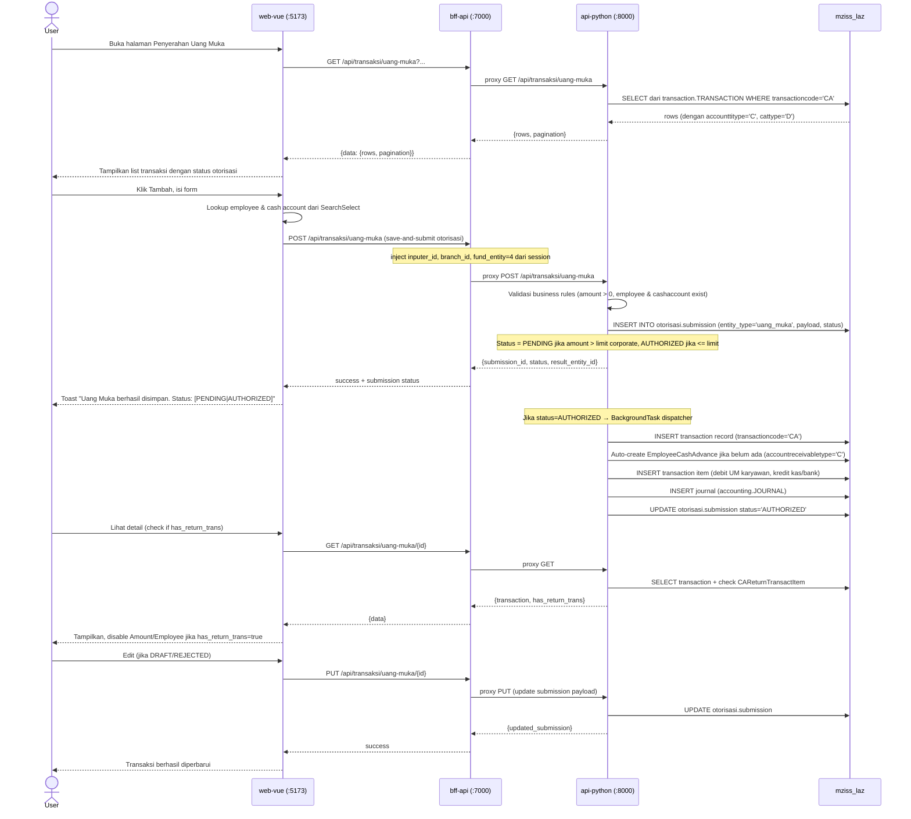

# Specs: Transaksi Penyerahan Uang Muka

**Portal**: zakat
**Domain**: `transaksi` (menu key prefix: keuangan.transaksi)
**Tipe**: CRUD + Approval Workflow (otorisasi)
**Legacy Ref**: `docs/legacy-apps/core/dialogs/Transaksi/fCashAdvance.*`
**Tanggal**: 2026-06-15

## Konteks

Transaksi Penyerahan Uang Muka (Cash Advance) memungkinkan inputer untuk mencatat pemberian uang muka kepada karyawan, baik untuk kebutuhan operasional maupun kegiatan. Uang muka ini nantinya dapat dikembalikan/dilaporkan melalui mekanisme LPJ (Laporan Pertanggungjawaban). Transaksi berjalan melalui jalur **otorisasi maker-checker** dengan auto-approval berdasarkan limit corporate. Fitur juga menyediakan rekening piutang otomatis untuk setiap karyawan penerima uang muka.

## Alur Data



## Endpoint Contract

### GET /api/transaksi/uang-muka
**Auth**: `require_menu("keuangan.transaksi.uang-muka-penyerahan")`
**Query params**:
- `page` (int, default=1)
- `limit` (int, default=25)
- `begin_date` (date, optional) — filter: tanggal posting >= begin_date
- `end_date` (date, optional) — filter: tanggal posting <= end_date
- `employee_id` (int, optional) — filter by employee
- `return_status` (enum: all|returned|not_returned, optional) — filter LPJ status
- `auth_status` (enum: all|pending|authorized, optional) — filter otorisasi status

**Response**:
```json
{
  "data": {
    "rows": [
      {
        "id": 1,
        "transaction_id": 101,
        "transaction_no": "KK-2026-001-KS-0000001",
        "actual_date": "2026-06-15",
        "employee_id": 5,
        "employee_name": "Budi Santoso",
        "cash_account_no": "1101001",
        "amount": 500000.00,
        "reference_no": "CHK-001",
        "description": "Uang muka kegiatan",
        "received_from": "HADI",
        "auth_status": "AUTHORIZED",
        "has_return_trans": false
      }
    ],
    "pagination": { "page": 1, "limit": 25, "total": 100, "total_pages": 4 }
  },
  "meta": { "request_id": "..." }
}
```

### POST /api/transaksi/uang-muka
**Auth**: `require_menu("keuangan.transaksi.uang-muka-penyerahan.tambah")`
**Body**:
```json
{
  "actual_date": "2026-06-15",
  "employee_id": 5,
  "cash_account_no": "1101001",
  "amount": 500000.00,
  "reference_no": "CHK-001",
  "description": "Uang muka kegiatan",
  "received_from": "HADI",
  "budget_id": 0,
  "real_memo_id": 0
}
```

*Note: `inputer_id`, `branch_code`, dan `fund_entity=4` (Amil) diinject oleh BFF dari session — tidak perlu dikirim frontend.*

**Response**:
```json
{
  "data": {
    "submission_id": 501,
    "transaction_id": 101,
    "transaction_no": "KK-2026-001-KS-0000001",
    "status": "AUTHORIZED",
    "message": "Penyerahan uang muka berhasil disimpan"
  }
}
```

### GET /api/transaksi/uang-muka/{id}
**Auth**: `require_menu("keuangan.transaksi.uang-muka-penyerahan")`

**Response**:
```json
{
  "data": {
    "id": 1,
    "transaction_id": 101,
    "transaction_no": "KK-2026-001-KS-0000001",
    "actual_date": "2026-06-15",
    "employee_id": 5,
    "employee_name": "Budi Santoso",
    "cash_account_no": "1101001",
    "cash_account_name": "Kas Kantor",
    "amount": 500000.00,
    "reference_no": "CHK-001",
    "description": "Uang muka kegiatan",
    "received_from": "HADI",
    "budget_id": 0,
    "real_memo_id": 0,
    "auth_status": "AUTHORIZED",
    "has_return_trans": false,
    "can_edit": true,
    "can_delete": false
  }
}
```

### PUT /api/transaksi/uang-muka/{id}
**Auth**: `require_menu("keuangan.transaksi.uang-muka-penyerahan.ubah")`
**Body**: (sama dengan POST, namun hanya field tertentu yg bisa diupdate jika belum LPJ)
```json
{
  "actual_date": "2026-06-15",
  "amount": 600000.00,
  "reference_no": "CHK-001",
  "description": "Uang muka kegiatan (updated)",
  "received_from": "HADI"
}
```

**Response**: `{ "data": { "id": 1, ... } }`

### DELETE /api/transaksi/uang-muka/{id}
**Auth**: `require_menu("keuangan.transaksi.uang-muka-penyerahan.hapus")`
**Kondisi**: Hanya bisa delete jika status DRAFT atau REJECTED

**Response**: `{ "data": { "id": 1, "message": "Deleted" } }`

### GET /api/lookup/employee
**Auth**: `require_menu("keuangan.transaksi.uang-muka-penyerahan")`
**Query params**:
- `search` (string, optional) — filter by employee name or ID number
- `branch_code` (string) — filter by branch

**Response**:
```json
{
  "data": [
    {
      "id": 5,
      "name": "Budi Santoso",
      "id_number": "E001",
      "branch_code": "001"
    }
  ]
}
```

### GET /api/lookup/cash-account
**Auth**: `require_menu("keuangan.transaksi.uang-muka-penyerahan")`
**Query params**:
- `branch_code` (string, required)
- `search` (string, optional)

**Response**:
```json
{
  "data": [
    {
      "account_no": "1101001",
      "account_name": "Kas Kantor",
      "cash_code": "KS"
    }
  ]
}
```

### GET /api/lookup/budget
**Auth**: `require_menu("keuangan.transaksi.uang-muka-penyerahan")`
**Query params**:
- `search` (string, optional)
- `actual_date` (date, optional) — filter budget yang aktif pada tanggal tersebut

**Response**:
```json
{
  "data": [
    {
      "id": 10,
      "budget_code": "BDG-001",
      "budget_name": "Kegiatan Sosial 2026",
      "owner": "Budi"
    }
  ]
}
```

## Database

**Tabel utama**:
- `transaction.TRANSACTION` (sudah ada) — menyimpan penyerahan UM dengan `transactioncode='CA'`
- `transaction.ACCOUNTRECEIVABLE` (sudah ada) — menyimpan rekening UM karyawan dengan `accountreceivabletype='C'`
- `transaction.ACCOUNTTRANSACTIONITEM` (sudah ada) — menyimpan item debit/kredit dengan `accounttitype='C'` dan `cattype='D'`
- `transaction.CASHADVANCEMEMOINFO` (sudah ada) — menyimpan link optional ke memo penyaluran
- `otorisasi.submission` (sudah ada) — menyimpan submission dengan `entity_type='uang_muka'`
- `otorisasi.entity_config` (sudah ada) — registrasi entity type

**DWH View**: `dwh.v_uang_muka_penyerahan` (baru dibuat dengan V###)

**Kolom kunci TRANSACTION**:
| Kolom | Type | Keterangan |
|---|---|---|
| `transactionid` | SERIAL | PK |
| `transactionno` | VARCHAR | Format: KK-{YYYY}-{branchCode}-{cashCode}-{seq7digit} |
| `actualdate` | DATE | Tanggal posting |
| `transactioncode` | VARCHAR | = 'CA' (Cash Advance) |
| `employeeid` | INTEGER | FK ke employee |
| `amount` | NUMERIC | Nominal uang muka |
| `authstatus` | VARCHAR | 'F'=PENDING, 'T'=AUTHORIZED |
| `inputer` | VARCHAR | User ID (dari session) |
| `branchcode` | VARCHAR | Cabang (dari session) |
| `receivedfrom` | VARCHAR | Kasir (default = inputer) |
| `referenceno` | VARCHAR | Nomor cek/kwitansi (optional) |
| `description` | VARCHAR | Keterangan (optional) |

**Kolom kunci ACCOUNTTRANSACTIONITEM**:
| Kolom | Type | Keterangan |
|---|---|---|
| `transactionitemid` | SERIAL | PK |
| `accounttitype` | VARCHAR | = 'C' (Cash Advance) |
| `cattype` | VARCHAR | = 'D' (Penyerahan) atau 'C' (Pengembalian) |
| `accountno` | VARCHAR | FK ke FinancialAccount (UM karyawan atau kas) |
| `funidentity` | INTEGER | = 4 (Amil) — hardcoded, tidak dari input |
| `mutation` | VARCHAR | 'D'=Debit, 'C'=Kredit |

**DWH View `dwh.v_uang_muka_penyerahan`**:
```sql
SELECT
  t.transactionid,
  t.transactionno,
  t.actualdate,
  t.transactiondate,
  t.referenceno,
  t.description,
  t.inputer,
  t.branchcode,
  t.authstatus,
  t.amount,
  t.receivedfrom,
  ar.employeeid,
  fa.accountname AS employee_name,
  ati_em.accountno AS employee_account_no,
  ati_ca.accountno AS cash_account_no,
  ca.accountname AS cash_account_name,
  CASE WHEN crti.transactionitemid IS NOT NULL THEN true ELSE false END AS has_return_trans
FROM transaction.transaction t
JOIN transaction.transactionitem ti ON ti.transactionid = t.transactionid
JOIN transaction.accounttransactionitem ati_em ON ati_em.transactionitemid = ti.transactionitemid
  AND ati_em.accounttitype = 'C' AND ati_em.cattype = 'D' AND ati_em.mutation = 'D'
JOIN transaction.financialaccount fa ON fa.accountno = ati_em.accountno
JOIN transaction.accountreceivable ar ON ar.accountno = ati_em.accountno
JOIN transaction.accounttransactionitem ati_ca ON ati_ca.transactionid = t.transactionid
  AND ati_ca.accounttitype IN ('A', 'L') AND ati_ca.mutation = 'C'
JOIN transaction.financialaccount ca ON ca.accountno = ati_ca.accountno
LEFT JOIN transaction.accounttransactionitem crti ON crti.returntransactionitemid = ati_em.transactionitemid
WHERE t.transactioncode = 'CA'
ORDER BY t.actualdate DESC
```

## Menu Key

| Key | Label | Roles | Sub-action |
|---|---|---|---|
| `keuangan.transaksi.uang-muka-penyerahan` | Penyerahan Uang Muka | ACC | — |
| `keuangan.transaksi.uang-muka-penyerahan.tambah` | (inherited) | ACC | POST |
| `keuangan.transaksi.uang-muka-penyerahan.ubah` | (inherited) | ACC | PUT |
| `keuangan.transaksi.uang-muka-penyerahan.hapus` | (inherited) | ACC | DELETE |

## Business Rules & Validasi

1. **Wajib isi**: `actual_date`, `employee_id`, `cash_account_no`, `amount` > 0
2. **Employee lookup**: SearchSelect dari `GET /api/lookup/employee`
3. **CashAccount lookup**: SearchSelect dari `GET /api/lookup/cash-account` (filter by branch)
4. **Budget optional**: Jika dipilih, simpan `budget_id` di submission payload
5. **Memo optional**: Jika dipilih, simpan `real_memo_id` di submission payload
6. **Fund Entity hardcoded**: `fund_entity = 4` (Amil) — diset otomatis, user tidak bisa ubah
7. **Auto-create EmployeeCashAdvance**: Jika employee belum punya rekening UM (accountreceivabletype='C'), dibuat otomatis saat dispatcher AUTHORIZED
8. **Has Return Trans check**: Di endpoint GET detail, cek apakah sudah ada CAReturnTransactItem terkait:
   - Jika `has_return_trans=true` → form edit HARUS disable field `amount`, `employee_id`, `cash_account_no`
   - Show pesan: "Transaksi ini sudah memiliki LPJ"
9. **Auto-approval limit**: Dispatcher cek limit corporate — jika `amount <= limit` → status='AUTHORIZED' otomatis; jika `> limit` → status='PENDING' (tunggu approval supervisor)
10. **Otorisasi jalur**: Selalu pakai `save-and-submit` endpoint (langsung PENDING jika > limit), bukan `submission/` (DRAFT — tidak muncul di halaman Otorisasi)

## Catatan Implementasi

- **Fund Entity = 4**: Jangan pernah ubah hardcoded value `fund_entity=4` (Amil) — ini menentukan kode akun jurnal yang benar per legacy DAF
- **Discriminators KRITIS**: Implementasi HARUS selalu filter dengan:
  - `transactioncode = 'CA'`
  - `accounttitype = 'C'`
  - `cattype = 'D'` (untuk penyerahan; cattype='C' untuk pengembalian/LPJ)
  - `accountreceivabletype = 'C'` (untuk rekening UM karyawan)
- **TransactionNo format**: `KK-{YYYY}-{branchCode}-{cashCode}-{seq7digit}` — perlu lookup cashCode dari cashaccount, dan nextval sequence dari DB
- **Delete hanya DRAFT/REJECTED**: Update field `status='DELETED'` di otorisasi.submission atau hard delete tergantung policy (konsultasi nuwis-architect)
- **Async dispatcher**: Saat status=AUTHORIZED, BackgroundTask di api-python menjalankan dispatcher setelah response ke BFF. Jangan block request — return PROCESSING/AUTHORIZED lalu background insert transaksi
- **Report laporan**: 2 laporan terpisah (Rekapitulasi + List) akan dibuat di iterasi berikutnya, bukan di fitur ini
