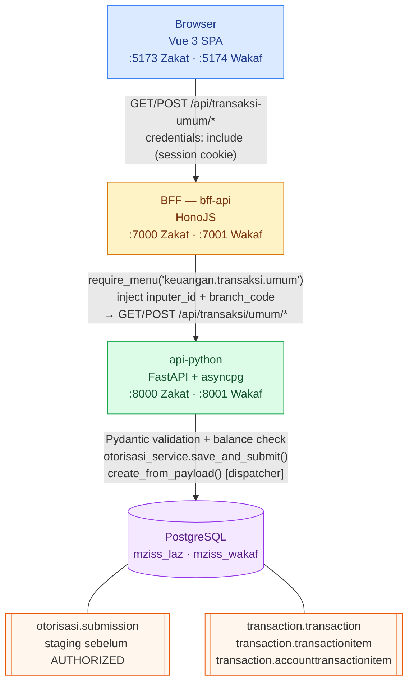
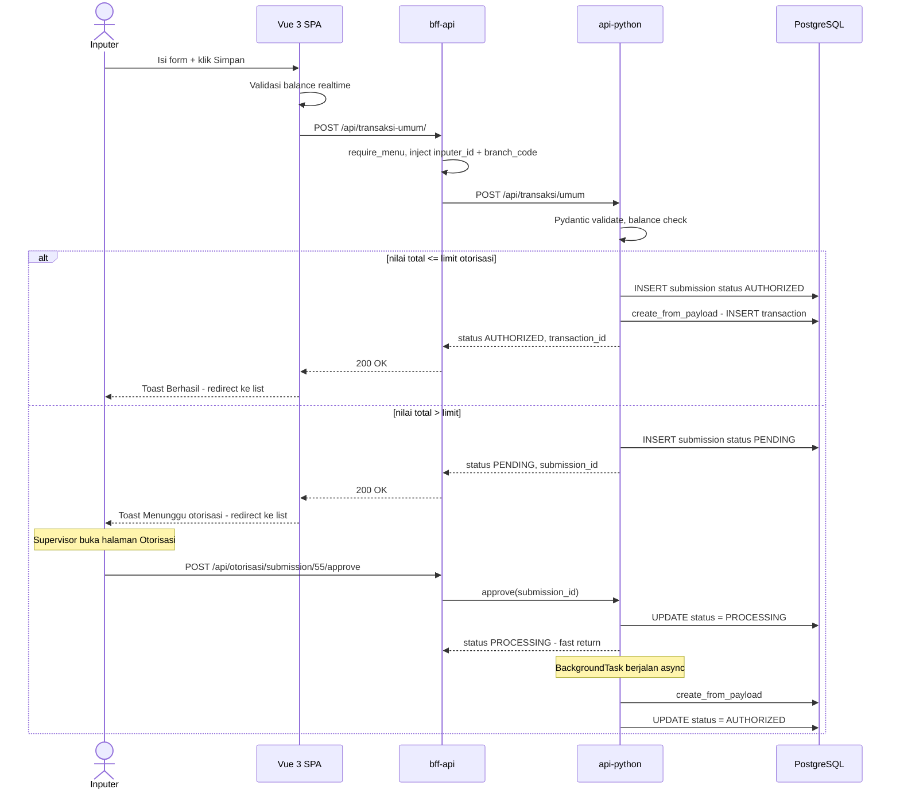
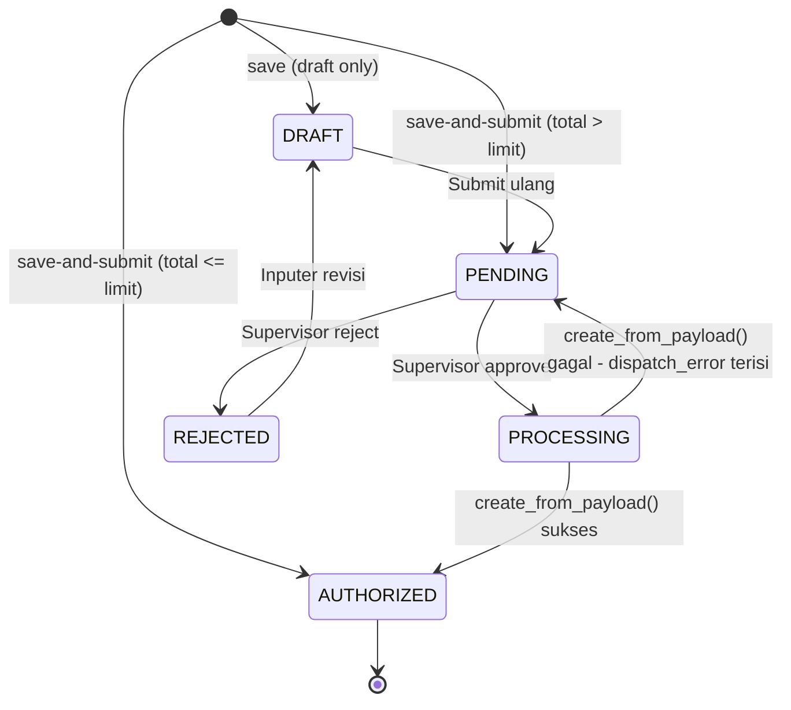

# Functional Specification Document (FSD)
## Transaksi Umum — Sistem Aplikasi ZISWAF

| | |
|---|---|
| **Versi** | 1.2 |
| **Status** | Active |
| **Tanggal** | 2026-06-19 |
| **Kode Transaksi** | `GT` |
| **Menu Key** | `keuangan.transaksi.umum` |

---

## 1. Arsitektur

### 1.1 Layer Diagram



### 1.2 Alur Create Transaksi (Sequence)



**Service boundaries:**
- **BFF**: auth guard, session extraction, branch resolution, proxy ke api-python
- **api-python**: business logic, Pydantic validation, DB writes via asyncpg
- **Frontend**: UX, real-time balance check (duplikasi dari backend untuk responsivitas)

---

## 2. Data Model

### 2.1 `transaction.transaction` (tabel utama setelah authorized)

| Kolom | Tipe | Nilai untuk GT |
|-------|------|----------------|
| `transactionid` | serial PK | — |
| `transactionno` | varchar | `GT-{YYYY}-{branch}-{seq:07d}` |
| `transactioncode` | varchar | `'GT'` |
| `actualdate` | date | tanggal transaksi |
| `description` | varchar | deskripsi transaksi |
| `referenceno` | varchar | no. referensi (nullable) |
| `branchcode` | varchar(3) | kode cabang |
| `inputerid` | integer | user_id inputer |
| `authstatus` | char(1) | `'T'` (saat insert, diupdate ke `'A'` oleh otorisasi) |
| `isposted` | boolean | `false` |
| `channelcode` | varchar | `'10'` |
| `amount` | numeric | sum of Debit items |
| `journalnoblockid` | integer | FK ke `journalblock` |

### 2.2 `transaction.transactionitem`

| Kolom | Tipe | Keterangan |
|-------|------|------------|
| `transactionitemid` | serial PK | — |
| `transactionid` | integer FK | ke `transaction` |
| `transactionitemtype` | char(1) | `'G'` (GL), `'A'` (B/C/D) |
| `account_code` | varchar | kode akun COA (tipe G) atau null |
| `account_name` | varchar | nama akun |
| `refaccountno` | varchar | no. rekening (tipe B/C/D) |
| `mutationtype` | char(1) | `'D'` atau `'C'` |
| `amount` | numeric | nilai IDR |
| `description` | varchar | keterangan baris |
| `itemtype_discriminator` | char(1) | `'G'`, `'B'`, `'C'`, `'D'` |

### 2.3 `transaction.accounttransactionitem` (tipe B, C, D saja)

| Kolom | Tipe | Tipe B | Tipe C | Tipe D |
|-------|------|--------|--------|--------|
| `accounttitype` | char(1) | `'A'` | `'D'` | `'Z'` |
| `accountno` | varchar | no. rekening | produk penghimpunan | program penyaluran |
| `fundentity` | integer | null | 1–5 | 1–5 |
| `donorid` | integer | null | donor_id | null |
| `ashnaf` | char(1) | null | null | F/M/U/H/G/S/I/A |
| `distributionitemaccount` | varchar | null | null | no. program |
| `fundaccountno` | varchar | null | null | no. sumber dana |

### 2.4 `otorisasi.submission` (sebelum authorized)

```sql
entity_type = 'transaksi_umum'
payload = {
  actual_date: 'YYYY-MM-DD',
  description: string,
  reference_no: string|null,
  inputer_id: integer,
  branch_code: string,
  items: [...]
}
```

---

## 3. API Contracts

### 3.1 BFF Endpoints (`/api/transaksi-umum/`)

**Auth:** Session cookie. Semua endpoint require `menu_key = 'keuangan.transaksi.umum'`.

---

#### `GET /api/transaksi-umum/`

**Query params:**

| Parameter | Tipe | Default | Keterangan |
|-----------|------|---------|------------|
| `page` | int | 1 | Halaman |
| `limit` | int | 25 | Baris per halaman |
| `date_from` | string | — | Format: `YYYY-MM-DD` |
| `date_to` | string | — | Format: `YYYY-MM-DD` |
| `search` | string | — | Partial match nomor/deskripsi |

BFF menambahkan `branch_code` jika `branch_access == 'single'`.

**Response 200:**
```json
{
  "data": {
    "rows": [
      {
        "transactionid": 42,
        "transactionno": "GT-2026-001-0000042",
        "actual_date": "2026-06-19",
        "description": "Penyesuaian saldo akhir bulan",
        "reference_no": null,
        "amount": 5000000,
        "authstatus": "A",
        "inputer": "HADI",
        "branch_code": "001"
      }
    ],
    "pagination": {
      "page": 1,
      "limit": 25,
      "total": 142,
      "total_pages": 6
    }
  },
  "meta": { "request_id": "uuid" }
}
```

---

#### `GET /api/transaksi-umum/{transaction_id}`

**Response 200:**
```json
{
  "data": {
    "transactionid": 42,
    "transactionno": "GT-2026-001-0000042",
    "actual_date": "2026-06-19",
    "description": "Penyesuaian saldo akhir bulan",
    "reference_no": null,
    "amount": 5000000,
    "authstatus": "A",
    "inputer": "HADI",
    "branch_code": "001",
    "items": [
      {
        "transactionitemid": 101,
        "item_type": "B",
        "account_code": null,
        "account_name": "Kas Tunai Pusat",
        "mutation_type": "D",
        "amount": 5000000,
        "description": "Penerimaan"
      },
      {
        "transactionitemid": 102,
        "item_type": "G",
        "account_code": "110101",
        "account_name": "Piutang Karyawan",
        "mutation_type": "C",
        "amount": 5000000,
        "description": "Pelunasan piutang"
      }
    ]
  },
  "meta": { "request_id": "uuid" }
}
```

**Response 404:**
```json
{
  "error": { "code": "NOT_FOUND", "message": "Transaksi tidak ditemukan" },
  "meta": { "request_id": "uuid" }
}
```

---

#### `POST /api/transaksi-umum/`

**Request body:**
```json
{
  "actual_date": "2026-06-19",
  "description": "Penyesuaian saldo akhir bulan",
  "reference_no": "KWT-001",
  "items": [
    {
      "item_type": "B",
      "account_no": "11010101",
      "account_name": "Kas Tunai Pusat",
      "mutation_type": "D",
      "amount": 5000000,
      "nominal": 5000000,
      "valuta": "IDR",
      "kurs": 1,
      "description": "Penerimaan tunai"
    },
    {
      "item_type": "G",
      "account_code": "110101",
      "account_name": "Piutang Karyawan",
      "mutation_type": "C",
      "amount": 5000000,
      "nominal": 5000000,
      "valuta": "IDR",
      "kurs": 1,
      "description": "Pelunasan piutang",
      "kode_anggaran": "",
      "ket_anggaran": ""
    }
  ]
}
```

*BFF menambahkan `inputer_id` dan `branch_code` sebelum meneruskan ke api-python.*

**Response 200 (AUTHORIZED / PENDING):**
```json
{
  "data": {
    "submission_id": 55,
    "status": "PENDING",
    "transaction_id": null,
    "bypassed_auth": false,
    "entity_type": "transaksi_umum"
  },
  "meta": { "request_id": "uuid" }
}
```

**Response 200 (auto-AUTHORIZED):**
```json
{
  "data": {
    "submission_id": 55,
    "status": "AUTHORIZED",
    "transaction_id": 42,
    "bypassed_auth": true,
    "entity_type": "transaksi_umum"
  }
}
```

**Response 422 (validation error):**
```json
{
  "error": {
    "code": "VALIDATION_ERROR",
    "message": "Jurnal belum balance: total debit 5000000 != total kredit 4500000",
    "details": null
  }
}
```

---

#### `DELETE /api/transaksi-umum/{transaction_id}`

Hapus transaksi dengan aturan:
- **Transaksi AUTHORIZED** (`transaction.*`): tidak bisa dihapus — gunakan transaksi koreksi baru (sesuai BR10)
- **Submission DRAFT/PENDING** (`otorisasi.submission`): hanya bisa dihapus oleh inputer yang sama (`submitted_by == user_id`); BFF menggunakan endpoint `DELETE /api/otorisasi/submission/{id}`
- **Transaksi PROCESSING**: tidak bisa dihapus — sedang diproses background

*Frontend menentukan endpoint yang dipanggil berdasarkan `_kind`: `'tx'` → `DELETE /api/transaksi-umum/{transactionid}`, `'sub'` → `DELETE /api/otorisasi/submission/{id}`.*

**Response 200:** `{ "data": { "deleted": true } }`
**Response 403:** Bukan milik user / sudah AUTHORIZED / sedang PROCESSING.
**Response 404:** ID tidak ditemukan.

---

#### `GET /api/transaksi-umum/lookup/kasbank?search=...`

**Response 200:**
```json
{
  "data": {
    "rows": [
      { "account_no": "11010101", "account_name": "Kas Tunai Pusat" }
    ]
  }
}
```

---

#### `GET /api/transaksi-umum/lookup/produk?search=...&fund_entity=1`

Lookup produk penghimpunan (prefix angka). Max 20 rows.

---

#### `GET /api/transaksi-umum/lookup/penyaluran?search=...`

Lookup program penyaluran (prefix huruf). Max 20 rows.

---

#### `GET /api/transaksi-umum/lookup/donor?search=...`

**Response 200:**
```json
{
  "data": {
    "rows": [
      { "donor_id": 100, "donor_name": "AHMAD FAUZI", "donor_no": "D00100" }
    ]
  }
}
```

---

### 3.2 api-python Internal Endpoints (`/api/transaksi/umum/`)

Tidak diakses langsung dari browser. Dipanggil oleh BFF.

| Method | Path | Keterangan |
|--------|------|------------|
| `GET` | `/api/transaksi/umum` | List (forwarded dari BFF) |
| `GET` | `/api/transaksi/umum/{id}` | Detail (forwarded dari BFF) |
| `POST` | `/api/transaksi/umum` | Create via otorisasi |
| `GET` | `/api/transaksi/umum/lookup/kasbank` | Lookup rekening |
| `GET` | `/api/transaksi/umum/lookup/produk` | Lookup produk |
| `GET` | `/api/transaksi/umum/lookup/penyaluran` | Lookup program |
| `GET` | `/api/transaksi/umum/lookup/donor` | Lookup donatur |

---

## 4. Business Logic Detail

### 4.1 Validasi Pydantic (schema level)

```python
# transaksi_umum_schema.py

# Balance check (dilakukan di validator root model)
total_debit = sum(item.amount for item in items if item.mutation_type == 'D'
                  or (item.item_type == 'C' and item.is_reversal))
total_credit = sum(item.amount for item in items
                   if item.mutation_type == 'C'
                   and not (item.item_type == 'C' and item.is_reversal))
# Catatan: tipe C selalu dihitung sebagai Kredit kecuali is_reversal=True
if abs(total_debit - total_credit) > 0.01:
    raise ValueError(f"Jurnal belum balance: total debit {total_debit} != total kredit {total_credit}")
```

### 4.2 Sequence: `create_from_payload()`

```
1. generate_transaction_no(year, branch_code)        → GT-YYYY-BBB-0000042
2. generate_journal_no(year, month)                  → GT001.YYYY.MM.0000001
3. INSERT transaction.transaction
4. INSERT transaction.journalblock
5. INSERT transaction.journal (1 per transaksi)
6. FOREACH item in items:
   a. INSERT transaction.transactionitem
   b. INSERT transaction.journalitem (debit & kredit terpisah)
   c. IF item_type IN ('B', 'C', 'D'):
      - INSERT transaction.accounttransactionitem
      - IF item_type == 'B': UPDATE financialaccount.balance
7. INSERT transaction.transhistoryofchanges (changetype='I')
8. RETURN transaction_id
```

### 4.3 Dampak Saldo per Tipe Item

| Tipe | `accounttitype` | Update Saldo |
|------|-----------------|--------------|
| G | — | Tidak ada |
| B | `'A'` | `balance += amount` jika Kredit; `balance -= amount` jika Debet |
| C | `'D'` | Selalu Kredit → `balance += amount`; jika `is_reversal=True` → `balance -= amount` |
| D | `'Z'` | Sesuai `mutation_type`; `is_correction=True` jika mutation_type='C' |

### 4.4 Otorisasi Flow



**Logika limit check:**
```python
# di otorisasi_service.save_and_submit()
limit = get_entity_config('transaksi_umum').auto_approve_limit  # dari otorisasi.entity_config
total = sum(i.amount for i in payload.items if i.mutation_type == 'D')

if total <= limit:
    status = 'AUTHORIZED'
    dispatcher()  # langsung jalankan create_from_payload
else:
    status = 'PENDING'  # tunggu supervisor di halaman Otorisasi
```

### 4.5 Lookup Discriminator

```sql
-- lookup_produk: hanya accountno yang dimulai angka (penghimpunan)
WHERE pa.accountno ~ '^[0-9]'

-- lookup_penyaluran: hanya accountno yang dimulai huruf (program penyaluran)
WHERE pa.accountno ~ '^[A-Za-z]'

-- lookup_kasbank: rekening dengan tipe kas/bank
WHERE fa.financialaccounttype = 'C'
```

---

## 5. Spesifikasi UI (Frontend)

### 5.1 Halaman List — `TransaksiUmumListPage.vue`

**Route:** `/keuangan/transaksi/umum` — name: `keuangan-transaksi-umum`

**Layout (3-part ISF standard):**

```
┌─────────────────────────────────────────────────────────────┐
│ TOOLBAR  [Dari] [Sampai] [Status▾] [Cari___]  [Tampilkan]  │ rounded-t border
├─────────────────────────────────────────────────────────────┤
│ PAGINATION  Showing 1–25 of 142           [< 1 2 3 >]      │ border-x
├─────────────────────────────────────────────────────────────┤
│ No. Transaksi │ Tanggal │ Deskripsi │ Nilai │ Status │ Aksi│ rounded-b border
│ GT-2026-001.. │ 19-06-26│ Penyesuai.│ 5.000.│ Posted │ ✎🗑│
└─────────────────────────────────────────────────────────────┘
```

**Status Filter:**

| Pilihan | Menampilkan |
|---------|-------------|
| Semua | txRows (AUTHORIZED) + subRows (DRAFT/PENDING/REJECTED) |
| Posted | txRows saja |
| Draft / Pending | subRows saja |

**Kolom Tabel:**

| Kolom | Sumber | Format |
|-------|--------|--------|
| No. Transaksi | `transactionno` / `Draft #id` | font-mono |
| Tanggal | `actual_date` | `dmy()` → DD-MM-YYYY |
| Deskripsi | `description` / `payload.description` | max-w truncate |
| Nilai | `amount` | `toLocaleString('id-ID')` |
| Status | `authstatus` / `status` | badge: "Posted" hijau / StatusBadge |
| Inputer | `inputer` / `payload.inputer_id` | uppercase username |
| Aksi | — | Pencil (detail) + Trash (hapus), `@click.stop` |

**Delete Confirmation Modal:**

```
┌──────────────────────────────────┐
│ Hapus Transaksi              [X] │
├──────────────────────────────────┤
│ Yakin ingin menghapus?           │
│                                  │
│ No. Transaksi  GT-2026-001-0042  │
│ Tanggal        19-06-2026        │
│ Deskripsi      Penyesuaian...    │
│ Nilai          5.000.000         │
│ Status         Posted            │
├──────────────────────────────────┤
│              [Batal] [Hapus 🗑] │
└──────────────────────────────────┘
```

### 5.2 Halaman Input — `TransaksiUmumCreatePage.vue`

**Route:** `/keuangan/transaksi/umum/input` — name: `keuangan-transaksi-umum-create`

**Split Layout:**

```
┌──────────────────┬───────────────────────────────────────────┐
│  STICKY LEFT     │  TOOLBAR                                  │
│  ─────────────   │  [+Kas/Bank] [+Penyaluran] [+Penghimpunan]│
│  Header Form     │  [+GL Accounting]                         │
│  Tanggal         │  ─────────────────────────────────────── │
│  Deskripsi *     │  Jenis │ Referensi │ D/K │ Jumlah │ Ket  │
│  No. Referensi   │  ─────────────────────────────────────── │
│                  │  [Kas/B] 11010101— │Debet│ 5.000.000│..  │
│  Ringkasan       │  [GL   ] 110101 — │Kredit│ 5.000.000│.. │
│  Debet: 5.000.000│                                           │
│  Kredit: 5.000.000                                           │
│  Selisih: 0      │                                           │
│  ✓ Balance       │                                           │
│                  │                                           │
│  [Batal] [Simpan]│                                           │
└──────────────────┴───────────────────────────────────────────┘
```

**Drawer (slide-from-right, z-50, backdrop bg-black/40):**

```
┌──────────────────────────────────────────────┬────────────────┐
│  Detail Kas / Bank                      [X]  │                │
├──────────────────────────────────────────────┴                │
│ LEFT: Form Fields          │  RIGHT: Nominal Panel            │
│                            │  ─────────────────────          │
│ Rekening Kas / Bank *      │  Nominal Transaksi              │
│ [Cari rekening...]  [Cari] │                                  │
│ > 11010101 Kas Tunai [X]   │  Jenis Mutasi:                  │
│                            │  [Debet ▾]                      │
│                            │                                  │
│                            │  Valuta:                        │
│                            │  [IDR — Rupiah ▾]               │
│                            │                                  │
│                            │  Nilai *                        │
│                            │  [5,000,000    ]                │
│                            │                                  │
│                            │  (Kurs — hidden jika IDR)       │
│                            │  (Ekuivalen — hidden jika IDR)  │
│                            │                                  │
│                            │  Keterangan:                    │
│                            │  [Penerimaan tunai...]          │
│                            │                                  │
│                            │  ┌──────────────────┐          │
│                            │  │ Mutasi: Debet     │          │
│                            │  │ IDR: 5.000.000    │          │
│                            │  └──────────────────┘          │
├────────────────────────────┴──────────────────┬──────────────┤
│                                  [Batal]       │[Simpan Detail]│
└───────────────────────────────────────────────┴──────────────┘
```

**Opsi Jenis Mutasi per Tipe Item:**

| Tipe | Opsi Kredit | Opsi Debet |
|------|-------------|------------|
| G (GL) | Kredit | Debet |
| B (Kas/Bank) | Kredit | Debet |
| C (Penghimpunan) | Kredit (Penerimaan) ← default | Debit (Reversal Penerimaan) |
| D (Penyaluran) | Kredit (Reversal Penyaluran) | Debit (Penyaluran) ← default |

**Field Khusus per Tipe:**

| Tipe | Field Tambahan |
|------|----------------|
| G | Kode Anggaran (text, opsional), Ket. Anggaran (text, opsional) |
| C | Kode Donatur (text auto-populate dari search), Jenis Dana (Zakat/Infaq/Wakaf) |
| D | Ashnaf (8 pilihan), Jenis Dana (Zakat/Infaq/Wakaf/Amil/Non-halal) |

**Multi-Currency (Nominal Panel):**

- Default: `valuta = 'IDR'`, `kurs = 1` → Kurs dan Ekuivalen tersembunyi
- Jika valuta ≠ IDR: tampilkan field Kurs + preview Ekuivalen IDR
- `amount` yang tersimpan = `nominal × kurs` (IDR equivalent)
- `nominal` disimpan terpisah untuk tampilan saat edit

**Valuta yang didukung:** IDR, USD, EUR, MYR, SGD, SAR

**Edit Item (F19):**

Klik icon pensil di baris item tabel → drawer re-opens dengan semua field terpopulasi:
- `drawerEditIdx` diset ke index item yang diedit (bukan `null`)
- Semua `drawerValuta`, `drawerKurs`, `drawerNilai`, `drawerMutationType`, `drawerDescription` diisi dari data item
- Field type-specific (COA, rekening, donatur, program) diisi sesuai tipe item
- Klik "Simpan Detail" → `formItems.value[drawerEditIdx]` diupdate in-place, bukan push baru
- Klik "Batal" → drawer ditutup tanpa mengubah item

---

## 6. State Management Frontend

### 6.1 List Page State

```typescript
const txRows = ref<TxRow[]>([])        // transaksi AUTHORIZED dari /api/transaksi-umum/
const subRows = ref<SubRow[]>([])      // draft/pending dari /api/otorisasi/my-submissions/
const loading = shallowRef(false)
const dateFrom = shallowRef(today)
const dateTo = shallowRef(today)
const search = shallowRef('')
const statusFilter = shallowRef<'all' | 'posted' | 'draft'>('all')
const page = shallowRef(1)
const pageSize = shallowRef(25)

// Delete modal
const showDeleteModal = shallowRef(false)
const deleteRow = ref<MergedRow | null>(null)
const deleteLoading = shallowRef(false)
```

### 6.2 Create Page State

```typescript
// Header
const formDate = shallowRef(today)
const formDescription = shallowRef('')
const formReferenceNo = shallowRef('')
const formItems = ref<AnyItem[]>([])

// Drawer control
const drawerOpen = shallowRef(false)
const drawerType = shallowRef<'G' | 'B' | 'C' | 'D' | null>(null)
const drawerEditIdx = shallowRef<number | null>(null)

// Nominal panel (shared)
const drawerValuta = shallowRef('IDR')
const drawerKurs = shallowRef(1)
const drawerNilai = shallowRef<number | null>(null)
const drawerMutationType = shallowRef<'D' | 'C'>('D')
const drawerDescription = shallowRef('')
const drawerEkuivalen = computed(() => Math.round((drawerNilai.value ?? 0) * (drawerKurs.value || 1)))

// Computed balance
const totalDebet = computed(() => formItems.value.filter(i => i.mutation_type === 'D').reduce(...))
const totalKredit = computed(() => formItems.value.filter(i => i.mutation_type === 'C').reduce(...))
const isBalanced = computed(() => formItems.value.length >= 2 && Math.abs(totalDebet.value - totalKredit.value) < 0.01)
```

### 6.3 Item Type Interface

```typescript
interface ItemBase {
  valuta: string       // 'IDR' | 'USD' | 'EUR' | ...
  kurs: number         // 1 jika IDR
  nominal: number      // nilai dalam valuta asli (= amount jika IDR)
  amount: number         // IDR equivalent = nominal × kurs; default 0 sebelum nilai diisi
  mutation_type: 'D' | 'C'
  description: string
}

interface ItemGL extends ItemBase {
  item_type: 'G'
  account_code: string
  account_name: string
  kode_anggaran: string    // baru v1.1
  ket_anggaran: string     // baru v1.1
}

interface ItemKasBank extends ItemBase {
  item_type: 'B'
  account_no: string
  account_name: string
}

interface ItemPenghimpunan extends ItemBase {
  item_type: 'C'
  product_account_no: string
  product_name: string
  donor_id: number           // 0 jika HAMBA ALLAH
  donor_name: string         // default 'HAMBA ALLAH'
  donor_no: string           // baru v1.1: kode donatur terpisah
  fund_entity: number        // 1=Zakat, 2=Infaq, 3=Wakaf
  is_reversal: boolean       // derivasi dari mutation_type === 'D'
}

interface ItemPenyaluran extends ItemBase {
  item_type: 'D'
  dist_account_no: string
  dist_account_name: string
  fund_account_no: string
  fund_account_name: string
  ashnaf: string             // F|M|U|H|G|S|I|A
  fund_entity: number        // 1–5
  is_correction: boolean     // derivasi dari mutation_type === 'C'
}
```

---

## 7. Error Handling

### 7.1 Frontend

| Kondisi | Penanganan |
|---------|------------|
| `UNAUTHORIZED` (401) | Redirect ke halaman login |
| `MENU_DENIED` (403) | Alert "Akses tidak diizinkan" |
| `VALIDATION_ERROR` (422) | Tampilkan `error.message` di `<Alert variant="destructive">` |
| Network error | `toast.error('Gagal memuat data transaksi')` |
| Delete gagal | `toast.error(error.message ?? 'Gagal menghapus transaksi')` |
| Submit balance gagal (FE) | Disable tombol + pesan inline di ringkasan |

### 7.2 Backend (api-python)

| Kondisi | HTTP | Kode Error |
|---------|------|------------|
| Jurnal tidak balance | 422 | `VALIDATION_ERROR` |
| `transaction_id` tidak ditemukan | 404 | `NOT_FOUND` |
| Akun COA tidak ditemukan | 422 | `VALIDATION_ERROR` |
| Otorisasi: limit check gagal | 422 | `VALIDATION_ERROR` |
| DB error saat insert | 500 | `INTERNAL_ERROR` |

---

## 8. Security & RBAC

### 8.1 Autentikasi
- Session cookie (`credentials: 'include'`) — semua request ke BFF
- BFF memeriksa session dengan `require_menu('keuangan.transaksi.umum')`
- Session expired → 401 → frontend redirect ke login

### 8.2 Otorisasi Level Baris
- `branch_access == 'T'`: BFF menambahkan `?branch_code={primary_branch}` pada query list
- `branch_access == 'S'`: tidak ada filter cabang — lihat semua
- POST body: `branch_code` selalu diisi BFF dari session (`primary_branch`)

### 8.3 Menu Permission
- Frontend: sidebar memfilter menu berdasarkan `auth.menus[]` (dari session login)
- BFF: setiap endpoint memiliki `require_menu('keuangan.transaksi.umum')` — 403 jika tidak ada

---

## 9. Skenario Pengujian (Test Scenarios)

### 9.1 Happy Path

```bash
# 1. Login sebagai HADI (all-branch)
# 2. Buat transaksi Kas+GL
POST /api/transaksi-umum/ body:
  { actual_date: "2026-06-19", description: "Test GT", items: [
    { item_type: "B", account_no: "11010101", mutation_type: "D", amount: 100000, ... },
    { item_type: "G", account_code: "110101", mutation_type: "C", amount: 100000, ... }
  ]}
→ 200, status PENDING atau AUTHORIZED

# 3. Cek list
GET /api/transaksi-umum/?date_from=2026-06-19&date_to=2026-06-19
→ 200, rows[] includes "Test GT"

# 4. Cek detail
GET /api/transaksi-umum/{id}
→ 200, items[0].amount == 100000
```

### 9.2 Validation Failure

```bash
# Balance check
POST /api/transaksi-umum/ body dengan total debit 100000, kredit 90000
→ 422, VALIDATION_ERROR: "Jurnal belum balance: total debit 100000 != total kredit 90000"

# Single item
POST /api/transaksi-umum/ body dengan 1 item
→ 422, VALIDATION_ERROR
```

### 9.3 Branch Isolation

```bash
# Login sebagai RAIS (single-branch: 001)
GET /api/transaksi-umum/?date_from=2026-06-01&date_to=2026-06-30
→ Hanya transaksi branch_code='001'

# POST sebagai RAIS → branch_code selalu '001' meski tidak diisi frontend
```

---

## 10. Lookup Reference

### 10.1 Lookup Kasbank
- Sumber: `transaction.financialaccount`
- Filter: `financialaccounttype = 'C'`
- Search: LOWER pada `accountno` dan `accountname`
- Max: 20 rows
- BFF menambahkan `branch_code` jika single-branch

### 10.2 Lookup Produk Penghimpunan
- Sumber: `transaction.productaccount` JOIN `financialaccount`
- Filter: `pa.accountno ~ '^[0-9]'` (prefix angka)
- Optional: `fund_entity` filter
- Max: 20 rows

### 10.3 Lookup Program Penyaluran
- Sumber: `transaction.productaccount` JOIN `financialaccount`
- Filter: `pa.accountno ~ '^[A-Za-z]'` (prefix huruf)
- Max: 20 rows

### 10.4 Lookup Donatur
- Sumber: `fund.donor`
- Returns: `donor_id`, `donor_name`, `donor_no`
- Max: 20 rows

---

## 11. File Index

| File | Deskripsi |
|------|-----------|
| `apps_zakat/web-vue/src/pages/keuangan/transaksi-umum/TransaksiUmumListPage.vue` | Halaman list + filter + delete modal |
| `apps_zakat/web-vue/src/pages/keuangan/transaksi-umum/TransaksiUmumCreatePage.vue` | Halaman input dengan split layout + drawer |
| `apps_zakat/web-vue/src/router/index.ts` | Route `keuangan-transaksi-umum` + `keuangan-transaksi-umum-create` |
| `apps_zakat/web-vue/src/lib/menu/registry.ts` | Menu key `keuangan.transaksi.umum` |
| `apps_zakat/bff-api/app/routers/transaksi_umum.py` | BFF proxy + session handling |
| `apps_zakat/api-python/app/modules/transaksi/transaksi_umum_router.py` | api-python endpoints |
| `apps_zakat/api-python/app/modules/transaksi/transaksi_umum_service.py` | Business logic + DB writes |
| `apps_zakat/api-python/app/modules/transaksi/transaksi_umum_schema.py` | Pydantic schemas + balance validation |
| `apps_zakat/api-python/app/modules/otorisasi/service.py` | Otorisasi dispatcher registry |
| `infra/db/migrations/seed/seed-menu-and-rolemenu.sql` | Menu seed untuk `keuangan.transaksi.umum` |

---

## 12. Riwayat Perubahan

| Versi | Tanggal | Perubahan |
|-------|---------|-----------|
| 1.0 | 2026-06-17 | Versi awal (4 item type, otorisasi flow) |
| 1.1 | 2026-06-19 | Split layout, drawer UI, tambah field kode_anggaran/ket_anggaran (GL), donor_no terpisah (Penghimpunan), multi-currency (valuta/kurs/nominal), mutation label eksplisit, status filter di list, delete confirmation modal |
| 1.2 | 2026-06-19 | Fix bug isBalanced (.value), fix amount non-nullable, fix stateDiagram syntax (≤/\n), klarifikasi DELETE authorization rules, tambah kolom Inputer di tabel list, tambah edit item flow (F19) |
