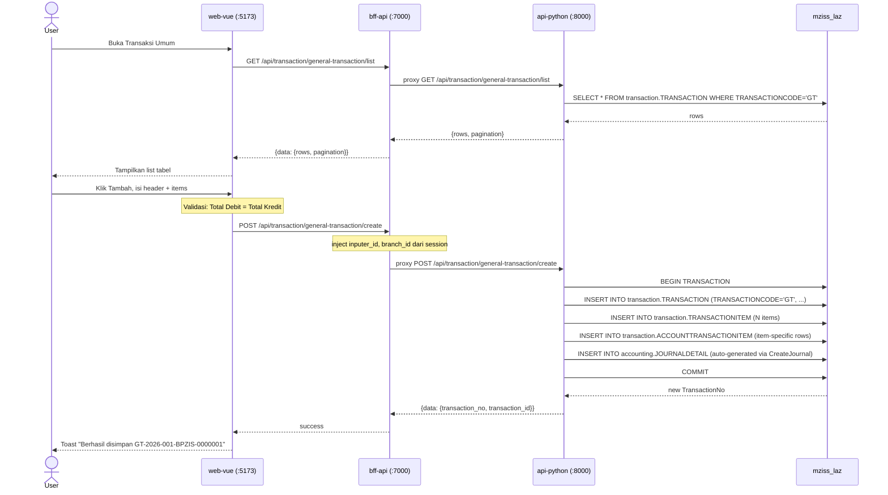

# Specs: Transaksi Umum (General Transaction)
**Portal**: zakat
**Domain**: `transaction` (menu key prefix: `keuangan.transaksi.umum`)
**Tipe**: CRUD + Composite Form (header + 4 item types)
**Legacy Ref**: `docs/legacy-apps/core/` — dialogs/TransaksiUmum + scripts/Transaction/GeneralTransaction.py
**Tanggal**: 2026-06-17

## Konteks

Transaksi Umum (General Transaction) adalah fitur untuk mencatat transaksi keuangan yang melibatkan 4 jenis mutasi rekening dalam satu dokumen: Penghimpunan dana (C), Penyaluran dana (D), Kas/Bank (B), dan Ledger GL (G). Setiap transaksi memiliki serangkaian item dengan tipe berbeda, dan sistem harus menghasilkan jurnal akuntansi bertingkat otomatis sesuai ParameterJournal='10'. Fitur ini kritis untuk operasional keuangan harian di level ACC (Accounting Officer).

---

## Alur Data



---

## Endpoint Contract

### POST /api/transaction/general-transaction/create
**Auth**: `require_menu('keuangan.transaksi.umum.tambah')`
**Body**:
```json
{
  "actual_date": "2026-06-17",
  "reference_no": "KWT-001",
  "description": "Keterangan transaksi keseluruhan",
  "rate": 1.0,
  "items": [
    {
      "item_type": "C",
      "product_id": 1,
      "donor_id": 42,
      "valuta": "IDR",
      "amount": 500000,
      "rate": 1.0,
      "mutation_type": "C",
      "fund_entity": 1,
      "description": "Zakat mal dari donatur"
    },
    {
      "item_type": "B",
      "account_no": "KAS-001",
      "valuta": "IDR",
      "amount": 500000,
      "rate": 1.0,
      "mutation_type": "D",
      "description": "Terima tunai"
    }
  ]
}
```

**Response**: 
```json
{
  "data": {
    "transaction_id": 123,
    "transaction_no": "GT-2026-001-BPZIS-0000001",
    "journal_no": "JNL-2026-001-0000001"
  },
  "meta": { "request_id": "..." }
}
```

### POST /api/transaction/general-transaction/update
**Auth**: `require_menu('keuangan.transaksi.umum.ubah')`
**Body**: Same as create, but include `transaction_no` to identify which record to update
```json
{
  "transaction_no": "GT-2026-001-BPZIS-0000001",
  "actual_date": "2026-06-17",
  "reference_no": "KWT-001-REV",
  "description": "Updated keterangan",
  "rate": 1.0,
  "items": [...]
}
```

**Response**: Same as create

### GET /api/transaction/general-transaction/list
**Auth**: `require_menu('keuangan.transaksi.umum')`
**Query params**:
- `page` (int, default=1)
- `limit` (int, default=25)
- `date_from` (YYYY-MM-DD, optional)
- `date_to` (YYYY-MM-DD, optional)
- `status` (T|F, optional) — auth status

**Response**:
```json
{
  "data": [
    {
      "transaction_id": 123,
      "transaction_no": "GT-2026-001-BPZIS-0000001",
      "actual_date": "2026-06-17",
      "reference_no": "KWT-001",
      "description": "Zakat mal",
      "amount": 1000000,
      "auth_status": "T",
      "inputer": "WISNU",
      "branch_code": "001"
    }
  ],
  "pagination": { "page": 1, "limit": 25, "total": 100, "total_pages": 4 },
  "meta": { "request_id": "..." }
}
```

### GET /api/transaction/general-transaction/{transaction_no}
**Auth**: `require_menu('keuangan.transaksi.umum')`

**Response**:
```json
{
  "data": {
    "transaction_id": 123,
    "transaction_no": "GT-2026-001-BPZIS-0000001",
    "actual_date": "2026-06-17",
    "reference_no": "KWT-001",
    "description": "Zakat mal",
    "amount": 1000000,
    "auth_status": "T",
    "journal_no": "JNL-2026-001-0000001",
    "inputer": "WISNU",
    "branch_code": "001",
    "items": [
      {
        "transaction_item_id": 456,
        "item_type": "C",
        "product_id": 1,
        "donor_id": 42,
        "amount": 500000,
        "mutation_type": "C",
        "fund_entity": 1,
        "description": "Zakat mal"
      },
      {
        "transaction_item_id": 457,
        "item_type": "B",
        "account_no": "KAS-001",
        "amount": 500000,
        "mutation_type": "D",
        "description": "Terima tunai"
      }
    ]
  },
  "meta": { "request_id": "..." }
}
```

### GET /api/transaction/general-transaction/rekening-info
**Auth**: `require_menu('keuangan.transaksi.umum')`
**Query params**:
- `no_rekening` — nomor rekening (kas/bank atau product account)

**Response**:
```json
{
  "data": {
    "account_no": "KAS-001",
    "account_name": "Kas Pusat IDR",
    "currency_code": "IDR",
    "account_type": "KAS",
    "branch_code": "001"
  },
  "meta": { "request_id": "..." }
}
```

### GET /api/transaction/general-transaction/kurs-info
**Auth**: `require_menu('keuangan.transaksi.umum')`
**Query params**:
- `currency_code` — e.g. "USD", "SGD"
- `tanggal` (optional, default: today) — tanggal untuk lookup kurs

**Response**:
```json
{
  "data": {
    "currency_code": "USD",
    "kurs": 15500.0,
    "kode_kurs": "BCA-USD-20260617",
    "tanggal": "2026-06-17"
  },
  "meta": { "request_id": "..." }
}
```

### POST /api/transaction/general-transaction/cek-limit
**Auth**: `require_menu('keuangan.transaksi.umum')`
**Body**:
```json
{
  "amount_debit": 10000000,
  "branch_code": "001"
}
```

**Response**:
```json
{
  "data": {
    "limit_available": 50000000,
    "amount_debit": 10000000,
    "exceeded": false,
    "message": "Dalam limit"
  },
  "meta": { "request_id": "..." }
}
```

### POST /api/transaction/general-transaction/cek-override
**Auth**: `require_menu('keuangan.transaksi.umum.override')`
**Body**:
```json
{
  "user_override": "SUPERVISOR_USERNAME",
  "password_override": "**hidden**",
  "amount_debit": 100000000,
  "branch_code": "001"
}
```

**Response**:
```json
{
  "data": {
    "override_valid": true,
    "override_user": "SUPERVISOR",
    "message": "Override approved"
  },
  "meta": { "request_id": "..." }
}
```

---

## Data Model — ER Diagram

```mermaid
erDiagram
  TRANSACTION ||--o{ TRANSACTIONITEM : contains
  TRANSACTIONITEM ||--o{ ACCOUNTTRANSACTIONITEM : "when TRANSACTIONITEMTYPE='A'"
  TRANSACTIONITEM ||--o{ GLITEM_EXTENSION : "when TRANSACTIONITEMTYPE='G'"
  ACCOUNTTRANSACTIONITEM ||--o{ DONORTRANSACTIONITEM : "when ACCOUNTTITYPE='D'"
  ACCOUNTTRANSACTIONITEM ||--o{ ZAKAHDISTARRANSACTIONITEM : "when ACCOUNTTITYPE='Z'"
  
  TRANSACTION {
    int TRANSACTIONID PK
    string TRANSACTIONNO UK
    string TRANSACTIONCODE
    timestamp TRANSACTIONDATE
    timestamp ACTUALDATE
    string REFERENCENO
    string DESCRIPTION
    string INPUTER
    string BRANCHCODE FK
    string AUTHSTATUS
    string ISPOSTED
    double AMOUNT
    string CURRENCYCODE
    double RATE
    string AUTHUSER
    timestamp AUTHDATE
    int JOURNALBLOCKID
    string JOURNALNO
  }

  TRANSACTIONITEM {
    int TRANSACTIONITEMID PK
    int TRANSACTIONID FK
    string TRANSACTIONITEMTYPE
    string BRANCHCODE
    string CURRENCYCODE
    string MUTATIONTYPE
    double AMOUNT
    double RATE
    double EKUIVALENAMOUNT
    string DESCRIPTION
    string REFACCOUNTNO
    string REFACCOUNTNAME
    string ACCOUNTCODE
    string PARAMETERJOURNALID
  }

  ACCOUNTTRANSACTIONITEM {
    int TRANSACTIONITEMID PK_FK
    string ACCOUNTNO FK
    string ACCOUNTTITYPE
    int FUNDENTITY
    string ISUPDATEBALANCE
    string FUNDACCOUNTNO
  }

  DONORTRANSACTIONITEM {
    int DONORID FK
    int MARKETERID
    double AMOUNTPERUNIT
    int TOTALUNIT
    double PERCENTAGEOFAMIL
  }

  ZAKAHDISTARRANSACTIONITEM {
    string ASHNAF
    string DISTRIBUTIONITEMACCOUNT
    string FUNDACCOUNTNO
    int MUSTAHIQID
    string DISTRIBUTIONCATEGORY
    string PRODUCTACCOUNTNO FK
  }

  GLITEM_EXTENSION {
    string GLNUMBER
    string GLNAME
  }
```

---

## UI Component Tree

```
TransaksiUmumPage.vue
├── Form Header Section
│   ├── DateField (actual_date) — read-only, set from server
│   ├── Input (reference_no) — optional
│   ├── Input (description) — optional
│   └── Hidden inputs (branch_code, inputer — from session)
├── Item Grid Section
│   ├── Toolbar
│   │   ├── Button "Tambah Item"
│   │   ├── Item Type Selector (C/D/B/G) — filter grid
│   │   └── Help text
│   ├── Dynamic Item Form (conditionally rendered)
│   │   ├── ItemType='C' Form (Penghimpunan)
│   │   ├── ItemType='D' Form (Penyaluran)
│   │   ├── ItemType='B' Form (Kas/Bank)
│   │   └── ItemType='G' Form (Ledger)
│   └── Items Grid (DataTable)
│       ├── Columns: Jenis, No Rekening, Nama, D/K, Nilai, Valuta, Kurs, Ekuivalen, Keterangan
│       ├── Row Actions: Edit, Delete
│       └── Summary Row: Total Debit | Total Kredit (warning if ≠)
├── Balance Validation Alert
│   └── Warning badge if Total Debit ≠ Total Kredit
├── Override Section (conditional)
│   ├── Input (user_override) — visible only if limit exceeded
│   └── Input (password_override) — visible only if limit exceeded
└── Action Buttons
    ├── Button "Simpan Sebagai Draft"
    ├── Button "Submit Otorisasi"
    └── Button "Batal"
```

---

## Discriminators Reference (KRITIS — Jangan Dihilangkan)

| Tabel | Kolom | Nilai | Artinya |
|---|---|---|---|
| `TRANSACTION` | `TRANSACTIONCODE` | `'GT'` | Transaksi Umum (General Transaction) — **SELALU hardcoded di setiap INSERT** |
| `TRANSACTIONITEM` | `TRANSACTIONITEMTYPE` | `'A'` | AccountTransactionItem (kas/bank/produk) |
| `TRANSACTIONITEM` | `TRANSACTIONITEMTYPE` | `'G'` | GLTransactionItem (ledger langsung) |
| `ACCOUNTTRANSACTIONITEM` | `ACCOUNTTITYPE` | `'D'` | DonorTransactionItem (Penghimpunan) |
| `ACCOUNTTRANSACTIONITEM` | `ACCOUNTTITYPE` | `'Z'` | ZakahDistTransactItem (Penyaluran) |
| `ACCOUNTTRANSACTIONITEM` | `ACCOUNTTITYPE` | `'A'` | AccountTransactionItem base (Kas/Bank) |
| `TRANSACTIONITEM` | `MUTATIONTYPE` | `'D'` | Debet |
| `TRANSACTIONITEM` | `MUTATIONTYPE` | `'C'` | Kredit |
| `ACCOUNTTRANSACTIONITEM` | `FUNDENTITY` | `1` | Zakat |
| `ACCOUNTTRANSACTIONITEM` | `FUNDENTITY` | `2` | Infaq |
| `ACCOUNTTRANSACTIONITEM` | `FUNDENTITY` | `3` | Wakaf |
| `ACCOUNTTRANSACTIONITEM` | `FUNDENTITY` | `4` | Amil |
| `ACCOUNTTRANSACTIONITEM` | `FUNDENTITY` | `5` | Non-halal |
| `ACCOUNTTRANSACTIONITEM` | `ASHNAF` | `F/M/U/H/G/S/I/A` | Fakir/Miskin/Mualaf/Hamba/Gharimin/Fisabillillah/Ibnu Sabil/Amil |
| `TRANSACTIONITEM` | `PARAMETERJOURNALID` | `'10'` | Journal parameter untuk GT — **SELALU hardcoded** |
| `TRANSACTION` | `AUTHSTATUS` | `'T'` / `'F'` | Sudah otorisasi / Belum otorisasi |
| `TRANSACTION` | `ISPOSTED` | `'T'` / `'F'` | Sudah diposting ke jurnal / Belum |

---

## Autonumber Format — Transaksi Umum

| Komponen | Format | Contoh |
|---|---|---|
| **Prefix** | `GT` | GT |
| **Tahun** | `{YYYY}` | 2026 |
| **Kode Cabang** | `{branch_code}` | 001 |
| **Cash Code** | `BPZIS` | BPZIS |
| **Sequence** | `{7digit}` | 0000001 |
| **Hasil** | `GT-YYYY-BC-BPZIS-XXXXXXX` | GT-2026-001-BPZIS-0000001 |

**Source**: sequence `seq_transactionnumber` di schema `transaction`

---

## Menu Key & Roles

| Key | Label | Roles | Actions |
|---|---|---|---|
| `keuangan.transaksi.umum` | Transaksi Umum | ACC | (read) |
| `keuangan.transaksi.umum.tambah` | — | ACC | create |
| `keuangan.transaksi.umum.ubah` | — | ACC | update |
| `keuangan.transaksi.umum.hapus` | — | ACC | delete |
| `keuangan.transaksi.umum.override` | — | SUP | override limit |

---

## Database

**Tabel**: `transaction.TRANSACTION`, `transaction.TRANSACTIONITEM`, `transaction.ACCOUNTTRANSACTIONITEM` (sudah ada, reuse existing)
**DWH View**: `dwh.v_general_transaction` (baru dibuat dengan V{NNN})

**Sequence**: `transaction.seq_transactionnumber` (sudah ada)

**Kolom kunci** (di TRANSACTION):
| Kolom | Type | Keterangan |
|---|---|---|
| `TRANSACTIONID` | SERIAL | PK |
| `TRANSACTIONNO` | VARCHAR(30) | Unique autonumber GT-YYYY-BC-BPZIS-XXXXXXX |
| `TRANSACTIONCODE` | VARCHAR(10) | `'GT'` hardcoded |
| `ACTUALDATE` | TIMESTAMP | Tanggal posting (dari batch user) |
| `TRANSACTIONDATE` | TIMESTAMP | Tanggal input |
| `INPUTER` | VARCHAR(20) | Dari session user |
| `BRANCHCODE` | VARCHAR(5) | FK ke enterprise.branch |
| `AUTHSTATUS` | VARCHAR(1) | `'T'`/`'F'` |
| `ISPOSTED` | VARCHAR(1) | `'T'`/`'F'` |

---

## Catatan Implementasi Kritis

1. **Form terpadu bukan sub-dialog** — di legacy, `fTransaksiUmum` adalah sub-dialog yang dipanggil oleh `fGeneralTransaction`. Di isf-app ini menjadi **satu page terpadu** yang menangani semua 4 item type dalam satu form composite.

2. **CreateJournal dipanggil di Transaction level** — bukan di item loop. Setelah semua item diinsert ke DB, `CreateJournal()` dipanggil sekali untuk menghasilkan jurnal akuntansi otomatis sesuai ParameterJournal='10'. Jika balance mismatch (status==2) → raise exception → rollback.

3. **Validasi D=K di frontend** — legacy tidak punya validasi sisi client. Isf-app HARUS menambahkan warning sebelum submit jika Total Debit ≠ Total Kredit (warning, bukan blocker).

4. **RAK otomatis antar cabang** — jika rekening kas/bank milik cabang berbeda, sistem harus auto-generate journal RAK di kedua cabang. Handle di layer service, bukan UI.

5. **Item type discriminators adalah batu loncatan utama**:
   - `TRANSACTIONITEMTYPE='A'` → lookup ACCOUNTTRANSACTIONITEM; jika `ACCOUNTTITYPE='D'` → Penghimpunan, jika `'Z'` → Penyaluran, jika `'A'` → Kas/Bank base
   - `TRANSACTIONITEMTYPE='G'` → lookup GLNUMBER/GLNAME, tidak ada ACCOUNTTRANSACTIONITEM row
   - **Salah discriminator = data corrupt di seluruh laporan. CRITICAL.**

6. **Override limit adalah conditional** — hanya tampilkan user_override + password_override input jika transaksi melebihi limit otorisasi. Cek via `cek-limit` endpoint sebelum submit.

7. **Session injection di BFF** — `inputer_id` dan `branch_id` di-inject BFF dari session, bukan dikirim frontend. Frontend HANYA kirim data bisnis.

---

*Generated: 2026-06-17*
