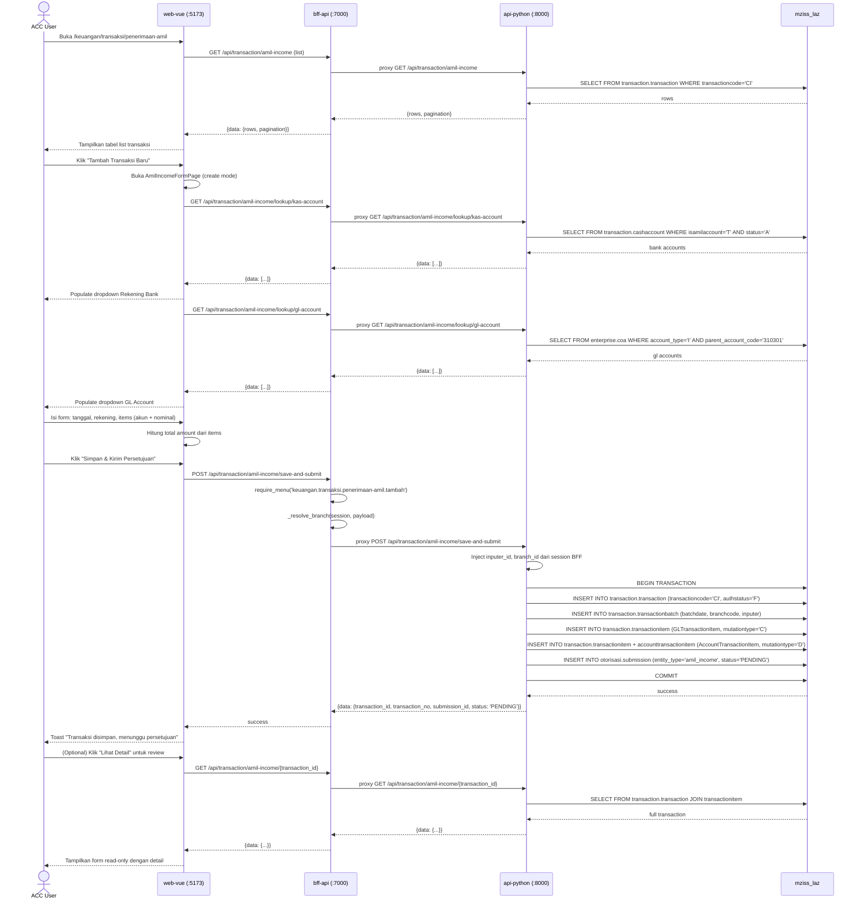

# Specs: Migrasi Menu TR0024A — Transaksi Penerimaan Amil

> ⚠️ **KOREKSI PASCA-VERIFIKASI DB (2026-06-20).** Discriminator awal di dok ini ditebak dari legacy COA dan **tidak cocok** dengan COA isf-app nyata (diverifikasi vs 308 baris CI di `mziss_laz`). Yang BENAR & dipakai di implementasi:
> - Akun pendapatan amil = family **`430xxx`** "PENERIMAAN DANA AMIL" (`transaction.account`, `account_type='I'`, `is_detail='T'`, code LIKE `43%`). BUKAN parent `310301` (itu "SALDO DANA AMIL", equity), dan COA table = `transaction.account` BUKAN `enterprise.coa`.
> - `transaction.transaction` TIDAK punya kolom `paymenttype`; channel via `channelcode` ('P' petty / 'R' lainnya). Item equiv col = `ekuivalenamount`. Rekening: `cashaccount` (isamilaccount='T') JOIN `financialaccount` (nama/cabang/status).
> - Posting nyata = **3-leg**: GL income credit (pjid `10`) + source credit opsional (pjid `C20`, mode Bank) + destination debit (pjid `10`). Menu key page = `finance.transactions.amil_income`; entity_config menu_key = `finance.monitoring.authorization`.
> Lihat memory `project-penerimaan-amil-model` & implementasi di `app/modules/transaksi/amil_income_*.py`.


**Tanggal:** 2026-06-20  
**Source:** `docs/legacy-apps/core/menus/Transaksi.mnu` — `Name='TR0024A'`  
**Modul:** `docs/legacy-apps/core/`  
**Event:** Migrasi menu legacy ke isf-app web-vue  

---

## RINGKASAN FITUR

**Fitur:** Transaksi Penerimaan Amil (Cash-In Amil — form input kas masuk pendapatan amil)  
**Portal:** Zakat  
**Legacy Form:** `dialogs/Transaksi/fCashIn.*`  
**Transaction Code:** `CI` (Cash In Amil)  
**Voucher Code:** `KM` (Kas Masuk)  
**Roles:** `ACC` (Accountant)  
**Menu Key:** `keuangan.transaksi.penerimaan-amil`  
**Route:** `/keuangan/transaksi/penerimaan-amil`

---

## AKSES

| Legacy AllowedGroups | isf-app role_code |
|---|---|
| `ACC` | `ACC` |

**Menu Key:** `keuangan.transaksi.penerimaan-amil`  
**Route:** `/keuangan/transaksi/penerimaan-amil`

---

## TIPE FITUR

**Tipe:** CRUD (Create, Read, Update, Delete) + Approval Workflow (Otorisasi)  
**Workflow:** Maker-checker dengan auto-approval berdasarkan limit nominal  
**Sistem Otorisasi:** Entity type = `amil_income`

---

## KONTEKS & TUJUAN

Form Penerimaan Amil digunakan oleh ACC (Accountant) untuk mencatat transaksi kas masuk
yang diterima organisasi (ZIS/Wakaf) sebagai pendapatan operasional amil. Transaksi ini
memisahkan dana yang masuk dari sisi "penerimaan umum" (seperti penghimpunan) dengan
"pendapatan khusus amil" seperti fee, jasa konsultasi, atau bunga bank.

Penerimaan Amil bisa dilakukan melalui tiga channel:
1. **Kas Kecil** (Petty Cash) — untuk transaksi kecil, internal
2. **Kas Cabang** — untuk transaksi kas tunai per cabang
3. **Bank** — untuk penerimaan transfer bank (channel utama)

Setiap penerimaan ditempatkan ke akun GL terpilih (parent `310301` — Pendapatan Amil),
dan dialokasikan dari rekening kas/bank yang ditandai sebagai "Amil Account" (`isamilaccount='T'`).

---

## ALUR DATA



---

## FORM FIELDS & LAYOUT

### HEADER SECTION

| Field | Type | Required | Default | Keterangan |
|---|---|---|---|---|
| `actual_date` | Date | ✓ | Today | Tanggal posting transaksi |
| `transaction_no` | String | ✗ | (auto) | Nomor transaksi (read-only, isi setelah save) |
| `paid_to` | String | ✗ | Username | Kasir/petugas pembuat transaksi |
| `received_from` | String | ✗ | — | Nama pihak yang memberikan kas |

### PAYMENT TYPE SECTION (Tab / Radio Group)

**Default Tab: Bank**

#### TAB KAS (payment_type = 'C' atau 'K')

| Field | Type | Required | Default | Keterangan |
|---|---|---|---|---|
| `cash_type` | Select | ✓ | 'C' | Jenis kas: 'C'=Kas Cabang, 'K'=Kas Kecil |
| `reference_no` | String | ✗ | — | No. Kwitansi |
| `description` | String | ✗ | — | Keterangan umum transaksi |
| `total_amount` | Currency | ✗ | (auto) | Total otomatis dari grid item (read-only) |

#### TAB BANK (payment_type = 'B')

| Field | Type | Required | Default | Keterangan |
|---|---|---|---|---|
| `bank_account_no` | SearchSelect | ✓ | — | Rekening Bank (filter: `isamilaccount='T'`, `status='A'`) |
| `reference_no` | String | ✗ | — | No. Cek / No. Referensi |
| `description` | String | ✗ | — | Keterangan umum transaksi |
| `rate` | Decimal | ✗ | 1.0 | Nilai Kurs (untuk valuta asing) |
| `total_amount` | Currency | ✗ | (auto) | Total otomatis dari grid item (read-only) |

#### TAB NON TUNAI / AKTIVA (payment_type = 'A')

**Status:** Not implemented di MVP (Tab disembunyikan di legacy)

---

### GRID DETAIL — ITEM TRANSAKSI

**Minimal 1 row wajib.**

| Field | Type | Required | Display | Keterangan |
|---|---|---|---|---|
| `account_code` | Lookup | ✓ | ✓ | GL Account (filter: `account_type='I'` AND parent `'310301'`) |
| `account_name` | String | ✗ | ✓ | Nama akun GL (read-only, auto dari lookup) |
| `amount` | Currency | ✓ | ✓ | Nominal penerimaan (> 0.0) |
| `cash_account_no` | SearchSelect | ✗ | ✓ | Rekening sumber (optional, untuk tracing) |
| `cash_account_name` | String | ✗ | ✓ | Nama rekening sumber (read-only, auto) |
| `description` | String | ✗ | ✓ | Keterangan item |
| `fund_product_code` | SearchSelect | ✗ | ✓ | Sumber dana (optional, lookup productaccount) |
| `fund_product_name` | String | ✗ | ✓ | Nama sumber dana (read-only, auto) |
| `currency_code` | String | ✗ | ✗ | Valuta per item (hidden, default IDR) |
| `rate` | Decimal | ✗ | ✗ | Kurs per item (hidden, default 1.0) |
| `ekuivalen` | Currency | ✗ | ✗ | Amount * Rate (hidden, auto-compute) |
| `fund_account_no` | String | ✗ | ✗ | Akun produk sumber (hidden, auto-resolve) |
| `fund_product_id` | Integer | ✗ | ✗ | ID produk sumber (hidden) |
| `budget_id` | Integer | ✗ | ✗ | ID budget (hidden, optional) |
| `budget_code` | String | ✗ | ✗ | Kode budget (hidden, optional) |
| `budget_owner` | String | ✗ | ✗ | Pemilik budget (hidden, optional) |
| `item_idx` | Integer | ✗ | ✗ | Urutan item (hidden, auto) |

---

## DISCRIMINATORS (KRITIS)

Jangan hilangkan saat implementasi — field ini membedakan transaksi penerimaan amil dari transaksi lain.

| Discriminator | Value | Tabel | Kolom | Artinya |
|---|---|---|---|---|
| **TransactionCode** | `'CI'` | `transaction.TRANSACTION` | `transactioncode` | Cash In Amil — membedakan dari SD001 (penghimpunan), DD001 (penyaluran), CO (cash out), dll |
| **VoucherCode** | `'KM'` | `transaction.TRANSACTIONTYPE` | `vouchercode` | Kas Masuk — digunakan sebagai prefix nomor transaksi (format: `KM-YYYY-branch-cashCode-seq`) |
| **IsAmilAccount** | `'T'` | `transaction.CASHACCOUNT` | `isamilaccount` | Hanya rekening bank/kas yang ditandai Amil bisa dipilih (beda dari penghimpunan) |
| **AccountType** | `'I'` | `enterprise.coa` | `account_type` | Income — tipe akun yang digunakan harus pendapatan |
| **ParentAccountCode** | `'310301'` | `enterprise.coa` | `parent_account_code` | Parent akun GL harus 310301 (Pendapatan Amil) |
| **GLItemMutationType** | `'C'` | `transaction.TRANSACTIONITEM` | `mutationtype` | Kredit — sisi GL (pendapatan masuk) |
| **AccountItemMutationType** | `'D'` | `transaction.TRANSACTIONITEM` | `mutationtype` | Debit — sisi kas/bank (kas keluar amil dari DLKB, masuk ke kas amil) |
| **ParameterJournalId (GL)** | `'10'` | `transaction.TRANSACTIONITEM` | `parameterjournalid` | Standard journal parameter |
| **ParameterJournalId (Source)** | `'C20'` | `transaction.TRANSACTIONITEM` | `parameterjournalid` | Journal parameter untuk source account saat BankIn |
| **ChannelCode (Kas)** | `'R'` | `transaction.TRANSACTION` | `channelcode` | Regular — untuk Kas Cabang & Bank |
| **ChannelCode (Petty)** | `'P'` | `transaction.TRANSACTION` | `channelcode` | Petty — untuk Kas Kecil |
| **AuthStatus** | `'F'` → `'T'` | `transaction.TRANSACTION` | `authstatus` | Approval status (F=perlu approval, T=auto-approved per limit) |
| **EntityType** | `'amil_income'` | `otorisasi.submission` | `entity_type` | Classifier untuk otorisasi dispatcher |

---

## NOMOR TRANSAKSI FORMAT

```
{VoucherCode}-{YYYY}-{branchCode}-{cashCode}-{seq7digit}
```

**Contoh:**
- `KM-2026-001-BCA001-0001234` — Bank BCA, cabang 001, sequence 1234
- `KM-2026-001-IDR-0000512` — Kas Cabang IDR, cabang 001, sequence 512
- `KM-2026-001-BMI-0000100` — Petty Cash, cabang 001, sequence 100

**Dimana:**
- `VoucherCode` = `'KM'` (dari `TransactionType` lookup)
- `YYYY` = tahun
- `branchCode` = kode cabang dari session user
- `cashCode` = kode rekening kas/bank yang dipilih (atau hardcoded `'BMI'` untuk petty)
- `seq7digit` = 7-digit sequence (managed by customidgenAPI)

---

## ENDPOINT CONTRACT

### GET /api/transaction/amil-income

**Auth:** `require_menu('keuangan.transaksi.penerimaan-amil')`  
**Method:** GET  
**Query Params:**
- `date_from` (optional, ISO 8601) — filter tanggal dari
- `date_to` (optional, ISO 8601) — filter tanggal sampai
- `branch_code` (optional) — filter cabang (hanya jika `branch_access='all'`)
- `page` (int, default=1) — halaman
- `limit` (int, default=25) — rows per page

**Response:**
```json
{
  "data": {
    "rows": [
      {
        "transaction_id": 12345,
        "transaction_no": "KM-2026-001-BCA001-0001234",
        "actual_date": "2026-06-20",
        "bank_account_no": "BCA001",
        "bank_account_name": "BCA (Amil)",
        "total_amount": 5000000.00,
        "reference_no": "CHK-00123",
        "description": "Penerimaan bunga bank",
        "inputer": "HADI",
        "branch_code": "001",
        "status": "AUTHORIZED",
        "auth_user": "RAIS",
        "auth_date": "2026-06-20T14:30:00",
        "payment_type": "B",
        "channel_code": "R"
      }
    ],
    "pagination": {
      "page": 1,
      "limit": 25,
      "total": 156,
      "total_pages": 7
    }
  },
  "meta": { "request_id": "req-uuid-123" }
}
```

---

### POST /api/transaction/amil-income/save-and-submit

**Auth:** `require_menu('keuangan.transaksi.penerimaan-amil.tambah')`  
**Method:** POST  
**Body:**
```json
{
  "actual_date": "2026-06-20",
  "payment_type": "B",
  "bank_account_no": "BCA001",
  "cash_type": null,
  "reference_no": "CHK-00123",
  "description": "Penerimaan bunga bank bulan Juni",
  "rate": 1.0,
  "paid_to": "HADI",
  "received_from": "PT BCA",
  "items": [
    {
      "account_code": "310301-001",
      "account_name": "Pendapatan Bunga Bank",
      "amount": 5000000.00,
      "currency_code": "IDR",
      "rate": 1.0,
      "cash_account_no": null,
      "fund_product_code": null,
      "description": "Bunga bank Juni 2026",
      "budget_id": null
    }
  ]
}
```

**Note:** Field `inputer_id` dan `branch_id` **di-inject oleh BFF** dari session — tidak perlu dikirim dari frontend.

**Response:**
```json
{
  "data": {
    "transaction_id": 12345,
    "transaction_no": "KM-2026-001-BCA001-0001234",
    "status": "PENDING",
    "submission_id": 987654,
    "message": "Transaksi disimpan dan menunggu persetujuan"
  },
  "meta": { "request_id": "req-uuid-123" }
}
```

**Or if auto-approved (amount <= limit):**
```json
{
  "data": {
    "transaction_id": 12345,
    "transaction_no": "KM-2026-001-BCA001-0001234",
    "status": "AUTHORIZED",
    "message": "Transaksi disimpan dan otomatis disetujui (amount <= limit)"
  },
  "meta": { "request_id": "req-uuid-123" }
}
```

---

### GET /api/transaction/amil-income/{transaction_id}

**Auth:** `require_menu('keuangan.transaksi.penerimaan-amil')`  
**Method:** GET  

**Response:**
```json
{
  "data": {
    "transaction_id": 12345,
    "transaction_no": "KM-2026-001-BCA001-0001234",
    "actual_date": "2026-06-20",
    "payment_type": "B",
    "bank_account_no": "BCA001",
    "bank_account_name": "BCA (Amil)",
    "reference_no": "CHK-00123",
    "description": "Penerimaan bunga bank",
    "rate": 1.0,
    "total_amount": 5000000.00,
    "inputer": "HADI",
    "branch_code": "001",
    "paid_to": "HADI",
    "received_from": "PT BCA",
    "status": "AUTHORIZED",
    "auth_status": "T",
    "auth_user": "RAIS",
    "auth_date": "2026-06-20T14:30:00",
    "channel_code": "R",
    "items": [
      {
        "transaction_item_id": 54321,
        "account_code": "310301-001",
        "account_name": "Pendapatan Bunga Bank",
        "amount": 5000000.00,
        "mutation_type": "C",
        "currency_code": "IDR",
        "rate": 1.0,
        "ekuivalen": 5000000.00,
        "description": "Bunga bank Juni 2026",
        "cash_account_no": null,
        "fund_product_code": null
      }
    ]
  },
  "meta": { "request_id": "req-uuid-123" }
}
```

---

### PUT /api/transaction/amil-income/{transaction_id}

**Auth:** `require_menu('keuangan.transaksi.penerimaan-amil.ubah')`  
**Method:** PUT  
**Body:** (sama seperti POST save-and-submit)

**Restriction:** Hanya transaksi dengan `status=DRAFT` atau `authstatus='F'` dapat diubah.

**Response:** Sama seperti GET detail.

---

### DELETE /api/transaction/amil-income/{transaction_id}

**Auth:** `require_menu('keuangan.transaksi.penerimaan-amil.hapus')`  
**Method:** DELETE  

**Restriction:** Hanya transaksi dengan `status=DRAFT` atau `authstatus='F'` dapat dihapus.

**Response:**
```json
{
  "data": {
    "message": "Transaksi berhasil dihapus"
  },
  "meta": { "request_id": "req-uuid-123" }
}
```

---

### GET /api/transaction/amil-income/lookup/kas-account

**Auth:** `require_menu('keuangan.transaksi.penerimaan-amil')`  
**Method:** GET  
**Query Params:**
- `branch_code` (optional) — filter cabang (auto dari session jika tidak ada)
- `payment_type` (optional: 'K', 'C', 'B') — filter jenis rekening

**Response:**
```json
{
  "data": [
    {
      "account_no": "BCA001",
      "account_name": "BCA (Amil)",
      "bank_name": "Bank Central Asia",
      "cash_code": "BCA001",
      "currency_code": "IDR",
      "status": "A",
      "is_amil_account": true,
      "branch_code": "001"
    },
    {
      "account_no": "MNDI001",
      "account_name": "Mandiri (Amil)",
      "bank_name": "Bank Mandiri",
      "cash_code": "MNDI001",
      "currency_code": "IDR",
      "status": "A",
      "is_amil_account": true,
      "branch_code": "001"
    }
  ],
  "meta": { "request_id": "req-uuid-123" }
}
```

---

### GET /api/transaction/amil-income/lookup/gl-account

**Auth:** `require_menu('keuangan.transaksi.penerimaan-amil')`  
**Method:** GET  
**Query Params:**
- `branch_code` (optional)
- `search` (optional) — search by account_code atau account_name

**Response:**
```json
{
  "data": [
    {
      "account_code": "310301-001",
      "account_name": "Pendapatan Bunga Bank",
      "account_type": "I",
      "parent_account_code": "310301",
      "parent_account_name": "Pendapatan Amil",
      "status": "A"
    },
    {
      "account_code": "310301-002",
      "account_name": "Pendapatan Jasa Konsultasi",
      "account_type": "I",
      "parent_account_code": "310301",
      "parent_account_name": "Pendapatan Amil",
      "status": "A"
    }
  ],
  "meta": { "request_id": "req-uuid-123" }
}
```

---

### GET /api/transaction/amil-income/next-number

**Auth:** `require_menu('keuangan.transaksi.penerimaan-amil')`  
**Method:** GET  
**Query Params:**
- `payment_type` (required: 'K', 'C', 'B') — jenis pembayaran
- `branch_code` (optional) — filter cabang
- `bank_account_no` (optional, required jika payment_type='B') — untuk ambil cash_code

**Response:**
```json
{
  "data": {
    "next_number": "KM-2026-001-BCA001-0001235",
    "prefix": "KM-2026-001-BCA001",
    "sequence": 1235
  },
  "meta": { "request_id": "req-uuid-123" }
}
```

---

## DATABASE SCHEMA

### Tabel Utama

#### transaction.TRANSACTION

Menyimpan header transaksi penerimaan amil.

| Kolom | Type | PK | FK | Keterangan |
|---|---|---|---|---|
| `transaction_id` | SERIAL | ✓ | | Primary key |
| `transaction_no` | VARCHAR(50) | | | Nomor unik transaksi (KM-YYYY-...) |
| `transaction_date` | TIMESTAMP | | | Waktu penciptaan transaksi |
| `actual_date` | DATE | | | Tanggal posting transaksi |
| `transactioncode` | VARCHAR(10) | | | Discriminator: `'CI'` |
| `branchcode` | VARCHAR(10) | | | Kode cabang user |
| `inputer_id` | VARCHAR(20) | | | User yang membuat transaksi (FK ke auth.users) |
| `amount` | DECIMAL(18,2) | | | Total nominal (sum dari items) |
| `currency_code` | VARCHAR(5) | | | Kode valuta (default 'IDR') |
| `rate` | DECIMAL(15,4) | | | Kurs (default 1.0) |
| `reference_no` | VARCHAR(50) | | | No. cek / No. referensi |
| `description` | VARCHAR(500) | | | Keterangan transaksi |
| `paid_to` | VARCHAR(50) | | | Kasir/petugas pembuat |
| `received_from` | VARCHAR(100) | | | Pihak yang memberikan kas |
| `channel_account_no` | VARCHAR(30) | | | Rekening pembayaran (kas/bank) |
| `channel_code` | VARCHAR(1) | | | 'R'=Regular (Kas/Bank), 'P'=Petty Cash |
| `payment_type` | VARCHAR(1) | | | 'K'=Kas Kecil, 'C'=Kas Cabang, 'B'=Bank, 'A'=Aset |
| `auth_status` | VARCHAR(1) | | | 'F'=belum approve, 'T'=approved |
| `auth_user` | VARCHAR(20) | | | User yang approve |
| `auth_date` | TIMESTAMP | | | Waktu approval |
| `is_posted` | VARCHAR(1) | | | 'T'=sudah posting jurnal, 'F'=belum |
| `journal_block_id` | INTEGER | | | FK ke accounting.journalblock |
| `journal_no` | VARCHAR(50) | | | Nomor jurnal akuntansi |
| `journal_error_description` | VARCHAR(500) | | | Error saat posting jurnal (jika ada) |
| `batch_id` | INTEGER | | FK | FK ke transaction.transactionbatch |
| `update_date` | TIMESTAMP | | | Waktu update terakhir |

**Filter untuk list:** `WHERE transactioncode='CI'`

---

#### transaction.TRANSACTIONITEM

Menyimpan item (baris) transaksi. Setiap penerimaan amil punya minimal 1 item GL.

| Kolom | Type | Keterangan |
|---|---|---|
| `transaction_item_id` | SERIAL | Primary key |
| `transaction_id` | INTEGER | FK ke TRANSACTION |
| `transaction_item_type` | VARCHAR(1) | 'G'=GLTransactionItem (Pendapatan), 'A'=AccountTransactionItem (Kas/Bank) |
| `branch_code` | VARCHAR(10) | Kode cabang |
| `account_code` | VARCHAR(30) | Kode GL account (untuk item tipe 'G') |
| `account_name` | VARCHAR(100) | Nama GL account |
| `mutation_type` | VARCHAR(1) | 'D'=Debit (Kas), 'C'=Kredit (Pendapatan) |
| `amount` | DECIMAL(18,2) | Nominal item |
| `rate` | DECIMAL(15,4) | Kurs item (default 1.0) |
| `ekuivalen_amount` | DECIMAL(18,2) | Amount * Rate |
| `currency_code` | VARCHAR(5) | Valuta item |
| `description` | VARCHAR(500) | Keterangan item |
| `parameter_journal_id` | VARCHAR(10) | '10'=standard, 'C20'=source account di BankIn |
| `ref_account_no` | VARCHAR(30) | Referensi akun (untuk tracing) |
| `ref_account_name` | VARCHAR(100) | Nama referensi akun |
| `rc_code` | VARCHAR(10) | Cost center (optional) |

---

#### transaction.ACCOUNTTRANSACTIONITEM

Extension dari TRANSACTIONITEM untuk item tipe 'A' (Kas/Bank).

| Kolom | Type | Keterangan |
|---|---|---|
| `transaction_item_id` | SERIAL | PK, FK ke TRANSACTIONITEM |
| `account_no` | VARCHAR(30) | FK ke CASHACCOUNT.account_no |
| `account_type` | VARCHAR(1) | 'D'=Penghimpunan, 'Z'=Penyaluran, 'C'=Cicilan, 'L'=Loan, 'A'=Other |
| `fund_entity` | INTEGER | 1=Zakat, 2=Infaq, 3=Wakaf, 4=Amil, 5=NonHalal |
| `is_update_balance` | VARCHAR(1) | 'T'=update balance, 'F'=tidak |
| `fund_account_no` | VARCHAR(30) | Referensi akun sumber dana |

---

#### transaction.CASHACCOUNT

Tabel master rekening kas/bank yang ada di sistem.

| Kolom | Type | Keterangan |
|---|---|---|
| `account_no` | VARCHAR(30) | PK — kode rekening unik |
| `account_name` | VARCHAR(100) | Nama rekening |
| `branch_code` | VARCHAR(10) | Kode cabang |
| `currency_code` | VARCHAR(5) | Valuta rekening |
| `bank_name` | VARCHAR(100) | Nama bank (jika bank account) |
| `bank_account_no` | VARCHAR(30) | Nomor rekening di bank |
| `status` | VARCHAR(1) | 'A'=Aktif, 'I'=Inactive |
| `cash_code` | VARCHAR(20) | Kode kas (digunakan di nomor transaksi) |
| `is_amil_account` | VARCHAR(1) | **'T'=Rekening Amil, 'F'=Bukan** (KRITIS) |
| `fund_category` | VARCHAR(10) | Kategori dana |
| `product_id` | INTEGER | FK ke product (optional) |

**Filter untuk dropdown Bank Account:** `WHERE is_amil_account='T' AND status='A' AND branch_code=:branch_code`

---

#### transaction.TRANSACTIONTYPE

Master tabel yang memetakan `transactioncode` ke `vouchercode`.

| Kolom | Type | Keterangan |
|---|---|---|
| `transaction_code` | VARCHAR(10) | PK (misal: 'CI', 'SD001', 'DD001') |
| `transaction_name` | VARCHAR(100) | Nama transaksi (misal: 'Cash In Amil') |
| `voucher_code` | VARCHAR(10) | Kode voucher untuk nomor transaksi (misal: 'KM') |

**Lookup untuk CI:** `SELECT voucher_code FROM TRANSACTIONTYPE WHERE transaction_code='CI'` → 'KM'

---

#### enterprise.coa

Master Chart of Accounts (GL Account).

| Kolom | Type | Keterangan |
|---|---|---|
| `account_code` | VARCHAR(30) | PK — kode akun GL |
| `account_name` | VARCHAR(100) | Nama akun |
| `account_type` | VARCHAR(1) | 'A'=Asset, 'L'=Liability, 'E'=Equity, 'D'=Debit (expense), 'I'=Income, 'C'=Contra |
| `parent_account_code` | VARCHAR(30) | FK ke parent akun (untuk hierarchy) |
| `status` | VARCHAR(1) | 'A'=Aktif, 'I'=Inactive |

**Filter untuk dropdown GL Account di item:** `WHERE account_type='I' AND parent_account_code='310301' AND status='A'`

---

#### otorisasi.submission

Menyimpan riwayat submission & approval (maker-checker workflow).

| Kolom | Type | Keterangan |
|---|---|---|
| `submission_id` | SERIAL | PK |
| `entity_type` | VARCHAR(50) | 'amil_income' untuk penerimaan amil |
| `entity_id` | VARCHAR(50) | Referensi ke transaction_id (string) |
| `payload` | JSONB | Full request payload (untuk re-execution jika perlu) |
| `status` | VARCHAR(20) | 'DRAFT'→'PENDING'→'PROCESSING'→'AUTHORIZED' atau 'REJECTED' |
| `submitted_by` | VARCHAR(20) | User yang submit |
| `submitted_at` | TIMESTAMP | Waktu submit |
| `approved_by` | VARCHAR(20) | User yang approve |
| `approved_at` | TIMESTAMP | Waktu approval |
| `dispatch_error` | VARCHAR(500) | Error jika dispatcher gagal |
| `result_entity_id` | VARCHAR(50) | ID entitas hasil (transaction_id) setelah AUTHORIZED |

---

## WORKFLOW OTORISASI

### Flow Maker-Checker

```
1. ACC membuat transaksi (form save)
   ↓
2. Sistem cek nominal vs limit ACC:
   - Jika amount <= limit['O'] → otomatis AUTHORIZED
   - Jika amount > limit['O'] → status PENDING (menunggu supervisor)
   ↓
3. Supervisor review di halaman Otorisasi
   ↓
4. Supervisor approve:
   - Status berubah PROCESSING
   - Background task jalankan dispatcher
   - Dispatcher INSERT journal + UPDATE balance
   - Status menjadi AUTHORIZED
   ↓
5. (Jika reject) → status DRAFT, ACC revisi & submit ulang
```

### Entity Config

Di tabel `otorisasi.entity_config`, wajib ada entry:
- `entity_type: 'amil_income'`
- `dispatcher_module: 'amil_income_service'`
- `dispatcher_function: 'create_from_payload'`
- `limit_entity: 'ENTITY_AMIL_INCOME'` (atau similar, sesuai config limit)

---

## KOMPONEN VUE YANG PERLU DIBUAT

### 1. AmilIncomePage.vue
- List view dengan tabel transaksi
- Filter: date range, branch (jika branch_access='all')
- Pagination (top-placed, standalone Paginator)
- Actions: [Lihat], [Edit (jika DRAFT)], [Hapus (jika DRAFT)]
- Button: "Tambah Transaksi Baru"

### 2. AmilIncomeFormPage.vue
- Form input untuk create & edit
- Tabs: Kas | Bank (default)
- Section: Header info
- Grid: Item transaksi (minimal 1)
- Actions: [Simpan & Kirim Persetujuan], [Batal]
- Lookup dropdowns: Rekening Bank, GL Account, Rekening Sumber

### 3. (Optional) AmilIncomeDetailPage.vue
- Read-only detail view (jika routed dari list)
- Display transaksi + items + status approval

---

## MENU KEY REGISTRY

Perlu didaftarkan di `apps_zakat/web-vue/src/lib/menu/registry.ts`:

```typescript
export const MENU_KEYS = {
  // ...
  KEUANGAN_TRANSAKSI_PENERIMAAN_AMIL: 'keuangan.transaksi.penerimaan-amil',
  KEUANGAN_TRANSAKSI_PENERIMAAN_AMIL_TAMBAH: 'keuangan.transaksi.penerimaan-amil.tambah',
  KEUANGAN_TRANSAKSI_PENERIMAAN_AMIL_UBAH: 'keuangan.transaksi.penerimaan-amil.ubah',
  KEUANGAN_TRANSAKSI_PENERIMAAN_AMIL_HAPUS: 'keuangan.transaksi.penerimaan-amil.hapus',
  // ...
}
```

---

## CATATAN IMPLEMENTASI PENTING

1. **Batch Handling:**
   - Service python harus auto-create/get batch per user + date + branch (internal, tidak di-expose UI)
   - Batch digunakan untuk mengelompokkan transaksi per hari

2. **FundAccountNo Resolve:**
   - Jika item punya `cash_account_no` tapi `fund_account_no` kosong, auto-resolve dari ProductAccount lookup
   - Logic: pilih ProductAccount dengan ProductId + BranchCode + CurrencyCode matching

3. **Currency & Rate:**
   - Default currency IDR, rate 1.0
   - Per-item rate mendukung valuta asing
   - `ekuivalen_amount = amount * rate` (auto-compute di service)

4. **Tab Non Tunai (Aktiva):**
   - Tersembunyi di MVP — tidak diimplementasi di fase 1
   - Jika diperlukan, buka sebagai phase 2

5. **Kwitansi Cetak:**
   - Fitur cetak kwitansi di-defer ke phase 2
   - Response API cukup return `transaction_no`, frontend bisa trigger print nanti

6. **Journal Posting:**
   - Hanya berjalan jika `authstatus='T'` (approved)
   - Posting otomatis saat transaksi disetujui via otorisasi
   - Jika posting gagal → `dispatch_error` terisi, ACC bisa retry

7. **Menu Permission:**
   - `require_menu('keuangan.transaksi.penerimaan-amil')` — view list + detail
   - `require_menu('keuangan.transaksi.penerimaan-amil.tambah')` — create
   - `require_menu('keuangan.transaksi.penerimaan-amil.ubah')` — update (DRAFT only)
   - `require_menu('keuangan.transaksi.penerimaan-amil.hapus')` — delete (DRAFT only)

8. **Async Feedback:**
   - Loading state selama POST/PUT/DELETE
   - Toast success pada save/update/delete berhasil
   - Toast error dengan detail message jika gagal
   - No inline confirm — delete via form modal (read-only form + confirm button)

9. **Discriminator Hardcoding:**
   - Jangan buat user input untuk `transactioncode`, `vouchercode`, `mutation_type`, `channel_code`, `parameter_journal_id`
   - Semua di-hardcode di service berdasarkan payment_type yang dipilih

10. **Limit Check:**
    - Auto-approval logic di service python
    - Jika `amount <= limit['O']` → `authstatus='T'` langsung
    - Jika `amount > limit['O']` → `authstatus='F'` + PENDING di otorisasi
    - Limit config dari `corporate.CheckLimitOtorisasi()` atau tabel limit di DB

---

## REFERENSI LEGACY

- **Form:** `docs/legacy-apps/core/dialogs/Transaksi/fCashIn.*`
- **Menu:** `docs/legacy-apps/core/menus/Transaksi.mnu` baris 291-294
- **Save handler:** `docs/legacy-apps/core/dialogs/Transaksi/fCashIn_data.py`
- **Service:** `docs/legacy-apps/core/scripts/Transaction/CashIn.py`
- **Transaction helper:** `docs/legacy-apps/core/script_modules/Transaction.py` baris 207-282

---

