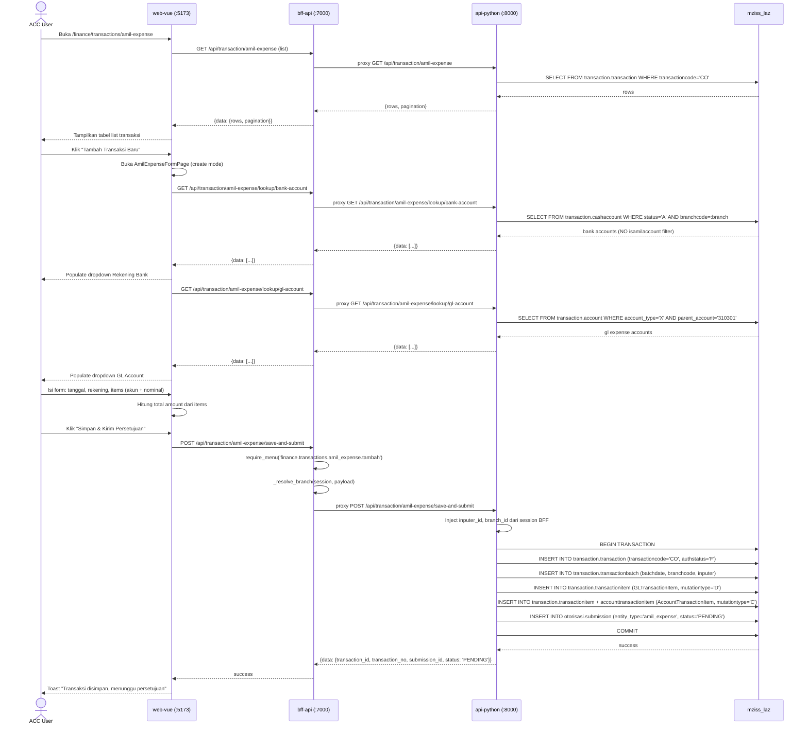

# Specs: Migrasi Menu TR0024B — Transaksi Pengeluaran Amil

**Tanggal:** 2026-06-20  
**Source:** `docs/legacy-apps/core/menus/Transaksi.mnu` — `Name='TR0024B'`  
**Modul:** `docs/legacy-apps/core/`  
**Event:** Migrasi menu legacy ke isf-app web-vue  

---

## RINGKASAN FITUR

**Fitur:** Transaksi Pengeluaran Amil (Cash-Out Amil — form input kas keluar beban amil)  
**Portal:** Zakat  
**Legacy Form:** `dialogs/Transaksi/fCashOut.*`  
**Transaction Code:** `'CO'` (Cash Out Amil) — FROZEN literal  
**Voucher Code:** `'KK'` (Kas Keluar) — FROZEN literal  
**Roles:** `ACC` (Accountant)  
**Menu Key:** `finance.transactions.amil_expense`  
**Route:** `/finance/transactions/amil-expense`

---

## AKSES

| Legacy AllowedGroups | isf-app role_code |
|---|---|
| `ACC` | `ACC` |

**Menu Key:** `finance.transactions.amil_expense`  
**Route:** `/finance/transactions/amil-expense`

---

## TIPE FITUR

**Tipe:** CRUD (Create, Read, Update, Delete) + Approval Workflow (Otorisasi)  
**Workflow:** Maker-checker dengan auto-approval berdasarkan limit nominal  
**Sistem Otorisasi:** Entity type = `'amil_expense'` (perlu didaftarkan di dispatcher)

---

## KONTEKS & TUJUAN

Form Pengeluaran Amil digunakan oleh ACC (Accountant) untuk mencatat transaksi kas keluar
yang dikeluarkan organisasi sebagai beban operasional amil. Transaksi ini memisahkan pengeluaran
khusus amil (seperti gaji, operasional, bonus) dari pengeluaran umum (penghimpunan/penyaluran).

Pengeluaran Amil bisa dilakukan melalui tiga channel:
1. **Kas Kecil** (Petty Cash) — untuk transaksi kecil, internal
2. **Kas Cabang** — untuk pengeluaran kas tunai per cabang
3. **Bank** — untuk pengeluaran transfer bank (channel utama)

Setiap pengeluaran dibebankan ke akun GL expense terpilih (parent `'310301'` — Beban Amil, account_type=`'X'`),
dan dikeluarkan dari rekening kas/bank pilihan user (TANPA filter `isamilaccount='T'` — semua rekening aktif boleh dipakai).

---

## ALUR DATA



---

## FORM FIELDS & LAYOUT

### HEADER SECTION

| Field | Type | Required | Default | Keterangan |
|---|---|---|---|---|
| `actual_date` | Date | ✓ | Today | Tanggal posting transaksi |
| `transaction_no` | String | ✗ | (auto) | Nomor transaksi (read-only, isi setelah save) |
| `paid_to` | String | ✗ | — | Nama penerima dana / pihak yang dibayar |
| `received_from` | String | ✗ | Username | Kasir/petugas mengeluarkan kas |

### PAYMENT TYPE SECTION (Tab / Radio Group)

**Default Tab: Kas** (berbeda dari amil-income yang default Bank)

#### TAB KAS (payment_type = 'K' atau 'C')

| Field | Type | Required | Default | Keterangan |
|---|---|---|---|---|
| `cash_type` | Select | ✓ | 'K' | Jenis kas: 'K'=Kas Kecil, 'C'=Kas Cabang |
| `petty_cash_account_no` | SearchSelect | ✗ | — | Nama Kas Kecil (lookup: semua PettyCash aktif, tampil jika cash_type='K') |
| `reference_no` | String | ✗ | — | No. Kwitansi |
| `description` | String | ✗ | — | Keterangan umum transaksi |
| `total_amount` | Currency | ✗ | (auto) | Total otomatis dari grid item (read-only) |

#### TAB BANK (payment_type = 'B')

| Field | Type | Required | Default | Keterangan |
|---|---|---|---|---|
| `bank_account_no` | SearchSelect | ✓ | — | Rekening Bank (filter: `status='A'`, branchcode=:branch; TANPA isamilaccount filter) |
| `reference_no` | String | ✗ | — | No. Cek / No. Referensi |
| `description` | String | ✗ | — | Keterangan umum transaksi |
| `rate` | Decimal | ✗ | 1.0 | Nilai Kurs (untuk valuta asing) |
| `total_amount` | Currency | ✗ | (auto) | Total otomatis dari grid item (read-only) |

#### TAB NON TUNAI / AKTIVA (payment_type = 'A')

**Status:** Not implemented di MVP (Tab disembunyikan di legacy)

---

### GRID DETAIL — ITEM TRANSAKSI

**Minimal 1 row wajib.**

**DELTA KRITIS vs Amil-Income:** Grid ini LEBIH SEDERHANA — tidak ada kolom cash_account_no, fund_product_code, fund_product_name.

| Field | Type | Required | Display | Keterangan |
|---|---|---|---|---|
| `account_code` | Lookup | ✓ | ✓ | GL Account Expense (filter: `account_type='X'` AND parent `'310301'`) |
| `account_name` | String | ✗ | ✓ | Nama akun GL (read-only, auto dari lookup) |
| `amount` | Currency | ✓ | ✓ | Nominal pengeluaran (> 0.0) |
| `description` | String | ✗ | ✓ | Keterangan item |
| `budget_code` | SearchSelect | ✗ | ✓ | Kode Budget (lookup via budget table) |
| `budget_owner` | String | ✗ | ✓ | Pemilik Budget (read-only, auto dari lookup) |
| `currency_code` | String | ✗ | ✗ | Valuta per item (hidden, default IDR) |
| `rate` | Decimal | ✗ | ✗ | Kurs per item (hidden, default 1.0) |
| `ekuivalen` | Currency | ✗ | ✗ | Amount * Rate (hidden, auto-compute) |
| `fund_entity` | Integer | ✗ | ✗ | Jenis Dana (1-9, enum, hidden) |
| `item_idx` | Integer | ✗ | ✗ | Urutan item (hidden, auto) |

---

## DISCRIMINATORS (KRITIS)

Jangan hilangkan saat implementasi — field ini membedakan transaksi pengeluaran amil dari transaksi lain.

| Discriminator | Value | Tabel | Kolom | Artinya |
|---|---|---|---|---|
| **TransactionCode** | `'CO'` | `transaction.transaction` | `transactioncode` | Cash Out Amil — membedakan dari SD001 (penghimpunan), DD001 (penyaluran), CI (cash in), dll |
| **VoucherCode** | `'KK'` | `transaction.transactiontype` | `vouchercode` | Kas Keluar — digunakan sebagai prefix nomor transaksi (format: `KK-YYYY-branch-cashCode-seq`) |
| **IsAmilAccount Filter** | TIDAK ADA | `transaction.cashaccount` | `isamilaccount` | **KRITIS:** untuk pengeluaran amil, ALL rekening aktif boleh dipilih (BUKAN hanya yang isamilaccount='T') |
| **AccountType** | `'X'` | `transaction.account` | `account_type` | Expense — tipe akun yang digunakan harus beban/pengeluaran |
| **ParentAccountCode** | `'310301'` | `transaction.account` | `parent_account` | Parent akun GL harus 310301 (Beban Amil) |
| **GLItemMutationType** | `'D'` | `transaction.transactionitem` | `mutationtype` | Debit — sisi GL (beban amil masuk) — BERLAWANAN dari amil-income (yang 'C') |
| **AccountItemMutationType** | `'C'` | `transaction.transactionitem` | `mutationtype` | Kredit — sisi kas/bank (kas/bank keluar) — BERLAWANAN dari amil-income (yang 'D') |
| **ParameterJournalId** | `'10'` | `transaction.transactionitem` | `parameterjournalid` | Standard journal parameter (untuk GL dan Account item — tidak ada 'C20') |
| **ChannelCode (Kas)** | `'P'` | `transaction.transaction` | `channelcode` | Petty — untuk Kas Kecil |
| **ChannelCode (Regular)** | `'R'` | `transaction.transaction` | `channelcode` | Regular — untuk Kas Cabang & Bank |
| **AuthStatus** | `'F'` → `'T'` | `transaction.transaction` | `authstatus` | Approval status (F=perlu approval, T=auto-approved per limit) |
| **EntityType** | `'amil_expense'` | `otorisasi.submission` | `entity_type` | Classifier untuk otorisasi dispatcher (perlu didaftarkan) |

---

## NOMOR TRANSAKSI FORMAT

```
{VoucherCode}-{YYYY}-{branchCode}-{cashCode}-{seq7digit}
```

**Contoh:**
- `KK-2026-001-BCA001-0001234` — Bank BCA, cabang 001, sequence 1234
- `KK-2026-001-IDR-0000512` — Kas Cabang IDR, cabang 001, sequence 512
- `KK-2026-001-PETTY-0000100` — Petty Cash, cabang 001, sequence 100

**Dimana:**
- `VoucherCode` = `'KK'` (dari `TransactionType` lookup, transactioncode='CO')
- `YYYY` = tahun
- `branchCode` = kode cabang dari session user
- `cashCode` = kode rekening kas/bank yang dipilih
- `seq7digit` = 7-digit sequence (managed by customidgenAPI)

---

## JOURNAL DIRECTION (KRITIS DELTA vs Amil-Income)

Pengeluaran Amil merekam **DOUBLE-ENTRY JOURNAL** dengan REVERSED mutation types vs Penerimaan Amil.

**Amil-Income (Cash-In) — Penerimaan:**
```
Debit:  Kas/Bank Masuk        (Account item, mutationtype='D')
Credit: Pendapatan Amil       (GL item, mutationtype='C')
Jurnal: Debit Kas | Kredit Pendapatan
```

**Amil-Expense (Cash-Out) — Pengeluaran:**
```
Debit:  Beban Amil            (GL item, mutationtype='D')
Credit: Kas/Bank Keluar       (Account item, mutationtype='C')
Jurnal: Debit Beban | Kredit Kas/Bank
```

**Implementasi:**
- GL item → `SetMutation('D', amount, rate)` — sisi Debit
- Account item → `SetMutation('C', totalAmount, rate)` — sisi Kredit
- Keduanya dengan `parameterjournalid='10'` (tidak ada `'C20'`)
- Posting logic: hanya saat `authstatus='T'` (approved via dispatcher)

---

## ENDPOINT CONTRACT

### GET /api/transaction/amil-expense

**Auth:** `require_menu('finance.transactions.amil_expense')`  
**Method:** GET  
**Query Params:**
- `date_from` (optional, ISO 8601) — filter tanggal dari
- `date_to` (optional, ISO 8601) — filter tanggal sampai
- `branch_code` (optional) — filter cabang (hanya jika `branch_access='all'`)
- `page` (int, default=1) — halaman
- `limit` (int, default=25) — rows per page

**Response:**
```json
{
  "data": {
    "rows": [
      {
        "transaction_id": 12345,
        "transaction_no": "KK-2026-001-BCA001-0001234",
        "actual_date": "2026-06-20",
        "bank_account_no": "BCA001",
        "bank_account_name": "BCA (Cabang 001)",
        "total_amount": 2500000.00,
        "reference_no": "CHK-99987",
        "description": "Pengeluaran gaji amil",
        "inputer": "HADI",
        "branch_code": "001",
        "status": "AUTHORIZED",
        "auth_user": "RAIS",
        "auth_date": "2026-06-20T14:30:00",
        "payment_type": "B",
        "channel_code": "R"
      }
    ],
    "pagination": {
      "page": 1,
      "limit": 25,
      "total": 78,
      "total_pages": 4
    }
  },
  "meta": { "request_id": "req-uuid-123" }
}
```

---

### POST /api/transaction/amil-expense/save-and-submit

**Auth:** `require_menu('finance.transactions.amil_expense.tambah')`  
**Method:** POST  
**Body:**
```json
{
  "actual_date": "2026-06-20",
  "payment_type": "B",
  "bank_account_no": "BCA001",
  "cash_type": null,
  "reference_no": "CHK-99987",
  "description": "Pengeluaran gaji amil Mei 2026",
  "rate": 1.0,
  "paid_to": "PT HRIS Indonesia",
  "received_from": "HADI",
  "items": [
    {
      "account_code": "310301-010",
      "account_name": "Beban Gaji Amil",
      "amount": 2500000.00,
      "currency_code": "IDR",
      "rate": 1.0,
      "description": "Gaji staf amil Mei",
      "budget_id": null,
      "budget_code": null
    }
  ]
}
```

**Note:** Field `inputer_id` dan `branch_id` **di-inject oleh BFF** dari session — tidak perlu dikirim dari frontend.

**Response:**
```json
{
  "data": {
    "transaction_id": 12345,
    "transaction_no": "KK-2026-001-BCA001-0001234",
    "status": "PENDING",
    "submission_id": 987654,
    "message": "Transaksi disimpan dan menunggu persetujuan"
  },
  "meta": { "request_id": "req-uuid-123" }
}
```

**Or if auto-approved (amount <= limit):**
```json
{
  "data": {
    "transaction_id": 12345,
    "transaction_no": "KK-2026-001-BCA001-0001234",
    "status": "AUTHORIZED",
    "message": "Transaksi disimpan dan otomatis disetujui (amount <= limit)"
  },
  "meta": { "request_id": "req-uuid-123" }
}
```

---

### GET /api/transaction/amil-expense/{transaction_id}

**Auth:** `require_menu('finance.transactions.amil_expense')`  
**Method:** GET  

**Response:**
```json
{
  "data": {
    "transaction_id": 12345,
    "transaction_no": "KK-2026-001-BCA001-0001234",
    "actual_date": "2026-06-20",
    "payment_type": "B",
    "bank_account_no": "BCA001",
    "bank_account_name": "BCA (Cabang 001)",
    "reference_no": "CHK-99987",
    "description": "Pengeluaran gaji amil Mei 2026",
    "rate": 1.0,
    "total_amount": 2500000.00,
    "inputer": "HADI",
    "branch_code": "001",
    "paid_to": "PT HRIS Indonesia",
    "received_from": "HADI",
    "status": "AUTHORIZED",
    "auth_status": "T",
    "auth_user": "RAIS",
    "auth_date": "2026-06-20T14:30:00",
    "channel_code": "R",
    "items": [
      {
        "transaction_item_id": 54321,
        "account_code": "310301-010",
        "account_name": "Beban Gaji Amil",
        "amount": 2500000.00,
        "mutation_type": "D",
        "currency_code": "IDR",
        "rate": 1.0,
        "ekuivalen": 2500000.00,
        "description": "Gaji staf amil Mei",
        "budget_code": null
      }
    ]
  },
  "meta": { "request_id": "req-uuid-123" }
}
```

---

### PUT /api/transaction/amil-expense/{transaction_id}

**Auth:** `require_menu('finance.transactions.amil_expense.ubah')`  
**Method:** PUT  
**Body:** (sama seperti POST save-and-submit)

**Restriction:** Hanya transaksi dengan `status=DRAFT` atau `authstatus='F'` dapat diubah.

**Response:** Sama seperti GET detail.

---

### DELETE /api/transaction/amil-expense/{transaction_id}

**Auth:** `require_menu('finance.transactions.amil_expense.hapus')`  
**Method:** DELETE  

**Restriction:** Hanya transaksi dengan `status=DRAFT` atau `authstatus='F'` dapat dihapus.

**Response:**
```json
{
  "data": {
    "message": "Transaksi berhasil dihapus"
  },
  "meta": { "request_id": "req-uuid-123" }
}
```

---

### GET /api/transaction/amil-expense/lookup/bank-account

**Auth:** `require_menu('finance.transactions.amil_expense')`  
**Method:** GET  
**Query Params:**
- `branch_code` (optional) — filter cabang (auto dari session jika tidak ada)

**DELTA:** TIDAK ADA filter `isamilaccount='T'` — ini perbedaan kunci dengan amil-income.

**Response:**
```json
{
  "data": [
    {
      "account_no": "BCA001",
      "account_name": "BCA (Cabang 001)",
      "bank_name": "Bank Central Asia",
      "cash_code": "BCA001",
      "currency_code": "IDR",
      "status": "A",
      "branch_code": "001"
    },
    {
      "account_no": "MNDI002",
      "account_name": "Mandiri (Cabang 002)",
      "bank_name": "Bank Mandiri",
      "cash_code": "MNDI002",
      "currency_code": "IDR",
      "status": "A",
      "branch_code": "002"
    }
  ],
  "meta": { "request_id": "req-uuid-123" }
}
```

---

### GET /api/transaction/amil-expense/lookup/gl-account

**Auth:** `require_menu('finance.transactions.amil_expense')`  
**Method:** GET  
**Query Params:**
- `branch_code` (optional)
- `search` (optional) — search by account_code atau account_name

**DELTA:** Filter `account_type='X'` (Expense, bukan 'I' Income seperti amil-income).

**Response:**
```json
{
  "data": [
    {
      "account_code": "310301-010",
      "account_name": "Beban Gaji Amil",
      "account_type": "X",
      "parent_account_code": "310301",
      "parent_account_name": "Beban Amil",
      "status": "A"
    },
    {
      "account_code": "310301-020",
      "account_name": "Beban Operasional Amil",
      "account_type": "X",
      "parent_account_code": "310301",
      "parent_account_name": "Beban Amil",
      "status": "A"
    }
  ],
  "meta": { "request_id": "req-uuid-123" }
}
```

---

### GET /api/transaction/amil-expense/lookup/petty-cash-account

**Auth:** `require_menu('finance.transactions.amil_expense')`  
**Method:** GET  
**Query Params:**
- `branch_code` (optional) — filter cabang

**Purpose:** Dropdown untuk memilih rekening Kas Kecil saat payment_type='K'.

**Response:**
```json
{
  "data": [
    {
      "account_no": "PETTY001",
      "account_name": "Kas Kecil Cabang 001",
      "cash_code": "PETTY001",
      "currency_code": "IDR",
      "status": "A",
      "branch_code": "001"
    }
  ],
  "meta": { "request_id": "req-uuid-123" }
}
```

---

### GET /api/transaction/amil-expense/next-number

**Auth:** `require_menu('finance.transactions.amil_expense')`  
**Method:** GET  
**Query Params:**
- `payment_type` (required: 'K', 'C', 'B') — jenis pembayaran
- `branch_code` (optional) — filter cabang
- `bank_account_no` (optional, required jika payment_type='B') — untuk ambil cash_code

**Response:**
```json
{
  "data": {
    "next_number": "KK-2026-001-BCA001-0001235",
    "prefix": "KK-2026-001-BCA001",
    "sequence": 1235
  },
  "meta": { "request_id": "req-uuid-123" }
}
```

---

## DATABASE SCHEMA

### Tabel Utama (Existing)

**Catatan:** Tidak ada tabel baru — semua data masuk ke schema existing `transaction.*` yang sudah dipakai amil-income.

#### transaction.transaction

Header transaksi pengeluaran amil.

| Kolom | Type | Keterangan |
|---|---|---|
| `transactionid` | SERIAL | PK |
| `transactionno` | VARCHAR(50) | Nomor unik transaksi (KK-YYYY-...) |
| `transactioncode` | VARCHAR(10) | **'CO'** (FROZEN discriminator) |
| `branchcode` | VARCHAR(10) | Kode cabang user |
| `inputer` | VARCHAR(20) | User yang membuat transaksi |
| `actualdate` | DATE | Tanggal posting transaksi |
| `amount` | DECIMAL(18,2) | Total nominal (sum dari items) |
| `currencycode` | VARCHAR(5) | Kode valuta (default 'IDR') |
| `rate` | DECIMAL(15,4) | Kurs (default 1.0) |
| `referenceno` | VARCHAR(50) | No. cek / No. referensi |
| `description` | VARCHAR(500) | Keterangan transaksi |
| `paidto` | VARCHAR(50) | Penerima dana / pihak dibayar |
| `receivedfrom` | VARCHAR(100) | Kasir mengeluarkan kas |
| `channelaccountno` | VARCHAR(30) | Rekening pembayaran (kas/bank) |
| `channelcode` | VARCHAR(1) | **'R'** (Regular, Kas/Bank) atau **'P'** (Petty) |
| `authstatus` | VARCHAR(1) | 'F'=belum approve, 'T'=approved |
| `authuser` | VARCHAR(20) | User yang approve |
| `authdate` | TIMESTAMP | Waktu approval |
| `isposted` | VARCHAR(1) | 'T'=sudah posting jurnal, 'F'=belum |
| `journalblockid` | INTEGER | FK ke accounting.journalblock |
| `journalno` | VARCHAR(50) | Nomor jurnal akuntansi |

**Filter untuk list:** `WHERE transactioncode='CO'`

---

#### transaction.transactionitem

Item (baris) transaksi. Setiap pengeluaran amil punya minimal 1 item GL.

| Kolom | Type | Keterangan |
|---|---|---|
| `transactionitemid` | SERIAL | PK |
| `transactionid` | INTEGER | FK ke TRANSACTION |
| `transactionitemtype` | VARCHAR(1) | **'G'**=GLTransactionItem (Beban), **'A'**=AccountTransactionItem (Kas/Bank) |
| `branchcode` | VARCHAR(10) | Kode cabang |
| `accountcode` | VARCHAR(30) | Kode GL account (untuk item tipe 'G') |
| `accountname` | VARCHAR(100) | Nama GL account |
| `mutationtype` | VARCHAR(1) | **'D'**=Debit (Beban), **'C'**=Kredit (Kas) — REVERSED vs amil-income |
| `amount` | DECIMAL(18,2) | Nominal item |
| `rate` | DECIMAL(15,4) | Kurs item (default 1.0) |
| `ekuivalenamount` | DECIMAL(18,2) | Amount * Rate |
| `currencycode` | VARCHAR(5) | Valuta item |
| `description` | VARCHAR(500) | Keterangan item |
| `parameterjournalid` | VARCHAR(10) | **'10'** (standard) — TIDAK ada 'C20' untuk amil-expense |
| `refaccountno` | VARCHAR(30) | Referensi akun (untuk tracing) |
| `refaccountname` | VARCHAR(100) | Nama referensi akun |

---

#### transaction.accounttransactionitem

Extension dari TRANSACTIONITEM untuk item tipe 'A' (Kas/Bank).

| Kolom | Type | Keterangan |
|---|---|---|
| `transactionitemid` | SERIAL | PK, FK ke TRANSACTIONITEM |
| `accountno` | VARCHAR(30) | FK ke CASHACCOUNT.accountno |
| `fundentity` | INTEGER | 1=Zakat, 2=Infaq, 3=Wakaf, 4=Amil, 5=NonHalal |
| `isupdatebalance` | VARCHAR(1) | 'T'=update balance, 'F'=tidak |
| `fundaccountno` | VARCHAR(30) | Referensi akun sumber dana |

---

#### transaction.cashaccount

Master rekening kas/bank.

| Kolom | Type | Keterangan |
|---|---|---|
| `accountno` | VARCHAR(30) | PK — kode rekening unik |
| `accountname` | VARCHAR(100) | Nama rekening |
| `branchcode` | VARCHAR(10) | Kode cabang |
| `currencycode` | VARCHAR(5) | Valuta rekening |
| `bankname` | VARCHAR(100) | Nama bank (jika bank account) |
| `bankaccountno` | VARCHAR(30) | Nomor rekening di bank |
| `status` | VARCHAR(1) | 'A'=Aktif, 'I'=Inactive |
| `cashcode` | VARCHAR(20) | Kode kas (digunakan di nomor transaksi) |
| `isamilaccount` | VARCHAR(1) | **TIDAK DIFILTER untuk amil-expense** (berbeda dari amil-income yang filter 'T') |

**Filter untuk dropdown Bank Account:** `WHERE status='A' AND branchcode=:branch_code` (NO isamilaccount filter)

---

#### transaction.transactiontype

Master memetakan `transactioncode` ke `vouchercode`.

| Kolom | Type | Keterangan |
|---|---|---|
| `transactioncode` | VARCHAR(10) | PK (misal: 'CO', 'CI', 'SD001', 'DD001') |
| `transactionname` | VARCHAR(100) | Nama transaksi |
| `vouchercode` | VARCHAR(10) | **'KK'** (untuk CO) |

**Verifikasi:** `SELECT vouchercode FROM transaction.transactiontype WHERE transactioncode='CO'` → harus return `'KK'`

---

#### otorisasi.submission

Riwayat submission & approval (maker-checker workflow).

| Kolom | Type | Keterangan |
|---|---|---|
| `submissionid` | SERIAL | PK |
| `entity_type` | VARCHAR(50) | **'amil_expense'** (untuk pengeluaran amil) |
| `entity_id` | VARCHAR(50) | Referensi ke transaction_id (string) |
| `payload` | JSONB | Full request payload |
| `status` | VARCHAR(20) | 'DRAFT'→'PENDING'→'PROCESSING'→'AUTHORIZED' atau 'REJECTED' |
| `submitted_by` | VARCHAR(20) | User yang submit |
| `submitted_at` | TIMESTAMP | Waktu submit |
| `approved_by` | VARCHAR(20) | User yang approve |
| `approved_at` | TIMESTAMP | Waktu approval |
| `dispatch_error` | VARCHAR(500) | Error jika dispatcher gagal |

---

## WORKFLOW OTORISASI

### Flow Maker-Checker

```
1. ACC membuat transaksi (form save via save-and-submit)
   ↓
2. Sistem cek nominal vs limit ACC:
   - Jika amount <= limit['O'] → otomatis AUTHORIZED
   - Jika amount > limit['O'] → status PENDING (menunggu supervisor)
   ↓
3. Supervisor review di halaman Otorisasi (finance.monitoring.authorization)
   ↓
4. Supervisor approve:
   - Status berubah PROCESSING
   - Background task jalankan dispatcher: amil_expense_service.create_from_payload()
   - Dispatcher INSERT journal (GL Debit | Kas Kredit) + UPDATE balance
   - Status menjadi AUTHORIZED
   ↓
5. (Jika reject) → status kembali ke DRAFT (ACC revisi & submit ulang)
```

### Entity Config

Di tabel `otorisasi.entity_config`, wajib ada entry:
- `entity_type: 'amil_expense'`
- `dispatcher_module: 'amil_expense_service'`
- `dispatcher_function: 'create_from_payload'`
- `limit_entity: 'ENTITY_AMIL_EXPENSE'` (atau per corp config)

---

## MENU KEY REGISTRY

Perlu didaftarkan di `apps_zakat/web-vue/src/lib/menu/registry.ts`:

```typescript
export const MENU_KEYS = {
  // ...
  FINANCE_TRANSACTIONS_AMIL_EXPENSE: 'finance.transactions.amil_expense',
  FINANCE_TRANSACTIONS_AMIL_EXPENSE_TAMBAH: 'finance.transactions.amil_expense.tambah',
  FINANCE_TRANSACTIONS_AMIL_EXPENSE_UBAH: 'finance.transactions.amil_expense.ubah',
  FINANCE_TRANSACTIONS_AMIL_EXPENSE_HAPUS: 'finance.transactions.amil_expense.hapus',
  // ...
}
```

---

## CATATAN IMPLEMENTASI PENTING

1. **Batch Handling:**
   - Service python harus auto-create/get batch per user + date + branch (internal, tidak di-expose UI)
   - Batch digunakan untuk mengelompokkan transaksi per hari

2. **Tab Default = Kas (DELTA):**
   - Amil-Income default tab = Bank
   - Amil-Expense default tab = Kas
   - Implementasi: set `payment_type='K'` di form open, bukan 'B'

3. **No IsAmilAccount Filter (KRITIS DELTA):**
   - Amil-Income: lookup bank hanya ambil `isamilaccount='T'`
   - Amil-Expense: lookup bank ambil SEMUA rekening aktif, TANPA filter isamilaccount
   - Endpoint: reuse `/api/transaction/bank-accounts` (non-amil) atau buat `/api/transaction/amil-expense/lookup/bank-account` terpisah (recommended)

4. **Grid Sederhana (DELTA):**
   - Amil-Income grid: account_code, account_name, amount, cash_account_no, cash_account_name, description, fund_product_code, fund_product_name
   - Amil-Expense grid: account_code, account_name, amount, description, budget_code, budget_owner (NO cash_account_no / fund_product)

5. **Lookup GL: Account_Type='X' (KRITIS):**
   - Amil-Income: `account_type='I'` (Income/Pendapatan)
   - Amil-Expense: `account_type='X'` (Expense/Beban) — BERBEDA
   - Jangan reuse endpoint lookup GL dari amil-income untuk amil-expense

6. **Journal Direction REVERSED (KRITIS):**
   - Amil-Income: GL='C' (Kredit Pendapatan), Account='D' (Debit Kas masuk)
   - Amil-Expense: GL='D' (Debit Beban), Account='C' (Kredit Kas keluar)
   - Service logic: `oItemGL.SetMutation('D', ...)` dan `oItemAccount.SetMutation('C', ...)`

7. **ParameterJournalId = '10' Everywhere (KRITIS):**
   - Amil-Income: GL item = '10', source account item (bank) = 'C20'
   - Amil-Expense: GL item = '10', account item = '10' (TIDAK ada 'C20')
   - Ini karena amil-expense tidak punya "source account" step — langsung dari kas/bank utama

8. **Entity_Type Registration (KRITIKAL):**
   - Dispatcher `'amil_expense'` harus didaftarkan di `otorisasi/service.py` sebelum live
   - Tanpa ini, transaksi tidak akan pernah AUTHORIZED (stuck di PENDING)

9. **Kwitansi Cetak:**
   - Fitur cetak kwitansi di-defer ke phase 2
   - Response API cukup return `transaction_no`

10. **Menu Permission:**
    - `require_menu('finance.transactions.amil_expense')` — view list + detail
    - `require_menu('finance.transactions.amil_expense.tambah')` — create
    - `require_menu('finance.transactions.amil_expense.ubah')` — update (DRAFT only)
    - `require_menu('finance.transactions.amil_expense.hapus')` — delete (DRAFT only)

11. **Async Feedback:**
    - Loading state selama POST/PUT/DELETE
    - Toast success pada save/update/delete berhasil
    - Toast error dengan detail message jika gagal
    - No inline confirm — delete via form modal (read-only form + confirm button)

12. **Discriminator Hardcoding:**
    - Jangan buat user input untuk `transactioncode`, `vouchercode`, `mutation_type`, `channel_code`, `parameter_journal_id`
    - Semua di-hardcode di service berdasarkan payment_type yang dipilih

13. **Tab Non Tunai (Aktiva):**
    - Tersembunyi di MVP — tidak diimplementasi di fase 1
    - Jika diperlukan, buka sebagai phase 2

---

## REFERENSI LEGACY

- **Form:** `docs/legacy-apps/core/dialogs/Transaksi/fCashOut.*`
- **Menu:** `docs/legacy-apps/core/menus/Transaksi.mnu` baris 296-300
- **Save handler:** `docs/legacy-apps/core/dialogs/Transaksi/fCashOut_data.py`
- **Service:** `docs/legacy-apps/core/scripts/Transaction/CashOut.py`
- **Analysis:** `docs/todos/2026-06-20-002-pengeluaran-amil/MIGRATION_ANALYSIS.md`

---
