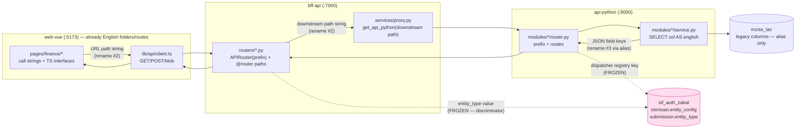

# Specs — Refactor BFF + api-python Naming to English

**Slug:** `2026-06-20-002-refactor-naming-english`
**Type:** Refactor (cross-layer, contract-changing)
**Portal:** Zakat first (`apps_zakat/`), mirror to Wakaf later
**Scope (confirmed with user):** file/folder + symbols + URL paths + JSON field names, with web-vue updated in **lockstep** wherever the BFF contract shifts.
**Companion docs:** [`glossary.md`](./glossary.md) (canonical mappings), [`plan.md`](./plan.md) (checklist)

---

## 1. Problem statement

`web-vue` already speaks English (page folders `fund-collection/`, route names `finance-*`, menu keys `finance.transactions.*`). The backend underneath is **mixed Indonesian/English**:

- **Indonesian URL prefixes**: `/penghimpunan`, `/penyaluran`, `/piutang`, `/transaksi/uang-muka`, `/transaksi-histori`, `/kas-kecil`, `/otorisasi`, `/parameter/pemilik-anggaran` …
- **Indonesian file/folder names**: `transaksi/`, `transaksi_histori/`, `kas_kecil/`, `otorisasi/`, `*_router.py`.
- **Module duplication**: `api-python/modules/transaction/` (English, holds penghimpunan+penyaluran) vs `modules/transaksi/` (Indonesian, holds the 6 other tx types). The BFF mirrors this with `transaction.py` / `transaksi.py` / `transaksi_umum.py`.
- **Indonesian JSON fields** leaking to the frontend: `no_rekening`, `tanggal`, `keterangan`, `zakat_profesi`, `ownerid`, `tglubah`, `id_peran`, `kode_cabang`, `valuta_code`, `ekuivalen_amount`, plus a camelCase soup in transaction-history.

Result: the contract surface between web-vue ↔ BFF ↔ api-python is inconsistent and hard to reason about.

## 2. Goal / target state

One consistent English naming convention across all three layers:

- **URL paths**: kebab-case English (`/fund-collection`, `/transaction/cash-advance`, `/authorization`, `/parameter/budget-owner`).
- **Python identifiers**: snake_case English module/folder/file/function names.
- **JSON fields**: snake_case English keys, produced via `SELECT col AS english_name` aliases (legacy DB columns are **never** ALTERed).
- **web-vue**: API call path strings, TS interfaces, and template bindings updated to match, verified end-to-end.
- **Frozen** (see glossary §5): discriminator codes (`entity_type` values, `transactioncode`, `fund_entity`, …) and Islamic terms (`ashnaf`, `zakat_fitrah`, `infaq`, `wakaf`, `qurban`).

## 3. Architecture — request flow & rename touchpoints



**Three rename axes**, each must be consistent across the whole chain:
1. **#1 internal symbols** — file/folder/function names. Backend-only, no contract change. Safe.
2. **#2 URL paths** — must change in api-python router *and* BFF router *and* BFF downstream call string *and* web-vue call string, all together.
3. **#3 JSON fields** — must change in api-python `SELECT ... AS` + Pydantic schema *and* web-vue TS interface + template binding, together.

## 4. Module consolidation (api-python)

Resolve the `transaction/` vs `transaksi/` split. **Flat merge** into `modules/transaction/` with English filenames — matches the existing convention (`penghimpunan_service.py` already lives flat in `transaction/`) and avoids splitting the monolith `transaction/router.py`:

```
api-python/app/modules/transaction/
├── router.py                         (monolith: keeps collection/distribution CRUD + batch upload)
├── service.py parse.py commit.py repository.py template.py schema.py   (batch core, unchanged)
├── fund_collection_{repo,schema,service}.py     (was penghimpunan_*)
├── fund_distribution_{repo,schema,service}.py   (was penyaluran_*)
├── cash_advance_{router,schema,service}.py             (was transaksi/uang_muka_*)
├── cash_advance_settlement_{router,schema,service}.py  (was transaksi/uang_muka_pengembalian_*)
├── inter_account_transfer_{router,schema,service}.py   (was transaksi/transfer_antar_rekening_*)
├── receivable_{router,schema,service}.py               (was transaksi/piutang_*)
├── general_{router,schema,service}.py                  (was transaksi/transaksi_umum_*)
├── amil_income_{router,schema,service}.py              (move only, already English)
└── hc_zis_{router,commit,parse,schema,service}.py      (was transaksi/{router,hc_zis_*})
```
Standalone modules renamed: `kas_kecil/` → `petty_cash/`, `otorisasi/` → `authorization/`, `transaksi_histori/` → `transaction_history/` (folder rename; inner filenames unchanged). The `transaksi/` folder is removed.

> Consolidation runs **Phase 1a** (per 2026-06-20 decision) — before path/field renames, with URL prefixes left unchanged so the contract doesn't break. Class names (`PenghimpunanCreate` → `FundCollectionCreate`) are symbol renames done in Phase 1b; they don't affect JSON contract.

## 5. Endpoint contract — old → new (the lockstep surface)

> Base prefix `/api` unchanged. `_resolve_branch` / session plumbing unchanged.

| Domain | Old (BFF external) | New (BFF external) | Old downstream (api-python) | New downstream |
|---|---|---|---|---|
| Fund collection | `/penghimpunan/*` | `/fund-collection/*` | `/api/transaction/penghimpunan/*` | `/api/transaction/fund-collection/*` |
| Fund distribution | `/penyaluran/*` | `/fund-distribution/*` | `/api/transaction/penyaluran/*` | `/api/transaction/fund-distribution/*` |
| Receivable | `/piutang/*` | `/receivable/*` | `/api/transaksi/piutang/*` | `/api/transaction/receivable/*` |
| Cash advance | `/transaksi/uang-muka/*` | `/transaction/cash-advance/*` | `/api/transaksi/uang-muka/*` | `/api/transaction/cash-advance/*` |
| Cash advance return | `/transaksi/uang-muka-pengembalian/*` | `/transaction/cash-advance-return/*` | same | `/api/transaction/cash-advance-return/*` |
| Inter-account transfer | `/transaksi/transfer-antar-rekening/*` | `/transaction/inter-account-transfer/*` | same | `/api/transaction/inter-account-transfer/*` |
| General transaction | `/transaksi-umum/*` | `/general-transaction/*` | `/api/transaksi/umum/*` | `/api/transaction/general/*` |
| Transaction history | `/transaksi-histori/*` | `/transaction-history/*` | `/api/transaksi-histori/*` | `/api/transaction-history/*` |
| HC-ZIS upload | `/transaksi/upload/hc-zis/*` | `/transaction/upload/hc-zis/*` | `/api/transaksi/upload/hc-zis/*` | `/api/transaction/upload/hc-zis/*` |
| Collection batch upload | `/transaction/upload/penghimpunan/*` | `/transaction/upload/fund-collection/*` | same | `/api/transaction/upload/fund-collection/*` |
| Petty cash | `/kas-kecil/*` | `/petty-cash/*` | `/api/kas-kecil/*` | `/api/petty-cash/*` |
| Authorization | `/otorisasi/*` | `/authorization/*` | `/api/otorisasi/*` | `/api/authorization/*` |
| Budget owner | `/parameter/pemilik-anggaran/*` | `/parameter/budget-owner/*` | same | `/api/parameter/budget-owner/*` |
| Sub-paths | `lookup/rekening`,`lookup/produk`,`lookup/kasbank`,`lookup/penyaluran`,`debitur*` | `lookup/account`,`lookup/product`,`lookup/cash-bank`,`lookup/distribution`,`debtor*` | mirror | mirror |

JSON field renames: see [`glossary.md`](./glossary.md) §3.

## 6. Risk register

| Risk | Severity | Mitigation |
|---|---|---|
| `entity_type` values are persisted in `otorisasi.submission` + `entity_config` + dispatcher registry, and hardcoded in 5+ web-vue files | **High** | **Recommend FREEZE** (treat as opaque code). If renamed: needs SQL data migration + `_register_defaults()` keys + seed + FE literals, all atomic. Decision required before Phase 5. |
| `id_peran` / `kode_cabang` flow into login → auth session → `stores/auth.ts` → sidebar filtering | High | Rename at api-python identity schema, BFF session-build, `auth.ts`, sidebar, all in one slice; re-test login + RBAC. |
| URL path change without FE update → 404 | High | Lockstep per domain; verify with `testing/e2e-*.sh` after each slice. |
| JSON field change without FE binding update → blank UI | High | Rename schema + alias + TS interface + template together per domain. |
| `transaksi_histori` camelCase fields are many & report pages depend on `saldo_*` | Medium | Normalize in one pass with the history slice; grep report pages for each key. |
| Wakaf drift while zakat refactors | Medium | Zakat-only now; capture diffs, mirror as a discrete follow-up. |

## 7. Recommended workflow type

**Refactor (vertical slices per domain)** — *not* CRUD/Report/Approval. Each domain slice touches api-python + bff + web-vue (+ DB seed only for the frozen-discriminator decision) and is independently E2E-verifiable. Order by ascending risk: internal symbols → low-traffic paths → high-traffic paths/fields → auth/identity fields → (optional) module consolidation. Keep `entity_type` frozen unless a separate decision says otherwise.

## 8. Out of scope

- Wakaf portal (separate follow-up).
- Renaming actual DB columns (alias only).
- Renaming discriminator codes / Islamic terms (glossary §5).
- Behavioral changes — this is naming-only; no logic, validation, or query-result changes.
