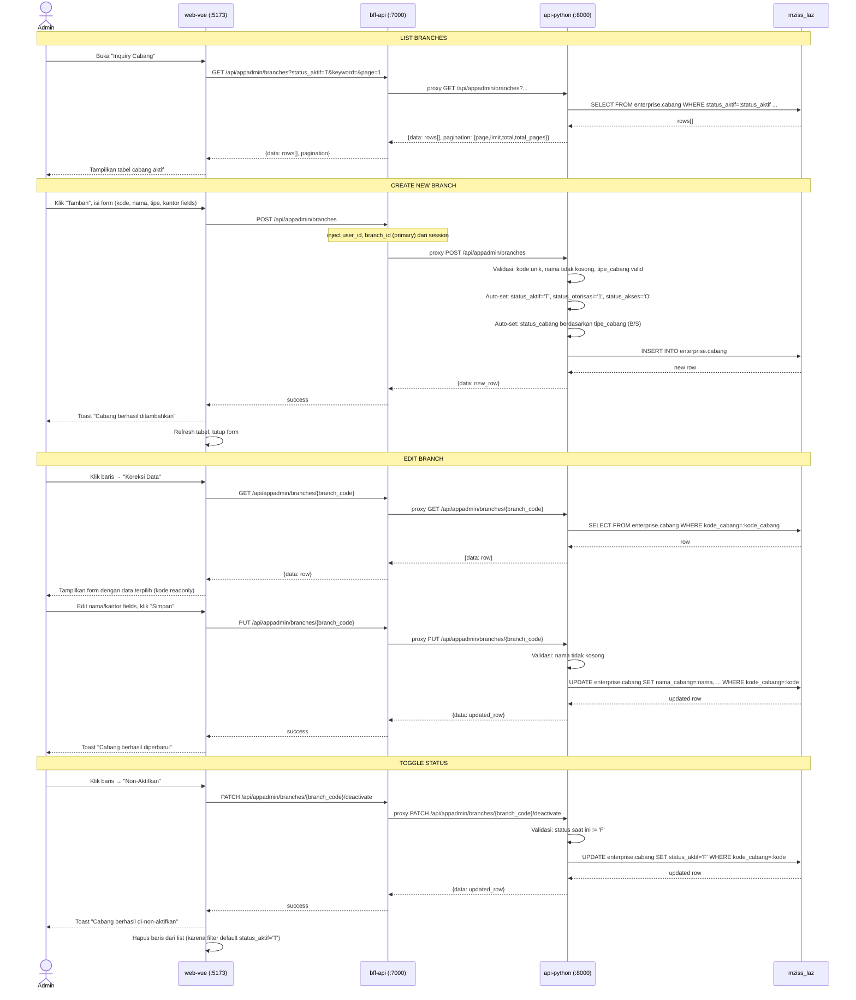
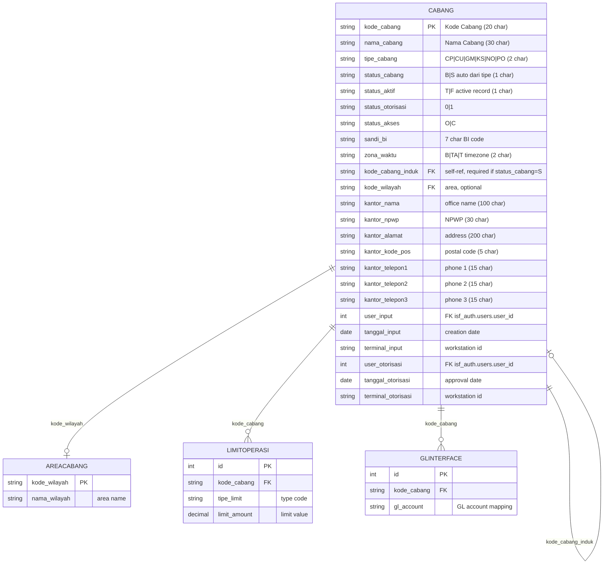

# Specs: Manajemen Cabang

**Portal:** zakat
**Domain:** `appadmin` (Pengaturan Akses / App Administration)
**Tipe:** CRUD (list, create, edit, toggle status, detail)
**Legacy Ref:** docs/legacy-apps/enterprise/ — dialogs/corporateParameter/cabang{Query,New,Edit,View}.*, scripts/corporateParameter/S_{NonAktifkan,Aktifkan}Cabang.py
**Tanggal:** 2026-06-22

---

## Konteks

Manajemen Cabang adalah fitur master data yang mengelola struktur organisasi kantor cabang
dan unit kerja di seluruh jaringan LAZ. Setiap cabang adalah entitas independen dengan
hierarki (Cabang Utama vs Pembantu), lokasi geografis, dan status operasional. Fitur ini
critical untuk RBAC per branch dan session management.

---

## Alur Data



---

## Entity Relationship Diagram



---

## Endpoint Contract

### GET /api/appadmin/branches

**Auth:** `require_menu("appadmin.branch.list")`

**Query params:**
- `page` (int, default=1) — halaman
- `limit` (int, default=25) — record per halaman
- `status_aktif` (string, optional: T|F|ALL, default=T) — filter aktif/tidak aktif
- `keyword` (string, optional) — LIKE kode_cabang atau nama_cabang (case-insensitive)

**Response:**
```json
{
  "data": [
    {
      "kode_cabang": "001",
      "nama_cabang": "Pusat",
      "tipe_cabang": "PO",
      "status_cabang": "B",
      "cabang_induk": null,
      "kantor_nama": "Kantor Pusat Jakarta",
      "status_aktif": "T",
      "zona_waktu": "B"
    },
    {
      "kode_cabang": "002",
      "nama_cabang": "Cabang Bandung",
      "tipe_cabang": "CU",
      "status_cabang": "B",
      "cabang_induk": "001",
      "kantor_nama": "Kantor Cabang Bandung",
      "status_aktif": "T",
      "zona_waktu": "B"
    }
  ],
  "pagination": {
    "page": 1,
    "limit": 25,
    "total": 45,
    "total_pages": 2
  },
  "meta": {
    "request_id": "req_xxx"
  }
}
```

---

### POST /api/appadmin/branches

**Auth:** `require_menu("appadmin.branch.create")`

**Body:**
```json
{
  "kode_cabang": "003",
  "nama_cabang": "Cabang Surabaya",
  "tipe_cabang": "CU",
  "kantor_nama": "Kantor Cabang Surabaya",
  "kantor_npwp": "01.123.456.7-890.123",
  "kantor_alamat": "Jl. Raya Surabaya No. 100",
  "kantor_kode_pos": "60000",
  "kantor_telepon1": "031-1234567",
  "kantor_telepon2": null,
  "kantor_telepon3": null
}
```

*Note: `user_input`, `tanggal_input`, `terminal_input`, `status_aktif`, `status_otorisasi`, `status_akses`, `status_cabang` diinject/auto-set oleh api-python — tidak perlu dikirim frontend.*

**Response:**
```json
{
  "data": {
    "kode_cabang": "003",
    "nama_cabang": "Cabang Surabaya",
    "tipe_cabang": "CU",
    "status_cabang": "B",
    "status_aktif": "T",
    "status_otorisasi": "1",
    "status_akses": "O",
    "kantor_nama": "Kantor Cabang Surabaya",
    "kantor_npwp": "01.123.456.7-890.123",
    "kantor_alamat": "Jl. Raya Surabaya No. 100",
    "kantor_kode_pos": "60000",
    "kantor_telepon1": "031-1234567",
    "zona_waktu": "B",
    "user_input": "hadi",
    "tanggal_input": "2026-06-22"
  },
  "meta": {
    "request_id": "req_xxx"
  }
}
```

---

### GET /api/appadmin/branches/{branch_code}

**Auth:** `require_menu("appadmin.branch.detail")`

**Path param:**
- `branch_code` (string) — kode cabang, e.g., "001"

**Response:**
```json
{
  "data": {
    "kode_cabang": "001",
    "nama_cabang": "Pusat",
    "tipe_cabang": "PO",
    "status_cabang": "B",
    "status_aktif": "T",
    "kantor_nama": "Kantor Pusat Jakarta",
    "kantor_npwp": "01.999.999.9-999.999",
    "kantor_alamat": "Jl. Gatot Subroto No. 50",
    "kantor_kode_pos": "12950",
    "kantor_telepon1": "021-1234567",
    "kantor_telepon2": "021-1234568",
    "kantor_telepon3": null,
    "zona_waktu": "B",
    "user_input": "hadi",
    "tanggal_input": "2025-01-01"
  },
  "meta": {
    "request_id": "req_xxx"
  }
}
```

---

### PUT /api/appadmin/branches/{branch_code}

**Auth:** `require_menu("appadmin.branch.edit")`

**Path param:**
- `branch_code` (string) — kode cabang (readonly)

**Body:**
```json
{
  "nama_cabang": "Pusat Jakarta Selatan",
  "kantor_nama": "Kantor Pusat Jakarta Selatan",
  "kantor_npwp": "01.999.999.9-999.999",
  "kantor_alamat": "Jl. Gatot Subroto No. 50 A",
  "kantor_kode_pos": "12950",
  "kantor_telepon1": "021-1234567",
  "kantor_telepon2": "021-1234568",
  "kantor_telepon3": null
}
```

**Response:**
```json
{
  "data": {
    "kode_cabang": "001",
    "nama_cabang": "Pusat Jakarta Selatan",
    "tipe_cabang": "PO",
    "status_cabang": "B",
    "status_aktif": "T",
    "kantor_nama": "Kantor Pusat Jakarta Selatan",
    "kantor_npwp": "01.999.999.9-999.999",
    "kantor_alamat": "Jl. Gatot Subroto No. 50 A",
    "kantor_kode_pos": "12950",
    "kantor_telepon1": "021-1234567",
    "kantor_telepon2": "021-1234568",
    "kantor_telepon3": null
  },
  "meta": {
    "request_id": "req_xxx"
  }
}
```

---

### PATCH /api/appadmin/branches/{branch_code}/deactivate

**Auth:** `require_menu("appadmin.branch.toggle-status")`

**Path param:**
- `branch_code` (string) — kode cabang

**Body:** (empty)

**Validasi:**
- Cabang harus status_aktif != 'F'

**Response:**
```json
{
  "data": {
    "kode_cabang": "003",
    "nama_cabang": "Cabang Surabaya",
    "status_aktif": "F"
  },
  "meta": {
    "request_id": "req_xxx"
  }
}
```

---

### PATCH /api/appadmin/branches/{branch_code}/activate

**Auth:** `require_menu("appadmin.branch.toggle-status")`

**Path param:**
- `branch_code` (string) — kode cabang

**Body:** (empty)

**Validasi:**
- Cabang harus status_aktif != 'T'

**Response:**
```json
{
  "data": {
    "kode_cabang": "003",
    "nama_cabang": "Cabang Surabaya",
    "status_aktif": "T"
  },
  "meta": {
    "request_id": "req_xxx"
  }
}
```

---

### GET /api/appadmin/branches/check-code/{branch_code}

**Auth:** `require_menu("appadmin.branch.create")`

**Path param:**
- `branch_code` (string) — kode cabang untuk dicek keunikan

**Response (if exists):**
```json
{
  "data": {
    "exists": true,
    "message": "Kode cabang sudah terdaftar"
  },
  "meta": {
    "request_id": "req_xxx"
  }
}
```

**Response (if not exists):**
```json
{
  "data": {
    "exists": false,
    "message": "Kode cabang tersedia"
  },
  "meta": {
    "request_id": "req_xxx"
  }
}
```

---

## Database

**Tabel:** `enterprise.cabang` (sudah ada di legacy, verification perlu)

**Kolom (dari MIGRATION_ANALYSIS):**

| Kolom | Type | Keterangan |
|---|---|---|
| `kode_cabang` | VARCHAR(20) | PK — Kode Cabang |
| `nama_cabang` | VARCHAR(30) | Nama Cabang |
| `tipe_cabang` | VARCHAR(2) | CP\|CU\|GM\|KS\|NO\|PO |
| `status_cabang` | VARCHAR(1) | B (Utama) \| S (Pembantu), auto dari tipe_cabang |
| `status_aktif` | VARCHAR(1) | T (Aktif) \| F (Non-Aktif), default T |
| `status_otorisasi` | VARCHAR(1) | 0\|1, default 1 |
| `status_akses` | VARCHAR(1) | O (Open) \| C (Closed), default O |
| `sandi_bi` | VARCHAR(7) | BI code (hidden di form) |
| `zona_waktu` | VARCHAR(2) | B (WIB) \| TA (WITA) \| T (WIT) |
| `kode_cabang_induk` | VARCHAR(20) | FK self-ref, required jika status_cabang='S' |
| `kode_wilayah` | VARCHAR(...) | FK areacabang, optional |
| `kantor_nama` | VARCHAR(100) | Nama Kantor |
| `kantor_npwp` | VARCHAR(30) | NPWP Kantor |
| `kantor_alamat` | VARCHAR(200) | Alamat Kantor |
| `kantor_kode_pos` | VARCHAR(5) | Kode Pos Kantor |
| `kantor_telepon1` | VARCHAR(15) | Telepon 1 |
| `kantor_telepon2` | VARCHAR(15) | Telepon 2 |
| `kantor_telepon3` | VARCHAR(15) | Telepon 3 |
| `user_input` | VARCHAR | Dari session user |
| `tanggal_input` | DATE | Creation date |
| `terminal_input` | VARCHAR | Workstation ID |
| `user_otorisasi` | VARCHAR | Approval user (opsional) |
| `tanggal_otorisasi` | DATE | Approval date (opsional) |
| `terminal_otorisasi` | VARCHAR | Approval workstation (opsional) |
| `level_cabang` | VARCHAR(...) | Hidden, warisan core banking |
| `kantor_tipe` | VARCHAR(...) | Hidden, warisan core banking |
| `id_sandibi` | INT | Hidden, warisan core banking |
| `id_sandilokasi` | INT | Hidden, warisan core banking |
| `kode_wilayah_kliring` | VARCHAR(...) | Hidden, warisan core banking |

---

## Menu Keys

| Key | Label | Roles | Aksi |
|---|---|---|---|
| `appadmin.branch.list` | Inquiry Cabang | ADMIN | View list + filter |
| `appadmin.branch.create` | Input Data Cabang Baru | ADMIN | Create new |
| `appadmin.branch.edit` | Koreksi Data Cabang | ADMIN | Edit existing |
| `appadmin.branch.detail` | Lihat Data Cabang | ADMIN | View detail (read-only) |
| `appadmin.branch.toggle-status` | Kelola Status Cabang | ADMIN | Activate/Deactivate |

---

## Catatan Implementasi

1. **Schema Verification Critical:** Tabel enterprise.cabang sudah ada di legacy. Layer 1 (DB) harus verifikasi kolom aktual di DB production sebelum implementasi. Perbandingan: kolom MIGRATION_ANALYSIS vs actual schema di mziss_laz.

2. **Self-Referencing Hierarchy:** kode_cabang_induk adalah self-reference FK. Implementasi api-python harus:
   - Validasi kode_cabang_induk ada di enterprise.cabang jika tipe_cabang='S'
   - Cegah circular reference (A → B → A)
   - Lazy-load cabang_induk di response list (join ke Cabang untuk nama)

3. **Status Cabang Discriminator:** status_cabang (B/S) HARUS auto-computed dari tipe_cabang, bukan user-input.
   - CP/GM/KS → status_cabang='S' (Pembantu)
   - CU/PO/NO → status_cabang='B' (Utama)
   - Hidden dari form (form tidak tampilkan field ini)

4. **Conditional Field:** kode_cabang_induk **enabled hanya** jika status_cabang='S' (Pembantu). Di create form, dropdown tipe_cabang perlu trigger onChange → validasi status_cabang → show/hide cabang_induk.

5. **Cross-Service Call Missing:** Legacy melakukan rexecscript('transaction', 'AppInterface/GenerateInstanceByBranch') saat create branch. **Investigasi tersendiri** diperlukan untuk menentukan:
   - Apa saja yang GenerateInstanceByBranch buat (instance transaksi? config? master data lain?)
   - Apakah diperlukan di isf-app atau bisa dihilangkan?
   - Jika ada, call mana endpoint-nya di api-python/transaction module?

6. **Tab GL Interface & Limit Operasi Ditangguhkan:** Legacy memiliki 2 tab hidden (TabVisible=false):
   - Tab Limit Operasi (edit enterprise.limitoperasi per cabang)
   - Tab GL Interface (edit enterprise.glinterface per cabang)
   - Implementasi awal **hanya fokus pada CRUD cabang**. Tab ini bisa di-sprint berikutnya jika diperlukan.

7. **Unique Branch Code:** POST /api/appadmin/branches harus cek kode_cabang belum ada (unique constraint atau aplikasi). Endpoint GET .../check-code/{code} tersedia untuk validasi async di form.

8. **Audit Trail:** user_input, tanggal_input, terminal_input HARUS di-set oleh api-python dari session header (user_id dari JWT, workstation/terminal dari header atau default). Jangan terima dari frontend.

9. **Status Akses (O/C):** status_akses='O' di-set saat create, bukan user-controlled. Fitur "Buka/Tutup Cabang" adalah session management terpisah, bukan bagian CRUD cabang.

10. **Filter Default:** LIST endpoint filter default status_aktif='T' (aktif saja). Frontend harus pass ?status_aktif=T ke API, atau API apply diskriminator ini.

---

## Open Questions untuk nuwis-architect

1. **GenerateInstanceByBranch:** Cross-service call ke transaction module ini kritis. Perlu dokumentasi atau analisis kode legacy untuk menjawab:
   - Apa fungsinya? (Generate GL instance? Budget instance? Master data?)
   - Perlu di-replicate ke api-python atau bisa skip di isf-app?
   - Jika ada, di mana endpoint-nya atau bagaimana trigger-nya?

2. **Dropdown Cabang Induk (Parent Branch):** Saat form edit/create cabang pembantu (status_cabang='S'), dropdown kode_cabang_induk harus list:
   - Hanya cabang dengan status_cabang='B' (utama), atau
   - Hanya cabang dengan status_cabang='B' OR parent dari cabang yang sedang diedit?
   - Pagination/search di dropdown diperlukan jika ribuan cabang?

3. **Portal Isolation:** Apakah enterprise.cabang shared di kedua portal (zakat & wakaf) atau per-portal?
   - Jika shared, tabel tidak perlu migration (data sudah ada)
   - Jika per-portal, butuh seed data untuk wakaf portal post-migration
   - Current understanding: cabang adalah core enterprise data, likely shared
