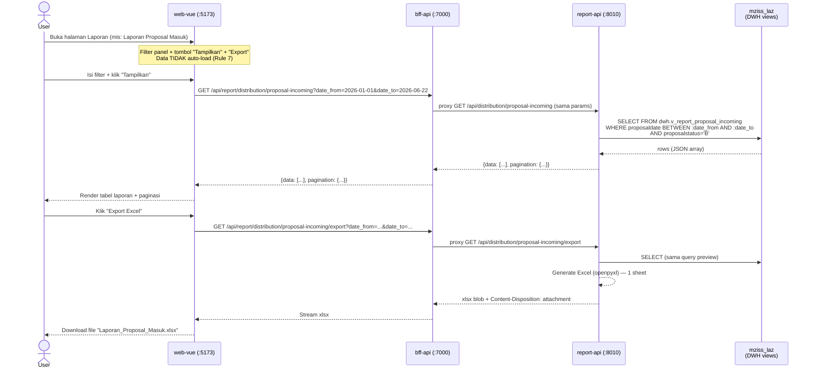

# Specs: Laporan Penyaluran Zakat

**Portal**: zakat
**Domain**: `distribution`
**Tipe**: Report (7 laporan berbeda)
**Legacy Ref**: docs/legacy-apps/program/dialogs/Laporan/* + fReportRealization*.* + QLapProposal.* + QLapMustahiq.*
**Tanggal**: 2026-06-22

## Konteks

Laporan Penyaluran adalah salah satu modul inti ZISWAF Zakat. Terdiri dari 7 laporan utama yang melacak proposal, mustahiq, dan realisasi penyaluran dana zakat (reguler/non-reguler, piutang, pengembalian). Setiap laporan punya filter dan output Excel multi-sheet berbeda dengan kompleksitas tinggi (hingga 15 JOIN + aggregation + nested loop).

## Alur Data



## Endpoint Contract

Semua endpoint di report-api. BFF proxy dengan `stream_report_api` untuk xlsx.

### 1. GET /api/report/distribution/proposal-incoming

**Auth**: `require_menu("distribution.report.proposal-incoming")`
**Query params**:
- `date_from` (str ISO YYYY-MM-DD, required)
- `date_to` (str ISO YYYY-MM-DD, required)
- `mustahiq_id` (int, optional) — FK to program.mustahiq
- `product_group_id` (int, optional) — FK to program.productgroup

**Response**:
```json
{
  "data": [
    {
      "proposal_id": 1,
      "proposal_date": "2026-01-15",
      "proposal_description": "Bantuan Pendidikan",
      "proposal_no": "PRP001",
      "proposal_nominal": 5000000,
      "proposal_received_by": "Admin",
      "proposal_received_date": "2026-01-15",
      "proposal_reference_by": "Koordinator",
      "customer_name": "Ahmad Hidayat",
      "product_group_name": "Beasiswa",
      "realization_date": "2026-01-20",
      "realization_amount": 5000000,
      "memo_amount": 5000000,
      "realmemo_number": "RM001",
      "fund_source_no": "FS001",
      "fund_source_name": "Zakat Umum",
      "proposal_status": "B"
    }
  ],
  "pagination": { "page": 1, "limit": 25, "total": 142, "total_pages": 6 },
  "meta": { "request_id": "..." }
}
```

### 1. GET /api/report/distribution/proposal-incoming/export

**Params**: (sama dengan endpoint preview)
**Response**: xlsx 1 sheet, kolom:
Nama Mustahiq | Jenis Program | No Proposal | Tgl Proposal | Deskripsi | Nominal | Diterima Oleh | Tgl Diterima | Referensi | Tgl Realisasi | Nominal Realisasi | No Memo | Sumber Dana

---

### 2. GET /api/report/distribution/mustahiq-list

**Query params**:
- `mustahiq_type` (str 'MP'/'MC', optional) — Individu/Lembaga
- `product_id` (int, optional)
- `date_start_from` (str ISO, optional)
- `date_start_to` (str ISO, optional)

**Response**:
```json
{
  "data": [
    {
      "mustahiq_id": 1,
      "mustahiq_type": "MP",
      "customer_name": "Ahmad Hidayat",
      "address_street": "Jl. Merdeka 123",
      "address_kelurahan": "Kelurahan A",
      "address_kecamatan": "Kecamatan B",
      "address_city": "Jakarta",
      "phone_number": "021234567",
      "cp_name": "Ibu Ahmad",
      "cp_phone_number": "021234567",
      "cp_mobile_number": "08123456789",
      "ashnaf_label": "Fakir",
      "product_name": "Beasiswa S1",
      "product_id": 1,
      "date_start": "2026-01-01",
      "distribution_amount": 500000,
      "school_name": "Universitas A",
      "sd_kelas": null,
      "sd_tahun_awal": null,
      "sd_tahun_akhir": null,
      "achievement": "Juara 1 Matematika",
      "supervisor_name": "Budi Santoso"
    }
  ],
  "pagination": { "page": 1, "limit": 25, "total": 89, "total_pages": 4 }
}
```

### 2. GET /api/report/distribution/mustahiq-list/export

**Response**: xlsx 1 sheet, kolom:
ID | Nama | Golongan | Ashnaf | Alamat | Telepon | Nama Kontak | Telp Kontak | HP Kontak | Supervisor | Tingkat | Sekolah | Achievement | Tgl Program | Nama Program | Rencana Distribusi | Realisasi

---

### 3. GET /api/report/distribution/realization-regular

**Query params**:
- `date_from` (str ISO, required)
- `date_to` (str ISO, required)

**Response**:
```json
{
  "data": [
    {
      "product_id": 1,
      "product_name": "Beasiswa Bulanan",
      "product_group_name": "Pendidikan",
      "customer_name": "Ahmad Hidayat",
      "address_street": "Jl. Merdeka 123",
      "realization_id": 100,
      "realization_date": "2026-06-01",
      "status_receivables": "N",
      "realization_amount": 500000,
      "report_amount": 500000,
      "report_detail_status": "1",
      "budget_code": "BK001",
      "budget_item_description": "Beasiswa Rutin"
    }
  ],
  "pagination": { "page": 1, "limit": 25, "total": 156, "total_pages": 7 }
}
```

### 3. GET /api/report/distribution/realization-regular/export

**Response**: xlsx 3 sheet (Detail, Rekap, RekapAnggaran)
- Detail: grouped by ProductName (subtotal)
- Rekap: sum per ProductGroupName
- RekapAnggaran: sum per BudgetCode

---

### 4. GET /api/report/distribution/realization-non-regular

**Query params**:
- `date_from` (str ISO)
- `date_to` (str ISO)
- `amount_min` (float, default 0)
- `amount_max` (float, default 3000000)

**Response**: (similar structure, additional fields: proposal_no, account_name)

### 4. GET /api/report/distribution/realization-non-regular/export

**Response**: xlsx 3 sheet (Detail, Rekap, RekapAnggaran)

---

### 5. GET /api/report/distribution/realization-receivable

**Query params**:
- `date_from` (str ISO)
- `date_to` (str ISO)

**Response**:
```json
{
  "data": [
    {
      "realization_id": 100,
      "realization_date": "2026-06-01",
      "realization_amount": 1000000,
      "realization_input_user": "Inputer01",
      "realization_type": "R",
      "realization_description": "Penyaluran Rutin",
      "realmemo_number": "RM001",
      "employee_name": "Siti Nur",
      "receivable_report_user_input": "Laporan01",
      "report_amount": 800000,
      "receivable_report_date": "2026-06-10"
    }
  ]
}
```

**Note**: Perhitungan sisa piutang (realization_amount - report_amount) dilakukan di frontend.

### 5. GET /api/report/distribution/realization-receivable/export

**Response**: xlsx 1 sheet, kolom: No | Tgl Realisasi | No Memo | Jenis | Keterangan | Nominal Realisasi | Nominal LPJ | Sisa Piutang | Nama Karyawan | Inputer Realisasi | Inputer LPJ

---

### 6. GET /api/report/distribution/realization-return

**Query params**:
- `date_from` (str ISO)
- `date_to` (str ISO)

**Response**:
```json
{
  "data": [
    {
      "return_id": 1,
      "return_date": "2026-06-15",
      "realization_amount": 1000000,
      "return_amount": 200000,
      "realmemo_number": "RM001",
      "return_description": "Pengembalian sebagian",
      "input_user": "Inputer01",
      "realization_id": 100,
      "costs": [
        {
          "cost_item_description": "Biaya Admin",
          "cost_amount": 50000
        },
        {
          "cost_item_description": "Biaya Transport",
          "cost_amount": 50000
        }
      ]
    }
  ]
}
```

### 6. GET /api/report/distribution/realization-return/export

**Response**: xlsx 1 sheet, kolom (nested): No | Tgl Pengembalian | Nominal Realisasi | Nominal Kembali | Rincian Biaya (expandable atau flat rows) | No Memo | Keterangan | Input Oleh

---

### 7. GET /api/report/distribution/realization-by-mustahiq

**Query params**:
- `date_from` (str ISO)
- `date_to` (str ISO)

**Response**:
```json
{
  "data": [
    {
      "customer_id": 1,
      "customer_name": "Ahmad Hidayat",
      "address_street": "Jl. Merdeka 123",
      "product_id": 10,
      "product_name": "Beasiswa S1",
      "product_group_name": "Pendidikan",
      "realization_date": "2026-06-01",
      "realization_amount": 500000,
      "detail_description": "Realisasi bulan Juni",
      "account_name": "Zakat Umum",
      "proposal_no": "PRP001",
      "proposal_nominal": 500000,
      "proposal_description": "Beasiswa Tahun Akademik 2026",
      "proposal_reference_by": "Koordinator",
      "budget_code": "BK001",
      "budget_item_description": "Beasiswa Rutin"
    }
  ],
  "pagination": { "page": 1, "limit": 25, "total": 234, "total_pages": 10 }
}
```

### 7. GET /api/report/distribution/realization-by-mustahiq/export

**Response**: xlsx 2 sheet (Detail grouped by mustahiq, Rekap per mustahiq)

---

## Database

**Portal**: zakat
**DWH Schema**: `dwh` (di mziss_laz)

### DWH Views (7 Views)

Semua view baru dibuat di fase nuwis-db-migrator dengan CAST not ::.

| View | Sumber | Keterangan |
|---|---|---|
| `dwh.v_report_proposal_incoming` | program.(proposal, productgroup, mustahiq, customer) LEFT JOIN (realizationdetail, realization, realizationmemo) + window function RANK() | Window function untuk ambil realization terbesar per mustahiqproduct |
| `dwh.v_report_mustahiq_list` | program.(mustahiq, customer, customercorporate, mustahiqproduct, product) LEFT JOIN (MustahiqAdditionalInfo, v_mustahiqdata), enum_varchar(eAshnaf) | Nested education fields; filter via params di BFF |
| `dwh.v_report_realization_regular` | program.(product, program, productgroup, realization, realizationdetail) LEFT JOIN (statusrecrepdetail, budget) | **DISCRIMINATOR**: programtype='R' |
| `dwh.v_report_realization_non_regular` | program.(product, program, productgroup, realization, realizationdetail) LEFT JOIN (proposal, budget) | **DISCRIMINATOR**: programtype='N'; branch_code dari BFF |
| `dwh.v_report_realization_receivable` | program.(realizationmemo, realization, vemployee) LEFT JOIN (statusreceivablereport, statusrecrepdetail) | **DISCRIMINATOR**: statusreceivables='Y'; LEFT JOIN filter pada reportdetailstatus IN ('1','2') |
| `dwh.v_report_realization_return` | program.(realizationreturn, realization, realizationmemo) LEFT JOIN (realizationcost, costitem) | Nested join untuk biaya; filter pada returndate bukan realizationdate |
| `dwh.v_report_realization_by_mustahiq` | program.(product, program, productgroup, realization, realizationdetail, customer) LEFT JOIN (proposal, budget) | Cross-type (R+N); branch_code dari BFF; grouped by customer_name |

---

## Frontend Pages

Lokasi: `apps_zakat/web-vue/src/modules/distribution/views/reports/`

| Halaman | Route | Menu Key | Filter Fields | Pagination |
|---|---|---|---|---|
| **1. Laporan Proposal Masuk** | `/distribution/report/proposal-incoming` | `distribution.report.proposal-incoming` | date_from (DateField, default awal bulan), date_to (DateField, default hari ini), mustahiq_id (SearchSelect opt), product_group_id (SearchSelect opt) | Ya, 25 rows |
| **2. Laporan Daftar Mustahiq** | `/distribution/report/mustahiq-list` | `distribution.report.mustahiq-list` | mustahiq_type (select Semua/Individu/Lembaga), product_id (SearchSelect opt), date_start_from (DateField opt), date_start_to (DateField opt) | Ya, 25 rows |
| **3. Laporan Realisasi Rutin** | `/distribution/report/realization-regular` | `distribution.report.realization-regular` | date_from (DateField required, default today), date_to (DateField required, default today) | Ya, 25 rows |
| **4. Laporan Realisasi Non Rutin** | `/distribution/report/realization-non-regular` | `distribution.report.realization-non-regular` | date_from (DateField), date_to (DateField), amount_min (Input number default 0), amount_max (Input number default 3000000) + validasi client amount_min <= amount_max | Ya, 25 rows |
| **5. Laporan Piutang Realisasi** | `/distribution/report/realization-receivable` | `distribution.report.realization-receivable` | date_from (DateField default today), date_to (DateField default today) | Ya, 25 rows; Sisa Piutang = computed di frontend (realization_amount - report_amount) |
| **6. Laporan Pengembalian Realisasi** | `/distribution/report/realization-return` | `distribution.report.realization-return` | date_from (DateField default today), date_to (DateField default today) | Ya, 25 rows; Rincian Biaya expandable atau flat rows |
| **7. Laporan Penyaluran Per Mustahiq** | `/distribution/report/realization-by-mustahiq` | `distribution.report.realization-by-mustahiq` | date_from (DateField default today), date_to (DateField default today) | Ya, 25 rows; Grouped by customer_name |

**Konvensi UI**:
- Filter panel di atas, data NOT auto-load (Rule 7)
- Tombol "Tampilkan" untuk fetch data
- Tombol "Export Excel" disabled hingga data ada
- DateField.vue untuk semua input tanggal (v-model = ISO string, display DD-MM-YYYY via dmy())
- SearchSelect.vue untuk dropdown panjang (mustahiq, program, productgroup)
- Pagination standalone `<Paginator>` di atas DataTable (tidak built-in)
- Tabel status badges: "Ya/Tidak" untuk receivables, "Belum/Sudah/Batal" untuk lapor status, "Rutin/Non Rutin" untuk tipe realisasi

---

## Discriminators (WAJIB Dijaga)

| Discriminator | Value | Dipakai Di | Keterangan |
|---|---|---|---|
| `program.programtype` | 'R' | Laporan Realisasi Rutin (endpoint 3) | WHERE programtype='R' di DWH view |
| `program.programtype` | 'N' | Laporan Realisasi Non Rutin (endpoint 4) | WHERE programtype='N' di DWH view |
| `realization.realizationtype` | 'R' atau 'N' | Laporan Piutang Realisasi (endpoint 5) | Display label "Rutin" vs "Non Rutin" di frontend |
| `realization.statusreceivables` | 'Y' | Laporan Piutang Realisasi (endpoint 5) | WHERE statusreceivables='Y' di DWH view — hanya realisasi berpiutang |
| `statusrecrepdetail.reportdetailstatus` | '0' / '1' / '2' | Laporan Realisasi Rutin (endpoint 3) + Piutang (endpoint 5) | '0'=Belum, '1'=Sudah, '2'=Batal. LEFT JOIN filter IN ('1','2') untuk hitung ReportAmount |
| `mustahiq.mustahiqtype` | 'MP' atau 'MC' | Laporan Daftar Mustahiq (endpoint 2) | 'MP'=Individu, 'MC'=Lembaga. Filter parameter di BFF |
| `proposal.proposalstatus` | 'B' | Laporan Proposal Masuk (endpoint 1) | WHERE proposalstatus='B' — hanya proposal aktif/diterima |
| `enum_varchar.enum_name` | 'eAshnaf' | Laporan Daftar Mustahiq (endpoint 2) | Lookup enum untuk label ashnaf (Fakir, Miskin, dst) |
| `realizationreturn.returndate` | filter date_from..date_to | Laporan Pengembalian Realisasi (endpoint 6) | Filter pada returndate BUKAN realizationdate (berbeda dari other reports) |

---

## Menu Keys

Daftarkan di `shared/constants/menu-keys.ts`:

```ts
export const MENU_KEYS = {
  // ... existing keys ...
  distribution: {
    report: {
      'proposal-incoming': 'distribution.report.proposal-incoming',
      'mustahiq-list': 'distribution.report.mustahiq-list',
      'realization-regular': 'distribution.report.realization-regular',
      'realization-non-regular': 'distribution.report.realization-non-regular',
      'realization-receivable': 'distribution.report.realization-receivable',
      'realization-return': 'distribution.report.realization-return',
      'realization-by-mustahiq': 'distribution.report.realization-by-mustahiq',
    },
  },
}
```

---

## Ambiguitas & Konfirmasi Diperlukan

### [1] Role QAC

Legacy analysis menunjukkan role **QAC** di 6 laporan pertama (endpoints 1–6), tetapi:
- QAC tidak ada di mapping role isf-app saat ini
- Kemungkinan = QC (Quality Control) atau mapping ke role yang sudah ada (DIST, SPVDIST, ADM)

**Action**: Konfirmasi ke nuwis-architect:
- Apakah QAC perlu ditambahkan sebagai role baru?
- Atau mapping ke role existing (DIST/SPVDIST/ADM/KEU)?

### [2] Laporan Penyaluran Per Mustahiq — AllowedGroups

Legacy analysis menunjukkan endpoint 7 (fReportRealizationByMustahiq) tidak memiliki `AllowedGroups` di file .mnu:
- Beberapa dialog laporan lain punya `AllowedGroups:DIST,SPVDIST,QAC`
- Laporan ini hanya punya `OnClick`, tanpa AllowedGroups

**Action**: Konfirmasi ke nuwis-architect:
- Apakah laporan ini accessible oleh semua role?
- Atau butuh pembatasan (misal DIST,SPVDIST seperti laporan lain)?

---

## Catatan Implementasi

### EndDate Logic untuk Laporan Receivable

Legacy fReportRealizationReceivable menggunakan `EndDate + 1 interval day` untuk membuat range inclusive di akhir:
```python
fmtEndDate = rec.EndDate + 1  # baris 34
```

Implementasi baru **harus pakai `<=` untuk date_to** alih-alih `< date_to + 1` agar lebih readable (tetap inclusive).

### Branch Filtering

- **Endpoint 4 (Non Regular)**: WAJIB pakai BranchCode dari session (BFF `_resolve_branch()`)
- **Endpoint 7 (By Mustahiq)**: WAJIB pakai BranchCode dari session
- **Endpoint 3 (Regular)**: TIDAK pakai BranchCode — laporan cross-branch
- **Lainnya**: Tidak ada branch filter

### Multi-Sheet Excel Export

- **Endpoints 3, 4** (Regular, Non Regular): 3 sheet (Detail, Rekap, RekapAnggaran)
- **Endpoints 1, 2, 5** (Proposal, Mustahiq, Receivable): 1 sheet
- **Endpoint 6** (Return): 1 sheet (nested costs sebagai sub-rows atau expandable)
- **Endpoint 7** (By Mustahiq): 2 sheet (Detail grouped, Rekap)

### Kompleksitas Query

- **Tinggi**: 14-15 JOIN di beberapa laporan, cross-schema (program.* + transaction.*), window function, nested loop
- **Rekomendasi**: Use model **OPUS** untuk nuwis-db-migrator saat create DWH views
