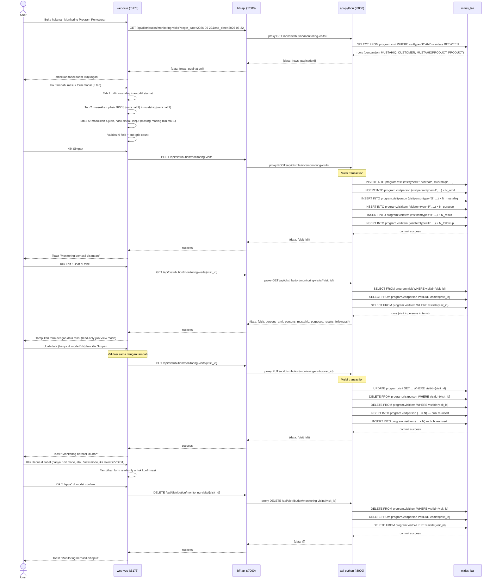

# Specs: Monitoring Program Penyaluran

**Portal**: zakat
**Domain**: `distribution` (menu key prefix)
**Tipe**: CRUD
**Legacy Ref**: docs/legacy-apps/program/dialogs/Kegiatan — QMonotoringProgramPenyaluran + fMonitoringProgram
**Tanggal**: 2026-06-22

## Konteks

Fitur monitoring program penyaluran memungkinkan staff distribusi (DIST, SPVDIST) untuk mencatat
dan melacak kunjungan lapangan ke mustahiq yang menerima penyaluran dana. Setiap kunjungan
menyimpan detail pihak yang bertemu (BPZIS + mustahiq), tujuan kunjungan, hasil pengamatan,
dan tindak lanjut yang diperlukan. Implementasi isf-app mengikuti validasi ketat legacy
`fMonitoringProgram_intr.py` (bukan versi lama `fEditMonotoringProgram`).

## Alur Data



## Endpoint Contract

### GET /api/distribution/monitoring-visits
**Auth**: `require_menu("distribution.monitoring.list")`
**Query params**:
- `begin_date` (string YYYY-MM-DD, required) — tanggal awal periode
- `end_date` (string YYYY-MM-DD, required) — tanggal akhir periode
- `page` (int, default=1)
- `limit` (int, default=25)

**Validasi query**:
- `begin_date` dan `end_date` wajib disediakan
- `begin_date` ≤ `end_date`

**Response**:
```json
{
  "data": {
    "rows": [
      {
        "visit_id": 1,
        "visit_date": "2026-06-22",
        "visit_location": "Jl. Merdeka 45, Jakarta",
        "visit_address": "Jl. Merdeka 45, Jakarta",
        "mustahiq_name": "Ahmad Setiawan",
        "program_name": "Program Zakat Fitrah",
        "mustahiq_product_name": "Paket A - Rp 500.000",
        "user_input": "ADMIN"
      }
    ],
    "pagination": {
      "page": 1,
      "limit": 25,
      "total": 100,
      "total_pages": 4
    }
  },
  "meta": { "request_id": "..." }
}
```

### GET /api/distribution/monitoring-visits/{visit_id}
**Auth**: `require_menu("distribution.monitoring.view")`
**Path params**:
- `visit_id` (int) — ID kunjungan

**Response**:
```json
{
  "data": {
    "visit": {
      "visit_id": 1,
      "mustahiq_id": 5,
      "mustahiq_product_id": 12,
      "visit_address": "Jl. Merdeka 45",
      "visit_location": "Rumah Ahmad",
      "visit_date": "2026-06-22",
      "visit_begin_time": "2026-06-22T09:00:00",
      "visit_end_time": "2026-06-22T10:30:00",
      "mustahiq_name": "Ahmad Setiawan",
      "program_name": "Program Zakat Fitrah",
      "mustahiq_product_name": "Paket A - Rp 500.000"
    },
    "persons_amil": [
      {
        "visit_person_id": 10,
        "visit_person_name": "Budi Santoso",
        "visit_person_position": "Koordinator Distribusi"
      }
    ],
    "persons_mustahiq": [
      {
        "visit_person_id": 11,
        "visit_person_name": "Ahmad Setiawan",
        "visit_person_position": "Penerima"
      }
    ],
    "purposes": [
      {
        "visit_item_id": 20,
        "visit_item_annotation": "Verifikasi penerimaan bantuan"
      }
    ],
    "results": [
      {
        "visit_item_id": 21,
        "visit_item_annotation": "Bantuan sudah diterima dengan baik"
      }
    ],
    "followups": [
      {
        "visit_item_id": 22,
        "visit_item_annotation": "Pantau perkembangan usaha 3 bulan ke depan"
      }
    ]
  },
  "meta": { "request_id": "..." }
}
```

### POST /api/distribution/monitoring-visits
**Auth**: `require_menu("distribution.monitoring.create")`
**Body**:
```json
{
  "mustahiq_id": 5,
  "mustahiq_product_id": 12,
  "visit_address": "Jl. Merdeka 45",
  "visit_location": "Rumah Ahmad",
  "visit_date": "2026-06-22",
  "visit_begin_time": "2026-06-22T09:00:00",
  "visit_end_time": "2026-06-22T10:30:00",
  "persons_amil": [
    { "visit_person_name": "Budi Santoso", "visit_person_position": "Koordinator Distribusi" }
  ],
  "persons_mustahiq": [
    { "visit_person_name": "Ahmad Setiawan", "visit_person_position": "Penerima" }
  ],
  "purposes": [
    { "visit_item_annotation": "Verifikasi penerimaan bantuan" }
  ],
  "results": [
    { "visit_item_annotation": "Bantuan sudah diterima dengan baik" }
  ],
  "followups": [
    { "visit_item_annotation": "Pantau perkembangan usaha 3 bulan ke depan" }
  ]
}
```

**Validasi**:
- `mustahiq_id` ≠ 0 (wajib dipilih)
- `visit_address` tidak kosong, max 200 char
- `visit_location` tidak kosong, max 200 char
- `visit_date` YYYY-MM-DD valid
- `visit_begin_time`, `visit_end_time` opsional
- `persons_amil` minimal 1 baris
- `persons_mustahiq` minimal 1 baris
- `purposes` minimal 1 baris
- `results` minimal 1 baris
- `followups` minimal 1 baris
- setiap annotation max 200 char

**Response**: `{ "data": { "visit_id": 1 }, "meta": {...} }`

### PUT /api/distribution/monitoring-visits/{visit_id}
**Auth**: `require_menu("distribution.monitoring.update")`
**Body**: sama dengan POST
**Catatan**: Implementasi legacy = delete semua child (visitperson, visititem) + re-insert

**Response**: `{ "data": { "visit_id": 1 }, "meta": {...} }`

### DELETE /api/distribution/monitoring-visits/{visit_id}
**Auth**: `require_menu("distribution.monitoring.delete")`
**Response**: `{ "data": {}, "meta": {...} }`

## Database

**Tabel**: Sudah ada di schema `program` (migrasi V006 atau lebih dahulu)
- `program.visit` — record kunjungan utama
- `program.visitperson` — pihak yang bertemu (BPZIS atau mustahiq)
- `program.visititem` — tujuan, hasil, tindak lanjut

**Kolom VISIT**:
| Kolom | Type | Keterangan |
|---|---|---|
| `visitid` | SERIAL | PK |
| `visittype` | VARCHAR(1) | Discriminator: `'P'` = Program Penyaluran |
| `visitdate` | DATE | Tanggal kunjungan |
| `visitaddress` | VARCHAR(200) | Alamat lokasi |
| `visitlocation` | VARCHAR(200) | Tempat pertemuan (deskripsi tempat) |
| `visitbegintime` | TIMESTAMP | Waktu mulai (optional, tersembunyi di UI) |
| `visitendtime` | TIMESTAMP | Waktu selesai (optional, tersembunyi di UI) |
| `mustahiqid` | INTEGER | FK → program.mustahiq (required) |
| `mustahiqproductid` | INTEGER | FK → program.mustahiqproduct (optional, nullable) |

**Kolom VISITPERSON**:
| Kolom | Type | Keterangan |
|---|---|---|
| `visitpersonid` | SERIAL | PK |
| `visitid` | INTEGER | FK → program.visit |
| `visitpersontype` | VARCHAR(1) | Discriminator: `'A'` = Amil/BPZIS, `'S'` = Mustahiq/Yayasan |
| `visitpersonname` | VARCHAR(100) | Nama pihak |
| `visitpersonposition` | VARCHAR(100) | Posisi/jabatan |

**Kolom VISITITEM**:
| Kolom | Type | Keterangan |
|---|---|---|
| `visititemid` | SERIAL | PK |
| `visitid` | INTEGER | FK → program.visit |
| `visititemtype` | VARCHAR(1) | Discriminator: `'P'` = Purpose, `'R'` = Result, `'F'` = Follow-up |
| `visititemannotation` | VARCHAR(200) | Catatan/deskripsi |

**Discriminators** (KRITIS):
| Tabel | Kolom | Nilai | Arti | Usage |
|---|---|---|---|---|
| `visit` | `visittype` | `'P'` | Program Penyaluran | Filter LIST, hardcoded di INSERT |
| `visitperson` | `visitpersontype` | `'A'` | Pihak Amil/BPZIS | Filter saat load tab 2 amil |
| `visitperson` | `visitpersontype` | `'S'` | Pihak Mustahiq/Yayasan | Filter saat load tab 2 mustahiq |
| `visititem` | `visititemtype` | `'P'` | Tujuan Kunjungan | Filter saat load tab 3 |
| `visititem` | `visititemtype` | `'R'` | Hasil Kunjungan | Filter saat load tab 4 |
| `visititem` | `visititemtype` | `'F'` | Tindak Lanjut | Filter saat load tab 5 |

**Index** (jika belum ada):
```sql
CREATE INDEX idx_visit_type_date ON program.visit(visittype, visitdate);
CREATE INDEX idx_visitperson_visit_type ON program.visitperson(visitid, visitpersontype);
CREATE INDEX idx_visititem_visit_type ON program.visititem(visitid, visititemtype);
```

**DWH View** (opsional, jika ada laporan monitoring di masa depan):
```sql
CREATE OR REPLACE VIEW dwh.v_monitoring_visit AS
SELECT
  a.visitid,
  a.visitdate,
  a.visitlocation,
  a.visitaddress,
  c.customername AS mustahiq_name,
  f.productname,
  e.mustahiqproductname,
  a.mustahiqid,
  a.mustahiqproductid
FROM program.visit a
LEFT JOIN program.mustahiq b ON a.mustahiqid = b.mustahiqid
LEFT JOIN program.customer c ON b.customerid = c.customerid
LEFT JOIN program.mustahiqproduct e ON a.mustahiqproductid = e.mustahiqproductid
LEFT JOIN program.product f ON e.productid = f.productid
WHERE a.visittype = 'P'
ORDER BY a.visitdate DESC;
```

## Menu Key

| Key | Label | Roles | Role Filter |
|---|---|---|---|
| `distribution.monitoring.list` | Monitoring Program Penyaluran | DIST, SPVDIST | Lihat + Hapus (SPVDIST hanya lihat) |
| `distribution.monitoring.create` | Tambah Monitoring | DIST | Akses form tambah |
| `distribution.monitoring.view` | Lihat Monitoring | DIST, SPVDIST | Akses form detail (read-only) |
| `distribution.monitoring.update` | Ubah Monitoring | DIST | Akses form edit |
| `distribution.monitoring.delete` | Hapus Monitoring | DIST, SPVDIST | Tombol hapus (dengan confirm form) |

**Catatan role**:
- DIST: full CRUD (lihat, tambah, ubah, hapus)
- SPVDIST: read-only + delete permission (lihat + hapus, tidak bisa tambah/ubah)

## Catatan Implementasi

### Discriminator Wajib Ada
Semua query WAJIB filter `visittype = 'P'` saat read list dan INSERT/UPDATE.
Ini memastikan bahwa visit type lain (jika ada di masa depan) tidak tercampur.

### Pola Bulk Replace saat Edit
Legacy menggunakan `DeleteAllPObjs()` kemudian re-insert. Implementasi isf-app:
1. START TRANSACTION
2. UPDATE program.visit SET ...
3. DELETE FROM program.visitperson WHERE visitid=X
4. DELETE FROM program.visititem WHERE visitid=X
5. INSERT visitperson (A) × N
6. INSERT visitperson (S) × N
7. INSERT visititem (P, R, F) × N
8. COMMIT

Jangan gunakan ON DELETE CASCADE — eksplisit delete untuk kontrol lebih baik.

### Validasi Client-side (9 rule)
Frontend WAJIB validasi sebelum POST:
1. mustahiq_id ≠ 0
2. visit_address ≠ ""
3. visit_location ≠ ""
4. visit_date ≠ ""
5. persons_amil.length ≥ 1
6. persons_mustahiq.length ≥ 1
7. purposes.length ≥ 1
8. results.length ≥ 1
9. followups.length ≥ 1

Backend JUGA validasi untuk fail-safe.

### Field Hidden tapi Disimpan
`visit_begin_time` dan `visit_end_time` ada di database tapi form tidak tampilkan.
Diterima dari body (opsional), disimpan jika ada, ditampilkan saat fetch detail tapi jangan render di UI.

### Mustahiq Product Opsional
`mustahiq_product_id` boleh NULL jika user tidak memilih program penyaluran spesifik.
Query join menggunakan LEFT JOIN agar tidak hilang record.

### No Otorisasi Workflow
Berbeda dengan transaksi keuangan, monitoring penyaluran **langsung** diterima tanpa approval maker-checker.
User DIST input → langsung INSERT (jika valid), tidak perlu PENDING status.

### Auto-fill Alamat
Saat user memilih mustahiq (via SearchSelect), fetch nama + alamat dari customer + mustahiq.
Tampilkan di field `visit_address` (pre-fill, bisa di-edit).

### Tanpa Timestamp Manual
Form tidak menerima `created_at`, `updated_at`, atau `inputer_id` — BFF akan inject
`inputer_id` dari session (lihat BFF layer spec untuk detail).
