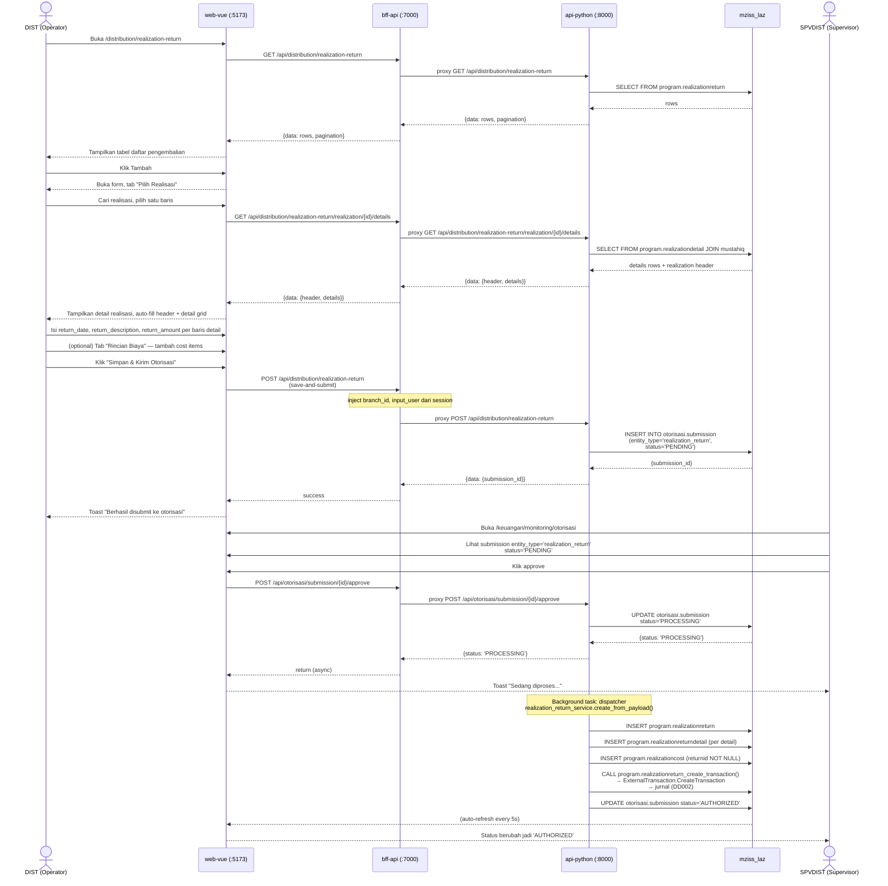

# Specs: Pengembalian Realisasi Program
**Portal**: zakat
**Domain**: `distribution` (menu key prefix)
**Tipe**: CRUD + Approval (Maker-Checker)
**Legacy Ref**: `docs/legacy-apps/program/QRealizationReturn` + `fRealizationReturn`
**Tanggal**: 2026-06-22

## Konteks

Pengembalian Realisasi Program adalah fitur pencatatan sisa dana yang dikembalikan dari kegiatan penyaluran (realisasi) yang sudah terjadi. Operator DIST mencari realisasi yang sudah ada, sistem otomatis mengisi detail per mustahiq dan sumber dana, operator mengisi jumlah pengembalian per baris, lalu data masuk antrian otorisasi untuk persetujuan SPVDIST. Saat disetujui, dispatcher membuat transaksi jurnal dengan kode DD002.

## Alur Data



## Endpoint Contract

### GET /api/distribution/realization-return
**Auth**: `require_menu("distribution.realization-return.list")`
**Query params**:
- `page` (int, default=1)
- `limit` (int, default=25)
- `search` (string, optional) — cari di return_description
- `realization_id` (int, optional) — filter by realization

**Response**:
```json
{
  "data": [
    {
      "id": 1,
      "return_date": "2026-06-15",
      "return_description": "Pengembalian sisa dana program",
      "realization_id": 10,
      "realization_date": "2026-06-01",
      "realization_description": "Distribusi Anak Yatim",
      "memo_number": "MEM-2026-001",
      "total_realization": 5000000,
      "total_return": 3000000,
      "total_cost": 0,
      "branch_code": "001",
      "input_user": "DIST001",
      "input_date": "2026-06-15T10:30:00Z",
      "auth_user": "SPVDIST001",
      "auth_date": "2026-06-16T14:00:00Z",
      "status": "AUTHORIZED"
    }
  ],
  "pagination": {
    "page": 1,
    "limit": 25,
    "total": 50,
    "total_pages": 2
  },
  "meta": {
    "request_id": "req-123456"
  }
}
```

### GET /api/distribution/realization-return/{id}
**Auth**: `require_menu("distribution.realization-return.list")`
**Response**:
```json
{
  "data": {
    "id": 1,
    "return_date": "2026-06-15",
    "return_description": "...",
    "realization_id": 10,
    "realization_date": "2026-06-01",
    "realization_description": "...",
    "memo_number": "MEM-2026-001",
    "total_realization": 5000000,
    "total_return": 3000000,
    "total_cost": 0,
    "cost_amount": 0,
    "branch_code": "001",
    "input_user": "DIST001",
    "input_date": "2026-06-15T10:30:00Z",
    "auth_user": null,
    "auth_date": null,
    "details": [
      {
        "return_detail_id": 1,
        "realization_detail_id": 10,
        "mustahiq_product_id": 5,
        "mustahiq_product_name": "Anak Yatim",
        "customer_name": "Ahmad Kusuma",
        "realization_amount": 1000000,
        "account_no": "110105",
        "account_name": "Kas Umum",
        "return_amount": 300000,
        "detail_description": "Kekurangan dana"
      }
    ],
    "costs": [
      {
        "realization_cost_id": 1,
        "cost_item_id": 100,
        "cost_item_code": "ADM",
        "cost_item_description": "Biaya Administrasi",
        "cost_amount": 50000,
        "additional_description": null
      }
    ]
  },
  "meta": {
    "request_id": "req-123457"
  }
}
```

### GET /api/distribution/realization-return/realization/{id}/details
**Auth**: `require_menu("distribution.realization-return.list")`
**Purpose**: Saat user memilih realisasi dari dialog, fetch detail realisasi untuk auto-fill grid
**Response**:
```json
{
  "data": {
    "realization": {
      "id": 10,
      "realization_date": "2026-06-01",
      "realization_description": "Distribusi Anak Yatim",
      "memo_number": "MEM-2026-001",
      "realization_type": "R",
      "total_amount": 5000000
    },
    "details": [
      {
        "realization_detail_id": 10,
        "mustahiq_product_id": 5,
        "mustahiq_product_name": "Anak Yatim",
        "customer_name": "Ahmad Kusuma",
        "realization_amount": 1000000,
        "account_no": "110105",
        "account_name": "Kas Umum"
      }
    ]
  },
  "meta": {
    "request_id": "req-123458"
  }
}
```

### POST /api/distribution/realization-return
**Auth**: `require_menu("distribution.realization-return.list")`
**Body**:
```json
{
  "return_date": "2026-06-15",
  "return_description": "Pengembalian sisa dana",
  "realization_id": 10,
  "cost_amount": 50000,
  "details": [
    {
      "realization_detail_id": 10,
      "return_amount": 300000,
      "detail_description": null
    }
  ],
  "costs": [
    {
      "cost_item_id": 100,
      "cost_amount": 50000,
      "additional_description": null
    }
  ]
}
```
*Note: `branch_id`, `input_user` diinject BFF dari session.*

**Response**: `{ "data": { "id": 1, ... }, "meta": { "request_id": "..." } }`

### PUT /api/distribution/realization-return/{id}
**Auth**: `require_menu("distribution.realization-return.list")`
**Body**: sama seperti POST
**Constraint**: hanya boleh edit jika status submission masih DRAFT (belum PENDING/AUTHORIZED)

### DELETE /api/distribution/realization-return/{id}
**Auth**: `require_menu("distribution.realization-return.list")`
**Response**: `{ "data": { "message": "Penghapusan berhasil" }, "meta": { "request_id": "..." } }`
**Constraint**: hanya boleh hapus jika status submission DRAFT

### GET /api/distribution/cost-items
**Auth**: `require_menu("distribution.realization-return.list")`
**Purpose**: Lookup cost items untuk dropdown di tab "Rincian Biaya"
**Query params**:
- `search` (string, optional) — cari di cost_item_code atau cost_item_description

**Response**:
```json
{
  "data": [
    {
      "cost_item_id": 100,
      "cost_item_code": "ADM",
      "cost_item_description": "Biaya Administrasi"
    }
  ],
  "meta": {
    "request_id": "req-123459"
  }
}
```

## Database

**Tabel**: Sudah ada (digunakan juga oleh realisasi biasa)
| Tabel | Status |
|---|---|
| `program.realizationreturn` | Sudah ada |
| `program.realizationreturndetail` | Sudah ada |
| `program.realizationcost` | Sudah ada (shared) |

**DWH View**: `dwh.v_realization_return` (baru dibuat)

**Kolom kunci**:

### program.realizationreturn
| Kolom | Type | Keterangan |
|---|---|---|
| `returnid` | SERIAL | PK |
| `returndate` | DATE | Tanggal pengembalian |
| `returndescription` | VARCHAR | Keterangan pengembalian |
| `returnamount` | NUMERIC | Total jumlah pengembalian (sum dari detail) |
| `costamount` | NUMERIC | Total biaya pengembalian (sum dari cost) |
| `realizationid` | INTEGER | FK → program.realization |
| `branchcode` | VARCHAR | Dari session |
| `inputuser` | VARCHAR | Dari session |
| `inputdate` | TIMESTAMP | Saat create |
| `authuser` | VARCHAR | Dari otorisasi |
| `authdate` | TIMESTAMP | Saat approval |

### program.realizationreturndetail
| Kolom | Type | Keterangan |
|---|---|---|
| `returndetailid` | SERIAL | PK |
| `returnid` | INTEGER | FK → program.realizationreturn |
| `realizationdetailid` | INTEGER | FK → program.realizationdetail (readonly) |
| `mustahiqproductid` | INTEGER | FK → program.mustahiqproduct |
| `accountno` | VARCHAR | FK → accounting.account (sumber dana) |
| `returnamount` | NUMERIC | Jumlah pengembalian (editable, ≤ realization_amount) |
| `realizationamount` | NUMERIC | Snapshot dari realization_amount (readonly) |
| `detaildescription` | VARCHAR | Keterangan detail (optional) |
| `transactionid` | INTEGER | FK → program.transaction (isi saat jurnal dibuat) |

### program.realizationcost (shared)
| Kolom | Type | Keterangan |
|---|---|---|
| `realizationcostid` | SERIAL | PK |
| `returnid` | INTEGER | FK → program.realizationreturn (**KRITIS**: NOT NULL untuk cost pengembalian, NULL untuk cost realisasi biasa) |
| `realizationid` | INTEGER | FK → program.realization |
| `costitemid` | INTEGER | FK → program.costitem |
| `costamount` | NUMERIC | Jumlah biaya |
| `additionaldescription` | VARCHAR | Keterangan tambahan |

## Discriminator Fields (KRITIS)

1. **program.realizationcost.returnid IS NOT NULL** → Ini adalah biaya pengembalian (RealizationReturnCost), bukan biaya realisasi biasa
2. **program.transaction.transactioncode = 'DD002'** → Jurnal pengembalian realisasi (dibedakan dari DD001 = jurnal realisasi biasa)
3. **program.realization.realizationtype IN ('R', 'N')** → Realisasi Rutin atau Non-Rutin (keduanya bisa dikembalikan)

## Menu Key

| Key | Label | Roles | Deskripsi |
|---|---|---|---|
| `distribution.realization-return.list` | Pengembalian Realisasi | DIST, SPVDIST | List dan view |
| `distribution.realization-return.add` | Tambah Pengembalian | DIST | Add + submit otorisasi |
| `distribution.realization-return.edit` | Edit Pengembalian | DIST | Edit (hanya DRAFT) |
| `distribution.realization-return.delete` | Hapus Pengembalian | DIST | Delete (hanya DRAFT) |

*Note: Otorisasi (approve) menggunakan menu_key umum `keuangan.monitoring.otorisasi` — tidak ada menu terpisah untuk approval.*

## Business Rules

1. **ReturnDate ≥ RealizationDate** — tanggal pengembalian tidak boleh sebelum realisasi
2. **TotalReturn + TotalCost == TotalRealization (strict equality)** — jumlah pengembalian + biaya harus sama persis dengan jumlah realisasi awal
3. **ReturnAmount per baris: 0 ≤ return_amount ≤ realization_amount** — pengembalian per detail tidak boleh melebihi realisasi awal
4. **CostAmount ≥ 0** — biaya tidak boleh negatif
5. **Grid detail tidak bisa dimodifikasi (tambah/hapus)** — hanya diisi otomatis saat pilih realisasi, user hanya isi return_amount
6. **Realisasi yang sudah ada pengembalian tidak bisa diubah** — guard di `realization/service.py` baris 504–510 (cek apakah ada row di `realizationreturn` dengan `realizationid` yang sama)
7. **Otorisasi 2-tahap**: DIST050=tambah, DIST051=ubah, DIST052=hapus → SPVDIST approve
8. **Hanya 1 pengembalian per realisasi** — tidak boleh ada 2 row `realizationreturn` dengan `realizationid` sama

## Catatan Implementasi

- Saat user klik "Pilih Realisasi" → dialog SearchRealizationDialog.vue mencari realisasi dengan status AUTHORIZED (transactionid NOT NULL) dan yang belum ada pengembalian (SELECT COUNT(*) FROM realizationreturn WHERE realizationid = ?)
- Total validation (TotalReturn + TotalCost == TotalRealization) harus dilakukan di frontend sebelum submit dan di backend saat POST
- Dispatcher (`realization_return_service.create_from_payload`) akan:
  1. Insert row ke `program.realizationreturn`
  2. Insert rows ke `program.realizationreturndetail` (one per detail)
  3. Insert rows ke `program.realizationcost` dengan `returnid` NOT NULL
  4. Call stored procedure atau service method untuk create transaction (DD002) → update `realizationreturndetail.transactionid`
- Auto-fill memo_number dari `realizationmemo` di realization header (readonly)
- Sidebar positioning: Menu item "Pengembalian Realisasi" dalam group "Penyaluran" (sejajar dengan "Realisasi Program")
